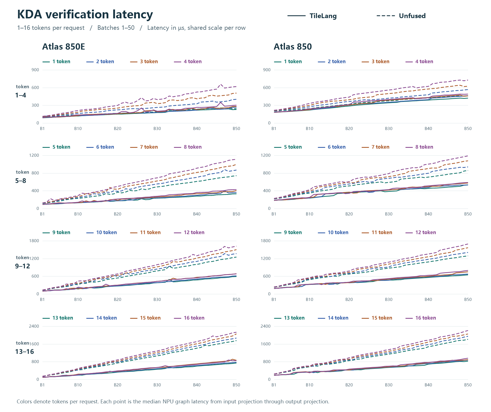

# GLM5Next KDA verify benchmark

Compare unfused and TileLang KDA verification on Ascend950DT_9581 (850E) and Ascend950PR_958b (850). The six-token fixture also reports the original fused schedule.
Install torch-npu, fla-npu, vllm-ascend, CANN 9.2.1 and TileLang with the Ascend mixed Cube/Vector backend.
Run from the repository root.

```sh
for seed in 51400 63700; do
    python benchmarks/kernels/kda_verify/benchmark.py \
        --batches 1,2,3,4,5,6,7,8,9,10 --seed "$seed" --out "timing-$seed.json"
done

python benchmarks/kernels/kda_verify/benchmark.py --batches 1:80 --out full-sweep.json
```

Each request verifies 1–16 tokens (six by default) with 64 heads, head dimension 128 and hidden size 4096.
Weights and inputs are synthetic. Compilation and immutable weight packing happen before capture.
Timing covers the input projection, padding when needed, the gate projections, the mixed kernel and the output projection.
All paths share inputs and weights. Each median comes from 20 timed NPU graph replays after warmup,
with ten forwards per replay by default. Replay order rotates and reverses between rounds.

| JSON field | Measurement |
| --- | --- |
| `native_us` | Unfused median latency in microseconds |
| `previous_us` | Original fused median latency in microseconds |
| `fused_us` | Batch-tuned fused median latency in microseconds |
| `speedup` | Unfused latency divided by batch-tuned latency |
| `speedup_vs_previous` | Original fused latency divided by batch-tuned latency |

Each row includes the underlying timing samples. For two seeds, take the geometric mean of the two median ratios at each batch size.

## Six-token batch schedules

| Batch | Tuned implementation |
| --- | --- |
| 1 | A single wave processes one head pair per Cube core. |
| 2 | A separate Vector step constructs the decay prefix. |
| 3-80 | Each core pipelines requests through a contiguous four-tap convolution window. |

All tuned schedules read history and current tokens from a contiguous on-chip window.
Except at batch 2, the Vector kernel accumulates the decay prefix in registers and rounds the recurrence output to BF16 before computing its gated RMS normalization in the same Vector function.
The paired runner also enables weight reuse at batches 1, 3 and 5 through 10.
At batches 5 through 80 of the fixed six-token fixture, it computes the two BF16 gate
projections across all requests in a single Cube launch. The TileLang mixed kernel
reads the gate rows for each head and performs convolution, state projection, recurrence
and normalization. Smaller batches compute both gate projections inside the mixed kernel. For batch 1 of this
fixture, the mixed kernel loads the three accepted history rows directly from the rollback cache.

For batches 5 through 80, Vector instructions widen BF16 convolution outputs and gate
inputs directly in registers. The kernel precomputes the output gate times the normalization
weight and stores the normalized BF16 output with packed Vector stores. These batches use
a three-stage pipeline and unroll the four convolution taps. The fixed six-token benchmark
uses hardware FP32 division, exponential and square root with flush-to-zero semantics.

For batches 14, 17, 19 and 22, the tuned benchmark pads the input projection by six rows,
producing GEMMs with 90, 108, 120 and 138 rows respectively. It slices the result back to the
valid tokens before the mixed kernel. Graph timings include the padding and projection.
The paired runner records the actual projection height in `tilelang_projection_rows`.

## Accuracy checks

The harness compares output, convolution cache, normalized values, correction records, KG records and the FP32 checkpoint with the unfused path. It exercises accepted prefixes of one, up to two, and the full request length, plus mixed prefixes across requests. To repeat the additional correctness runs:

```sh
for seed in 22100 32300 48100; do
    python benchmarks/kernels/kda_verify/benchmark.py --check-only \
        --batches 1,2,3,4,5,6,7,8,9,10 --seed "$seed" --out "checks-$seed.json"
done
```

Cache slot zero is reserved. The harness assigns synthetic slots 1 through batch size.
Serving integration of the mixed kernel requires scheduler-supplied cache indices and validation with real model weights.

## Compare the unfused baseline and tuned TileLang kernel

Run both paths on identical inputs and weights on the same NPU.

```sh
python benchmarks/kernels/kda_verify/compare_backends.py --batches 1:80 --seed 66210 --repeat 3 --samples 11 --out tilelang.json
```

Each output row contains median latency in microseconds and raw samples keyed by `unfused` and `tilelang`.
The runner validates one token, up to two tokens, the full request length and mixed lengths across requests.
After graph capture it changes the accepted prefix and fills output buffers with NaNs.
It then checks replay against the unfused reference, including convolution history, correction and KG records,
normalized output and the FP32 checkpoint.

### Token-length sweep

Pass `--tokens` to either runner. For example:

```sh
for t in $(seq 1 16); do
    python benchmarks/kernels/kda_verify/compare_backends.py --tokens "$t" --batches 1:80 --repeat 3 --samples 7 --out "latency-t$t.json"
done
```

The state projection packs query and key rows into 16 rows for lengths 1–8 and 32 rows for lengths 9–16. On both boards the tuned schedule precomputes decay-adjusted keys at length 9 for batches 11–80 and length 16 for batches 32–80 with a gate lower bound between -5 and 0. The graph includes all projections, convolution, recurrence and gated normalization.



Across batches 1–80 and token lengths 1–16, the geometric mean unfused-to-fused latency ratio was 2.00× on 850E and 1.72× on 850. The figure displays batches 1–50. Each measured shape passed eager and graph replay comparison with synthetic weights.

## Interpreting utilization

For this fixed shape and six-token workload, `model_utilization` reports useful BF16 projection FLOPs
(1,651,507,200 per request) divided by elapsed time and a 432 TFLOP/s reference peak.
Logical MBU uses a 4 TB/s (850E) or 1.4 TB/s (850) reference peak and the modeled tensor bytes for the path.
For batch size B, modeled bytes are 275,481,096 + 7,790,100 脳 B for unfused and
275,481,088 + 6,020,612 脳 B for TileLang, with another 98,304 脳 B when the input projection is padded. This allowance counts reads and writes of valid input rows. Dummy rows add no useful FLOPs.
One Cube launch computes both gate projections directly from their input columns. Each core holds a
512-channel weight tile in L1 across 32-token panels. The consumer reads only valid gate rows.
The traffic model excludes dummy rows in the final gate tile.
The batched gate schedule adds 393,216 bytes per request for writing and reading its two BF16 gate tensors.
Both metrics use the same complete QKV-to-output median latency. For comparison across schedules,
`fixed_work_mbu_pct` and `fixed_work_sum_points` use the parent schedule's logical bytes,
excluding the extra gate transfers. At fixed batch and projection height the fixed-work score
is inversely proportional to latency. A score of 100 corresponds to the sum of the reference
compute time and the reference memory time.
The sum is expressed in percentage points. These model estimates exclude FP32 and vector work from
the FLOP numerator and do not measure physical HBM traffic or hardware occupancy.
