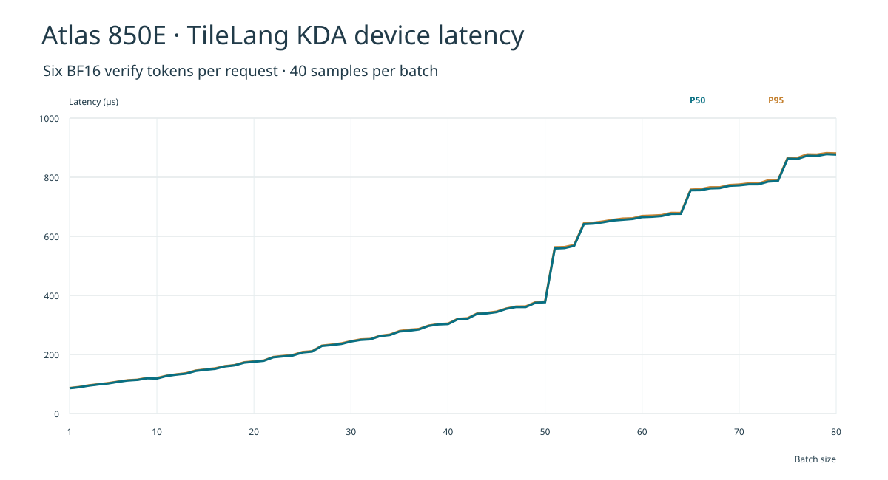

# Optimized single-launch ReplaySSM verify

The fused operator lives in [vllm_ascend/ops/tilelang/kda.py](../../../../vllm_ascend/ops/tilelang/kda.py). Import it with `from vllm_ascend.ops.tilelang.kda import WholeKDA`. The benchmark entry points retain their existing call signatures.

The BF16 kernel processes six verification tokens per request from QKV projection through output projection. The CSV includes the unfused path (不融合), cannbotDSL, the published multi-kernel TileLang path, the first single-kernel measurement, and the optimized kernel. Positive savings indicate a latency reduction from the published multi-kernel path. Each optimized point is the median of 11 device tasks. Model weights are packed before timing.

### Atlas 850E batch 1–80 sweep

At batch 10, 30 Cube cores handle QKV while two compute the low-rank gate projections. Vector cores synchronize before consuming the projected values. During replay, Cube stages checkpoint tiles and five output-weight panels in L1. The specialization runs on Ascend950DT_9581 with ten six-token requests.

Each point below covers one `main_kernel` device task per invocation, after six warmups. The sweep checks projection, gated normalization, output, convolution cache, correction, KG, checkpoint preservation and unused pages at every batch size. The batch-10 comparison interleaves 40 samples per schedule.



[Per-batch P50, P95 and output error](850e-tilelang-b1-80.csv) · [Device samples and numerical checks](850e-tilelang-b1-80-samples.json)

### Six-token BF16 ReplaySSM comparison

The benchmark compares the unfused path (不融合), optimized single-launch TileLang, and cannbotDSL from CANN ops-transformer commit `48f71c57`. The cannbotDSL retest covers batches 1–50 on each device. Every point is the median of 11 msprof device timings. The unfused and TileLang columns use the previously measured results for the same input.

| Device | Batch | Unfused (µs) | TileLang (µs) | cannbotDSL (µs) |
| --- | ---: | ---: | ---: | ---: |
| 850E | 1 | 145.572 | 85.193 | 146.250 |
| 850E | 10 | 267.074 | 121.274 | 222.235 |
| 850E | 50 | 888.222 | 376.788 | 562.251 |
| 850 | 1 | 272.180 | 177.839 | 231.876 |
| 850 | 10 | 395.459 | 242.507 | 317.153 |
| 850 | 50 | 961.953 | 555.678 | 772.583 |

TileLang recorded a lower median than cannbotDSL in all 100 comparisons. All 1,100 cannbotDSL samples recorded one kernel. Output and correction errors passed their relative L2 bounds, convolution history and checkpoints matched the reference, and replay-key and decay records were finite. A vLLM process was resident on the Atlas 850 device during the retest.

In the CSV, `native_us` is unfused latency, `pr16634_us` is cannbotDSL latency at `48f71c57`, and `pr16634_previous_us` records its earlier revision. [cannbotDSL samples](cannbotdsl-48f71c57-samples.json) · [Interactive comparison](https://biuapha.github.io/LLM-Analysis/glm53_prefill_decode_operator_block_diagram.html?v=27f09227#tilelang)

Atlas 850 的 batch 49 另做了交错复测。固定权重地址时，旧版与优化后单核的设备耗时中位数分别为 554.682 和 550.206 µs。轮换四份数值相同、地址不同的权重时，分别为 553.285 和 548.454 µs。每种配置下两版各测 20 次，两种执行顺序各占 10 次。 [配对实测样本](atlas-850-b49-paired-device-times.json)

## Measured software environment

| Component | Version used for the Atlas 850E and 850 six-token benchmark |
| --- | --- |
| TileLang | `0.1.15` with the Ascend backend, JIT target `ascend`, execution backend `cython` |
| CANN toolkit | `9.2.1` |
| Python and architecture | CPython `3.12.16`, Linux `aarch64` |
| PyTorch | `2.10.0+cpu` |
| Ascend PyTorch extension | `torch-npu 2.10.0.post7` |

The installed wheel was `tilelang-0.1.15-cp39-abi3-manylinux_2_34_aarch64.whl`. Its recorded SHA-256 is `77343b47643eaab07d8c1f8314c6c33e4992cb07883207796c900b719626524f`. The NPU computations use torch-npu and the Ascend backend.

Run the following commands from this directory with the captured replay fixture, CANN 9.2.1, the Ascend TileLang environment, torch-npu and vllm-ascend available. Use a fresh profiler output directory for each board.

```sh
batches=$(seq -s, 1 50)
msprof --output=profile --task-time=on --msproftx=on --application="python verify_whole_kda.py --trace trace.pt --out verified.json --batches $batches --mstx"
python extract_whole.py profile timing.json
```

[Latency and accuracy](mtp5-optimized-whole-kda-b1-50.csv) · [Three device timing curves](mtp5-optimized-whole-kda-b1-50.svg) · [Individual device samples and numerical checks](mtp5-optimized-whole-kda-b1-50.json)
