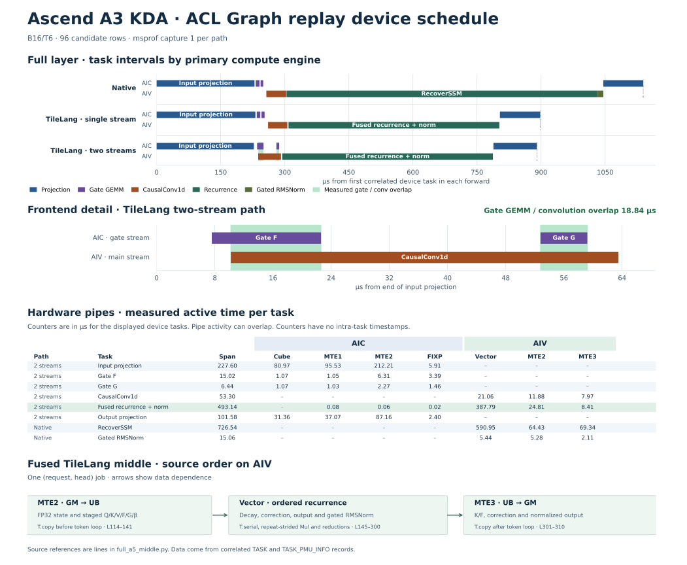
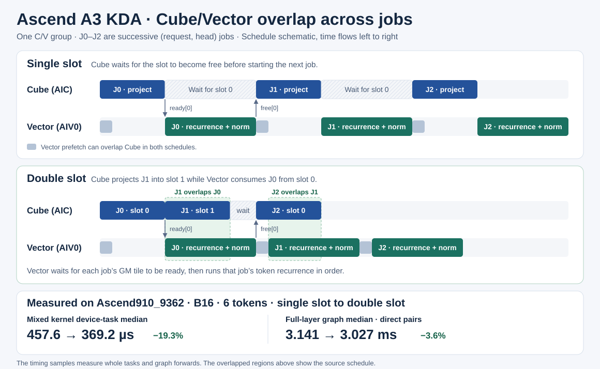
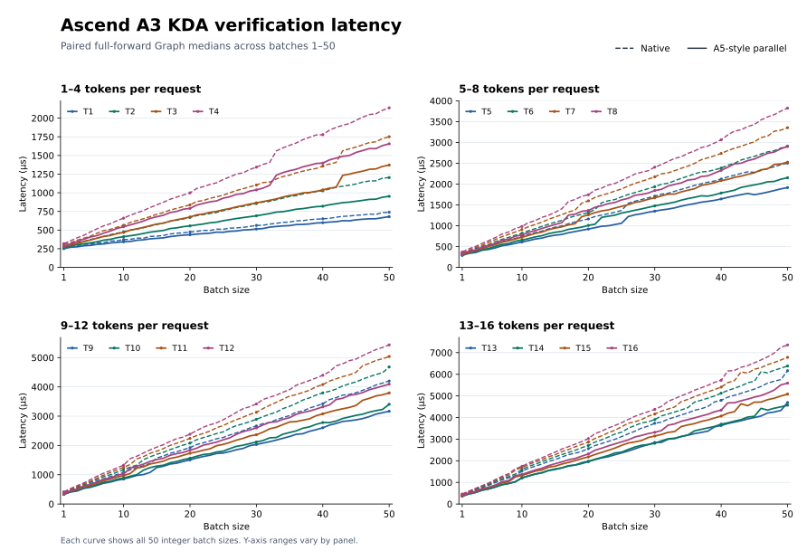
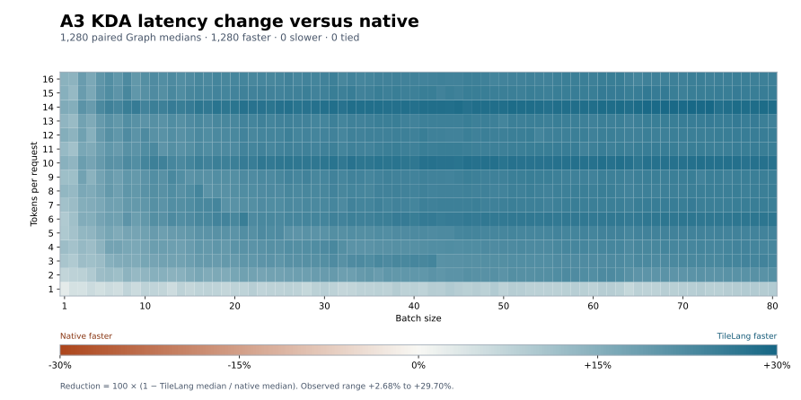

# KDA verification on Ascend A3 with TileLang

The full-layer replay starts with hidden activations and ends with the output
projection. It follows the synthetic GLM5Next layer in the
[Ascend A5 verification benchmark](https://github.com/vllm-project/vllm-ascend/pull/22370).
The layer uses 4,096 hidden channels, 64 heads, BF16 activations and weights,
and an FP32 checkpoint in `[batch, head, value, key]` order.

## Full-layer replay

The benchmark runs the merged Q/K/V, beta and gate input projection, both
128-to-8,192 gate projections, four-tap depthwise Conv1D with SiLU, recurrent
verification, sigmoid-gated RMSNorm and the 8,192-to-4,096 output projection.
Verification writes correction and key/gate records, advances the private
convolution history using the previously accepted prefix, and reads the
persistent checkpoint without committing any speculative token.

| Path | Gate projections | Convolution and verification | Outer projections |
| --- | --- | --- | --- |
| Native baseline | Two linear calls | Native causal update, RecoverSSM and gated RMSNorm | Native BF16 linear calls |
| `a5-style` | Two linear calls | Native causal update, then TileLang Vector fusion for recurrent verification and gated RMSNorm | Native BF16 linear calls |
| `a5-style-parallel` | Two linear calls on an auxiliary stream | Native causal update on the main stream, then the same fused TileLang Vector kernel | Native BF16 linear calls |
| TileLang middle | Either two linear calls or one TileLang Cube launch | Torch preparation, then one mixed Cube/Vector kernel for state projection, recurrence and gated RMSNorm | Native BF16 linear calls |
| Gate-only fusion | One TileLang Cube launch | Native causal update, RecoverSSM and gated RMSNorm | Native BF16 linear calls |

The fused gate kernel reads both activation slices from the merged projection and
retains a weight tile in L1 across token panels. The mixed kernel computes the
decay-adjusted checkpoint projection on Cube. Vector can load the recurrence
coefficients, values and normalization gate while Cube works. Vector waits for
the FIX flag before the recurrence and writes normalized output directly.
The persistent checkpoint stays FP32. Three BF16 GEMMs with FP32 accumulation
approximate the state projection using the leading operands and their two
first-order residual products.
Torch convolution, coefficient preparation and FP32-to-BF16 operand packing
in the TileLang-middle path run inside the measurement boundary.

Use an Ascend A3 environment with the pinned TileLang backend below, with
`vllm_ascend`, `fla_npu` and their native KDA/causal update dependencies
available for the native comparator. The native harness measures the same
sequence of unfused stages as the A5 synthetic comparator, using the installed
A3 native implementations.

```bash
cd benchmarks/kernels/kda_verify_a3
python compare_full.py --baseline native --batches 1:80 --tokens 6 \
    --candidates native:16:0,native:32:0,native:64:0,native:0:16 \
    --seed 724311 --repeat 9 --warmup 5 --tune-samples 5 --samples 23 \
    --out a3-layer-l6.json
python compare_full.py --baseline native --batches 1,2,5,8,10,16,32,50,80 \
    --tokens 6 --seed 724311 --out a3-layer-ablation.json
python compare_full.py --baseline native --batches 1,8,32,80 --tokens 1,8,9,16 \
    --candidates 0:0,native:16:0 --repeat 3 --warmup 3 --tune-samples 2 \
    --samples 7 --seed 724311 --out a3-layer-lengths.json
```

The ablation tests the TileLang middle on nine batches. The full batch sweep
uses the native middle and varies the gate row tile size (16, 32 or 64) or
aligns the merged input projection to 16 rows. The active projection height
is `batch * tokens`. A larger gate tile
processes more rows at once but can require more padding. Aligning the input
projection can change the native GEMM schedule and its BF16 rounding, so the
benchmark retests the convolution history for each candidate. Candidate
parameters are `gate_tile:projection_alignment` for the
TileLang middle and `native:gate_tile:projection_alignment` for the native
middle. A zero leaves that option disabled. At each batch the driver checks
eager and graph forwards with 1, 2, all and mixed accepted lengths. It records
two accuracy protocols adapted from the A5 tests and requires exact history and an
unchanged checkpoint. `--protocol elementwise` selects the synthetic
comparator's elementwise tolerances and `--protocol both` requires both sets.

Only eligible schedules are ranked by their median full-layer latency.
The winner for each batch is measured against native using independent
ABBA/BAAB samples. The graph runs nine complete forwards per sample by default,
with NPU stream events and the same advancing private-cache semantics for all
paths. Use `--tokens 1:16` to repeat the sweep at other verify lengths.
`--baseline torch` uses the portable reference when developing without the
native KDA dependencies.

### A5-style FP32 recurrence and parallel frontend

The [`a5-style` path](full_a5_middle.py) follows the A5
[synthetic small-batch replay](https://github.com/Biuapha/vllm-ascend/blob/26cbec39d8d66b71f351681d32fd36877c1fa2f3/benchmarks/kernels/kda_verify/small_batch.py)
by reading each head's FP32 checkpoint directly and running its candidate
tokens in order. On A3, the kernel keeps the checkpoint copy in Vector UB,
writes the correction and key/gate records, and applies sigmoid-gated RMSNorm
after rounding the core output to BF16. AscendC repeat-strided FP32 multiplies
reuse the decay, key, and query vectors across matrix rows directly in UB.
The outer update reuses the packed correction across each row, and the final
token only projects the decayed state and adds the correction contribution.
Multi-row DMA loads the head's token inputs before the recurrence and stores
the correction, key/gate records, and normalized output after it. This keeps
the same FP32 multiply/add order and BF16 rounding point.

`a5-style` serializes the frontend. `a5-style-parallel` uses an event after the
merged input projection to fork the two gate projections onto an auxiliary
stream. Native causal convolution proceeds on the main stream. A second event
joins the gate stream before the fused Vector kernel and output projection.
Each head's verification runs its tokens in order in the fused Vector kernel.

#### Measured frontend overlap

Graph replay device task timestamps show that the gate GEMMs on the auxiliary
stream overlap causal convolution on the main stream in all 30 two-stream
samples at B1/B2/B16 and T1/T6. The median intersection per shape ranges from
15.0 to 21.4 µs. The native and single-stream TileLang paths have zero
intersections in their 30 samples each. In eager mode the gate GEMMs finish
before convolution starts in all 30 two-stream samples.
[Graph profile](a5-style-pilot/graph-profile.csv) ·
[Eager profile](a5-style-pilot/eager-profile.csv) ·
[Eager timeline](a5-style-pilot/eager-frontend.svg) ·
[Per-task pipe counters](a5-style-pilot/pipe-counters.csv)

The B16/T6 timelines follow the [A5 hardware view](https://github.com/vllm-project/vllm-ascend/pull/22370#batch-10-kda-hardware-timeline-on-atlas-850e)
with a full-layer view and a frontend zoom. The bars use device task timestamps
and group each task by its primary AIC or AIV engine. Each figure gives the
task-level PMU durations in µs for AIC Cube, MTE1, MTE2 and FIXP, and for AIV
Vector, MTE2 and MTE3. The A3 capture exposes aggregate pipe durations. The
fused AIV load, compute and store sequence comes from source.



At B16/T6, the median device task duration is 492.460 µs for the two-stream
eager fused middle, 726.340 µs for native RecoverSSM and 15.140 µs for
native gated RMSNorm. These medians exclude launch gaps. The Graph figure
shows 18.84 µs of frontend overlap in the displayed sample.
[Eager kernel timings](a5-style-pilot/eager-kernel-stages.csv)

```bash
msprof --output=./a5-style-graph-t1 --task-time=on --msproftx=on \
    --application="python profile_full.py capture --execution graph \
    --baseline native --batches 1,2,16 --tokens 1 --variant a5-style \
    --variant a5-style-parallel --core-count 20 --samples 5 --warmup 3 \
    --protocol both --seed 843217 --out a5-style-graph-t1-capture.json"
python profile_full.py extract --profile a5-style-graph-t1 \
    --manifest a5-style-graph-t1-capture.json --out a5-style-graph-t1-device.json
```

### Short-prefix preparation and C/V scheduling

`legacy` runs the original TileLang middle. `fused-prep` moves the ordered FP32
decay prefix, zero padding, and BF16 high/residual packing to one Vector kernel.
The coefficient batched matmul still consumes FP32 rows. `fused-prep-cv1` and
`fused-prep-cv2` assign independent `(request, head)` jobs to the same number of
persistent Cube/Vector groups. `cv1` waits for Vector to finish the preceding job
before Cube can use its single slot again. `cv2` lets Cube project the next job
into the second GM slot while Vector consumes the preceding one. Each head's
token recurrence remains ordered.



Set `--core-count` to the test device's Cube core count (20 in this example).
The benchmark validates each fixed variant and reports its full-forward Graph
samples against the native baseline. Compare `cv1` with `cv2` to isolate the
effect of the second slot. Device task timing can measure the mixed kernel's
duration. Measuring the overlap itself requires a Cube/Vector pipe trace.

```bash
python compare_full.py --baseline native --batches 1,16 --tokens 6 \
    --variant legacy --variant fused-prep --variant fused-prep-cv1 \
    --variant fused-prep-cv2 --core-count 20 --seed 724311 \
    --warmup 5 --repeat 9 --samples 23 --out a3-cv-graph.json
```

On one Ascend910_9362 logical device, the six-token run recorded the following
full-layer graph medians. Each TileLang variant was paired with native for 23
samples of nine forwards. The native row uses the pair with `fused-prep`.

| Variant | B1, µs | B16, µs |
| --- | ---: | ---: |
| Native | 342.073 | 1136.689 |
| `legacy` | 1949.809 | 14333.694 |
| `fused-prep` | 926.869 | 2991.220 |
| `fused-prep-cv1` | 947.093 | 3136.838 |
| `fused-prep-cv2` | 932.516 | 3022.491 |

In direct single-slot and double-slot pairs, the second slot reduced graph
latency by 1.5% at B1 and 3.6% at B16. At B16 the mixed-kernel device task
median fell from 457.629 to 369.187 µs. The original path's Torch `cumprod`
took 11312.966 µs at B16. The preparation kernel took 53.081 µs with the
original mixed schedule, which gave the lowest TileLang graph latency here.
All eight graph configurations passed the relative-L2 protocol with exact
convolution history. The three fused variants also passed at B2 with 1, 8, 9
and 16 tokens in both eager and graph mode.

[Graph medians](cv-results/graph.csv) · [Samples and accuracy](cv-results/metrics.json)
· [Length checks](cv-results/length-checks.json) · [Run configuration](cv-results/run.json)

The [latest A5 replay](https://github.com/Biuapha/vllm-ascend/blob/021ae8d1b6b6b1d1b57f570737640f21bf4659c0/benchmarks/kernels/kda_verify/optimized_replay/verify_whole_kda.py)
uses a captured serving trace with paged caches and a single `WholeKDA`
launch. The captured fixture is unavailable in the public PR. The A3 prototype
uses the public synthetic generator, contiguous caches and several launches per
forward. Its profiler reports the span from the first device task to the last,
the compute busy time and the count of compute tasks for each complete eager
forward.

```bash
msprof --output=./a3-cv-profile --task-time=on --msproftx=on \
    --application="python profile_full.py capture --baseline native \
    --batches 1,16 --tokens 6 --variant legacy --variant fused-prep \
    --variant fused-prep-cv1 --variant fused-prep-cv2 --core-count 20 \
    --samples 11 --seed 724311 --out a3-cv-capture.json"
python profile_full.py extract --profile a3-cv-profile \
    --manifest a3-cv-capture.json --out a3-cv-device.json
```

## Standalone verification with 1–16 tokens per request

This sweep uses the same synthetic single-layer boundary as the
[A5 length sweep](https://github.com/vllm-project/vllm-ascend/pull/22370#standalone-verification-with-116-tokens-per-request).
It covers each integer batch from 1 through 80 and each request length from 1
through 16. The line figure compares native and `a5-style-parallel` over
B1–50 in µs. The heat map shows the paired latency change over all 1,280 shapes.

Each comparison uses seven ABBA/BAAB samples. Each timed Graph replay executes
three complete forwards and the latency is reported per forward. Timing uses one
accepted token per request. Accuracy checks cover one, two, all and mixed
accepted lengths in eager and Graph mode. Every shape passed the elementwise
and relative-L2 tolerances, exact convolution history checks and unchanged
checkpoint and input-history checks. Both paths in each pair run on the same
Ascend910_9362 device.

The TileLang path has a lower median at all 1,280 shapes.
The median per-shape latency reduction is 23.88%. The TileLang path wins all seven paired samples at 1,278 shapes.
The smallest reduction is 2.68% at B1/T1. The largest reduction is 29.70% at B71/T14.

| Batch | Tokens | Native, µs | TileLang, µs | Reduction |
| ---: | ---: | ---: | ---: | ---: |
| 1 | 1 | 258.12 | 251.20 | 2.68% |
| 80 | 1 | 998.72 | 906.99 | 9.18% |
| 16 | 6 | 1129.21 | 865.61 | 23.34% |
| 32 | 16 | 4752.39 | 3644.88 | 23.30% |





[Sweep data](a5-style-sweep/graph.csv) · [Run configuration](a5-style-sweep/run.json)

Run from the benchmark directory. Each invocation writes a JSON file for one
length. The `held_out` entries contain the paired stream-event timings.

```bash
for tokens in $(seq 1 16); do
    python compare_full.py --baseline native --variant a5-style-parallel \
        --batches 1:80 --tokens "$tokens" --core-count 20 --protocol both \
        --warmup 5 --repeat 3 --samples 7 --seed 724311 \
        --out "$(printf 't%02d.json' "$tokens")"
done
```

## Isolated verification core

The original core demo measures the Cube state projection and Vector correction
recurrence on already prepared inputs. It retains a separate FP64 oracle.

From the repository root, check the algebra with PyTorch on CPU:

```bash
python benchmarks/kernels/kda_verify_a3/demo.py --device cpu --batch 2 --heads 3 --tokens 6
python -m pytest -q benchmarks/kernels/kda_verify_a3/test_reference.py
```

For the NPU path, use an Ascend A3 environment with compatible CANN, PyTorch,
`torch_npu` and the [Ascend TileLang backend](https://github.com/tile-ai/tilelang-ascend/tree/9b5ac505c801ce038e31cc8ab6f1f83e14df1497).
Follow the backend's installation instructions and source the CANN environment.
The kernel targets `ascendc` with `platform="A3"`.

```bash
python benchmarks/kernels/kda_verify_a3/demo.py --device npu --batch 1 --heads 64 --tokens 6 --iterations 50
```

## What runs in the kernel

Each (request, head) pair is one job with 1–8 candidate tokens, 128 key
channels and 128 value channels. Every job in a launch has the same length.
The fixture supplies post-convolution Q, K and V, normalized K, scaled and
normalized Q, activated beta, and a per-key decay multiplier. The persistent
state in the referenced implementation is FP32. This demo uses an FP16
checkpoint in `[job, key, value]` order so it can serve directly as a Cube
operand. The driver prepares the projection rows and pairwise coefficients in
PyTorch before launching the kernel.

1. Cube projects 16 padded rows of decay-adjusted K and Q against the
   checkpoint in one FP16 GEMM with FP32 accumulation. It writes the result to
   global memory and signals completion with a FIX cross-core flag.
2. The two Vector subblocks each own 64 value channels. In the prefetch
   schedule they load coefficients, beta and values before waiting on Cube.
   Only the projected state needs the flag. This creates an opportunity to
   overlap independent transfers with the projection.
3. Vector consumes the projected state and walks the candidates in order.
   Each token's correction contributes to its own output and to later tokens.
   The kernel returns FP32 corrections and outputs for the valid rows.

For an independent check, the CPU FP64 oracle advances a private state using
the following recurrence. The same input checkpoint is used for both paths.

```text
D      = decay[t, :, None] * S
corr_t = beta[t] * (v[t] - k[t] @ D)
S      = D + outer(k[t], corr_t)
out_t  = q[t] @ S
```

The driver compares every valid correction and output with this oracle and
checks that the input checkpoint retains its original values. The tolerance
(`rtol=2e-3`, `atol=1e-3`) accounts for rounding the prepared Cube rows to
FP16. Committing an accepted prefix, convolution, model projections and
normalization are outside the kernel's timing boundary.

## Interpret the timing

With `--iterations N`, the driver also compiles a *wait-first* schedule that
waits for the same flag before loading the independent inputs. Both schedules
use the same tensors and arithmetic and are checked against the oracle. After
five warm-up calls per schedule, the runner times four groups in wait-first,
prefetch, prefetch, wait-first order. It synchronizes the NPU around each
group and reports the mean time per call for each schedule and their ratio.
The times include dispatch and output/workspace allocation in the TileLang
call. They exclude preparation, compilation and accuracy checks. A ratio above
one means prefetch was faster for that shape and device. A device trace is
needed to establish how much transfer and Cube work actually overlapped.

A positive `--iterations` value enables the wait-first oracle check. Run
all nine accuracy cases from the repository root with the commands below.

```bash
for tokens in 1 2 3 4 5 6 7 8; do
    python benchmarks/kernels/kda_verify_a3/demo.py --device npu --batch 1 \
        --heads 64 --tokens "$tokens" --iterations 1
done
python benchmarks/kernels/kda_verify_a3/demo.py --device npu --batch 1 \
    --heads 2 --tokens 6 --iterations 1
```
