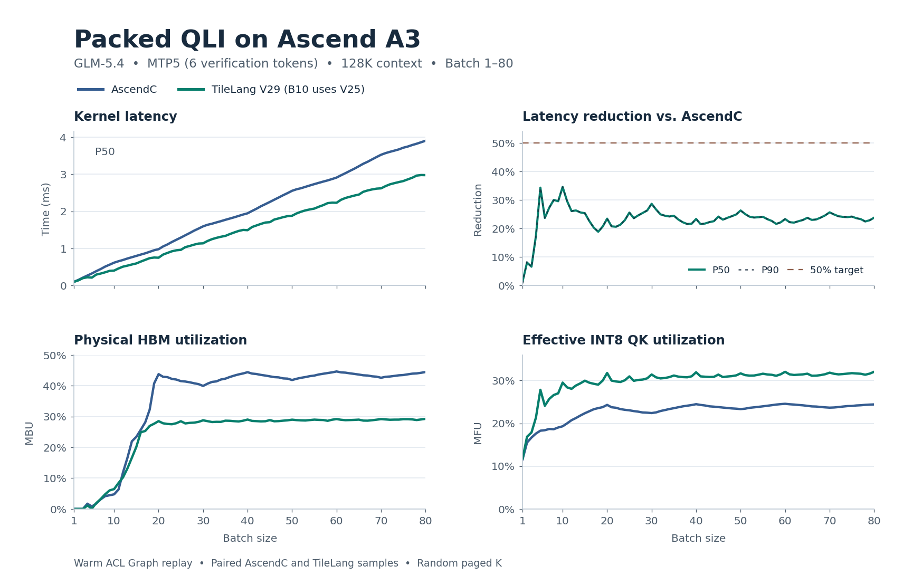

# GLM-5.4 MTP5 quantized lightning indexer on Ascend A3

This standalone benchmark compares `torch_npu.npu_quant_lightning_indexer` with the TileLang V29 implementation for paged INT8 queries and keys. It uses synthetic tensors with the GLM-5.4 indexer shape and runs on one visible Ascend A3 die per paired comparison.

## Workload and schedule

MTP5 produces six query rows per request. The sweep uses batches 1 through 80, 131,072 key tokens per request, 128-token pages, 32 query heads of width 128, and top-k 2,048. The native API receives `TND` queries, `PA_BSND` keys, and `sparse_mode=3`. At batch `B`, query, key, page-table, and output shapes are `[6B, 32, 128]`, `[1024B, 128, 1, 128]`, `[B, 1024]`, and `[6B, 1, 2048]`. Seed 53 generates random physical page placement. The six rows see 131,067 through 131,072 key tokens under causal masking.

The packed schedule shares a scan of the paged keys across six query rows and balances contiguous 2,048-token key tiles across 20 Cube cores. Double-buffered QK staging overlaps the next Cube calculation with prior score processing on Vector. The merge preserves the native ordering of the four-row and two-row groups on tied scores. V29 uses a four-way merge at B1–2, retains the measured V25 schedule at B10, and uses the packed schedule at the other batches in this sweep.

## Reproduce latency and index checks

The recorded setup used Ascend910_9362 (A3, 20 Cube and 40 Vector cores, nominal Cube frequency 1,650 MHz), CANN 9.2.1, Linux aarch64, CPython 3.12.16, PyTorch 2.10.0+cpu, and torch-npu 2.10.0.post7. Build [TileLang-Ascend](https://github.com/tile-ai/tilelang-ascend) at revision `9b5ac505c801ce038e31cc8ab6f1f83e14df1497` with the Ascend backend and its recursive dependencies. Activate CANN and expose exactly one die to the benchmark process.

Run from the repository root with a new output directory. `--config` optionally reads the four indexer-related dimensions from a GLM-5.4 configuration. The defaults reproduce the synthetic fixture without model weights.

```bash
python benchmarks/kernels/qli_glm54_a3/bench_glm54_mtp5.py \
  --batch-start 1 --batch-stop 80 --context 131072 \
  --warmup 7 --forwards 9 --samples 23 --oracle-batch 1 --oracle-batch 10 \
  --output qli-a3-results
```

The runner compares eager and ACL Graph output for each backend and checks the ordered index tensors across backends. At selected batches it also checks a CPU score oracle. Each latency point comes from 23 paired groups after warm-up. Each group uses two replays per backend, alternating ABBA and BAAB across groups. The elapsed device event for each replay is divided by nine calls. `timing.json` stores parity and summary values. `timing_samples.jsonl` stores the per-group data. The published sweep was split across two A3 dies, with both backends of each pair on the same die.

## Published results

All 80 batches matched the AscendC ordered indices across 19,440 query rows. TileLang reduced both P50 and P90 at every batch. The median P50 reduction was 23.73%, with a range of 1.42% at B1 to 34.59% at B10. The 50% P50 reduction target remains open.



The [full B1–80 CSV](results-b1-b80.csv) includes P50 and P90, index parity, the paired speedup and 95% bootstrap interval, HBM capture coverage, and both physical and logical bandwidth metrics.

- Physical MBU is the median of measured HBM read plus write bandwidth divided by 1,600 GB/s per die. These counters come from separate synchronized warm graph replay captures using `msprof` system hardware memory counters and MSTX ranges around 0.45-second windows, with two windows per backend at each batch. HBM bytes per call are estimated from measured bandwidth and the call rate in each window.
- Logical MBU, available in the CSV, divides the fixture's logical traffic by P50 and the same peak bandwidth.
- Effective INT8 QK MFU is `2 × visible Q/K pairs × 32 × 128 / P50 / 540.672 TOPS`. It counts one multiply and one add per visible QK element. The denominator uses the nominal dense INT8 Cube peak. The numerator covers QK only, while the timed operator includes the score and top-k work.

At B80, estimated HBM traffic fell from 2.776 GB to 1.392 GB per call, while QK MFU increased from 24.42% to 32.05%. With less traffic to serve, measured HBM utilization fell from 44.44% to 29.24%. These results cover the standalone 128K operator workload on A3.
