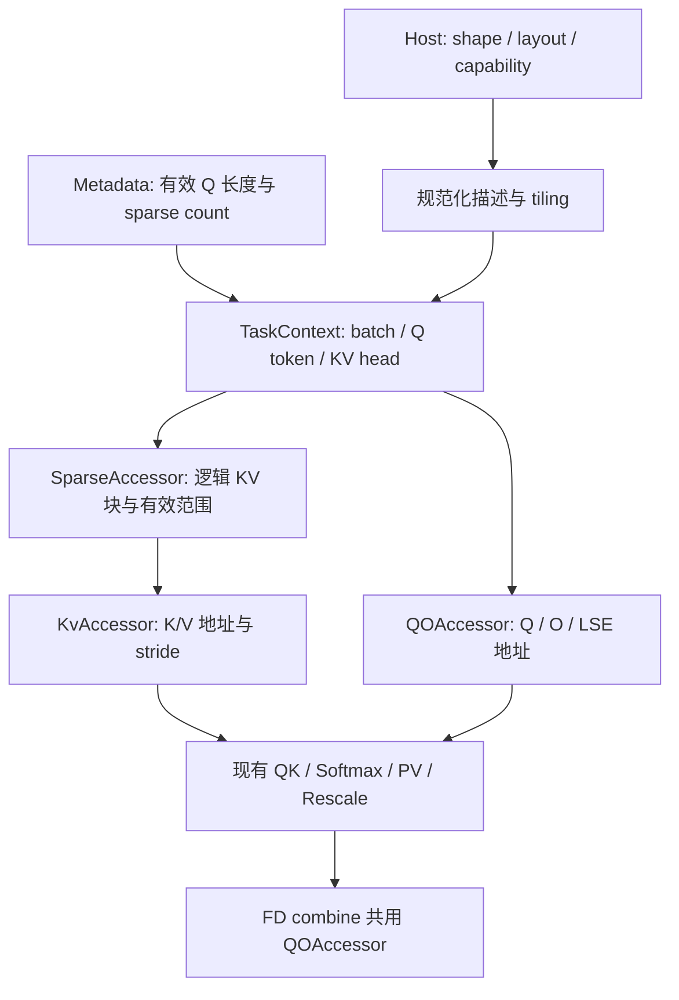

# A5 GBSA：TND 非 PA 与多布局扩展设计

状态：第一阶段代码已按 BSA 参考方案落地，包含 A5 FP16/BF16 TND 非 PA、LSE、Metadata/FD 接入；按本次要求，尚未运行构建、测试或设备验证。FP8 非 PA 和 BSND/BNSD 的能力开放仍属后续阶段。

目标是在 A5/arch35 上支持 `layoutQ=TND, layoutKv=TND`，并让后续 BSND、BNSD 扩展主要落在序列解释和数据访问层。以仓库 `block_sparse_attention` 的 A5 非 PA 实现为参考，沿用其独立 Format 模板、布局 stride 与 TLA tile copy 模式，同时保留 GBSA 的 packed GQA、cu/seqused、causal 和 Metadata/FD 契约。沿用现有 ACLNN 参数，不引入布局转换前置算子或伪造页表。

## 0. BSA 非 PA 实现对照与采用方式

核对的主要源码：

| BSA 参考位置 | 已有实现 | GBSA 的采用方式 |
| --- | --- | --- |
| [arch35 regular kernel](../../block_sparse_attention/op_kernel/arch35/block_sparse_attention_kernel_arch35_regular.h)，`operator()` | 独立 `qFormat/kvFormat`；按 TND/BNSD/BSND 计算 batch/head/token stride，构造 GM TLA tensor | 复用这套布局表达，整理成 GBSA 内部小型 traits/helper |
| [kernel interface](../../block_sparse_attention/op_kernel/block_sparse_attention_kernel_interface.cpp)，`BsaInferIntfRegular` | Q/KV 格式分别向下传递，LSE 格式也是独立参数 | 修正 GBSA 当前 `qFormat,qFormat` 传参，保留独立 qFormat、kvFormat，再加编译期 paged 开关 |
| [QK block](../../block_sparse_attention/op_kernel/attn_infra/gemm/block/bsa_block_mmad_qk_arch35_ABf16_C_to_UB.hpp)，`SparseKL1TileNLoad` | `oriStartOffset=logicalBlock*Y+innerOffset`；K 用 `GetTile(...,(0,oriStartOffset),(D,len))` 加载 | 复用非 PA 块坐标和列方向 tile copy；GBSA 同名 loader 已有相同基本逻辑，无需整文件移植 |
| [PV block](../../block_sparse_attention/op_kernel/attn_infra/gemm/block/bsa_block_mmad_pv_arch35_ABf16_C_to_UB.hpp)，`SparseVBaseTileL1FullLoad` | V 用 `GetTile(...,(oriStartOffset,0),(len,D))` 加载；尾块按真实长度裁剪 | 复用行方向 tile copy，传入 GBSA 过滤后的有效长度 |
| [host tiling](../../block_sparse_attention/op_host/block_sparse_attention_tiling.cpp)，`ParseQKVInTND/BSND/BNSD`、`ParseSeqlensInTND/NonTND` | 布局分别解析；固定格式区分分配容量和 actual length | 参考函数拆分与维度映射；长度输入适配 GBSA 自身契约 |

需要保留的差异：

1. **任务的 M 轴不同。** BSA 每个任务固定一个 Q head，`rowNum=qSTileSizeAct`，M 沿 token；GBSA 每个任务固定一个 Q token 和 KV head，`rowNum=groupSize`，M 沿 Q heads。因此 BSA 的 Q/O row stride 是 token stride，GBSA 应取 head stride。直接搬 BSA 的 Q/O layout 会在 TND 下把 D 错设为 Nq×D。
2. **长度输入不同。** BSA 的 actualSeqLengths 是 `int64[B]` 的逐 batch 长度，TND batch base 通过累加该长度推进，host 校验总和等于 T。GBSA 的 cu 是 `int64[B+1]` 存储前缀，seqused 是可选 `int32[B]` 有效长度；必须用 cu 起址，不能照抄 BSA 的有效长度累加。
3. **稀疏输入与顺序不同。** BSA 将 `[B,Nq,Qb,Kvb]` blockSparseMask 转为 index/count，再按 gathered KV 序列切 tile；GBSA 已直接接收 index/count，且有原始槽位的 FD 区间与逐 Q token causal 过滤，不需要 Mask2Idx workspace。
4. **LSE 外部约定不同。** BSA 的 BSND LSE 跟随 `[B,S,N,1]`，现有 GBSA wrapper 则为 `[B,N,S,1]`。本阶段保留 GBSA 契约，不直接搬 BSA 的 BSN1 分发。

BSA host 当前要求 Q/KV layout 相同，且 regular kernel 的 KV shape 构造中有一处 BSND 分支判断写成 `qFormat == Format::BSND`。GBSA 独立扩展 Q/KV 时应使用 `kvFormat`，不能因参考模板已有两个参数就认为混合布局已得到验证。

落地上先做 GBSA 内部复用，不让 GBSA 直接 include 兄弟算子的私有 kernel 头文件。两边已有独立 infra、模板签名和不同计算策略；跨算子抽公共库应作为后续独立变更。

## 1. 范围与现状

建议第一阶段交付 FP16/BF16 的 TND 非 PA，覆盖 LSE、seqused 和 FD；第二阶段让独立的 FP8 full-quant kernel 接入相同访问策略，再开放非 PA quantType=5。BSND/BNSD 是明确的扩展设计，本阶段不宣称已支持。若本次交付要求覆盖 A5 全部现有 dtype，则第一、二阶段合并验收。

第一阶段继承现有限制：`D=128`、`blockShape=[1,128]`、`isPackedGQA=1`、`maskType=1`、A5非量化FP16/BF16支持`softmaxPrecision=0/1`、`Nq % Nkv=0`、`groupSize<=128`、`topK<=256`。非 PA 仍是块稀疏注意力，稀疏块大小与存储是否分页无关。

代码中的耦合点：

| 位置 | 当前行为 | 设计改动 |
| --- | --- | --- |
| `op_host/op_api/aclnn_generic_block_sparse_attention.cpp` | 仅接受 TND/PA_BBND；KV 归一化保留 PA dim0 stride | 按架构、布局、dtype 查询能力；按布局选择 KV 归一化方式 |
| `op_host/generic_block_sparse_attention_infershape.cpp` | KV 固定 4D，要求 blockTable | 分布局解析 Q/K/V 和输出 shape |
| `op_host/generic_block_sparse_attention_tiling.cpp` | batch 来自 blockTable，KV 长度输入和 key 编码固定 PA | 独立解析 batch、序列、布局及存储参数 |
| `op_kernel/generic_block_sparse_attention_kernel_interface.cpp` | kernel 的 `kvFormat` 实际传入 `qFormat` | 独立传入 Q 格式与 KV 访问策略 |
| `op_kernel/arch35/generic_block_sparse_attention_kernel_arch35.h` | 固定读取 sequsedKv、查询页表、按 physicalId×pageStride 寻址 | 接入统一逻辑块过滤与 KV accessor |
| `op_kernel/arch35/generic_block_sparse_attention_kernel_arch35_full_quant.h` | 同样复制了 PA 寻址逻辑 | 复用同一 accessor，单独验证 FP8 计算路径 |
| `../generic_block_sparse_attention_metadata/op_host/generic_block_sparse_attention_metadata_check.h` | 入口仅放行 TND/PA_BBND；下层已有部分 TND KV 长度检查 | 同步开放经过验证的组合 |
| `op_kernel/generic_block_sparse_attention_fd_utils.h` 与 arch35 FD combine | task 到 Q 地址及输出固定 TND | 与主 kernel 共用 Q 序列/输出访问策略 |

Metadata AICPU 当前按 Q 有效长度和 sparseBlockCount 构建调度，不依赖 KV 物理页地址；但没有因此完成 TND KV 数据值校验，入口放开必须配套补齐。

## 2. 对外契约

TND 非 PA 调用形式：

```text
Q: [Tq, Nq, D]             K/V: [Tkv, Nkv, D]
O: [Tq, Nq, D]             LSE: [Tq, Nq, 1]，按现有开关输出
layoutQ="TND"             layoutKv="TND"
cuSeqLengthsQ: int64[B+1]  cuSeqLengthsKv: int64[B+1]，均必传
sequsedQ: int32[B]         sequsedKv: int32[B]，均可选
blockTable: nullptr
sparseBlockIdx: int32[Nkv, totalQBlocks, topK]
sparseBlockCount: int32[Nkv, totalQBlocks]
```

`B = len(cuSeqLengthsQ)-1`，并校验 Q/KV 前缀数组、seqused 的 batch 一致。PA 判定唯一来源是 `blockTable != nullptr`：非空为 PA，空为非 PA。layoutKv 单独描述布局并做组合校验；当前 PA 仅接受 PA_BBND，非 PA 仅接受 TND，PA_BBND 缺少 blockTable 仍报参数错误。

序列有两套独立含义，Q、KV 两侧一致：

```text
storageStart[b] = cu[b]
storageLen[b]   = cu[b+1] - cu[b]
actualLen[b]    = seqused[b]（存在时），否则 storageLen[b]
```

cu 从 0 开始、单调不减、末项等于对应张量 T；`0 <= actualLen <= storageLen`。允许空 batch 段，padding 位于各段尾部。任务数由 `sum(actualQLen)*Nkv` 决定；物理起址始终由存储前缀决定，不能用 seqused 的累加值替代 cu。

`totalQBlocks = sum_b ceilDiv(qStorageLen[b], blockShapeX)`。sparseBlockIdx 中的 KV 块号是 **batch 内逻辑块号**，不跨 batch 编号，不是物理页号，也不以 seqused 重新压缩编号。

causal 继承当前右对齐语义：当 `actualKvLen >= actualQLen` 时，Q 的局部 token `s` 可访问 `j <= actualKvLen-actualQLen+s`。当前 kernel 对 `KvLen<Qlen` 整个任务输出空值，本设计先保持该行为；如需标准右对齐下的部分有效行，应另行统一 PA/非 PA 契约，不能只改新路径。

## 3. 内部拆分：逻辑任务与物理存储



参照 BSA，以少量 header-only、可内联的模板/函数实现，不引入虚函数。下面四项是职责划分，不要求第一阶段建立四套 policy 类；建议集中为 `GbsaLayoutHelper<Format>`、`BatchSeqInfo` 及几个访问函数，避免每种布局复制整个 kernel：

- `SeqAccessor<Layout>`：读取 batch 的存储起点、存储长度和有效长度；task 解码仅依赖 Q 有效长度。
- `SparseAccessor<QLayout>`：将 `(batch, kvHead, qTokenInBatch)` 映射到 sparse count/idx，返回原始槽位中的逻辑块号。
- `KvAccessor<Storage, Layout>`：将 `(batch, logicalBlock, kvHead)` 映射为 K/V GM offset、token stride 和有效 token 数；只有 paged 特化读取 blockTable。
- `QOAccessor<QLayout>`：构造 packed GQA 的 Q tile、O tile 与 LSE 写回位置；padding 清零、正常输出和 FD combine 使用同一规则。

这里的 `Layout` 是用户 tensor 布局；QK 的 `RowMajor/ColumnMajor` 仍是局部 GEMM 视图，两者不要混用。

内部沿用 BSA/GBSA 已有的 `Format={TND,BNSD,BSND}`，另以编译期 `bool isPaged` 区分存储。`isPaged` 由 blockTable 是否存在决定，经 TilingKey 的独立分页标志选择编译期实例。对外的 `PA_BBND` 只解码为 `kvFormat=BSND`，并校验必须提供 blockTable；此时 BSND 只描述页内 `[token,head,D]` 的轴顺序，外层必须走页表与 pageStride；未来 PA_BNBD 对应 `BNSD,true`。Dense TND 对应 `TND,false`。不重复引入另一套 TensorLayout 枚举，不把 Q/KV layout 绑定为同一个模板参数，也不额外暴露 public paged 属性。

建议 kernel 实例的形态为：

```cpp
// 接口示意，不是本次已提交实现。
using Kernel = GbsaRegularKernelArch35<
    BlockMmadQK, EpilogueOnlineSoftmax, BlockMmadPV, EpilogueRescaleO,
    Format::TND, Format::TND, false>;  // qFormat, kvFormat, isPaged
// 现有 PA_BBND 则为 Format::TND, Format::BSND, true。
```

第一阶段实例化现有 PA 和新增 Dense/TND；BSND/BNSD 仅保留策略边界，不一次性编译所有布局组合。

## 4. 寻址与尾块

以下 offset、stride 均以元素计，乘法在 64 位中完成。`s` 为 batch 内 token，`h` 为 head，`d` 为 D 维索引，`S` 为张量分配的序列容量。

| 存储布局 | 元素地址 | token stride | head stride |
| --- | --- | --- | --- |
| TND | `(cu[b]+s)*N*D + h*D + d` | `N*D` | `D` |
| BSND | `b*S*N*D + s*N*D + h*D + d` | `N*D` | `D` |
| BNSD | `b*N*S*D + h*S*D + s*D + d` | `D` | `S*D` |
| PA_BBND | `pageId*pageStride + inPage*N*D + h*D + d` | `N*D` | `D` |

对于逻辑 KV 块 `l`，`s0=l*blockShapeY`。Dense/TND：

```text
kOffset = (cuKv[b] + s0)*Nkv*D + kvHead*D
vOffset = (cuKv[b] + s0)*Nkv*D + kvHead*D
```

K 和 V 使用独立张量基址与描述，不能因第一阶段 stride 相同而把二者绑定。PA 第一阶段仍要求 pageSize=blockShapeY，因此 `pageId=blockTable[b,l]`，K/V 分别使用现有 kStride0/vStride0。

统一逻辑过滤先于物理映射：

```text
visibleEnd = actualKvLen - actualQLen + qTokenInBatch + 1  // 先处理 KvLen<Qlen
validTokens = min(blockShapeY, actualKvLen-s0, visibleEnd-s0)
```

先检查 `l>=0`、`s0<actualKvLen`、`s0<visibleEnd`，再做减法；仅 `validTokens>0` 的块进入流水。Dense 不读取 `maxBlocksPerBatch`，不能把总 Tkv 的块数当作单 batch 的容量。PA 额外检查页表列范围及物理页范围。

SparseAccessor 保持输入顺序，不在本功能中排序或去重。FD 的 firstBlockStart/lastBlockEnd 是原始 sparse 槽位区间：必须先按调度区间取槽位，再过滤无效块，不能先压缩全局有效块而改变 FD 分段语义。

`blockShapeY` 是稀疏逻辑块长度，`kvBaseTile` 是计算 tile，`blockSize` 是 PA 页长，三者应有独立命名和来源。Dense 路径不伪造 pageSize=128；若底层 MMAD 当前将 blockSize 参数同时用于 tile 遍历，应先重命名/拆开该计算参数，再传 blockShapeY/kvBaseTile。

GM→L1 使用真实 validTokens，不能只将张量名义 shape 改成 128：最后一个 KV batch 无额外可读页，过读会越界。维持原来 QK/PV 的逻辑矩阵形状和 token stride，验证非整块数据搬运以及 L1 补齐不会影响结果。

**与 BSA loader 对接的具体选择：先保留 GBSA 一次处理一个有效逻辑块的流水。** BSA 以 batch/head base tensor 配合原始 sparseIdx，在 loader 内增加块偏移；GBSA 可在 ResolveKvBlock 中先完成同一偏移，得到 block base tensor，再加载块内 tile。两者在 Dense 地址上等价：

```text
BSA:  batchHeadBase + (logicalBlock*Y + innerOffset)*tokenStride
GBSA: blockBase     + innerOffset*tokenStride
      blockBase = batchHeadBase + logicalBlock*Y*tokenStride
```

这使 PA/Dense 在进入 MMAD 时均成为一个已定位的 tile。第一阶段可复用 GBSA 现有全零 index 适配方式；它是 loader 的块内零偏移辅助数据，不是 PA 页表，Dense 不应为此生成 blockTable。进一步清理时，将同一 `CopyGmToL1B + GetTile` 提取为 direct block load，减少不必要的 index 读取，而无需复制 BSA 的完整 gather 调度。

构造 K/V 布局参考 BSA 的现有形式：K 为 ColumnMajor、token stride 作为 leading dimension；V 为 RowMajor、token stride 作为 leading dimension。对 TND/BSND KV，stride=Nkv×D；BNSD KV 为 D。GM tensor base 和有效 shape 分开传递，不转置 KV 张量。

**必须区分 pipelineTileIdx 与源数据坐标。** GBSA/BSA 的 `gatheredKvSTileIdx` 同时参与 loader 索引和 L1/L0 buffer/event 轮转。若把 Dense 改为 `gSparseIdx[rawSlot]` 的单块视图，不能简单把整个 PV 调用的 gatheredKvSTileIdx 置零，否则会改变 P buffer 选择。保留流水迭代号；若新增 direct load 接口，源块内偏移单独传零，buffer 轮转继续使用原迭代号。

不直接采用 BSA 的 `(count-1)*Y+lastBlockSize` 来推导 GBSA gathered 长度：它依赖 Mask2Idx 生成的顺序和尾块位置，GBSA 在 FD 段内做 causal 过滤后可能为空，且合法输入可非排序。当前用逐块 validTokens 更符合 GBSA；以后如需跨稀疏块拼大 tile，需要先定义每块有效长度的前缀映射。

未来页大小不等于稀疏块大小时，一个逻辑块可能跨页，需要返回多个物理 span；本阶段继续拒绝该组合，不提前在热循环中引入多 span 开销。

## 5. Host、tiling 与 Metadata

Host 解析顺序建议改为：能力属性 → Q/K/V 布局与 shape → batch/长度输入 → sparse shape → PA 专用参数或 Dense stride → dtype/能力联合校验 → tiling。

能力查询应覆盖 `(SoC, layoutQ, layoutKv, quantType, dtype, LSE)`。共享纯枚举/规则，ACLNN、InferShape、Tiling、Metadata 通过各自上下文适配；不要让 A5 的入口放宽连带宣称 A2 支持非 PA。InferShape 可以理解新 shape，最终架构放行必须在可确定 SoC 的层执行。Metadata 若单独放行布局，也必须明确其可生成调度不等于所有主算子架构均支持。

Dense 第一阶段计算描述要求连续；ACLNN 可用既有 Contiguous 机制归一化非连续输入，图直达 tiling 应检查实际 stride 并拒绝未支持的描述。PA 保留现有 dim0-strided 零拷贝规则。不得将 `NormalizeDim0KvTensor` 的 PA 特例不加区分地用于 Dense。

新增 Dense 的必要 tiling 信息建议追加在现有字段末尾：`totalQTokens/totalKvTokens`（用于边界验证，64 位）；第一阶段的 token/head stride 可按连续布局推导。BSND/BNSD 落地时再追加 `qSeqCapacity/kvSeqCapacity` 及确有需要的 stride 字段，内部 accessor 接口提前按独立 stride 设计。现有 kStride0/vStride0 继续保持 PA 页 stride 语义，Dense 置零且不读取；blockSize/maxBlocksPerBatch 同理。

Host 的 tiling 定义与 `op_kernel/kernel_common.hpp` 手写镜像必须同步，检查 sizeof/offsetof 和序列化读取；追加字段不意味着二进制可任意混装，host/kernel 包必须配套。优先不改变 AICPU Metadata 的调度二进制协议。

TilingKey 以现有 GenerateTilingKey 的实际加法为准，修正头文件容易误导的位段注释。保留旧 PA key：A5 Dense/TND FP16 为 `9250000030001002`，BF16 为 `9250000030023222`；LSE 分别加 `100000000`。即 KV=TND 使用 `30000000`，paged=0，Q=TND 加 2。新增常量、入口分发和 host 生成逻辑必须同时更新，并验证新旧 key 无碰撞。量化 key 在相应阶段按现有输出 dtype 加数扩展。

Metadata 的调度输入继续是有效 Q 任务和原始 sparse count，不加入物理 KV 地址。第一阶段 Q 仍为 TND，现有 configSignature 可保持：切换 KV 存储不改变任务编号和 sparse 槽位分段。这个签名不是数据内容校验，不能据此允许复用过期 metadata；仍要求每次与当前输入配套生成。

数据值检查需明确执行位置：

- Host 检查 dtype/rank/shape、batch 一致、必选/互斥参数及整数容量，不能直接解引用设备 cu/seqused。
- Metadata AICPU 增加 KV cu/seqused 的读取与检查：前缀从零开始且非递减、有效长度不超过存储差分；沿用 Q 侧已有检查。
- Metadata API 没有 K/V tensor，无法单独证明 `cuKv[B]==Tkv`；主 kernel 利用 tiling 的实际 Tkv 做边界防护，Q 同理。非法段不得形成 GM 访问；不能把 kernel 的安全退出宣称为 ACLNN 同步参数报错。
- task 数、sparse 容量仍需符合现有 metadata/调度的 32 位范围。64 位 GM offset 不代表本次扩展了任务数量上限。

后续 Q=BSND/BNSD 时，应明确 qBlockNum 是每 batch 容量还是总量，并同步 Metadata 与主 kernel 的 signature 计算；若更改签名内容或协议语义，需要版本升级与双端校验，不能只改一端 hash。

## 6. BSND/BNSD 的扩展路径

BSND 的一个 token 内 GQA heads 连续，与 TND 的 packed GQA tile 相同。主要扩展点是：参照 BSA 的 `strideQOB/strideKVB`，batch 起点由 `cu[b]` 改为固定 batch stride，容量来自 shape 的 S，有效长度来自 seqused（不传则 S）。建议新开放的 BSND/BNSD 契约不接收 cu，消除固定容量与变长存储前缀的歧义。

BSND Q 的 sparse 外部形状遵循仓库已有 batched 约定：`[B,Nkv,ceilDiv(Sq,X),topK]`，count 为前三维；不随 Q 的 BSND 维序改成 `[B,Qb,Nkv,topK]`。TND 的 sparse 是 `[Nkv,totalQBlocks,topK]`，两者不能直接 reshape 互用，需要 SparseAccessor 单独计算偏移。

O 跟随 Q 布局，LSE 保持仓库 C++/Python wrapper 的对应约定：TND `[T,N,1]`，BSND 和 BNSD 均为 `[B,N,S,1]`。因此 BSND 的 O 虽可连续写同一 token 的多个 heads，LSE 的 head stride 却是 S，必须独立描述，不能直接套用 TND 的连续 LSE 写回。normal write、padding write、FD combine 三处统一通过 QOAccessor。FD partial buffer 继续使用内部 `[partialTask,group,D]` 及原有 partial LSE 排布，不随外部布局变化。

BNSD 需要区分两种成本：

- KV=BNSD：单 head 的 token 连续，主要是 base 和 token stride 改变。
- Q=BNSD：同一 token 的不同 heads 间隔 `Sq*D`，当前连续 `[groupSize,D]` 的 Q load/O store/LSE write 假设失效。必须验证带 head stride 的 tile copy，或实现专用 gather/scatter；FD combine 的连续写回也要改。不能仅新增 Format 枚举就开放。

优先验证现有 TLA `MakeLayout(shape,stride)` 与 tile copy 能否直接表达 `[group,D]`、stride=`[Sq*D,1]` 的 Q/O tile；只有现有 copy/epilogue 无法正确承载时才增加 gather/scatter。BSA 已有 BNSD 路径可作为 stride copy 的参考，但其 M 轴沿 token，不能替代 GBSA packed-head 场景的验证。

因此建议顺序为 TND/TND → TND/BSND KV → BSND Q 与已支持 KV → BNSD KV → BNSD Q。Q/KV 格式可独立扩展，但能力表只放行已有端到端测试的组合。

## 7. 空结果与 FD 正确性

当前 regular/full-quant A5 kernel 在过滤后存在 `if (kvSLoopNum == 0) continue;`，使后面的 WriteEmptyOutput/WriteNeutralPartial 分支不可达。实现时应合并为空结果单一出口：

- 普通任务：O=0；LSE 沿用现有 `-FLT_MAX` 哨兵。
- FD partial：partial O=0、partial LSE 使用同一哨兵，保证 combine 不读取未写入 workspace。
- Q padding：仅清理存储段内无效 Q 位置，不与有效任务写入交叠。

全部 partial 为空、部分 partial 为空都要测；如后续将 LSE 哨兵改成 `-inf`，必须同时处理 combine 中 `-inf-(-inf)`，不能单独修改常量。

第一阶段复用现有 FD 开关、调度、partial buffer 和 combine 数学过程。因为 Q 仍是 TND，输出地址应与 PA 路径一致；后续 Q 布局扩展才改变其访问策略。避免为了非 PA 支持另建一套 FD 调度协议。

## 8. 实施与验收

建议按以下可独立审查的步骤实施，能力开关在实现完整后开放：

1. 参照 BSA 提取 Format traits、batch/head/token stride 和序列访问函数，打通独立 qFormat/kvFormat/isPaged，现有 PA 走相同流水；修正空结果出口并回归。优先复用 GBSA 已有的 BSA 风格 tile loader，暂不做跨算子公共库重构。
2. 补 Host/InferShape/Metadata 的 TND 非 PA 契约，追加必要 tiling 字段、key、dispatch；regular kernel 接入 Dense/TND。
3. 完成 FP16/BF16、LSE、FD 端到端验证后开放能力并更新 API 文档及示例。
4. full-quant kernel 复用 accessor，验证 FP8→FP16/BF16；继续遵守当前 FP8 不支持 LSE 的限制。
5. 按前述路径扩展 BSND/BNSD，每次只增加已实现的能力组合。

| 验证类别 | 关键用例与判据 |
| --- | --- |
| Host/InferShape/Key UT | TND KV 3D；cuKv 必选；blockTable 互斥；batch/head/D 不匹配；新 key/LSE key 精确匹配；A2/未开放量化拒绝；旧 PA key 不变 |
| Metadata/寻址测试 | Q/KV 各自不等长；cu 与 seqused 同传；空 batch；cu 出现下降、非零起点、used 越界；任务数按 actual、地址按 storage |
| 存储与有效长度分离 | `cuKv=[0,131,388]`、`sequsedKv=[129,255]`，第二 batch 必须从 token 131 起址，不能从 129 起址 |
| 尾块和 causal | KV 长度 1/127/128/129/255/257；单 token decode、多 token Q、Q=KV、Q<KV；Q>KV 验证当前空结果契约；最后 batch 无额外页可过读 |
| 数值对照 | 同一逻辑 Q/K/V 构造 Dense TND 与随机物理页排列的 PA；两者分别对照 FP32 稀疏 causal reference，采用项目现有 dtype 容差；不能只做两条 kernel 互比 |
| 稀疏边界 | count=0、部分槽位 -1、全部 causal 不可见、非排序合法块、跨 batch 的错误块号；不依赖预先清零输出 |
| GQA/LSE | group=1、非对齐 group、128；多 KV heads；LSE 开关；Q padding O/LSE 值 |
| BSA loader 适配 | 至少 4 个有效 KV 块跨越 PRE_LAUNCH 与 P buffer 轮转；非排序输入使 causal 尾块位于中间；稀疏过滤产生槽位间隙；确认 K/P/V 对应同一迭代且不读取后继无效槽位 |
| FD | topK 阈值附近（当前 host 为 12）、实际触发与不触发拆分；检查 metadata flags 确认路径；一部分或全部 partial 为空；反复复用脏 workspace；FD 开关数值一致 |
| PA 回归 | 连续及 K/V 不同 dim0 stride、随机页表、FP16/BF16/现有 FP8、LSE/FD |
| 性能 | 分别记录主 kernel 与 Metadata+主算子耗时；不同 B、Nkv、group、topK、长短序列；布局抽象后的 PA 与改动前基线比较；不能预先承诺提速比例 |

性能验收重点是 accessor 能被编译期消除不适用分支，Dense kernel 不读页表、不增加布局转换 workspace，保持原有 QK/PV 的流水和 buffer 复用。batch 查询先复用当前线性查找，若测得成为瓶颈，再考虑独立的索引缓存优化。

设计结论：本次需要实现的是“逻辑 KV 稀疏块到 Dense TND 存储”的新访问策略；将 Q/O、序列和 sparse 的语义同步明确，才能让 BSND 扩展真正复用计算及 FD 流程。

实现中的公共布局接口以 Format 模板参数选择规则：`ReadBatchSeqInfo<Format>`、`ValidateSeqLengths<Format>`、`GetTensorOffset<Format>`、`GetLseOffset<Format>`。TND 的 cu 前缀解释与 BSND/BNSD 的固定容量解释在内部区分；外部调用接口不绑定 TND 命名。Dense KV 块起址复用同一 batch/head/token 坐标。当前主 kernel、Host 能力开关和 FD 任务解码仍只开放 TND Q；这些 helper 的扩展不表示 BSND/BNSD 算子路径已完整实现或验证。
