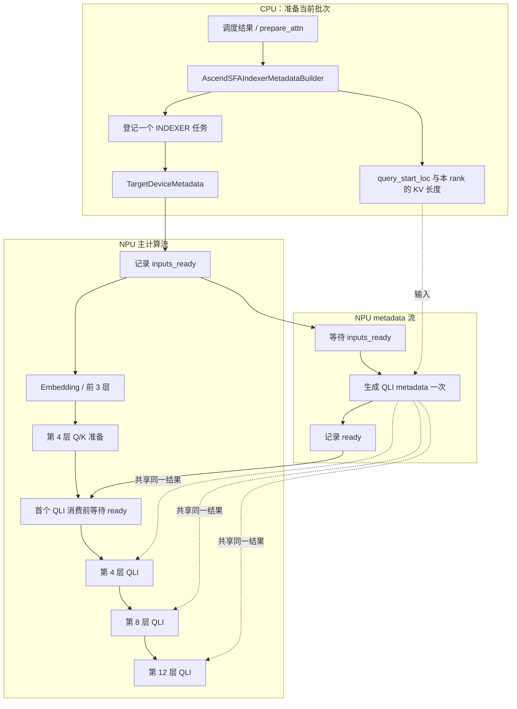

# Kimi K3.1 QLI metadata 异步构建

本改动把 owner-local FP8 QLI 的 metadata 生成交给
`AscendSFAIndexerMetadataBuilder`，接入 V2 已有的
`TargetDeviceMetadata`。同组各层继续共享一个结果。

## 两种异步的区别

- `async_scheduling`：CPU 调度工作与设备执行重叠。
- 本文的异步 metadata：设备工作由独立 NPU stream 执行，在消费处建立事件依赖。

两者不是同一个开关。仅把设备算子移动到 Python 的 `build()` 中，
并不会自动使它与主流计算并行。这里沿用 V2 已有的设备多流机制。

## 方案来源

来源是本私仓基线 `635d196` 已有的 DeepSeek V4.1 A5 + V2 实现：

- [Dsv4.1 builder 的 deferred 作用域及任务登记](https://github.com/hust17yixuan/vllm-ascend-kimi/blob/635d196858ddeba42941bf9221105c25ede3bc27/vllm_ascend/attention/dsa_v41.py#L860)：
  `_publish_task()` 共享 metadata，并登记 `DeviceMetadataTask`。
- [Dsv4.1 QLI 消费前的等待](https://github.com/hust17yixuan/vllm-ascend-kimi/blob/635d196858ddeba42941bf9221105c25ede3bc27/vllm_ascend/models/deepseek_v41/indexer.py#L272)：
  原本就调用 `wait_for_device_metadata(INDEXER, id(op_metadata))`。
- [V2 TargetDeviceMetadata](https://github.com/hust17yixuan/vllm-ascend-kimi/blob/635d196858ddeba42941bf9221105c25ede3bc27/vllm_ascend/worker/device_metadata.py#L174)：
  收集 builder 任务、安排 eager/capture 提交和 replay 收尾。
- [已有 executor 的独立流与等待去重](https://github.com/hust17yixuan/vllm-ascend-kimi/blob/635d196858ddeba42941bf9221105c25ede3bc27/vllm_ascend/worker/device_metadata.py#L46)：
  记录输入就绪、生产完成事件，并在消费端按组去重等待。

本次复用这些类与图执行入口，没有修改共享 executor 或 Dsv4.1 路径。
具体差异是：Dsv4.1 使用持久输出 buffer，任务 key 为 `id(buffer)`；
K3.1 直接使用算子返回 tensor，任务 key 为长期存在的 `id(builder)`。
两者都在首个消费点建立依赖，FULL replay 都执行捕获的生产节点。

## 执行结构

以下以第 4、8、12 层使用同一 indexer metadata 的情况为例。

主流中的 wait 是设备事件依赖，不是 CPU 全设备同步。
executor 按 `(INDEXER, builder_id)` 去重：同组后续层和最终 join
不会重复下发等待。若本次模型路径没有执行 QLI，最终 join 仍等待生产完成，
防止下一步覆盖尚未读取的输入。

## 代码落点

1. `attention/indexer.py` 的 `defer_device_metadata()` 限定目标模型的构建作用域；
   draft 构建及 Model Runner V1 不自动启用这个 producer。
2. `_defer_local_qli_metadata()` 登记生成任务，使用 Kimi indexer 的
   `index_n_heads/index_head_dim/index_topk` 和当前 metadata 组的长度输入。
3. `_get_local_qli_inputs()` 在首个消费者处等待对应事件，直接返回生成结果。
   未启用 deferred producer 的既有路径保留按 forward 共享的行为。
4. `worker/v2/model_runner.py` 明确限定
   `architecture == "KimiK31ForConditionalGeneration"`，再要求 A5、
   sharded DCP 和 FP8 indexer；既有 DeepSeek V4.1 启用条件保留。

普通 K3 MLA、其他未接入的 MLA backend 不新增 metadata 任务或消费等待。
已接入独立 metadata stream 的 DeepSeek indexer 原本就有同类等待。

## Eager 与 FULL graph

| 阶段 | 生成任务的执行位置 |
| --- | --- |
| Eager | `prepare_attn` 构建结束后，向 metadata 流提交 |
| Warmup / capture | `ModelWithContext.forward()` 开头提交；生成、事件和消费一起捕获 |
| FULL replay | 执行已经捕获的生产与消费节点；主机不再提交生成任务 |

直接保留 metadata 算子的返回 tensor。Eager 的 metadata 对象持有它；
FULL graph 使用捕获时的分配。没有增加“生成临时 tensor → 拷贝到输出 buffer”
的设备操作。输入仍由框架原有的稳定长度 buffer 每步更新。

## 成本与验收

代码消除了首个 QLI 前串行生成的安排，并提供与前面层计算重叠的机会。
但新增的跨流事件有成本，不能声称绝对零耗时，也不能仅凭调用次数减少宣称加速。

- CPU 测试覆盖 24 个消费者仅一次等待、输入 dtype 转换、重新 prepare、
  warmup/capture 生成、replay 不在主机重提交、未消费任务收尾及模型启用边界。
- 实际 builder 测试核对 DCP 本地长度，而非把全局长度误传给算子。
- 单卡设备测试比较异步结果与同输入同步算子的有效 payload，覆盖 eager、
  FULL replay、长度原位更新、空本地历史和 padding。
- 性能结论需要对比同样工作量下的串行/异步设备时间；单算子微基准不能代替
  完整 K3.1 模型的端到端验收。

## 本次验证结果

2026-10-27，183 的 Ascend 950DT 物理 NPU1，独立临时源码目录；
未启动或修改模型服务。torch `2.10.0+cpu`、torch_npu `2.10.0.post7`。

- 实际 vLLM 环境下的相关 CPU 套件：97 passed。
- 后续将启用范围明确收窄到 K3.1 后，本地组合及边界回归：33 passed。
  普通 K3、KimiLinear 即使满足 sharded DCP + FP8 也不启用，
  并且不会调用 K3.1 的 sharded 检查；Dsv4.1 原有条件保持生效。
- NPU：4 个配置通过（请求数 4/8 × eager/FULL），每个配置原位更新输入 8 次；
  3 个消费者的 864 个有效 int32 均与同步生成结果精确一致。

以下为 FULL graph 微基准。两种实现都只生成一次 metadata，
请求数 32、indexer heads 32、head dim 128、top-k 2048；
前置工作是 BF16 `[2048,2048] × [2048,2048]` MatMul。
每组 5 轮、每轮 300 次 replay，串行/异步交替测量，表中是每轮均值的中位数。

| 前置 MatMul 次数 | 主流生成一次（µs） | V2 异步生成（µs） | 异步减串行（µs） |
| --- | ---: | ---: | ---: |
| 0 | 39.21 | 42.58 | +3.37 |
| 1 | 84.09 | 49.45 | -34.64 |
| 3 | 174.02 | 138.39 | -35.62 |

这说明多流机制有额外成本，但存在足够前置计算时可以获得净收益。
`+3.37 µs` 是整条多流链的测量差，不能单独归因于某一个 wait。
这些结果不代表完整 K3.1 模型加速，也不满足“所有场景绝对零额外耗时”的断言。
