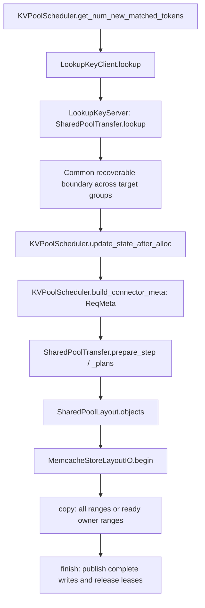

# Shared object layout for Ascend Store and pool-backed PD

This experimental format lets ordinary `AscendStoreConnector` and
`LayerwisePoolConnector` share complete prefix objects. The latter lives under
`kv_p2p/pd_pool/` and composes the ordinary pool implementation. It does not
inherit Mooncake V2's transport or replace the existing proxy.

## Implementation boundary

| Module | Responsibility |
| --- | --- |
| `kv_pool/ascend_store/shared_layout.py` | Bind registered Ascend tensors to logical Store shards and byte ranges; build compatible object identities |
| `kv_pool/ascend_store/shared_io.py` | Allocate or lease objects, copy selected ranges, publish complete objects, release client leases |
| `kv_pool/ascend_store/shared_transfer.py` | Build ordinary request plans, find recoverable prefixes and consume layer readiness callbacks |
| `kv_pool/ascend_store/pool_scheduler.py` | Existing request/save-range policy, committed checkpoint lifetime and completion events |
| `kv_p2p/pd_pool/scheduler.py` | CPD request boundary and handoff metadata, composed with `KVPoolScheduler` |
| `kv_p2p/pd_pool/worker.py` | Complete PD receives and PD-only tail/state publication, composed with `KVPoolWorker` |
| `kv_p2p/pd_pool/connector.py` | vLLM connector callbacks, HMA loaded-group selection and MRV2 state-copy integration |

The only shared Mooncake extraction is the pure stateful prompt truncation
helper, `mooncake.utils.truncate_stateful_prefill_request`. Existing V2 delegates
to it. No P2P send/receive implementation is copied into the pool.

## Object identity and byte order

`SharedPoolLayout` reuses upstream `HeadMajorStoreLayout` and `MambaStoreLayout`
for logical shard ownership and component ranges. Ascend supplies physical
tensor views, page strides, compression ratios and padding constraints. The
upstream StoreLayout/SSM helper interfaces are runtime prerequisites; an older
wheel without those interfaces is not a supported drop-in deployment.

A full-object key is an existing Ascend `PoolKey` containing:

- model identity and prefix block hash;
- logical Store shard, rather than physical local rank identity;
- a versioned schema fingerprint and `kv` or `state` role;
- canonical allocator group index zero, since owner identity is in the schema.

The schema includes ordered target owners, component/spec semantics, Store TP,
block/hash granularity and explicit `cache_prefix` identifying weights/epoch.
It excludes local addresses, request ID, P/D role and layerwise/bulk mode.
Changes in local draft allocator group numbering therefore do not rename
target objects. Peers must still agree on target grouping and schema.

This is a new versioned namespace. It does **not** reinterpret legacy
rank-local pool objects with an incompatible payload order.

For dense HND attention, content is packed logically as owner 0 K/V, owner 1
K/V, and so on, using whole head shards. K/V remain separate local tensors;
plans reference their original addresses without a temporary packed tensor.
Page padding is excluded. NHD-to-HND conversion is not provided.

One-head MLA/indexer uses replicated content: rank zero writes, all ranks read,
and physical TP does not multiply its key space. Actual component widths,
dtypes and compression ratios determine ranges. Empty rope components are
omitted. Recurrent state uses upstream component splitting and exact checkpoint
boundaries; runtime state sharing currently requires equal TP and Store TP.

## Ordinary pool lifecycle

Ordinary lookup requires contiguous attention content and the recurrent
checkpoint at the same logical boundary. It does not require every historical
state checkpoint. Reads restore the final checkpoint rather than replaying
historical state pages. Circular request-lifetime buffers are excluded from
ordinary prefix lookup and are reconstructed through the aligned replay path.

`store_tp_size` opts ordinary pooling into this format. Outside that opt-in,
the existing path remains selected. Ordinary saving publishes complete blocks
only; it never writes or searches for a partial tail. `save_decode_cache`
allows committed decode blocks to become prefixes reusable by a P instance.
Save ranges must remain within accepted **and already computed** tokens.

Layerwise mode changes copy timing, not key or payload format. Reads and writes
in either mode can interoperate. Before publishing, every planned component
must have been copied. `MemcacheStoreLayoutIO` uses existing backend wrappers
for readability, allocation, add/remove lease, key information and write finish,
and the native `store.batch_copy` operation for data movement.

Client-local reference counts retain a shared lease while multiple requests use
the same object. Failed lease acquisition is distinguished from a successfully
acquired lease needing cleanup. After transfers drain, returned lease-release failures are logged without failing
the completed transfer; backend TTL reclaims any remaining leases. Local cleanup
records are cleared so a stale retry cannot release a later session's lease.
Allocation, copy and publication failures still fail the operation.
These local counters do not prove the native backend's internal lease state.

## PD handoff

`PoolPDScheduler` handles CPD flags, while ordinary scheduling still owns full
blocks. P may save ready layers; D restores its complete receive plan before
continuing model execution. The existing proxy forwards `kv_transfer_params`.
It does not compute keys, transmit addresses or need a new endpoint protocol.

For stateful models, P computes through prompt token N-1 and D recomputes the
last prompt token. Ordinary full blocks use the same schema and hashes as
prefix pooling. PD alone writes compact partial attention objects and exact
recurrent/circular state snapshots. Tail keys include the full prompt identity,
valid boundary and a distinct namespace; hashing only trailing tokens is unsafe.
The prompt identity includes prefix-cache salt and extra-key semantics.

P publishes its final handoff only after save completion. The forwarded fields
are protocol version, original prompt length, CPD direction flags and, when
needed, speculative-token count for compatibility checking. D reconstructs
object keys from its request and matching schema. No raw key list is forwarded.
PD objects are not actively deleted after handoff; normal pool eviction applies.

## Worker ownership and completion

Scheduler-side grouped specs can lose per-owner draft information. After cache
registration, the worker supplies a versioned group manifest through the
existing lookup RPC: target groups, ordinary-prefix groups and stateful status.
PD uses this authoritative description for loaded-group selection. This RPC
is between local scheduler and worker, not a proxy wire-format extension.

The connector forwards pool completion events through
`build_connector_worker_meta`, `update_connector_output` and
`has_pending_push_work`. This releases pinned committed Mamba checkpoints,
including after cancellation. Speculative scratch blocks must not be pinned.

## Guardrails and follow-up work

Current runtime requires MemCache with synchronous reads, MRV2 eager, PP=PCP=DCP=1,
explicit compatible schema/weight namespaces and supported cache specs.
Shared layer-buffer reuse, KV events, host-resident groups and dense NHD are
not enabled by this change. Address-level TP tests are not heterogeneous
full-model acceptance. Stateful runtime currently rejects unequal Store TP.

PD receive failure is reported through request-level `failed_recving` together
with completion, rather than ambiguous hybrid block IDs. The existing Ascend
guard against hybrid `kv_load_failure_policy=recompute` remains intact.
Ordinary synchronous lookup-to-lease eviction races do not yet have equivalent
request-level failure isolation. Concurrent writer/eviction semantics, native
in-flight lease guarantees and performance need further production validation.

See [Flash integration and validation](glm53flash_pool_stage1.md) for the
validated model configuration and explicit limitations.

### MemCache 1.3.0 lease pairing and bounded PD handoff

`batch_alloc` owns a write lease; successful `batch_write_finish(WRITE_OK)`
consumes that lease and publishes the object. Do not subsequently call
`batch_remove_lease` for that write: the native API releases read operations.
An incomplete write remains unpublished and expires by native TTL.
`batch_add_lease` acquires a read operation only for a readable object;
`batch_remove_lease` releases that client's read operation. P and D can hold
independent read operations for the same key. Returned read cleanup errors
are logged after copies have drained; TTL handles residual ownership.

Protocol `ascend_shared_v2` adds `pool_pd_handoff_deadline`. After publishing,
each P shard acquires read leases for all its handoff objects, including full
blocks, attention tails and recurrent state. P emits the handoff only after
all workers complete acquisition. A publication-to-acquisition miss fails the
handoff instead of forwarding an unprotected key. D must acquire its own read
leases before the deadline and then keeps them through the synchronous copy.

`handoff_ttl_s` defaults to 60 seconds (allowed 5–300), measured from scheduling
the final P step. P releases holds on a later step after that deadline plus
two seconds; idle or failed workers rely on native TTL (deadline plus 30
seconds). D rejects an expired handoff with a one-second safety margin.
Cross-host deployments require synchronized clocks with less than one second
of skew; colocated P/D share a host clock. This is a bounded handoff window,
not a D-ACK protocol or an indefinite pin. It protects against normal eviction,
not explicit object deletion, pool process failure or lease expiry. Requests
queued beyond the deadline fail rather than consume potentially stale data.

The contract was checked against Ascend/memcache GitCode release/1.3.0
`cfe30446f43d533ff18d746f2e14b633e518ca6f` and the installed 1.3.0 SDK:
WRITE_OK followed by read-lease removal reproduces -3106; overlapping P/D read
leases allow D to retain exact bytes after P releases and under allocation
pressure exceeding the test pool's capacity.
