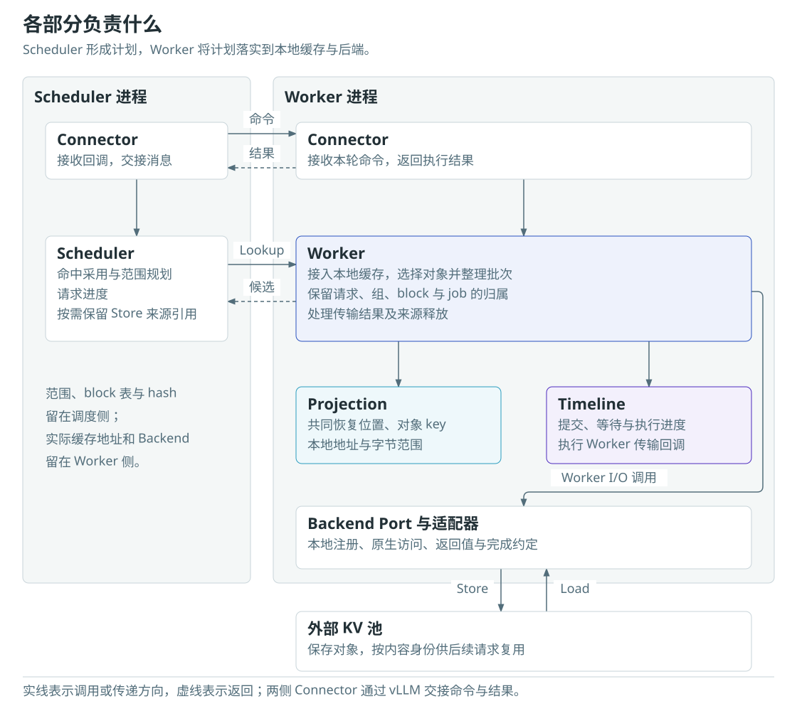
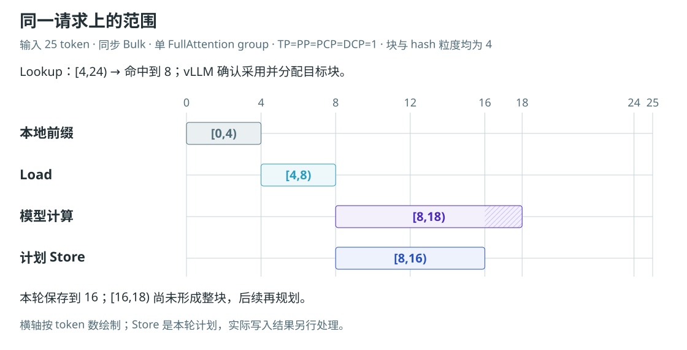
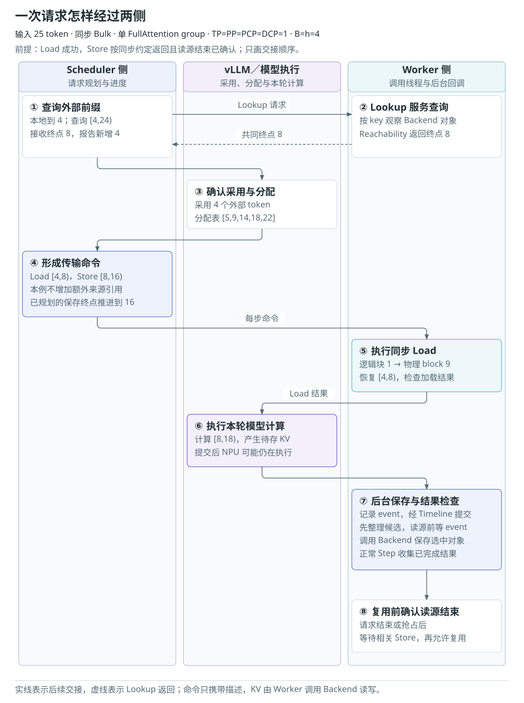
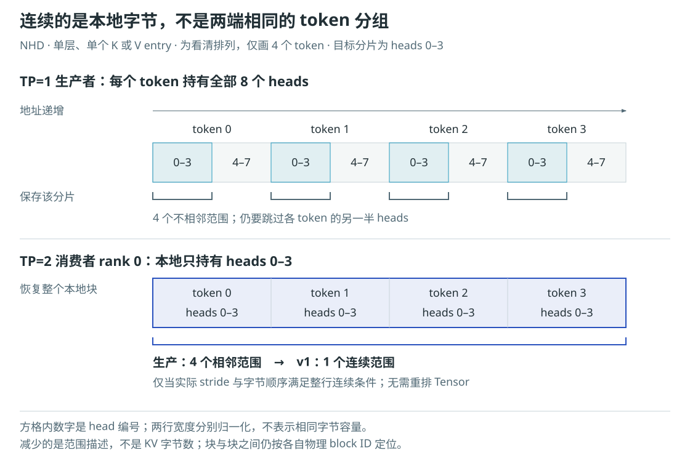
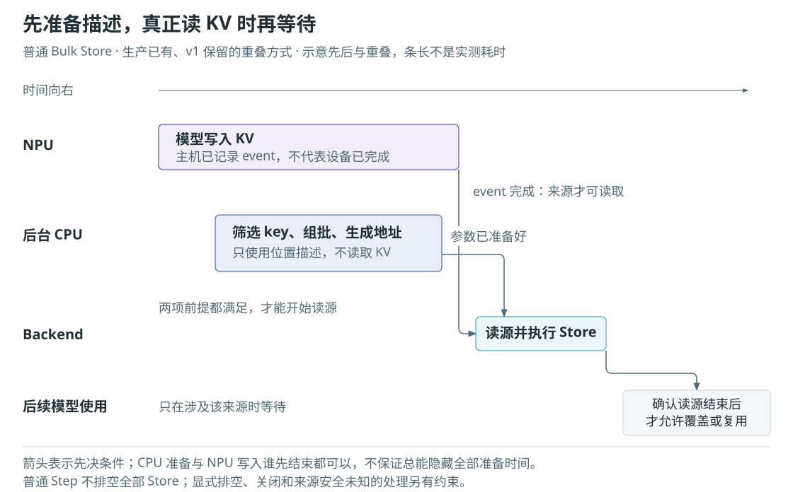
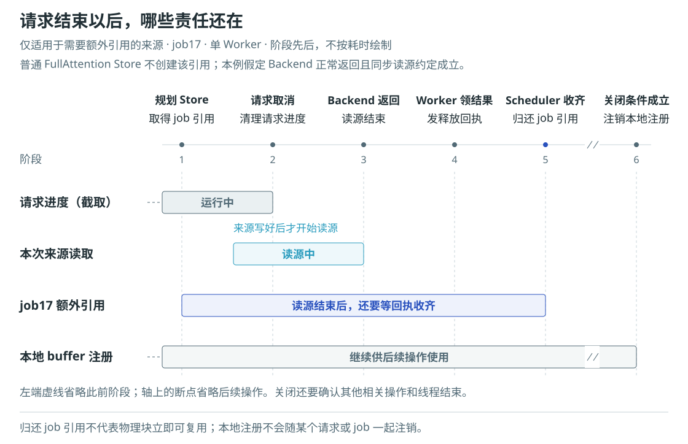

# AscendStore v1 架构与性能设计

AscendStore 把已经计算过的 KV 缓存保存到外部存储，让后续请求复用相同前缀。请求先查询可用对象，再把需要的数据读回自己的缓存；模型计算出新的 KV 后，也可以将它保存到池中。

本文介绍 AscendStore v1 的总体架构、主要流程、性能设计和资源寿命，并给出有明确条件的实测摘要。实现对照以 `d783ffdec83aaf804ece24289f39cbaaa864c2d9` 为基准；“生产实现”指同一代码快照中的 `AscendStoreConnector` 路径，不是线上集群实测。具体组合会随代码演进更新，本文不列完整支持矩阵，也不将局部性能结果扩展为所有路径的结论。

## 1. 背景与设计目标

vLLM 的本地前缀缓存受当前实例的缓存容量限制。外部 KV 池可以保留更多历史，并让不同请求按内容查找可复用的数据。命中以后，请求就能少计算一段已有前缀。

接入外部存储时，查询、传输和模型计算各有自己的进度。远端存在一个 key，不表示数据已经恢复到本地；模型已经写出 KV，也不表示后台保存已读完来源。请求结束时，仍可能有 Store 正在使用它的缓存。

因此，设计需要处理四个问题：

- **选对数据。** 找到各缓存组共同需要的前缀，保持对象身份、分片和本地布局一致。
- **排好顺序。** 加载完成后才能使用目标；来源写好后才能保存；读源结束后才能修改来源。
- **管住寿命。** 为尚未结束的操作保留缓存和注册资源，取得相应完成结果后再释放。
- **控制开销。** 减少不必要的地址段和对象准备，摊薄调用成本，并保留 CPU、NPU 与后台传输可以重叠的部分。

重构以生产实现的业务逻辑为参照。结构调整保留请求规划和传输语义；发现确定的错误时，再依据具体路径修正。可以复用的布局计算提前准备，本次请求的选择和状态仍沿显式主线处理。

## 2. 总体架构

vLLM 负责请求调度、缓存分配和模型执行。AscendStore 通过 Connector 接收这些阶段的回调，在 Scheduler 侧形成计划，在 Worker 侧执行传输。两侧通过消息交接，实际 KV 字节由 Worker 调用 Backend 读写。



| 组件 | 主要负责什么 |
| --- | --- |
| Connector | 转交 vLLM 回调，传递命令和返回结果 |
| Scheduler | 查询并采用远端命中，规划 Load／Store，维护请求进度，并按来源回收条件管理额外引用 |
| Worker | 接入本地缓存，选择传输对象，保留请求与 job 归属，处理执行结果 |
| Projection | 根据内容身份和缓存布局，计算恢复位置、对象 key 及字节范围 |
| Timeline | 安排提交、等待和执行顺序，管理队列与逐层执行进度 |
| Backend Port 与适配器 | 约定访问和完成语义，将操作交给 Mooncake、Memcache 等原生后端 |

这里的 Scheduler 是 AscendStore 在调度进程中的规划组件。它使用 vLLM 提供的请求与分配信息，不接管模型调度。Worker 也使用 ModelRunner 已经分配的缓存，不另建一份模型 KV。

Scheduler 持有 token 范围、block 表和内容 hash。Worker 持有实际 Tensor/view、地址布局和 Backend 实例。同一命令到达不同 Worker 后，由各自的本地布局转换成地址。

构建阶段还有三份辅助信息。vLLM Adapter 解析上层配置并创建实例；Topology 记录缓存组、物理层和分片身份；RouteSpec 保存启动时的路径选择。它们让运行阶段沿已选好的结构推进。

## 3. 主要工作流程

### 3.1 初始化与缓存注册

启动配置先确定 Bulk、Layerwise 以及相应的执行路径。此时已经知道缓存规格，但还没有实际缓存地址。

ModelRunner 分配缓存后，Worker 接收 Tensor/view，提取基址、块长度、块步长和层区间，并绑定 Projection。所选 Backend 若要求预先登记本地内存，Worker 同时完成注册，随后启动 Timeline。

布局参数用于计算传输位置，注册范围用于满足传输库的内存访问要求。多个 view 可以共享底层 storage；Worker 按这份分配组织覆盖范围，同时保留各 view 自己的起点和步长。注册本地内存不会创建远端对象。

### 3.2 查询、采用与加载

Lookup 使用前缀 hash 和缓存身份查询远端对象。Worker 收集各组的可用性，再由 Reachability 计算共同恢复位置。FullAttention 需要相应历史 KV，Mamba 需要准确位置的状态；共同终点必须同时满足这些需求。

稀疏保留仅控制 Store。Lookup 不按写入间隔过滤候选，避免漏掉输入末端和其他请求留下的恢复数据；哪些对象能支持恢复，仍由上游 manager 根据缓存类型和实际可用对象判断。

Lookup RPC 的单次请求解码、查询或结果编码失败时，服务端记录异常并回复零命中，随后继续处理请求。客户端遇到收发失败或无效响应时也按外部未命中处理，关闭失败的连接，在后续查询时重新创建，避免迟到回复被用于另一条请求。

Connector 的 `kv_connector_extra_config.lookup_rpc_timeout_ms` 控制一次 Lookup 的发送与等待回复总预算，单位为毫秒；默认 `-1` 表示无限等待，`0` 表示不等待，正整数启用有限预算，最大为 ZMQ 支持的 `2147483647`。默认值暂与生产一致，有限预算需依据真实后端负载校准。超时只是客户端停止等待，不能取消已经进入后端 SDK 的查询。RPC 服务线程独占 socket 的创建、收发和关闭；关闭时先完成已接收的查询并确认线程退出，再释放 Worker 资源。若默认五秒的关闭等待期内仍未退出，关闭操作报错并保留 Worker，允许查询结束后重试。关闭等待期不限制正常查询的执行时间。

Lookup 返回的是恢复候选。vLLM 确认采用并分配目标块后，Scheduler 才能将它交接成 Load 命令。命令携带范围、完整分组 block 表和内容身份，Worker 据此选择目标位置。

下面用一个普通 Prefill 例子串起范围。Prefill 是为已有输入计算缓存的阶段。本例输入长 25 token，采用同步 Bulk、单 FullAttention group，TP、PP、PCP、DCP 均为 1，块和 hash 粒度均为 4；普通保存丢弃不足整块的尾部。



查询从本地终点 4 到对齐后的输入终点 24，得到远端命中到 8。采用后，Load 范围为 `[4,8)`。若完整 block 表为 `[5,9,14,18,22]`，这个范围对应逻辑块 1，Worker 从表中取出物理 block 9，再计算它在各 entry 中的地址。

entry 表示用于传输的一个实际 Tensor/view。一个对象可以收集多个 entry 的内存段；读取时按约定顺序填回这些段。命令描述位置和身份，KV 字节仍留在缓存或后端中。

### 3.3 计算与后台保存

把前面的范围放回两侧交接，可以看到计划、执行和来源保护各自在什么时候发生。下图沿用同一例子，Load 成功，Store 按同步约定正常返回并确认读源结束。



Scheduler 在规划时推进已规划的保存终点，用来避免重复规划；写入是否成功仍由执行结果决定。本例使用普通 FullAttention，其 manager 在请求存活期间保留全部块，Store 不再额外遍历 block 表、创建来源引用或分配 Store job ID。请求结束或抢占后，Worker 在模型可能复用这些块之前等待相关 Store 结束。

对于会在请求存活期间回收页面的缓存 manager，以及需要保护的 checkpoint 来源，Scheduler 仍在交接 Store 命令前取得额外引用，并分配 job ID。Worker 确认读源结束后回传释放计数，Scheduler 收齐预期 Worker 的回执后归还引用。这个分支不应套到所有 Store 上，详见第 6 节。

普通 Bulk Store 在后台执行。候选筛选、组批和地址参数可以先准备，真正读源前再等 NPU event 完成。正常 Step 收集已完成结果，只为本步可能复用的来源等待相关批次；显式排空和关闭才等待全部 pending Store。这里的 fence 是来源复用前的等待，不是每步无条件排空整个队列。

### 3.4 同一主线上的执行变化

同步 Load 在调用线程内等待结果；异步 Load 提交后保留 pending 请求，后续收集完成结果；Layerwise 则在当前层使用前恢复数据，并可提前加载后续层。

这些路径仍要保持对象身份、字节范围和请求归属一致。变化也可能影响候选准备与命令下发时点，Timeline 则集中处理各路径的等待和执行顺序。

Layerwise Store 逐层写入同一个完整对象。最终收尾检查所需层和复制结果，再对符合条件的对象 commit，确认发布。Layerwise Load 读取已有对象，完成后结束读 session。

### 3.5 投机解码

v1 接受 vLLM 提供的投机解码配置，已有的后端、并行拓扑、私有状态和部分对象限制仍然适用。与生产路径一致，Scheduler 和 Worker 都通过上游 `speculative_config.use_eagle()` 判断是否需要 EAGLE 类处理，不另设方法名白名单。外部命中进入请求的最后一个传输粒度块时，Scheduler 留出重算范围；停在内部块边界的命中保持不变。这个外部缓存策略也不会跟随上游关闭本地尾块丢弃的开关。

Store 继续使用上游确认的 token 范围和 block hash，并按传输粒度对齐。调度中包含但尚未有确认 hash 的草稿位置不进入保存范围；草稿被拒绝后，后续计划使用 vLLM 回退后的计算进度。Key 格式和去重规则不因草稿器改变：已存在的 key 跳过，缺失的 key 才写入，Decode 保存仍受 `save_decode_cache` 控制。Bulk 使用现有收尾流程，在 Drafter 执行完成后记录来源就绪事件，再读取已注册的目标模型与草稿模型缓存。

## 4. 关键设计选择

### 4.1 分开空间计算与执行顺序

Projection 回答“哪个对象、哪些字节”，Timeline 回答“什么时候可以访问”。Worker 准备本次对象和选择结果，Projection 根据已绑定的布局计算 key、地址和长度；Timeline 安排执行，Worker 回调在需要的时点等待并访问这些位置。

PP 改变本地层集合，TP 改变块内 head 分片，多组缓存使用各组自己的布局。它们通过选择 entry 或块内片段形成传输段。Bulk 按对象组织这些段，Layerwise 另加对象内偏移，取出当前层的数据。

位置确定以后，还要满足访问条件。Store 读取来源前要等模型写好，模型使用 Load 目标前要等恢复完成，逐层写入的对象还要完成发布。拆分后，空间规则集中在 Projection，等待与执行推进集中在 Timeline，Worker 保留两者之间的对象和结果归属。

### 4.2 固定布局与本次对象选择分开

Projection 中有些量随请求变化，有些量在同一份缓存和配置下保持不变。启动配置先确定层区间和分片规则；缓存绑定后，再取得真实基址、shape 和 stride，准备可以复用的数值数组。

先在一个缓存组内看地址计算。用 $i$ 给本次入选的 block 行编号，$b_i$ 是该行的物理 block ID；用 $j$ 给传输段编号。段 $j$ 来自 entry $e_j$，相对块起点的偏移为 $\delta_j$，地址为：

$$
a_{i,j}=A_{e_j}+b_iS_{e_j}+\delta_j.
$$

$A_{e_j}$ 是 Tensor/view 的基址，$S_{e_j}$ 是相邻块起点的步长，$\delta_j$ 是块内偏移，三者都以字节计。分片规则和实际布局固定后，每个候选段对应的 entry 与块内偏移也随之确定。换一个请求的 block，只改变这里的 $b_i$。

因此，绑定布局时可以先保存：

$$
\beta_j=A_{e_j}+\delta_j,\qquad
\sigma_j=S_{e_j}.
$$

$\beta_j$ 是这段在物理 block 0 中的起点，$\sigma_j$ 是移到下一块时增加的字节数。本次请求到来后，地址式就变为：

$$
a_{i,j}=\beta_j+b_i\sigma_j.
$$

普通连续片段的块内偏移为 0，直接保存 entry 的基址和步长。PP 预先确定各分区对应的 entry 区间；TP 切片把固定的 token 与 head 偏移合入段起点。运行时按入选 block 行与传输段组成地址矩阵，用 NumPy 广播批量计算。例如固定段起点为 4116 字节、块步长为 64 字节，物理 block 3 和 7 的地址分别为 4308 和 4564 字节。

长度和段选择仍要结合本次输入。连续 token 片段的长度可以随有效 token 数变化；按 token 展开的 TP 片段可以先保存每段长度，再根据本次 token 数筛选有效段。对象掩码决定哪些对象参与，段的排列顺序决定对象字节怎样拼接。

| 时点 | 已知信息 | 可以准备什么 |
| --- | --- | --- |
| 解析启动配置 | 缓存组、层归属与分片规则 | 确定投影路径和对象身份规则 |
| 绑定实际缓存 | 基址、shape、stride 与层区间 | 保存 key 前缀、固定段起点、步长和长度所需参数 |
| 本次请求到来 | block IDs、token 数、选择掩码与内容 hash | 选择对象和段，生成最终地址、长度及完整 key |

布局数组只保存位置描述，不包含 KV 数值。绑定时保留固定模板，地址矩阵在请求到来后按所选 block 生成。key 也保留模型、组和分片等固定前缀，再拼接本次内容 hash。生产已经缓存普通 key 前缀，Layerwise 也已经使用 NumPy；v1 的具体差异在于哪些推导被提前、哪些循环被批量计算替代，以及是否直接减少传输段，不能仅凭“使用数组”推导性能优势。

### 4.3 Scheduler 和 Worker 各保留一条显式主线

Scheduler 从请求状态出发，经过 Lookup、采用与分配确认，再形成传输命令。新请求、持续运行和抢占恢复分别更新进度，随后回到共同的命令规划和来源保护过程。

Worker 从命令出发，经过对象行、key 选择、批次整理和地址计算，最后调用 Backend 并处理结果。分支只在需要不同处理的地方展开，后续仍保持同一套对象和结果归属。

筛选或合并批次时，Worker 同时保留请求、原始缓存组、物理 block 和 Store job 的对应关系。内部数组可以使用紧凑下标，key 和失败记录继续使用原始组身份。

### 4.4 后端差异留在访问边界

Backend Port 约定本地注册、对象查询、读写和完成结果。适配器负责原生参数、返回值及资源接口，Worker I/O 将本次调用的结果对应回传输来源。

整对象接口按 key 读写完整对象。逐层访问可以使用 KeyRange，以 key 和对象内偏移定位；也可以使用 GVA，在受保护的访问期间取得远端地址，再按地址复制。当前 Layerwise 的 Mooncake 路径使用 KeyRange，Memcache 路径使用 GVA。

这些接口各有自己的容量、保护和发布要求。后端提供什么能力，就按相应的访问方式组织调用；上层保留统一的请求、来源和结果处理主线。

## 5. 性能设计与生产实现对照

外部命中省去了一段模型计算，但 Lookup、对象筛选、地址生成、后端参数转换、传输和等待仍会消耗时间。地址公式简单，不代表构造几十万个地址和长度、将它们转成原生接口参数也便宜。因此，v1 分别控制实际工作量、重复准备与调用成本，以及关键路径上的等待；这些成本可能相互重叠，不能简单相加当作请求延迟。

### 5.1 先减少范围数，再批量生成地址

一个传输范围由地址和长度描述。生产普通 Bulk 对每个 block 调用 `prepare_value`，再遍历层 entry；TP mismatch 的 `_build_strided_addrs` 还会逐 token 构造范围。v1 对需要保留的范围进行批量计算；当实际布局允许用更少的范围表达相同字节时，则先减少范围数。

以 NHD 的 TP=1 生产者、TP=2 消费者为例。NHD 在一个缓存块内先按 token、再按 head 排列，每个 head 的向量连续。生产者持有全部 heads，保存一半 heads 时，相邻 token 的目标片段之间夹着另一半 heads，不能直接合成整块。消费者每个 rank 只持有自己的一半 heads，恢复其完整本地块时，这些 token 的数据却连续排列。



生产 TP mismatch 对两侧都逐 token 展开。v1 在注册时检查本地 key 切片数、Tensor 的实际 stride、片段顺序与完整块覆盖；满足整行连续条件时改用连续范围，不满足时保留散布范围。它不搬动 KV 来制造连续性，也不改变本例的 NHD 池内字节顺序。

本次 Qwen3-8B 测试的消费者每请求恢复 8192 token，即 64 个 128-token block；模型有 36 层，每层 K/V 两个 entry。因此每个消费者 rank 的范围数可由布局推出：

```text
生产：64 blocks × 36 layers × 2 entries × 128 tokens = 589824 个范围
v1：  64 blocks × 36 layers × 2 entries              =   4608 个范围
```

范围数降到 1/128，而 KV 字节数不变；每个范围也不等于一次网络 RPC。减少的描述会贯穿地址构造、Python／原生参数转换和后端范围处理，但各阶段节省多少时间，需要分段测量。这一结论只适用于满足连续条件的一侧，不能套用到仍需切分 heads 的生产者。

对于不能合并的范围，v1 将绑定时保存的段起点与步长用于 NumPy 广播，减少逐元素 Python 运算。向量化没有消除输出数组、临时数组和 `.tolist()` 转换，也没有降低必须传输的字节量；小批次是否获益仍取决于这些固定开销。

实现入口：[生产地址构造](https://github.com/ChenZhuo888/vllm-ascend/blob/d783ffdec83aaf804ece24289f39cbaaa864c2d9/vllm_ascend/distributed/kv_transfer/kv_pool/ascend_store/pool_worker.py#L3138)、[v1 连续性检查与范围生成](https://github.com/ChenZhuo888/vllm-ascend/blob/d783ffdec83aaf804ece24289f39cbaaa864c2d9/vllm_ascend/distributed/kv_transfer/kv_pool/ascend_store/v1/projection/bulk/tp_mismatch.py#L51)。

### 5.2 先确定参与对象，再生成传输参数

Store 候选只需要描述内容 key、block 行及其请求归属，不必立即生成所有内存范围。v1 先按后端要求查询存在性，并对同批重复 key 选择一次写入；再压缩入选行，为这些对象生成地址和长度。若后端不要求写前查询，可以跳过该查询；本次测试使用的 Mooncake 路径仍要求查询。

生产普通 Bulk 已经先筛选缺失 key，再计算地址。这里的新增差异主要是把同样的顺序落实到 TP mismatch：生产先为全部候选生成地址，再丢弃已存在对象的参数；v1 把筛选移到地址生成之前。假设某批只有十分之一的对象需要写入，就不必为另外九成对象展开 TP 地址段，但候选 key 和存在性查询的成本仍然存在。全部候选都需要写入时，这项筛选顺序不会减少最终范围数。

筛选时必须保留原始缓存组、物理 block、请求和可选 Store job 的关系。v1 不能为了压缩数组，丢失失败结果应该归给谁，或把内部紧凑组下标写进远端 key。实现入口：[Bulk Store 准入与参数生成](https://github.com/ChenZhuo888/vllm-ascend/blob/d783ffdec83aaf804ece24289f39cbaaa864c2d9/vllm_ascend/distributed/kv_transfer/kv_pool/ascend_store/v1/worker/bulk/worker.py#L515)。

### 5.3 按 Step 组批，固定层关系按绑定复用

生产 Bulk 主要逐请求准备并调用后端。v1 在一个 Worker 内汇集同一步的 Load 或 Store 命令，合并对象行和参数后调用 Backend；Store 的存在性查询与同批去重也在这个范围内进行。请求之间不需要为了各自的相同准备流程重复进入后端接口。每份批次保留请求边界和来源映射，返回结果仍分别交给对应请求。

这里合并的是同一步已经到达的工作，不是等待未来请求的跨 Step 动态组批，也不保证原生库内部只发一个 RPC。更大的批次会增加一次调用的参数内存和完成等待粒度；选择性 Store fence 也可能需要等到包含目标请求的整个批次完成。因此，调用次数减少是结构事实，最终吞吐与尾延迟仍需实测。

PP 和 Layerwise 还有另一类重复成本。生产 Consumer PP 在每个对象上重新划分层列表、切片并改写 key 的 PP 字段；v1 在绑定时保存各 PP 分区的 key 前缀和 entry 区间。生产 Layerwise 已共享块数据并使用 NumPy，但部分逐层路径仍反复计算 entry 内偏移和之前各层的长度和；v1 一次计算对象内偏移，并为每个物理层保存所需布局视图，运行时只代入本次 block。

这些变化减少重复推导，不代表所有中间状态都能永久缓存。请求选择、session 准入结果和执行失败仍按本次操作处理。实现入口：[Bulk 组批](https://github.com/ChenZhuo888/vllm-ascend/blob/d783ffdec83aaf804ece24289f39cbaaa864c2d9/vllm_ascend/distributed/kv_transfer/kv_pool/ascend_store/v1/worker/bulk/worker.py#L204)、[Consumer PP 绑定](https://github.com/ChenZhuo888/vllm-ascend/blob/d783ffdec83aaf804ece24289f39cbaaa864c2d9/vllm_ascend/distributed/kv_transfer/kv_pool/ascend_store/v1/projection/bulk/consumer_pipeline.py#L76)、[Layerwise 固定偏移](https://github.com/ChenZhuo888/vllm-ascend/blob/d783ffdec83aaf804ece24289f39cbaaa864c2d9/vllm_ascend/distributed/kv_transfer/kv_pool/ascend_store/v1/projection/layerwise/key_range.py#L152)。

### 5.4 等待放在真正需要数据的位置

CPU 可以在 NPU 仍写入 KV 时整理 key、筛选对象并计算地址，因为这些操作使用的是位置描述，不读取 KV 值。只有 Backend 开始读取来源之前，才必须等待来源 event 完成。若把等待放在 CPU 准备之前，原本能重叠的两段工作就会串行。



普通 Bulk 不必在每个 Step 开始时排空所有后台 Store。Worker 先收集已完成结果；当本步涉及结束或抢占请求的块复用时，再等待覆盖这些请求的必要批次。FIFO 队列保证某请求较晚批次完成时，它更早的批次也已完成。对于请求运行期间可能回收的来源，额外引用提供另一层保护，不能仅靠请求结束时的 fence。

生产已经有 CPU 准备在前、读源等待在后，以及按释放请求等待的设计。v1 保留这些条件，意义是避免组件拆分把异步路径变成全局串行，并不是首次引入异步 Store。来源状态不明确时仍必须阻止危险复用，不能以性能为由跳过完成检查。

### 5.5 控制重构新增的热路径开销

结构拆分会增加状态快照、结果归属和函数调用。v1 对没有传输工作的路径尽早返回：普通 Decode 未开启保存且无需状态 checkpoint 时，不再复制无消费者的进度快照；Bulk 的逐层回调直接返回；空 Layerwise Load 不再进入无意义的等待。Layerwise 完成处理按请求组织来源，并按组复用层过滤结果，减少重复扫描与对象重建。

这些修改主要用于控制 v1 自身的管理开销。生产也已有 Decode 早退和 Layerwise 共享数据，不能把消除早期 v1 回退写成新超过生产的收益。目前没有真实 NPU Layerwise 性能结果，也没有将上述各项逐一隔离的消融实验。

## 6. 状态与资源的生命周期

### 6.1 每份状态按自己的寿命结束

一次模型 Step 结束后，当前命令上下文可以清理，后台操作可能仍在执行。下面选用确实需要额外引用的 Store job，而不是第 3 节的普通 FullAttention 示例：请求取消后，进度已经清理，Store 仍在读源。图中比较请求进度、来源读取、额外引用和本地注册各自的结束时点。



其他状态也按自己的管理者和完成条件清理：

| 状态或资源 | 由谁管理 | 什么时候结束 |
| --- | --- | --- |
| 请求进度 | Scheduler | 请求结束或抢占时清理，恢复时重建 |
| 异步 Load 的 pending 请求 | Worker | 对应 completion 被接收 |
| 需要保护的 Store job 的额外来源引用 | Scheduler | 收齐预期 Worker 的来源释放回执；普通 FullAttention Store 不创建这份引用 |
| 逐层作业与 session 状态 | Timeline | 作业结果已处理，相应 session 完成收尾 |
| 后台队列与线程 | Timeline | 停止接收提交，处理收尾并确认线程退出 |
| 远端读写保护 | Backend 与对应 session 流程 | 相应访问结束，取得所需结束结果 |
| 本地缓存持有与注册 | Worker 资源所有者 | 满足操作和线程关闭条件，并确认注销、客户端关闭 |

### 6.2 防回收与防覆盖分别处理

source lease 为需要保护的 Store 来源增加引用，防止它们被回收。是否需要额外引用取决于实际缓存 manager 的回收行为和 checkpoint 生命周期，而不只看缓存规格的名称。普通 FullAttention 来源由请求存活期间的分配与复用前的 fence 保护，不再无条件增加引用。无论采用哪种防回收方式，模型后续原地改写的顺序仍需单独控制。

Timeline 因此还要建立写入、读源和后续修改的顺序：

$$
\text{来源写好}\preceq\text{开始读源}\preceq\text{读源结束}\preceq\text{允许后续修改}.
$$

$\preceq$ 表示先决条件关系。来源 event 连接写入与读源；在确实可能覆盖或复用这份来源的位置，Store fence 等待相应后台结果。其他不涉及这份来源的工作不因该关系自动变成全局等待。

### 6.3 保存结果与来源安全分别判断

保存失败时，来源可能已经读完；对象已经发布时，也不能据此推断本次来源读取结束。Worker 分别处理写入结果和来源释放，Backend 则提供相应接口的完成保证。

下面讨论源地址已交给后端的同步 Store。正常返回以 Backend 履行同步读源约定为前提：

| 本次保存结果 | 来源读取状态 | Worker 的处理 |
| --- | --- | --- |
| 保存成功 | 已确认结束 | 有 job 时回传释放计数，允许继续 |
| 正常返回写入失败码 | 已确认结束 | 记录失败，有 job 时回传释放计数，允许继续 |
| 异常或结果无法解释 | UNKNOWN | 保留未确认的 pending Store，阻止正常继续 |

后台任务发出完成通知后，Worker 还要检查这些结果。队列处理完毕、线程退出或 Future 销毁，都不能单独证明原生读源已结束。若原生调用只确认提交，适配器还需要对应的完成等待，才能兑现 Port 的约定。

### 6.4 关闭前确认操作和线程结束

Worker 先处理未收尾的 Store，再关闭 Load／Store Timeline，确认后台线程退出。Store 来源仍未确认时，本地缓存与注册资源继续保留。条件成立后，才注销 buffer、关闭 Backend，最后清除缓存持有。

注册回滚或注销失败时，资源所有者保留尚未释放的区域，供显式重试。关闭入口已经封闭，只说明不再接收新提交；资源能否交还，仍由操作结果、线程退出和注销结果共同决定。

## 7. 实测证据与结论边界

### 7.1 测试条件与计时口径

2026-10-13 至 14 日的两次真实 NPU 测试比较了生产与 v1 的 TP=1 生产者 → TP=2 消费者服务。每次生命周期的两端使用同一种 Connector，不混搭生产与 v1。共同条件如下：

| 项目 | 条件 |
| --- | --- |
| 硬件与模型 | Ascend A2（910B3），实际使用 3 卡；Qwen3-8B、BF16、NHD、单 dense KV group |
| 传输 | Mooncake `0.3.11.post1`；Bulk，同步 Load、后台异步 Store；消费者只 Load |
| 请求 | 每请求输入 8193 token、固定输出 256 token；External 恢复 8192 token，尾部 1 token 仍计算 |
| 并发与样本 | 客户端最大并发 C8，每阶段 16 个请求；C8 不保证模型每步 batch 恰好为 8 |
| 运行方式 | eager，关闭 async scheduling 和 chunked prefill；开启 prefix caching，关闭 Decode 保存 |
| 重复与统计 | 生产 → v1 → v1 → 生产；每次生命周期两轮，各实现每阶段四轮，取逐轮指标的中位数 |

先计时执行生产者冷请求，再在计时外排空 Store、确认对象发布并 reset 消费者本地前缀缓存，最后计时执行消费者 External 全命中请求。消费者指标包含完整 HTTP 服务过程中的 Lookup、Load、尾 token 计算和 256-token 生成，不包含之前的生产者计算、Store 发布等待、reset、启动和预热。因此它既不是纯 Load 微基准，也不是完整 P/D 链路耗时。

两次均使用 vLLM `8cc9aa5ad350f6f80cf3bebb298d410803ff75a9`。第一次 Ascend 提交为 `260f83720324537832744cddbc3630ebd1e91443`，第二次为 `d783ffdec83aaf804ece24289f39cbaaa864c2d9`。每次的四轮指标来自两个独立服务生命周期，不是四个完全独立的进程样本；两次也不是固定物理卡上的同一二进制重跑。

### 7.2 结果与复核入口

| 场景与指标 | 第一次生产 → v1 | 第二次生产 → v1 |
| --- | --- | --- |
| 消费者输出吞吐（token/s） | 25.55 → 68.58，达到 2.68 倍（提高 168.36%） | 27.13 → 67.81，达到 2.50 倍（提高 149.96%） |
| 消费者平均 TTFT（s） | 46.58 → 1.20，降低 97.43% | 41.86 → 1.25，降低 97.01% |
| 生产者冷请求输出吞吐（token/s） | 28.18 → 28.10，下降 0.27% | 29.32 → 28.12，下降 4.10% |

TTFT 是收到首个输出 token 的时间；表中“平均 TTFT”是四个逐轮均值的中位数。百分比使用未四舍五入的指标计算。生产者冷请求包含 prefill 和生成，不是纯 Store 用时；这些结果没有证明 Store 全面加速。

两次 TP Mismatch 测试均通过，请求完成数、输入输出长度、命中来源和零抢占检查通过。每轮 16 个消费者请求合计从 External 恢复 131072 token，本地只计算 16 个输入尾 token，本地前缀命中为 0。**文本比较仍有差异，测试只记录、不阻断，原因未在这两次实验中查清；通过状态不能证明严格文本一致、精度无损或 KV 逐字节一致。**

复核入口为[第一次 NPU Job](https://github.com/vllm-project/vllm-ascend/actions/runs/38424325266/job/115396004245)、[第二次 NPU Job](https://github.com/vllm-project/vllm-ascend/actions/runs/38493078274/job/115624542367)。日志中 `ASCENDSTORE_TP_PERFORMANCE` 后的 JSON 包含逐轮指标、命中统计与文本差异；需要下载时，可登录 GitHub，在[第一次运行](https://github.com/vllm-project/vllm-ascend/actions/runs/38424325266)和[第二次运行](https://github.com/vllm-project/vllm-ascend/actions/runs/38493078274)页面的 Artifacts 区域查找名称以 `a2-4card-1-1` 结尾的日志包。Artifact 受保留期限制。[固定版本测试代码](https://github.com/ChenZhuo888/vllm-ascend/blob/d783ffdec83aaf804ece24289f39cbaaa864c2d9/tests/e2e/pull_request/four_card/test_ascendstore_v1_tp_mismatch.py)给出可复核的执行流程。

### 7.3 可以推出什么，尚不能推出什么

源码与布局能证明消费者范围数量减少，实测能证明上述配置下消费者完整请求的吞吐和 TTFT 改善。但本轮没有分段插桩或逐项消融，不能把全部收益归给 NumPy、范围合并、组批或某个提交，更不能把 TPOT 变化直接解释成 decode 算子加速。

该结果不覆盖 TP=2→1、其他 TP 比例、Consumer PP、Hybrid、Layerwise、混合命中、跨机或长稳。普通 Bulk 的已有对照也不能支持同幅收益；Layerwise 和无 reset 混合流量仍缺少对应硬件性能证据。CPU/mock 测试可以验证已覆盖的地址、筛选、顺序与故障处理，不能替代原生后端、设备传输和对象发布验证。
