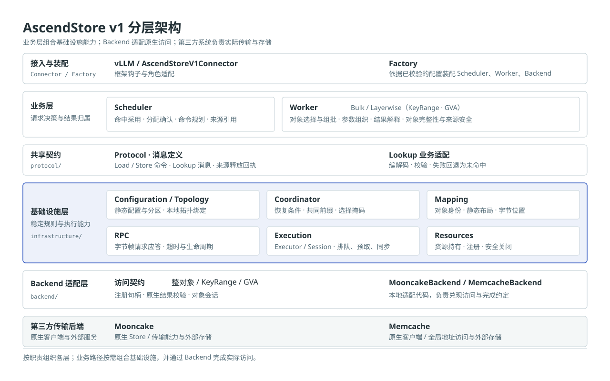
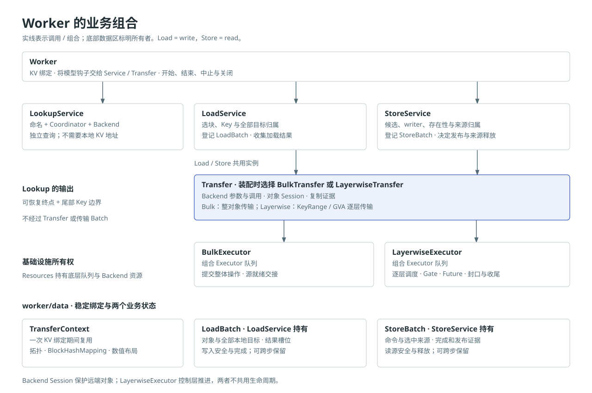
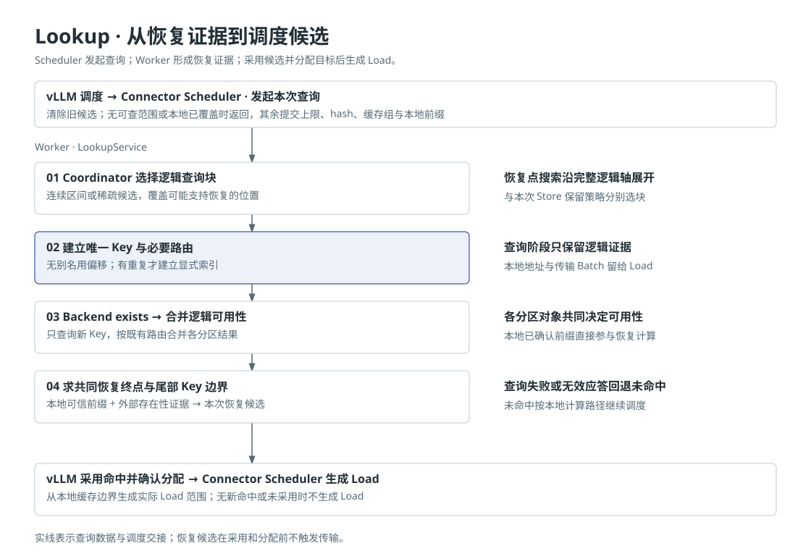
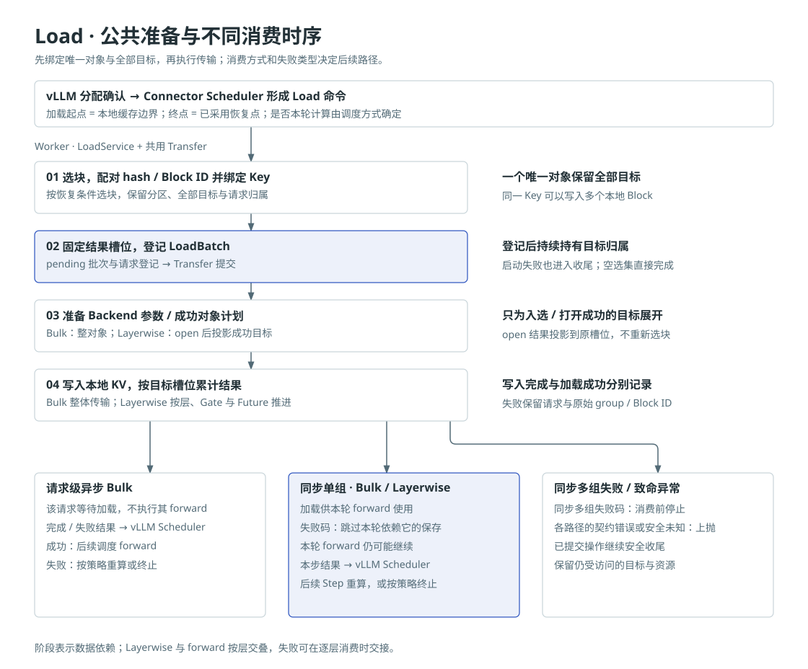
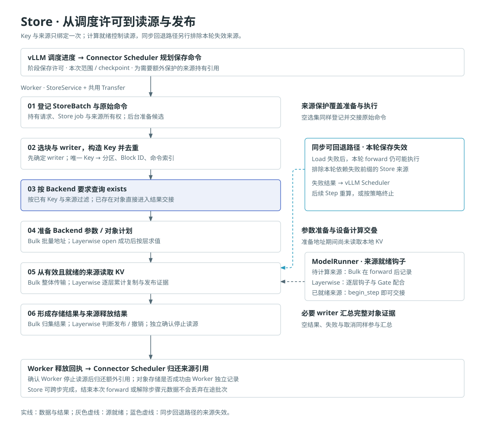
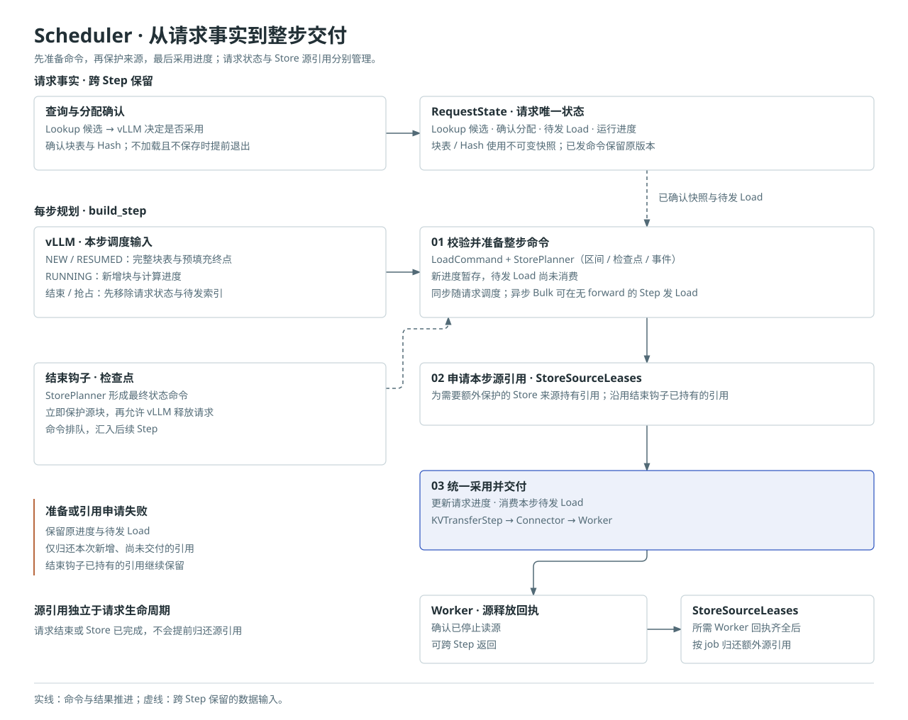

# AscendStore v1 架构与基础设施设计

AscendStore 将模型计算产生的 KV 缓存保存到外部存储，让后续请求按内容复用已有数据。Scheduler 根据请求进度与缓存分配形成命令，Worker 执行 Lookup、Load、Store 并交回结果。业务层组合基础设施提供的恢复点计算、映射、通信、执行和资源管理能力。

本文先说明整体边界，再展开 Worker 的组合关系、三条业务数据流与 Scheduler 的命令交接。地址、长度和布局示例均以字节为单位。执行器中的 **write 表示写入本地 KV，对应 Load；read 表示读取本地 KV，对应 Store**。

## 1. 总体架构



Connector 在 Scheduler 和 Worker 进程中分别实例化。查询与缓存控制通过独立 RPC 交接；Scheduler 经 vLLM Connector 元数据下发 Load / Store 命令，Worker 向框架交回 Load 完成与失败信息，并向 Scheduler 交回需要归还的 Store 源引用回执。KV 字节经 Backend 传输。

资源所有权与调用关系分开：Service / Transfer 使用 Backend，Resources 保留客户端、注册句柄及对象会话，直到业务排空并确认内存安全后才释放。

## 2. 代码结构

以下目录以 `ascend_store/v1/` 为根，省略包导出和部分辅助文件。

```text
v1/
├── connector.py                 vLLM 钩子适配、配置准入与两侧实例装配
├── protocol/
│   ├── messages.py              跨进程查询请求与应答、传输命令和来源释放回执
│   ├── outcomes.py              本地操作完成、失败与安全排空结果
│   ├── observations.py          跨 Worker 的缓存事件汇总
│   └── lookup.py                查询与缓存控制的编解码、校验和应答语义
├── scheduler/
│   ├── scheduler.py             加载候选与范围、命中采用、分配确认、每步命令交付
│   ├── state.py                 请求、分配与规划进度
│   └── store.py                 StorePlanner 规划命令，StoreSourceLeases 管理源引用
├── worker/
│   ├── worker.py                KV 绑定、钩子适配、业务生命周期
│   ├── service/
│   │   ├── lookup.py            查询与恢复证据
│   │   ├── load.py              Load 选块、组批与目标结果
│   │   └── store.py             Store 候选、writer、发布与来源结果
│   ├── transfer/
│   │   ├── bulk.py              整对象参数与传输
│   │   └── layerwise.py         KeyRange / GVA 参数、逐层传输与收尾
│   └── data/
│       ├── context.py          KV 绑定期间稳定的 TransferContext
│       ├── batch.py            LoadBatch / StoreBatch 与逐层传输计划
│       ├── selection.py        入选对象及其目标或来源归属
│       └── keys.py             查询 / 加载所需的唯一对象索引
├── infrastructure/
│   ├── configuration.py        静态配置解析与支持检查
│   ├── topology.py             本地 rank、缓存组、物理层与分区
│   ├── rpc.py                  字节帧请求应答与连接 / 线程生命周期
│   ├── coordinator.py          恢复条件、共同终点与选块掩码
│   ├── mapping.py              BlockHashMapping 与 Key / Local / Remote / Layer
│   ├── executor.py             队列与 BulkExecutor / LayerwiseExecutor
│   ├── collective.py           CollectiveGroup 与 GroupCompletion
│   └── resources.py            执行器、对象会话、注册与客户端所有权
└── backend/
    ├── interfaces.py           整对象、KeyRange、GVA 访问契约
    ├── registration.py         注册句柄与失败回滚
    ├── results.py              原生结果校验与规范化
    ├── mooncake/               Mooncake 客户端与对象会话适配
    └── memcache/               Memcache 客户端与对象会话适配
```

## 3. Worker：业务组合与数据流

### 3.1 组合关系与状态归属



`LayerTransferPlan` 保存已选对象的执行数据，`_LayerwiseStep` 保存执行器内部控制信息，都不承担额外的业务状态。步骤结束后，已提交任务的闭包仍持有所需控制记录；Service 的 pending 队列则继续持有尚未完成的 Batch，因此解除本步钩子不会丢失跨步操作。

### 3.2 Lookup：只准备查询和恢复证据



Lookup 的候选规则覆盖可能支持恢复的逻辑位置。Store 的保留策略只描述本次保存哪些块，无法描述外部存储中所有可能存在的恢复点，因此两者分别选块。

查询观察按恢复条件保留数据：

| 缓存形态 | 观察结果保留什么 |
| --- | --- |
| 连续 Full Attention | 起点、块大小和命中序列 |
| 稀疏或多缓存组 | 每个候选的起点、覆盖长度、hash 与命中证据，用于协调不同组的恢复条件 |

### 3.3 Load：对象唯一，目标不能丢



同步回退时，本次 forward 的计算范围已由调度结果确定，Worker 不会因 Load 返回失败码而就地重新排程。即使 Load 与 Store 的 token 范围不重叠，后缀 Attention 对前缀 KV 的使用仍可能把错误传播到后续层的新 KV。后续重算不会自动撤销已发布的远端对象，因此要排除本轮依赖失败前缀产生的保存。

- 单组 / 多组按模型的完整缓存组布局判断，所选传输组只是其中的子集，不能据此放宽失败策略。
- 同一请求只保留一个在途 Load。启动失败或目标写入安全未确认时，批次继续持有目标归属。
- 可回退的失败码以目标写入已停止为前提；参数或结果数量违反契约、写入安全未知的异常均上抛。

### 3.4 Store：先选合格来源，再查询和展开地址



- 范围命令从本次保存起点选块；checkpoint 命令使用指定状态块，并补齐恢复该 checkpoint 必需的 companion 块。
- 多分区需要稳定结果顺序时，排序移动的是已经绑定的 Key 与来源，结果沿命令索引交回原请求和 Store job。
- 已存在对象的成功证据来自 Backend，无需读取本次本地来源。来源失效只影响仍需读取的待写对象，记录随当前批次结束，不延续到后续重算批次。

### 3.5 三条业务与两种传输方式

三条业务保留的身份与归属不同：

| 业务 | 沿数据流保留什么 |
| --- | --- |
| Lookup | 逻辑可用性、唯一查询 Key 与必要路由 |
| Load | 唯一对象、全部本地目标、请求归属与结果槽位 |
| Store | 唯一 Key、一个合格来源及其命令索引 |

Bulk / Layerwise 与这个划分正交：两者复用同一 Service 的选块与归属，区别在传输粒度、对象访问方式和时序。

Layerwise 跨层复用 Selection、成功对象计划和可共享的层参数模板；不在每层重新生成 Key、执行存在性查询或重建请求归属。层地址和范围在对应层需要时求值。GVA 的远端基址来自本次 Backend Session，不能当成永久 Mapping 数据。

“数据只准备一次”约束的是重复推导，不是禁止扫描。Lookup 合并可用性、Store 按 exists 和来源有效性过滤候选、Layerwise 按 open 结果投影成功对象，以及完成后的失败与发布汇总，都有新的输入证据。这些阶段沿既有身份推进，不重新选块或重建归属。

### 3.6 Scheduler 与 Connector 交接



- 查询使用原始 prompt 边界；Store 按本次预填充终点区分重放与 Decode。Consumer 开启 `save_decode_cache` 后可以保存 Decode 区间，重放部分仍按预填充策略处理。
- vLLM 追加已确认的 Hash；`RequestState` 按来源和长度复用快照，增长或来源替换时重新冻结。NEW／RESUMED 核对块表后，Load 与初始 Store 复用确认后的块表。原始 group ID 表示缓存组身份，紧凑下标只用于批次内部定位。
- Load-only 不建立 Store 进度；Decode 不保存且没有状态检查点时，在转换新增块表和 Hash 前退出。来源保护、检查点和事件各自需要的准备与扫描仍然保留。
- `store_planned_end_token` 从 Lookup 已知的远端可用终点开始，随命令发出而推进，不代表 Backend 已完成保存。Store 命令区分来源已就绪与仍待本步计算；来源就绪、保存成功和来源可以释放分别判断。

Protocol 的 `messages.py` 定义跨进程交接的数据，包括 Lookup 请求与应答、传输命令和来源释放回执；`outcomes.py` 定义 Transfer、Service、Worker 与 Connector 在本地调用中使用的操作结果。Connector 将本地 Load 结果适配到框架字段：

| 框架字段 | 适用范围 | 交付内容 |
| --- | --- | --- |
| `finished_recving` | 请求级异步 Bulk | 已结束加载的请求 ID，成功与失败分别判断 |
| `failed_recving` | 请求级异步 Bulk，模型具有多个缓存组 | 加载失败的请求 ID |
| `invalid_block_ids` | 单缓存组的失败码上报 | 需要失效处理的本地 Block ID |

同步 Bulk 的 Mamba 状态准备由 ModelRunner 在加载返回后、forward 消费前完成。

启用缓存事件时，Store 命令携带本次 token 区间快照，选块时绑定事件归属；exists 与最终发布结果共同确认关联对象均可用后产生事件，再通过 Protocol 汇总各 Worker 的共同事件。

Load 耗时在批次完成后领取，Scheduler 则按当前未归还的来源引用统计等待释放的请求与块数，两者经 Connector 统计接口交给框架。结果、事件与耗时快照领取后即移出待交付队列，来源释放回执独立用于归还 Scheduler 的引用。

## 4. 基础设施

### 4.1 Configuration

Configuration 负责整体静态解析，将执行选项、缓存规格、传输粒度和并行分区整理为 Scheduler 与 Worker 共用的配置。角色与保存选项分别确定 Load / Store 能力和预填充 / Decode 的保存许可。缓存规格与粒度复用 vLLM 的解析结果，Backend 的对象格式要求转化为相应的分区约束。

Connector 先调用 Configuration 完成解析和支持检查，再装配 Scheduler 或 Worker。配置描述两侧共用的规则，不依赖某个 Worker 的进程坐标；不支持的组合在申请 Backend 资源前被拒绝。

### 4.2 Topology

Topology 基于已校验的配置，绑定当前 Worker 的实际 rank、缓存组与物理层、对象分片位置及上下文成员关系，为 Mapping 和 Worker 提供本地事实。writer 选举和对象发布由 StoreService 根据这些事实决定。

Worker 侧先完成 Topology 绑定，再申请 Backend 资源并构造 Worker。Scheduler 使用 Configuration 规划请求，无需创建本地拓扑；不同 Worker 则根据各自进程坐标得到对应的 Topology。

### 4.3 RPC

RPC 提供同步字节帧请求应答，使用 ZMQ REQ / REP。客户端由单一调用线程使用，同一连接一次只进行一个交换；服务端在持有 socket 的线程上串行执行处理回调。Protocol 适配查询与缓存重置的消息语义：查询失败或无效应答回退为未命中，重置则返回明确的成功或失败结果。

客户端延迟建连，发送和接收共用同一个截止时间。交换失败后丢弃连接并向调用方抛出异常，不自动重试；下次请求重新建连，避免迟到应答进入后续交换。Protocol 检测到无效响应时也会要求重置连接。客户端超时只结束本次等待，不能取消已经进入原生客户端的查询。

服务端的 socket 由服务线程创建、使用和关闭，启动失败通过屏障传回调用方。Connector 关闭时先等待 Lookup 服务退出，再关闭 Worker 及其 Backend 资源；等待超时则保留这些资源，允许稍后重试。服务退出保证处理回调已结束，不保证应答已送达客户端。

### 4.4 Coordinator

Coordinator 在 Token 轴上统一理解本地与外部 KV 的逻辑可用性，判断共同可恢复终点，并选择各阶段所需的逻辑块。Full Attention 依赖相应历史，滑动窗口依赖终点附近的窗口，状态缓存依赖对应位置的检查点。请求进度由 Scheduler 推进，是否采用命中也由 Scheduler 决定。

单组与多组统一使用 `Coordinator`，复用 vLLM core 的 `SpecGroup` 和注册 Manager。标准 Full Attention 在满足粒度条件时直接扫描连续命中；其他情况通过 `ExternalCachedBlockPool` 将本地已确认前缀与外部命中提供给 Manager，协调共同恢复终点。占位块只参与逻辑计算，不进入对象 key 命名。

| 阶段 | 已知条件 | Coordinator 的职责 |
| --- | --- | --- |
| Lookup | 查询上限与本地已确认前缀；查询后的外部命中 | 先选择可能支持候选终点的查询块，再根据可用性证据求各组共同支持的恢复终点 |
| Load | Scheduler 已确定的加载终点 | 选择恢复到该终点所需的逻辑块，不再求解共同终点或重复裁剪 |
| Store | 本次保存区间、预填充边界与保留策略 | 选择应保存的逻辑块，mask 从本次起始块计数 |

Lookup 的查询候选、外部实际命中和 Load 所需块是不同结果；Store 的稀疏保留规则也不能替代 Lookup 选择，否则会漏掉仍可恢复的终点。恢复终点与尾部对象边界不一致时，`ReachablePrefix` 保留读取所需的尾部 key 边界。

Coordinator 输出逻辑终点与选择掩码，不查询 Backend、不读写 KV 字节，也不计算 Tensor 地址。LookupService 执行查询；LoadService / StoreService 将选择与目标或来源绑定，由 Transfer 结合 Mapping 生成 Backend 参数。

### 4.5 Mapping

`BlockHashMapping` 绑定逻辑块与 Hash 的粒度关系，按逻辑位置配对内容 Hash 和调用方 Block ID。物理 Mapping 根据 Topology 与最终 Tensor 的 shape/stride，生成 Key、Local、Remote 和层索引，供 Load、Store 共用。

初始化时推导对象选区和连续段，运行时按 Hash、Block ID 与层区间求值。Service 负责业务选择与结果归属，Transfer 组织 Backend 参数。第 5 章说明预计算的依据、增广维度和连续段推导规则。

### 4.6 Executor

`executor.py` 将通用队列与执行控制分开。`Executor` 提供单线程 FIFO 队列：启动屏障确认线程初始化完成，提交返回 Future，关闭排空任务并回收线程。Resources 持有这些底层队列；`BulkExecutor` 和 `LayerwiseExecutor` 组合借用它们，Transfer 不直接操作底层 Executor。

`BulkExecutor` 负责整体操作的提交以及读源就绪交接。提交 Store 时创建的 `source_ready` 是 `Future[Event]`：Future 等模型钩子交来事件，事件再证明此前的设备写入已完成。Worker 提供记录设备事件的回调，Transfer 在合适的钩子调用执行器完成交接；后台先准备参数，真正读源前再同步该事件。已就绪来源可以在开始本步时记录，普通 Bulk 来源在保存收尾钩子记录。它不是 Layerwise Gate，也不表示 Store 完成；空选集无需等待不存在的读取。

`LayerwiseExecutor` 收拢本步的逐层调度、预取窗口、计算开始 Gate、Future、read 提交去重与收尾。模型钩子由调用线程推进，后台操作在借用的串行队列上执行；Transfer 提供实际复制与收尾回调。Service 只接收批次结果，不参与逐层推进。

预取分别记录提交位置和领取位置。例如 write 顺序为 `[2, 5, 9, 12]`，窗口深度为 2，首次等待层 2 时提交层 2、5；下一次等待层 5 时补交层 9。层 5 在后台完成不会自动推进模型的领取位置。相同物理层的重复钩子保持幂等。后续预取等待当前层的计算开始 Gate，源就绪事件则约束 Store 实际读源。当前 KeyRange 多缓存组路径在计算开始回调记录读源就绪，其余按保存钩子记录；重复钩子不会再次提交同一层。Gate、源就绪和复制完成不能互相替代。

结束步骤时执行器停止推进、取消尚在等待的 Gate，并封口 read、安排剩余收尾；已提交任务持有其控制记录直到完成。中止不能打断已经进入原生调用的复制或设备事件等待。`end_step` 不关闭底层队列，也不以本步控制记录解除来宣告跨步 Store 完成。

### 4.7 Resources

`Resources` 持有执行器、Backend 对象会话、内存注册句柄和客户端，并保留 KV Tensor 引用。Worker 持有 TransferContext、Service 和 Transfer；逐层控制由 LayerwiseExecutor 持有。

绑定时，Resources 先保留 KV Tensor，并按真实 view 的地址跨度计算注册范围；Worker 绑定 TransferContext，从 Tensor 构建分区与段布局并装配 Transfer 和 Service，再由 Resources 注册 buffer、启动执行器。共享 storage 的多个 view 合并覆盖范围，空 view 被跳过。注册范围包含访问跨度中的 padding，Mapping 的段长度只包含有效载荷。

关闭从 Worker 的业务收尾开始：领取结果，检查 Store 读源与 Load 写目标的安全状态，并排空、停止执行器。只有安全状态已确认，才继续释放底层资源。Resources 随后依次关闭对象会话、执行额外清理（例如发布协调组）、释放注册句柄、关闭 Backend，最后放掉 Tensor 引用。

清理遇到失败即停止后续资源释放，保留句柄和相关引用供重试；全部清理成功后才放掉 Tensor 引用。原生调用异常导致读源状态未知时，Worker 还需保留安全状态；仅有 Future 结束或 Python 线程退出，无法证明设备和客户端已停止访问该内存。

### 4.8 Backend

整对象接口用 key 和本地地址段传输完整对象。KeyRange 接口用 key、对象大小和对象内偏移访问部分字节。GVA 接口先通过对象会话取得受保护的远端地址，再按本地地址、远端地址和长度复制。当前 Mooncake Layerwise 使用 KeyRange，Memcache Layerwise 使用 GVA。

Mooncake 的普通 TransferEngine 路径由 v1 Backend 持有进程级引擎和注册表，与旧 Connector 的全局引擎隔离。多个 v1 客户端注册同一地址和大小时共享引用，最后一个注册句柄释放时才注销内存；失败的回滚或注销保留句柄供重试。引擎初始化复用上游 `GlobalTE` 的失败策略，原生初始化失败后需要重启进程。使用 Store 独立引擎或 fabric memory 的路径仍按各自原生契约处理。

Backend 实现原生客户端调用、内存注册、对象保护和结果规范化。Layerwise Transfer 累计各层复制证据，StoreService 根据来源有效性和对象完整性决定 commit 或 revoke，再由 Transfer 调用 Backend Session。commit 发布完整对象；revoke 撤销未完成写入，其完成确认取决于原生接口提供的所有权保证。

同步 Store 正常返回时，接口保证本地来源读取已经结束，返回的失败码仍可以表示某些对象写入失败。异常缺少这一完成保证，调用者需要保留未知状态。远端发布和本地读源结束分别记录，避免用其中一个状态代替另一个。

### 4.9 Collective

`collective.py` 在同一文件提供 `CollectiveGroup` 与 `GroupCompletion`。前者管理专用 Gloo 组和 `all_gather`，后者接受必要参与者集合，汇总不透明的条目标识与身份，只返回必要参与者全部完成且身份一致的本地条目。

这两个组件不认识 Store、GVA、writer、远端地址或发布策略。StoreService 根据实际拓扑选择 writer，并将 Key 与分配身份交给 GroupCompletion，再解释汇总结果。所有通信成员必须以相同次序进入各轮，包括空报告；通信组必须在在途操作排空后才能关闭。

## 5. Mapping

### 5.1 逻辑映射：BlockHashMapping

`BlockHashMapping` 将逻辑 Token 位置对应到内容 Hash 和调用方提供的本地 Block ID。逻辑块大小与 Hash 粒度在初始化时确定，因此可以提前绑定每块包含的 Hash 数量，以及完整块末尾 Hash 的相对位置。

例如，一个逻辑块包含 128 Tokens，Hash 粒度为 64 Tokens，每块对应两个 Hash，使用其中第二个标识完整块：

| 逻辑块 | Token 区间 | 前缀中的 Hash | 完整块 Hash | 本地 Block ID |
| --- | --- | --- | --- | --- |
| 0 | `[0, 128)` | `h0, h1` | `h1` | 7 |
| 1 | `[128, 256)` | `h2, h3` | `h3` | 11 |

| 初始化时绑定 | 运行时提供与求值 |
| --- | --- |
| 逻辑块大小、Hash 粒度、每块 Hash 数量、末尾 Hash 的相对位置 | 本次 Hash 序列、Block ID 表、选择范围和尾部边界；输出逻辑位置、Hash、Block ID 的配对 |

本地块表可以只保留后缀。例如上表的块表缩为 `[11]` 时，仍按完整前缀中的逻辑位置与 `h3` 配对。Load 的恢复终点可能位于已存储对象内部，命令保留该尾部对象的 Key 边界，用它定位 Hash；Store checkpoint 则按精确状态边界取得 Hash，并绑定指定来源块。

Lookup 使用 Hash 范围枚举能力；Load、Store 在选中块时完成 Hash、Block ID 和请求归属的绑定。保存掩码、writer 选择等业务规则由 Service 决定。

### 5.2 物理映射：三份数据与求值公式

物理 Mapping 将一个对象的选中字节组织成连续段，每段都可以通过起始地址和长度访问。绑定结果分为 Key、Local、Remote：

| 数据 | 表达什么 | 绑定结果 |
| --- | --- | --- |
| Key | 对象身份 | 各分区的命名前缀与后缀 |
| Local | 本地选中字节的位置 | 每段在 Block 0 的基址、逻辑块步长和有效长度 |
| Remote | 字节在远端对象中的位置 | 完整对象大小与各段的对象内字节偏移 |

每个原始缓存组独立绑定。模型、缓存规格和本地并行信息确定后，`PartitionId = (PP rank, DCP rank, head/TP rank)` 标识该组的一个分区，内容 Hash 再标识分区中的对象。对齐状态缓存使用 TP rank 作为第三项。Key 与 Local 按 PartitionId 索引；同一 PP 的 head 分区共享段长度、块步长、层索引和 Remote 偏移，Remote 与层索引按 PP rank 保存。

对选中的第 $i$ 个对象，令 $h_i$ 为内容 Hash，$b_i$ 为本地 Block ID；对对象内第 $j$ 段，令 $\beta_j$ 为 Block 0 基址、$\sigma_j$ 为逻辑块步长、$\ell_j$ 为有效长度、$o_j$ 为远端对象内偏移。$G_i$ 是本次 Backend Session 提供的 GVA 对象基址，$\Vert$ 表示字符串拼接。地址、步长、长度和偏移均以字节计：

$$
\begin{aligned}
\mathrm{Key}_i &= \mathrm{prefix} \Vert h_i \Vert \mathrm{suffix} \\
\text{本地地址}_{ij} &= \beta_j + b_i \sigma_j \\
\text{复制长度}_j &= \ell_j \\
\text{GVA 地址}_{ij} &= G_i + o_j
\end{aligned}
$$

KeyRange 直接使用对象内偏移 $o_j$。Local 与 Remote 按同一段序对应，Layer 表记录每层在该序列中的半开索引区间，例如第 0 层占 `[0:2]`、第 1 层占 `[2:4]`。

### 5.3 从全集选取子集与提前计算

完整 KV Tensor 包含本 Worker 的所有本地缓存块。Topology 先确定每个对象的层、head 和上下文分区，Spec 再确定一个逻辑块覆盖的存储范围：

| 切分 | 对象包含的子集 | Mapping 使用的事实 |
| --- | --- | --- |
| PP / layer | 目标 PP 区间内的模型层 | 实际物理层及其目标 PP 归属 |
| TP / head | 本地全部 heads，或 TP mismatch 下的一份 head 子集 | 每个本地 rank 对应的对象分区数量 |
| CP / Token | 对应上下文分片的 Tokens | 上游完成 DCP 切分后的本地 Tensor、实际 DCP 身份与远端槽位；PCP 沿用本地 Tensor 选区 |

```text
完整 KV Tensor
    → 按目标 PP 选择本地层
    → 按对象分区选择 head 范围
    → 按逻辑块大小确定块内 Kernel Block 范围
    → 得到一个逻辑块在该分区内的字节选区
```

一次绑定期间，Tensor 的 shape、stride、分量相对位置和对象分区固定。同一分量的选区随 Block ID 整体平移，选中字节之间的相对距离保持不变。因此可以在 Block 0 上推导连续段，再为每段保留逻辑块步长；各分量的步长由各自 Tensor 决定。

例如每个逻辑块选中 32 字节，相邻逻辑块起点相距 40 字节，绑定结果就是长度 32、步长 40。传输 Block 7 时只需将起点平移 `7 × 40` 字节。同一 head 分区在各逻辑块上的段数、长度和对象内偏移均可复用。

对已绑定分区模板的位置与身份求值，动态输入是 Block ID 和 Hash。业务提供本次选择的块与层范围，Transfer 据此选择已有模板；GVA 的远端基址由本次对象会话提供。几何推导使用 `register_kv_caches` 交来的最终 Tensor 元数据，`data_ptr()` 已包含 view 的 storage offset。普通 Attention 按 Token 数确定 Kernel Block 数量，压缩缓存按 Spec 换算对应的存储大小。

### 5.4 增广维度与布局描述

Mapping 将物理 Tensor 的维度扩充为同时包含对象坐标和内容坐标的**增广维度**。一个维度的拆分遵循同一索引关系：

```text
原维度：shape = [a × b]，stride = [s]
拆分后：shape = [a, b]，stride = [b × s, s]

原索引 = 外层索引 × b + 内层索引
```

例如，640 Token 的逻辑块包含五个 128 Token Kernel Blocks，Kernel Block 轴拆成“逻辑块、块内 Kernel Block”；8 个 heads 分成两个对象分区时，head 轴拆成“head 分区、分区内 head”。将对象坐标移到前两维，并补上元素内字节维度，得到：

```text
原维度：
[Kernel Block, Token, head, head_size]

增广维度：
[逻辑块, head 分区, 块内 Kernel Block, Token, 分区内 head, head_size, 元素内字节]
 └─ 对象坐标 ──┘  └────────────────── 内容维度 ──────────────────┘
```

增广描述沿用实际物理 stride，拆出的外层 stride 等于原 stride 乘以内部数量。float16 的元素内字节维度大小为 2、stride 为 1。每个分量最终表示为 `_Layout(offset, shape, strides)`，其中 offset 相对同一 storage 分组中首个分量的起点计算，strides 统一使用字节单位。以下术语用于描述推导过程：

| 术语 | 含义 |
| --- | --- |
| 逻辑对象 | 由 Key 标识的内容，可以包含多个分量和连续段 |
| 分量 | 输入的一个 Tensor view，例如 K、V 或状态 Tensor |
| 对象坐标 | Layout 的前两维：逻辑块、head 分区；确定正在访问哪个对象实例 |
| 内容维度 | 固定对象坐标后，用于枚举该对象所选字节的其余维度 |
| Layout | 一个由相对偏移、shape 和 strides 指定的规则字节选区，可以包含间隔 |
| Layout 集合 | 多个 Layout 的选中字节共同组成的选区 |
| 连续段 | 固定对象坐标后，可通过一个起点和长度访问的连续字节区间 |

初始 Layout 描述一个分量；合并后的 Layout 可以包含多个分量；最终每个 Layout 描述一段连续字节及其随对象坐标的平移关系。对象坐标在推导期间保持符号形式，内容维度参与折叠与展开。

同一层的分量按底层 storage 分组，在组内按相对偏移分析接续关系。对象字节顺序依次采用物理层顺序、独立 storage 的声明顺序、同一 storage 内 Block 0、head 分区 0 的选中字节地址顺序。其他对象沿用该段序，各段按自身的对象坐标步长平移。相同的相对 shape/stride 布局共享几何缓存，后续层用各自基址绑定完整段模板。

### 5.5 分量维度与连续段推导

Mapping 先把分量之间的平移或接续关系表达为内容维度，再由同一个维度折叠循环处理。合并限定在同一层、同一 storage 中，对象坐标的 shape 与 strides 保持一致：

| 分量关系 | 维度操作 |
| --- | --- |
| 两个 Layout 规范化后的 shape/strides 相同，起点相差固定的字节距离 | 新增大小为 2 的分量轴，以起点距离为 stride |
| 两个 Layout 规范化后沿一个内容轴接续，其余轴相同 | 将该轴的大小相加；缺少的轴按大小 1 对齐 |
| 其他关系 | 保留各自 Layout，分别展开为有序字节区间 |

新增分量轴也可以带有间隔。多个等距分量通过扩展该轴表示；不同大小的分量沿可接续的内容轴合并。每次形成的新维度都交给 `fold` 化简。组合后按 stride 规范化，再逐轴检查：每个重复轴的 stride 必须不小于其内层选区的地址跨度，使下一份内层选区从前一份末尾或之后开始。满足时可按维度顺序展开；否则保留原来的多个有序流。

对于按 stride 从小到大排列的相邻内容轴，设内层大小为 `n`、stride 为 `s`，外层大小为 `m`、stride 为 `t`。当 `t = n × s` 时，两轴合成大小 `n × m`、stride 为 `s` 的一轴：

```text
外层索引 × (n × s) + 内层索引 × s
    = (外层索引 × n + 内层索引) × s
```

分量、Token、head、Kernel Block 轴都使用这个条件。stride 为 1 的折叠轴表示连续字节；stride 大于 1 的折叠轴保留等距间隔。对象坐标始终位于前两维，参与分量平移关系的比较，内容轴参与折叠。

| 操作 | 处理范围 | 表示上的变化 | 保持的内容 |
| --- | --- | --- | --- |
| `fold` | 一个 Layout 的内容维度 | 按 stride 从小到大合并满足 `t = n × s` 的相邻轴 | 该 Layout 选中的字节集合 |
| `join` | 两个 Layout 之间 | 新增分量轴或扩展一个内容轴，随后折叠得到的 Layout | 两个 Layout 选中字节的并集 |
| `expand` | 一个 Layout 尚存的内容重复维度 | 枚举剩余坐标，生成地址有序的连续段 Layout，保留对象坐标 | 展开前后选中字节的并集 |

`_storage_segments` 在同一层、同一 storage 的 Layout 集合上按以下顺序执行：

```text
各分量的增广 shape/stride
          │
          ▼
fold：化简单个 Layout
          │
          ▼
join：新增分量轴或扩展内容轴
  每次组合后 fold，并继续尝试组合
          │
          ▼
已化简为一个连续段？
    ├─ 是 → 直接输出 ─────────────────────────┐
    │                                         │
    └─ 否 → 展开 → 有序归并 → 接续相邻字节段 ──┤
                                              ▼
                                 缓存完整的相对段模板
                                              │
                                              ▼
                                 绑定基址，生成地址表
```

展开后的接续条件是前一段末尾等于后一段起点，且对象坐标的平移关系一致。即使只剩一个带间隔的 Layout，重复边界也可能出现接缝，因此同样经过这一步。每一步保持选中字节相同，变化的是维度和 Layout 的数量。

#### 共享 K/V：合并后继续折叠

取一个小型 Attention 布局：每个逻辑块包含 4 Tokens，每个 Kernel Block 包含 2 Tokens，2 heads、head size 为 2、float16。一份 Kernel Block 的 K 占 `2 × 2 × 2 × 2 = 16` 字节，V 同样占 16 字节。本地共三个逻辑块，只有一个 head 分区，K/V 共享 storage：

```text
逻辑块 0：K0 [0,16)  V0 [16,32)  K1 [32,48)  V1 [48,64)
逻辑块 1：K2 [64,80) V2 [80,96)  K3 [96,112) V3 [112,128)
逻辑块 2：从偏移 128 开始，重复相同布局
```

K、V 的 Tensor shape 都是 `[6,2,2,2]`，字节 strides 都是 `[32,8,4,2]`，起点偏移分别为 0、16。下面的 shape 前两维始终为逻辑块、head 分区；单个 head 分区的 stride 记为 0。

| 阶段 | offset | shape | 字节 strides |
| --- | --- | --- | --- |
| 初始 K | 0 | `[3,1,2,2,2,2,2]` | `[64,0,32,8,4,2,1]` |
| 初始 V | 16 | `[3,1,2,2,2,2,2]` | `[64,0,32,8,4,2,1]` |
| 分别 fold | K 为 0，V 为 16 | `[3,1,2,16]` | `[64,0,32,1]` |
| join 引入分量轴，fold 前 | 0 | `[3,1,2,2,16]` | `[64,0,16,32,1]` |
| 再次 fold | 0 | `[3,1,64]` | `[64,0,1]` |

第一次 fold 得到 K、V 在每个 Kernel Block 内各自连续的 16 字节。join 引入大小为 2、stride 为 16 的分量轴，位于内容维度开头。fold 按 stride 排列内容轴，在同一个循环中先将分量轴与字节轴折叠成 32 字节，再将 Kernel Block 轴折叠成 64 字节，最终直接输出一段。

若每个 Kernel Block 的 K/V 后有 8 字节 padding，重复步长变为 40。分量轴折叠后的 shape 为 `[3,1,2,32]`、strides 为 `[80,0,40,1]`，最终展开成偏移 0、40 的两段，每段 32 字节。有效长度与逻辑块步长分别保留，padding 留在选区之外。

#### 不同重复模式：展开后接续

两个共享 storage 的状态分量使用 uint8，每个逻辑块的起点步长为 160 字节。A 的 Tensor shape/strides 为 `[3,2,4]` / `[160,16,1]`，offset 为 0；B 为 `[3,12]` / `[160,1]`，offset 为 4。各自 fold 后：

| Layout | offset | shape | 字节 strides | Block 0 的选中字节 |
| --- | --- | --- | --- | --- |
| A | 0 | `[3,1,2,4]` | `[160,0,16,1]` | `[0,4)`、`[16,20)` |
| B | 4 | `[3,1,12]` | `[160,0,1]` | `[4,16)` |

A 有两次重复，B 只有一份连续字节，需分别展开内容维度。按偏移归并后，接续关系变得直接：

```text
A 的第一段 [0,4) → B [4,16) → A 的第二段 [16,20)
                  接缝归并 → [0,20)

结果：offset = 0，shape = [3,1,20]，strides = [160,0,1]
```

整个过程保留逻辑块维度。每个实际 Block ID 都使用同一份 20 字节段模板，在自身起点上求值。新增分量轴后的 Layout 也可能存在接缝：例如 `[2,2,4]`、strides 为 `[12,8,1]` 的内容选区展开为 `[0,4)`、`[8,12)`、`[12,16)`、`[20,24)`，接缝归并后保留三段。

### 5.6 绑定结果的使用

绑定结束后，Context 保存只读数值数组和对象大小；相同的段长度与块步长用单元素数组共享。Bulk 和 KeyRange 的长度列表在 Transfer 初始化时准备，GVA 直接使用数组，同一 PP 的 head 分区复用长度与偏移模板。Resources 保活 Tensor 存储，重新分配后重新绑定。

| 传输方式 | 使用绑定结果的方式 |
| --- | --- |
| Bulk | 选择对象的完整 Local 段序列，按 Key 传输 |
| Layerwise / KeyRange | 根据 Layer 索引选择本层段，沿用其在完整对象中的 Remote 偏移 |
| Layerwise / GVA | 选择本层段，在 Remote 偏移上叠加本次对象会话基址；对象布局包含配置确定的全局层预留、上下文槽位和对齐 |

Service 提供已绑定 Key 与归属的 Selection，Transfer 按所选 Block ID 批量计算地址并组织参数，Backend 执行复制并管理对象会话。Lookup 的 Key 模板按完整远端分区集合建立，可以查询本 rank 以外的分区。

Key 沿用 `PoolKey` 或 Backend 的命名规则。读写端按生产部署约束保持传输方式与缓存布局一致，允许不同 TP 分区数量以相同字节顺序表达同一对象。对象字节顺序调整时，两端一起升级，并清理受影响缓存或使用新的 cache namespace。

## 6. 时序、发布与资源生命周期

### 6.1 来源安全与目标安全

Store 读取本地 KV 需要内容有效且设备写入已完成。来源有效性来自业务结果，源就绪事件来自模型钩子，事件完成本身不证明加载成功。读取开始后，Backend 的完成证据确认停止读源，Scheduler 的引用和 Worker 的 fence 再约束后续回收或覆盖。

普通 Full Attention 请求存活期间，manager 保留相关缓存块。请求结束或抢占后，Worker 在模型可能复用这些块之前等待相关 Store。对于请求存活期间就可能回收页面的 manager，以及需要保护的 checkpoint 来源，Scheduler 额外持有引用，并等待预期 Worker 的来源释放回执。

正常 Step 只收集已完成结果，必要时等待即将复用来源所涉及的批次。全存在、无候选或未开始 IO 的 Store 也需要完成原始命令的结果与释放交接。原生调用异常且无法确认已停止读源时，保留批次与来源保护，阻止危险复用。Load 对本地目标有对称约束：写入安全未知时不能释放目标资源或将异常当普通未命中。

### 6.2 共享对象发布

Memcache GVA 的共享对象可能由多个 rank 写入。StoreService 根据实际 `ContextRank` 成员关系识别副本，每组副本选择最小 global rank 作为 writer。存在多个对象分片时，使用覆盖相关成员的 CollectiveGroup 汇总；成员集合来自实际拓扑，不凭 rank 算术推定。

发布条件是必要 writer 的来源有效、各必要层复制完成，且远端分配身份（地址与大小）一致。GroupCompletion 返回一致完成的 Key，StoreService 据此选择 commit。来源失效后，Layerwise 停止该对象后续层的读取，未完成对象进入撤销收尾。非 writer、空结果和失败的成员同样参与本轮汇总；预留空间中的空闲槽位不虚构 writer。

对象打开、复制、发布和撤销分别保留完成证据。原生接口无法确认安全撤销或撤销失败时，Session 继续持有未确认的对象，供后续清理。远端对象是否发布和本地来源是否停止被读分别决定对象会话与本地内存的释放。

### 6.3 绑定、步骤结束、重置与关闭

绑定 KV 时，Resources 先保留 Tensor；Worker 建立 TransferContext、Transfer 和 Service，再注册有效跨度并启动执行队列。失败时按已取得的资源逆向清理，不能先丢 Tensor 引用再排空可能访问它的任务。

结束一步只结束本步控制关系，异步 Load 与跨步 Store 仍由 Service 的 pending 批次持有。没有 forward 的空步骤也收集先前提交的异步完成和来源释放回执，再清除元数据。Layerwise 先停止新增层操作、安排完成回调，再允许批次被最终领取。钩子异常和 forward 异常均触发中止，保留原异常及已提交任务的安全状态，关闭时继续排空；框架的 finally 收尾路径不再发起正常保存。

缓存重置在暂停调度、没有活动步骤、在途 Load 或未归还来源引用时执行。Scheduler 在发出重置请求前清除旧恢复候选；Worker 等待 Store 停止读源，清空待交付缓存事件，再调用 Backend 清理缓存。执行队列、注册和业务准入继续保留，后续请求可以重新查询和传输。应答失败时无法确认远端是否已执行，旧候选保持失效，调用方得到失败结果。当前 Mooncake Bulk 支持该操作，Mooncake Layerwise 返回拒绝，其他 Backend 返回不适用。

关闭按以下依赖推进：

1. Connector 先关闭 LookupServer，确认服务线程不再调用 Worker；超时则保留 Worker 与 Backend，稍后重试。
2. Worker 停止接受业务提交，结束或中止当前逐层控制，封口并排空已提交 Load / Store，检查目标写入与来源读取是否都已停止。
3. Resources 停止执行队列，再关闭 Backend 对象 Session、Collective 等附加资源、内存注册句柄和 Backend 客户端，最后释放 Tensor 引用。

某一步清理失败就保留仍受其依赖的句柄和引用。Future 已结束、线程已退出都不足以证明原生访问已结束；安全未知时不能继续释放底层内存。

## 7. 关键约束的验证

验证重点是身份、字节、结果与安全边界。测试不以私有辅助函数的调用次数或中间对象形状作为业务正确性的替代。

| 要验证的关系 | 现有测试入口 | 主要检查 |
| --- | --- | --- |
| 配置准入与直接装配 | `test_configuration_support.py`、`test_connector_construction.py` | 不支持组合先拒绝、角色装配、构造失败清理 |
| Configuration | `infrastructure/test_configuration.py` | 配置解析、原始组身份与分区规则 |
| Topology | `infrastructure/test_topology.py` | 本地 rank、PP 范围与实际上下文成员 |
| 逻辑 hash 与 Block ID | `worker/test_block_hash_mapping.py` | 不同粒度、加载起点、尾部边界与调用方块表 |
| Key / Local / Remote / Layer | `infrastructure/mapping/test_mapping.py`、`test_partition_bindings.py`（同目录） | 分区、非连续 view、段序、对象偏移与预留 |
| 分量合并与对象字节顺序 | `infrastructure/mapping/test_object_layout.py` | 物理轴序、padding、分量接续、最小段数与独立 TP 消费端回写 |
| 三条业务的数据流 | `worker/test_data_flow.py`、`test_store_candidates.py`、`test_single_preparation.py`（同目录） | Lookup 新 Key、重复目标、writer 筛选、exists 过滤与归属保留 |
| Scheduler 规划与来源保护 | `scheduler/test_scheduler.py`、`test_source_leases.py`（同目录） | 候选采用、快照有效期、整步发布、失败撤销、空步骤 Load 与跨请求生命周期的源引用 |
| Scheduler / Worker 接口契约 | `test_dataflow_contracts.py` | 候选有效期、V1 / V2 恢复入口、阶段许可、分组失败交付、加载失败到 Store 来源失效及重算恢复 |
| 实际参数与字节一致性 | `worker/test_equivalence.py`、`test_layerwise_bytes.py`（同目录） | 对照基准、整对象 / 逐层重组、KeyRange / GVA 字节 |
| 串行队列与逐层时序 | `infrastructure/test_execution.py`、`test_layerwise_executor.py`、`test_attention_gate.py`（同目录） | 提交 / 领取分离、Gate 取消、封口、重复钩子与收尾 |
| Lookup 契约与 RPC | `protocol/test_lookup.py`、`infrastructure/test_rpc.py` | 消息校验、失败回退、连接重建与线程退出 |
| 集成与空步骤 | `test_connector_integration.py`、`test_connector_lifecycle.py` | 异步完成只交付一次、无 forward、异常收尾与关闭顺序 |
| 消费、观测与缓存控制 | `test_dataflow_contracts.py` | 同步加载后的模型状态准备、按对象可用证据产生事件、统计领取、RPC 重置与后续请求准入 |
| 注册与关闭所有权 | `infrastructure/test_resources.py`、`worker/test_worker.py` | 绑定与注册顺序、失败保留、内存安全未知时禁止释放 |
| 共享对象发布 | `worker/test_gva_writers.py`、`infrastructure/test_collective.py` | writer 完备性、空报告、失败及分配身份分歧 |

路径相对于 `tests/ut/distributed/ascend_store/v1/`。CPU 字节模拟与单元测试验证数据和状态约束；CollectiveGroup 的通信调用使用 mock，多 writer 汇总使用线程与屏障模拟各 rank。真实 Gloo 多进程通信、原生 Backend 和 NPU 的设备事件、注册范围、读写完成、地址保护及发布语义仍需对应环境验证，不能由这些 CPU 结果代替。
