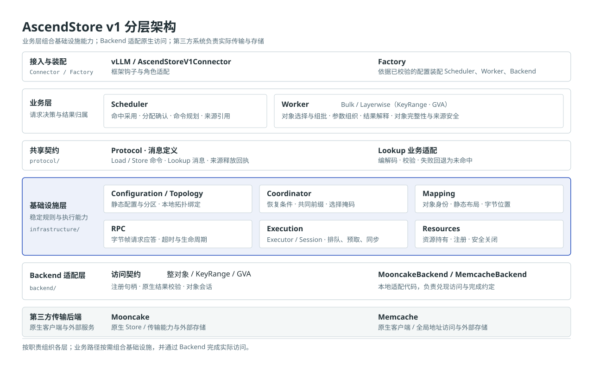
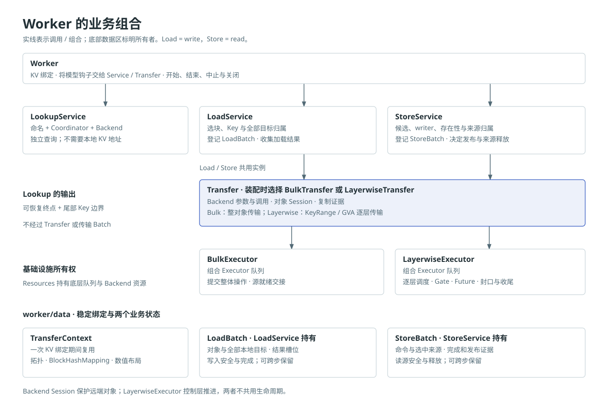
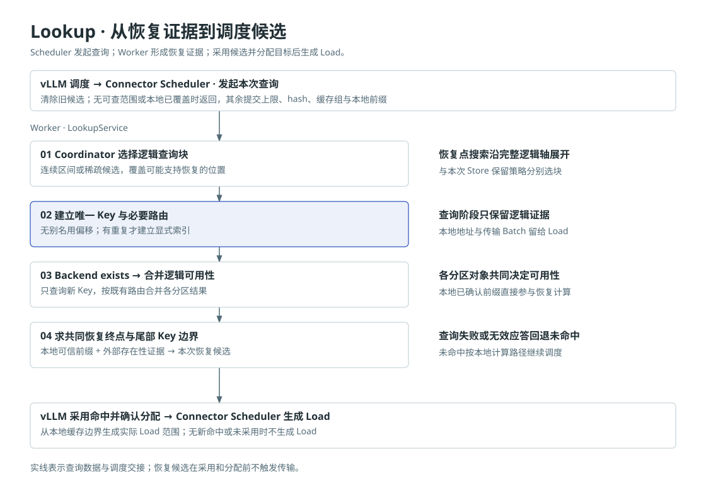
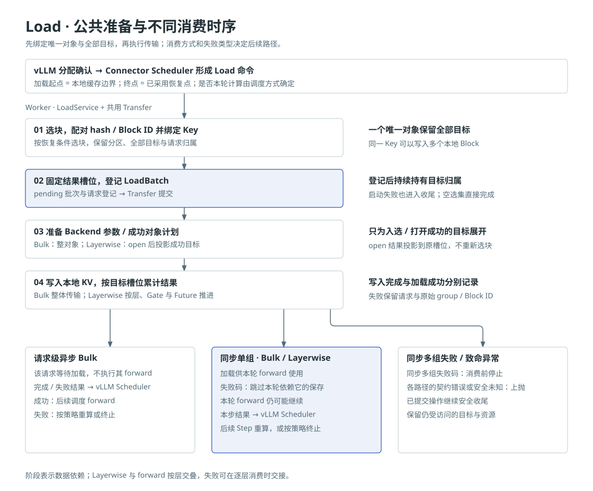
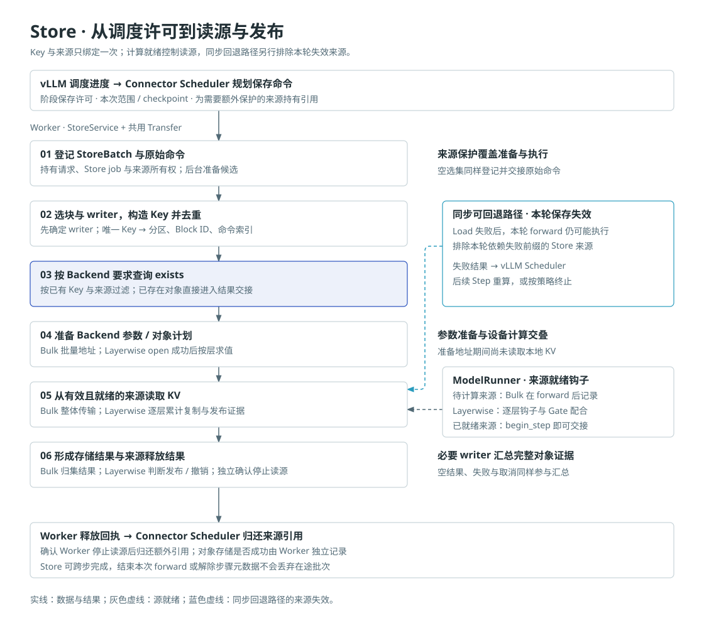
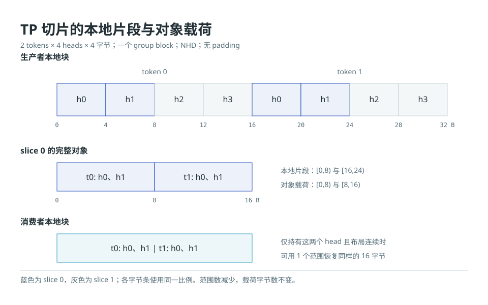

# AscendStore v1 架构与基础设施设计

AscendStore 将模型计算产生的 KV 缓存保存到外部存储，让后续请求按内容复用已有数据。Scheduler 根据请求进度与缓存分配形成命令，Worker 执行 Lookup、Load、Store 并交回结果。业务层组合基础设施提供的恢复点计算、映射、通信、执行和资源管理能力。

本文先说明整体边界，再展开 Worker 的组合关系与三条业务数据流。地址、长度和布局示例均以字节为单位。执行器中的 **write 表示写入本地 KV，对应 Load；read 表示读取本地 KV，对应 Store**。

## 1. 总体架构



Connector 在 Scheduler 和 Worker 进程中分别实例化。Lookup 通过独立 RPC 查询；Load / Store 命令与完成信息通过 vLLM Connector 元数据交接，KV 字节经 Backend 传输。

资源所有权与调用关系分开：Service / Transfer 使用 Backend，Resources 保留客户端、注册句柄及对象会话，直到业务排空并确认内存安全后才释放。

## 2. 代码结构

以下目录以 `ascend_store/v1/` 为根，省略包导出和部分辅助文件。

```text
v1/
├── connector.py                 vLLM 钩子适配、配置准入与两侧实例装配
├── protocol/
│   ├── messages.py              命令、Lookup 消息与来源释放回执
│   ├── results.py               Load / Store 完成与安全排空结果
│   └── lookup.py                Lookup 编解码、校验与未命中回退
├── scheduler/
│   ├── scheduler.py             命中采用、分配确认、每步命令规划
│   ├── lookup.py                请求侧恢复候选与实际加载范围
│   ├── state.py                 请求、分配与规划进度
│   └── source_leases.py         需要额外保护的 Store 来源引用
├── worker/
│   ├── worker.py                KV 绑定、钩子适配、业务生命周期
│   ├── service/
│   │   ├── lookup.py            查询与恢复证据
│   │   ├── load.py              Load 选块、组批与目标结果
│   │   └── store.py             Store 候选、writer、发布与来源结果
│   ├── transfer/
│   │   ├── bulk.py              整对象参数与传输
│   │   └── layerwise.py         KeyRange / GVA 参数、逐层传输与收尾
│   └── data/
│       ├── context.py          KV 绑定期间稳定的 TransferContext
│       ├── batch.py            LoadBatch / StoreBatch 与逐层传输计划
│       ├── selection.py        入选对象及其目标或来源归属
│       └── keys.py             查询 / 加载所需的唯一对象索引
├── infrastructure/
│   ├── configuration.py        静态配置解析与支持检查
│   ├── topology.py             本地 rank、缓存组、物理层与分区
│   ├── rpc.py                  字节帧请求应答与连接 / 线程生命周期
│   ├── coordinator.py          恢复条件、共同终点与选块掩码
│   ├── mapping.py              BlockHashMapping 与 Key / Local / Remote / Layer
│   ├── executor.py             队列与 BulkExecutor / LayerwiseExecutor
│   ├── collective.py           CollectiveGroup 与 GroupCompletion
│   └── resources.py            执行器、对象会话、注册与客户端所有权
└── backend/
    ├── interfaces.py           整对象、KeyRange、GVA 访问契约
    ├── registration.py         注册句柄与失败回滚
    ├── results.py              原生结果校验与规范化
    ├── mooncake/               Mooncake 客户端与对象会话适配
    └── memcache/               Memcache 客户端与对象会话适配
```

## 3. Worker：业务组合与数据流

### 3.1 组合关系与状态归属



`LayerTransferPlan` 保存已选对象的执行数据，`_LayerwiseStep` 保存执行器内部控制信息，都不承担额外的业务状态。步骤结束后，已提交任务的闭包仍持有所需控制记录；Service 的 pending 队列则继续持有尚未完成的 Batch，因此解除本步钩子不会丢失跨步操作。

### 3.2 Lookup：只准备查询和恢复证据



- 连续 Full Attention 的观察结果只需起点、块大小和命中序列；稀疏或多组路径还保留每个候选的起点、覆盖长度与 hash，以表达不同恢复条件。
- 一个逻辑块可能对应多个远端分区，各分区的对象都存在才算可用；本地已确认前缀直接作为恢复证据参与计算。
- Store 的保留策略只决定本次保存哪些块，不能描述外部存储中所有可能存在的恢复点。因此 Lookup 使用自己的候选规则。

### 3.3 Load：对象唯一，目标不能丢



- 同一请求不能同时登记两次在途 Load。登记后即使启动失败，Service 仍持有目标归属，关闭时能够继续检查写入是否停止。
- 单组失败只有在目标写入已结束且框架支持失效重算时才可回退。当前多缓存组的部分加载失败缺少同等回退契约，因此上抛；参数或结果数量错误、写入安全未知也不能当作普通未命中处理。

### 3.4 Store：先选合格来源，再查询和展开地址



- 范围命令从本次保存起点选块；checkpoint 命令使用指定状态块，并补齐恢复该 checkpoint 必需的 companion 块。
- 多分区需要稳定结果顺序时，排序移动的是已经绑定的 Key 与来源。来源中的命令索引用于将结果交回原请求和 Store job，不需要另建反向索引。
- 共享汇总要求参与者进入相同轮次。没有数据或准备失败的成员也发送报告，是为了让其他成员能结束本轮，并判断必要 writer 的证据是否齐全。

### 3.5 三条业务与两种传输方式

三条业务需要的数据不同，不能为了统一流程而全部展开成一套对象行。Lookup 需要逻辑可用性；Load 需要唯一对象及所有目的地；Store 需要唯一 Key 及选中的来源。Bulk / Layerwise 与这个划分正交：两者复用同一 Service 的选块与归属，区别在传输粒度、对象访问方式和时序。

Layerwise 跨层复用 Selection、成功对象计划和可共享的层参数模板；不在每层重新生成 Key、执行存在性查询或重建请求归属。层地址和范围在对应层需要时求值。GVA 的远端基址来自本次 Backend Session，不能当成永久 Mapping 数据。

“数据只准备一次”约束的是重复推导，不是禁止扫描。必须保留的扫描包括 Lookup 合并可用性、Store 根据 exists 结果过滤候选、Layerwise 根据 open 结果投影成功对象，以及完成后的失败与发布汇总。这些阶段有新的输入证据，沿既有身份推进；没有新信息时不应再次拆分、合并或重建归属。

### 3.6 Scheduler 与 Connector 交接

Scheduler 将外部命中视为候选，只有 vLLM 确认采用并分配目标块后才生成 Load 命令。Store 规划区分已就绪来源和本步仍在计算的来源，并为需要额外保护的来源持有引用。原始 group ID 始终表示缓存组身份，紧凑下标仅用于批次内部定位。

Connector 直接装配 Scheduler 和 Worker。异步请求级 Load 当前用于 Bulk；Layerwise 使用同步 Scheduler，通过逐层钩子与计算交叠。Worker 将 begin、加载、层等待、保存和 end 钩子适配到 Service / Transfer，不直接推进底层队列或逐层 Future。

没有 forward 的空步骤也要收集先前提交的异步完成和来源释放回执，再清除元数据。普通步骤结束只解除当前步骤控制关系，不能丢弃跨步 Load / Store 批次。Forward 或钩子异常时中止本步，保留原异常以及已提交任务的安全状态，关闭时继续排空。

Protocol 的 Lookup 适配将查询失败或无效应答转为未命中；RPC 不解释命中语义。Store 来源释放回执表示 Worker 已停止读源，用来归还 Scheduler 的引用，不代表存储成功；异步 Load 完成和失败信息也必须只交付一次。

## 4. 基础设施

### 4.1 Configuration

Configuration 负责整体静态解析，将执行选项、缓存规格、传输粒度和并行分区整理为 Scheduler 与 Worker 共用的配置。缓存规格与粒度复用 vLLM 的解析结果，Backend 的对象格式要求转化为相应的分区约束。

Connector 先调用 Configuration 完成解析和支持检查，再装配 Scheduler 或 Worker。配置描述两侧共用的规则，不依赖某个 Worker 的进程坐标；不支持的组合在申请 Backend 资源前被拒绝。

### 4.2 Topology

Topology 基于已校验的配置，绑定当前 Worker 的实际 rank、缓存组与物理层、对象分片位置及上下文成员关系，为 Mapping 和 Worker 提供本地事实。writer 选举和对象发布由 StoreService 根据这些事实决定。

Worker 侧先完成 Topology 绑定，再申请 Backend 资源并构造 Worker。Scheduler 使用 Configuration 规划请求，无需创建本地拓扑；不同 Worker 则根据各自进程坐标得到对应的 Topology。

### 4.3 RPC

RPC 提供同步字节帧请求应答，使用 ZMQ REQ / REP。客户端由单一调用线程使用，同一连接一次只进行一个交换；服务端在持有 socket 的线程上串行执行处理回调。Lookup 的业务适配由 Protocol 完成。

客户端延迟建连，发送和接收共用同一个截止时间。交换失败后丢弃连接并向调用方抛出异常，不自动重试；下次请求重新建连，避免迟到应答进入后续交换。Protocol 检测到无效响应时也会要求重置连接。客户端超时只结束本次等待，不能取消已经进入原生客户端的查询。

服务端的 socket 由服务线程创建、使用和关闭，启动失败通过屏障传回调用方。Connector 关闭时先等待 Lookup 服务退出，再关闭 Worker 及其 Backend 资源；等待超时则保留这些资源，允许稍后重试。服务退出保证处理回调已结束，不保证应答已送达客户端。

### 4.4 Coordinator

Coordinator 在 Token 轴上统一理解本地与外部 KV 的逻辑可用性，判断共同可恢复终点，并选择各阶段所需的逻辑块。Full Attention 依赖相应历史，滑动窗口依赖终点附近的窗口，状态缓存依赖对应位置的检查点。请求进度由 Scheduler 推进，是否采用命中也由 Scheduler 决定。

单组与多组统一使用 `Coordinator`，复用 vLLM core 的 `SpecGroup` 和注册 Manager。标准 Full Attention 在满足粒度条件时直接扫描连续命中；其他情况通过 `ExternalCachedBlockPool` 将本地已确认前缀与外部命中提供给 Manager，协调共同恢复终点。占位块只参与逻辑计算，不进入对象 key 命名。

| 阶段 | 已知条件 | Coordinator 的职责 |
| --- | --- | --- |
| Lookup | 查询上限与本地已确认前缀；查询后的外部命中 | 先选择可能支持候选终点的查询块，再根据可用性证据求各组共同支持的恢复终点 |
| Load | Scheduler 已确定的加载终点 | 选择恢复到该终点所需的逻辑块，不再求解共同终点或重复裁剪 |
| Store | 本次保存区间、prompt 边界与保留策略 | 选择应保存的逻辑块，mask 从本次起始块计数 |

Lookup 的查询候选、外部实际命中和 Load 所需块是不同结果；Store 的稀疏保留规则也不能替代 Lookup 选择，否则会漏掉仍可恢复的终点。恢复终点与尾部对象边界不一致时，`ReachablePrefix` 保留读取所需的尾部 key 边界。

Coordinator 输出逻辑终点与选择掩码，不查询 Backend、不读写 KV 字节，也不计算 Tensor 地址。LookupService 执行查询；LoadService / StoreService 将选择与目标或来源绑定，由 Transfer 结合 Mapping 生成 Backend 参数。

### 4.5 Mapping

`BlockHashMapping` 表达逻辑位置、内容 hash 与调用方 Block ID 的关系，供 Load / Store 共用。它处理 hash 粒度、范围切片和尾部边界，不分配块、不查询后端，也不保存请求状态。Lookup 只使用其 hash 范围能力。

Mapping 将对象身份、本地字节与远端位置分别绑定为 Key、Local、Remote 三份数据，Layer 记录物理层到 segment 区间的关系。一个 segment 是可连续复制的本地字节段；各份数据通过一致的分区坐标与段顺序对应。

绑定时利用真实 Tensor view 表达切分并识别连续段，形成可复用的数值布局。运行时按内容 hash、本地 Block ID 和层区间求值，Transfer 据此组织 Bulk、KeyRange 或 GVA 参数。对象选择、发布和来源安全由 Service 负责。第 5 章说明具体布局关系。

### 4.6 Executor

`executor.py` 将通用队列与执行控制分开。`Executor` 提供单线程 FIFO 队列：启动屏障确认线程初始化完成，提交返回 Future，关闭排空任务并回收线程。Resources 持有这些底层队列；`BulkExecutor` 和 `LayerwiseExecutor` 组合借用它们，Transfer 不直接操作底层 Executor。

`BulkExecutor` 负责整体操作的提交以及读源就绪交接。提交 Store 时创建的 `source_ready` 是 `Future[Event]`：Future 等模型钩子交来事件，事件再证明此前的设备写入已完成。Worker 提供记录设备事件的回调，Transfer 在合适的钩子调用执行器完成交接；后台先准备参数，真正读源前再同步该事件。已就绪来源可以在开始本步时记录，普通 Bulk 来源在保存收尾钩子记录。它不是 Layerwise Gate，也不表示 Store 完成；空选集无需等待不存在的读取。

`LayerwiseExecutor` 收拢本步的逐层调度、预取窗口、计算开始 Gate、Future、read 提交去重与收尾。模型钩子由调用线程推进，后台操作在借用的串行队列上执行；Transfer 提供实际复制与收尾回调。Service 只接收批次结果，不参与逐层推进。

预取分别记录提交位置和领取位置。例如 write 顺序为 `[2, 5, 9, 12]`，窗口深度为 2，首次等待层 2 时提交层 2、5；下一次等待层 5 时补交层 9。层 5 在后台完成不会自动推进模型的领取位置。相同物理层的重复钩子保持幂等。后续预取等待当前层的计算开始 Gate，源就绪事件则约束 Store 实际读源。当前 KeyRange 多缓存组路径在计算开始回调记录读源就绪，其余按保存钩子记录；重复钩子不会再次提交同一层。Gate、源就绪和复制完成不能互相替代。

结束步骤时执行器停止推进、取消尚在等待的 Gate，并封口 read、安排剩余收尾；已提交任务持有其控制记录直到完成。中止不能打断已经进入原生调用的复制或设备事件等待。`end_step` 不关闭底层队列，也不以本步控制记录解除来宣告跨步 Store 完成。

### 4.7 Resources

`Resources` 持有执行器、Backend 对象会话、内存注册句柄和客户端，并保留 KV Tensor 引用。Worker 持有 TransferContext、Service 和 Transfer；逐层控制由 LayerwiseExecutor 持有。

绑定时，Resources 先保留 KV Tensor，并按真实 view 的地址跨度计算注册范围；Worker 绑定 TransferContext，从 Tensor 构建分区与段布局并装配 Transfer 和 Service，再由 Resources 注册 buffer、启动执行器。共享 storage 的多个 view 合并覆盖范围，空 view 被跳过。注册范围包含访问跨度中的 padding，Mapping 的段长度只包含有效载荷。

关闭从 Worker 的业务收尾开始：领取结果，检查 Store 读源与 Load 写目标的安全状态，并排空、停止执行器。只有安全状态已确认，才继续释放底层资源。Resources 随后依次关闭对象会话、执行额外清理（例如发布协调组）、释放注册句柄、关闭 Backend，最后放掉 Tensor 引用。

清理遇到失败即停止后续资源释放，保留句柄和相关引用供重试；全部清理成功后才放掉 Tensor 引用。原生调用异常导致读源状态未知时，Worker 还需保留安全状态；仅有 Future 结束或 Python 线程退出，无法证明设备和客户端已停止访问该内存。

### 4.8 Backend

整对象接口用 key 和本地地址段传输完整对象。KeyRange 接口用 key、对象大小和对象内偏移访问部分字节。GVA 接口先通过对象会话取得受保护的远端地址，再按本地地址、远端地址和长度复制。当前 Mooncake Layerwise 使用 KeyRange，Memcache Layerwise 使用 GVA。

Mooncake 的普通 TransferEngine 路径由 v1 Backend 持有进程级引擎和注册表，与旧 Connector 的全局引擎隔离。多个 v1 客户端注册同一地址和大小时共享引用，最后一个注册句柄释放时才注销内存；失败的回滚或注销保留句柄供重试。引擎初始化复用上游 `GlobalTE` 的失败策略，原生初始化失败后需要重启进程。使用 Store 独立引擎或 fabric memory 的路径仍按各自原生契约处理。

Backend 实现原生客户端调用、内存注册、对象保护和结果规范化。Layerwise Transfer 累计各层复制证据，StoreService 判断对象完整性并决定 commit 或 revoke，再由 Transfer 调用 Backend Session。commit 发布完整对象；revoke 撤销未完成写入。适配器落实这些操作的原生语义。

同步 Store 正常返回时，接口保证本地来源读取已经结束，返回的失败码仍可以表示某些对象写入失败。异常缺少这一完成保证，调用者需要保留未知状态。远端发布和本地读源结束分别记录，避免用其中一个状态代替另一个。

### 4.9 Collective

`collective.py` 在同一文件提供 `CollectiveGroup` 与 `GroupCompletion`。前者管理专用 Gloo 组和 `all_gather`，后者接受必要参与者集合，汇总不透明的条目标识与身份，只返回必要参与者全部完成且身份一致的本地条目。

这两个组件不认识 Store、GVA、writer、远端地址或发布策略。StoreService 根据实际拓扑选择 writer，并将 Key 与分配身份交给 GroupCompletion，再解释汇总结果。所有通信成员必须以相同次序进入各轮，包括空报告；通信组必须在在途操作排空后才能关闭。

## 5. Mapping

### 5.1 逻辑块身份与本地块表

`BlockHashMapping` 先解决“这个逻辑块的内容 hash 与本地 Block ID 是什么”，物理布局再解决“这个 Block ID 的字节在哪里”。两种映射放在同一模块，分别处理逻辑身份与内存位置，不相互代替。

例如缓存块覆盖 128 token，hash 粒度为 64 token，完整前缀的 hash 为 `[h0, h1, h2, h3]`，本地块表为 `[7, 11]`。两个逻辑块分别配成 `(逻辑块 0, h1, Block 7)`、`(逻辑块 1, h3, Block 11)`。若本次范围从 token 128 开始，只输出第二组；若调用方仅保留后缀块表 `[11]`，仍按前缀逻辑位置对齐到第二个块，而不是把它误配到 h1。

Load 的尾部 key 边界可能晚于恢复终点，此时使用命令保留的边界找到真正存储对象的 hash。Store checkpoint 则使用精确状态边界的 hash 与指定来源块。映射只负责配对，业务的保存掩码、writer 策略和请求归属在 Service 中确定。选中块时立即将这些身份绑定，不先展开通用行再拆出 hash 后重新匹配。

### 5.2 物理布局的三份数据

Mapping 用 Key、Local、Remote 三份数据，分别描述对象身份、本地字节和远端位置。

| 对象 | 回答的问题 | 绑定结果 |
| --- | --- | --- |
| Key | 这些字节属于哪个对象？ | 各分区的命名前缀与后缀，运行时填入内容 hash |
| Local | 本地有哪些字节？ | 每段在 block 0 的基址、块步长和有效长度 |
| Remote | 每段放在远端对象的哪里？ | 完整对象大小与各段的对象内字节偏移；不保存运行时远端基址 |

一个 segment 是一次可以连续复制的本地字节段。Local 按物理层、缓存条目名、Tensor 分量及逻辑元素顺序排列这些段，Remote 使用相同段序。Layer 将每个物理层对应到这条段序列的半开区间；它是数组下标关系，不是字节偏移，也不生成另一份布局。

每个原始缓存组（Group）独立绑定，其上下文已经确定模型与缓存规格、原始 group ID、并行规模和当前 Worker 的本地信息。`PartitionId = (PP rank, DCP rank, head/TP rank)` 在这个绑定内唯一标识一个分区：三项分别表示目标 PP 层区间、实际 DCP 分片和 head / TP 分区；需要对齐的状态缓存以 TP rank 作为第三项。

PartitionId 是 Key 与 Local 的共同索引，跨 Group 或绑定实例时仍需要外层上下文；内容 hash 再区分该分区内不同内容的远端对象。

同一 PP 内的 head 分区共享段长度、块步长、Layer 关系和 Remote 偏移，仅本地基址及 Key 身份不同。因此 Key 与 Local 按 PartitionId 索引，Remote 与 Layer 按 PP rank 索引。

### 5.3 三种切分布局

TP、PP、CP 分别沿 head、模型层和上下文 token 划分数据，影响对象归属的不同部分。

| 切分 | 决定什么 | 当前 Mapping 的处理 |
| --- | --- | --- |
| TP / head | 每个对象包含哪些 head | TP mismatch 时将本地 head 等分，形成各自的 Key 与 Local 段；普通路径保留本地 head 范围 |
| PP / layer | 每个对象包含哪些模型层 | 将实际物理层归入目标 PP 区间，只为本地持有的层生成分区 |
| CP / token | 每个上下文分片包含哪些 token | 本地 Tensor 已完成 DCP 切分，直接保留实际 DCP 身份；按格式确定远端槽位，不再次切本地 token，PCP 也不额外切本地 Tensor |

Layerwise 在已确定的对象内逐层选择 segment，保留其在完整对象中的偏移。它不改变对象的 TP、PP、CP 归属。布局关系可以组合，但生产路径是否开放某种组合，由 Configuration 的支持检查决定。

### 5.4 连续性

一个对象的有效载荷可以来自多个不连续的本地范围。连续性决定需要多少个 segment；对象字节顺序决定这些段怎样排列。两者不能靠排序本地地址来统一，也不能把其他 head 或 padding 当作有效载荷复制。



块步长与段长度也必须分开。例如每块有效载荷为 32 字节、相邻块起点相距 40 字节时，每次复制 32 字节，寻址仍按 40 字节移动。逐层访问同样保留对象偏移：第二层从对象第 32 字节开始，就不能因本次只传第二层而将偏移重置为 0。

### 5.5 用 Tensor view 建立布局

绑定阶段直接使用真实 KV Tensor 的 shape、stride 与 view 表达切分。先按 cache spec 的物理存储行数将 kernel block 归并为 group block，再沿 head 轴形成所需分区。NHD 的块内顺序是 token、head、向量；HND 及 LBHNC 的逐层 view 使用 head 优先的顺序，Mapping 保留各自的逻辑元素顺序。

连续 view 直接形成一个 segment；不连续 view 按逻辑元素顺序拆成连续子段。普通布局与 head 切片共用这一规则，padding 和非连续 stride 由实际 view 决定，不改变有效字节的对象内顺序。

这些 view 操作不复制 KV 数据，也不做布局格式转换。绑定后仅保留基址、块步长、长度和对象偏移等只读数值数组；一致的步长与长度用单元素数组共享。Tensor 的存储生命周期由 Resources 保证，更换底层分配时需要重新绑定。

### 5.6 绑定结果的使用

绑定生成 Key、Local，并按需生成 Layer 关系；Remote 由所选访问方式单独建立。Bulk 使用 Key 和 Local 传输整对象；KeyRange 为各段计算紧凑对象偏移；GVA 根据 Configuration 与 Topology 的约束，在紧凑段序上加入全局层预留、上下文槽位及对齐。Remote 的对象大小因此可以大于本地有效载荷之和。

运行时，Service 提供已绑定 Key 与归属的 Selection，Transfer 根据本地 Block ID 和所需层区间批量计算参数。对段 $j$，令 $\beta_j$ 为 block 0 基址，$\sigma_j$ 为块步长，$\ell_j$ 为长度，$o_j$ 为对象偏移；$b_i$ 为第 $i$ 条记录的本地 Block ID，$G_i$ 为本次对象会话提供的远端基址。地址、步长、长度和偏移均以字节计，$\Vert$ 表示字符串拼接。

$$
\begin{aligned}
\mathrm{Key}_i &= \mathrm{prefix} \Vert \text{内容 hash}_i \Vert \mathrm{suffix} \\
\text{本地地址}_{ij} &= \beta_j + b_i \sigma_j \\
\text{复制长度}_j &= \ell_j \\
\text{GVA 地址}_{ij} &= G_i + o_j
\end{aligned}
$$

KeyRange 直接使用 $o_j$；GVA 的 $G_i$ 由有效 Backend 对象会话提供，不属于永久绑定数据。Layerwise 用同一段区间选择 Local 与 Remote；Bulk 使用完整段序列。Lookup 的命名范围单独建立，可以覆盖本 rank 没有本地来源的分区。

Mapping 只求值位置与身份。Service 负责对象选择与结果归属，Transfer 负责逐层计划复用和 Backend 参数组织；Backend 负责实际复制及对象会话。

## 6. 时序、发布与资源生命周期

### 6.1 来源安全与目标安全

Store 的模型写入完成、Backend 停止读源、来源允许回收是不同条件。源就绪事件只允许开始读取；复制结束证据用于确认停止读源；Scheduler 的引用和 Worker 的 fence 再约束后续回收或覆盖。

普通 Full Attention 请求存活期间，manager 保留相关缓存块。请求结束或抢占后，Worker 在模型可能复用这些块之前等待相关 Store。对于请求存活期间就可能回收页面的 manager，以及需要保护的 checkpoint 来源，Scheduler 额外持有引用，并等待预期 Worker 的来源释放回执。

正常 Step 只收集已完成结果，必要时等待即将复用来源所涉及的批次。全存在、无候选或未开始 IO 的 Store 也需要完成原始命令的结果与释放交接。原生调用异常且无法确认已停止读源时，保留批次与来源保护，阻止危险复用。Load 对本地目标有对称约束：写入安全未知时不能释放目标资源或将异常当普通未命中。

### 6.2 共享对象发布

Memcache GVA 的共享对象可能由多个 rank 写入。StoreService 根据实际 `ContextRank` 成员关系识别副本，每组副本选择最小 global rank 作为 writer。存在多个对象分片时，使用覆盖相关成员的 CollectiveGroup 汇总；成员集合来自实际拓扑，不凭 rank 算术推定。

发布前，必要 writer 必须完成各自的必要层，并确认使用相同的远端分配身份（地址与大小）。GroupCompletion 返回一致完成的 Key，StoreService 据此选择 commit。缺少 writer、任一必要层失败或分配身份不一致，都不能发布。非 writer、空结果和打开失败的成员同样参与本轮汇总；预留空间中的空闲槽位不虚构 writer。

对象打开失败、复制失败、发布失败和撤销失败分别保留其证据。撤销失败时保留未确认的 Session 所有权供后续清理。远端对象是否发布和本地来源是否停止被读不能互相替代。

### 6.3 绑定、结束与关闭

绑定 KV 时，Resources 先保留 Tensor；Worker 建立 TransferContext、Transfer 和 Service，再注册有效跨度并启动执行队列。失败时按已取得的资源逆向清理，不能先丢 Tensor 引用再排空可能访问它的任务。

结束一步只结束本步控制关系。异步 Load 与跨步 Store 仍由 Service 的 pending 批次持有；空步骤也可以交回它们的完成。Layerwise 必须先停止新增层操作、安排完成回调，再允许批次被最终领取。钩子异常和 forward 异常均触发中止，不能在框架的 finally 收尾路径继续发起正常保存并覆盖原异常。

关闭按以下依赖推进：

1. Connector 先关闭 LookupServer，确认服务线程不再调用 Worker；超时则保留 Worker 与 Backend，稍后重试。
2. Worker 停止接受业务提交，结束或中止当前逐层控制，封口并排空已提交 Load / Store，检查目标写入与来源读取是否都已停止。
3. Resources 停止执行队列，再关闭 Backend 对象 Session、Collective 等附加资源、内存注册句柄和 Backend 客户端，最后释放 Tensor 引用。

某一步清理失败就保留仍受其依赖的句柄和引用。Future 已结束、线程已退出都不足以证明原生访问已结束；安全未知时不能继续释放底层内存。

## 7. 关键约束的验证

验证重点是身份、字节、结果与安全边界。测试不以私有辅助函数的调用次数或中间对象形状作为业务正确性的替代。

| 要验证的关系 | 现有测试入口 | 主要检查 |
| --- | --- | --- |
| 配置准入与直接装配 | `test_configuration_support.py`、`test_connector_construction.py` | 不支持组合先拒绝、角色装配、构造失败清理 |
| Configuration | `infrastructure/test_configuration.py` | 配置解析、原始组身份与分区规则 |
| Topology | `infrastructure/test_topology.py` | 本地 rank、PP 范围与实际上下文成员 |
| 逻辑 hash 与 Block ID | `worker/test_block_hash_mapping.py` | 不同粒度、加载起点、尾部边界与调用方块表 |
| Key / Local / Remote / Layer | `infrastructure/mapping/test_mapping.py`、`test_partition_bindings.py`（同目录） | 分区、非连续 view、段序、对象偏移与预留 |
| 三条业务的数据流 | `worker/test_data_flow.py`、`test_store_candidates.py`、`test_single_preparation.py`（同目录） | Lookup 新 Key、重复目标、writer 筛选、exists 过滤与归属保留 |
| 实际参数与字节一致性 | `worker/test_equivalence.py`、`test_layerwise_bytes.py`（同目录） | 对照基准、整对象 / 逐层重组、KeyRange / GVA 字节 |
| 串行队列与逐层时序 | `infrastructure/test_execution.py`、`test_layerwise_executor.py`、`test_attention_gate.py`（同目录） | 提交 / 领取分离、Gate 取消、封口、重复钩子与收尾 |
| Lookup 契约与 RPC | `protocol/test_lookup.py`、`infrastructure/test_rpc.py` | 消息校验、失败回退、连接重建与线程退出 |
| 集成与空步骤 | `test_connector_integration.py`、`test_connector_lifecycle.py` | 异步完成只交付一次、无 forward、异常收尾与关闭顺序 |
| 注册与关闭所有权 | `infrastructure/test_resources.py`、`worker/test_worker.py` | 绑定与注册顺序、失败保留、内存安全未知时禁止释放 |
| 共享对象发布 | `worker/test_gva_writers.py`、`infrastructure/test_collective.py` | writer 完备性、空报告、失败及分配身份分歧 |

路径相对于 `tests/ut/distributed/ascend_store/v1/`。CPU 字节模拟与单元测试验证数据和状态约束；Gloo 进程测试验证集体通信顺序。原生 Backend / NPU 验证还需覆盖设备事件、注册范围、读写完成、地址保护和发布语义，不能由 CPU 结果代替。
