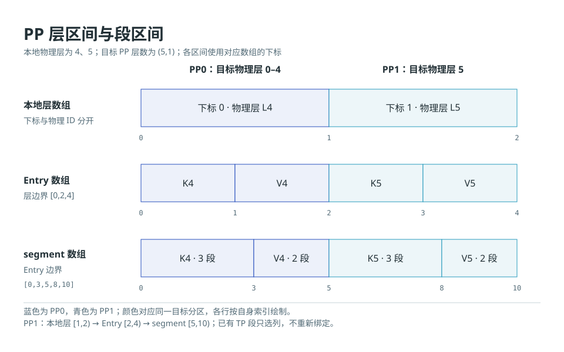
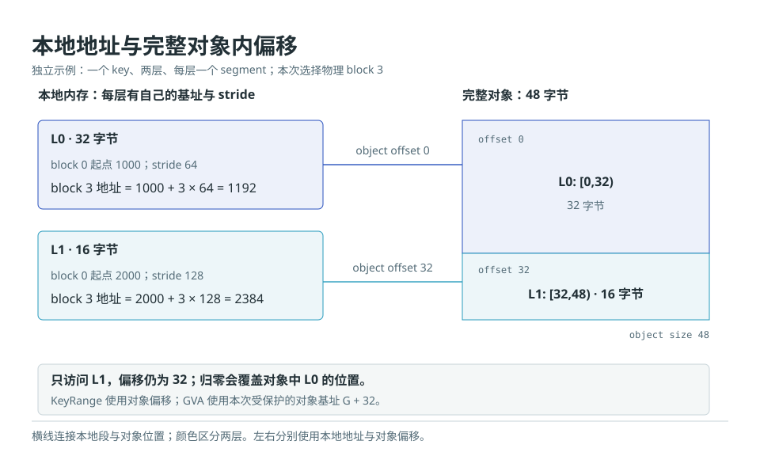

# AscendStore v1 架构与基础设施设计

AscendStore 将模型计算产生的 KV 缓存保存到外部存储，让后续请求按内容复用已有数据。v1 的业务层负责决定本次请求要查询、加载或保存什么，再组合基础设施提供的可达性计算、布局映射、消息通信、执行协调和资源管理能力完成操作。

这套划分保留两条清楚的业务主线：Scheduler 根据请求与缓存分配形成命令，Worker 根据命令选择对象、组织传输并处理结果。可复用的计算和机制集中在 infrastructure 中，但请求归属、对象发布条件和来源释放判断仍由业务层负责。

本文面向实现与维护者。源码基线为 `1e3d0a705`；分层图展示各部分的职责归属。文中的地址和布局示例为便于推导而构造，均以字节为单位。

## 1. 总体架构


vLLM 负责请求调度、缓存分配与模型执行。`AscendStoreV1Connector` 适配框架钩子，在 Scheduler 和 Worker 两种角色下分别实例化。`factory.py` 根据已经解析和校验的配置装配具体组件。

业务层由 Scheduler 和 Worker 构成。Scheduler 持有请求进度、采用的命中范围和缓存分配信息；Worker 使用已经分配好的 KV Tensor，持有本地 Mapping 与执行上下文，并处理传输结果。Bulk 按完整对象传输，Layerwise 将对象的传输分解到物理层。逐层访问又分为 KeyRange 和 GVA：前者按对象 key 与字节范围访问，后者按全局地址访问。

基础设施层提供可组合的能力。configuration 确定静态事实，protocol 定义两侧交接的消息及 Lookup 通信，Coordinator 判断哪些缓存可以支持恢复，Mapping 描述对象身份与字节位置，Execution 安排调用的执行顺序，Resources 管理需要显式释放的资源。业务路径按需组合这些能力，例如 Lookup 使用 Coordinator、Mapping 的命名能力和 Backend。

Backend 适配层位于独立的 `backend/` 目录。它定义整对象、KeyRange 和 GVA 的访问约定，并将其转换为 Mooncake、Memcache 原生客户端调用。第三方后端层包含这些客户端、传输能力与外部存储服务。

Worker 直接调用 Backend 完成读写，Resources 持有 Backend 及其资源句柄。图中的职责划分保留这些实际依赖。

## 2. 代码结构

以下目录以 `ascend_store/v1/` 为根。目录树展示主要职责，省略包导出文件和部分辅助文件。

```text
v1/
├── connector.py                 vLLM 钩子适配与两侧角色入口
├── factory.py                   配置准入后的实例装配
├── scheduler/
│   ├── scheduler.py             Lookup 采用、分配确认、每步命令规划
│   ├── lookup.py                请求侧命中候选与重算范围处理
│   ├── state.py                 请求与规划进度
│   └── source_leases.py         需要额外保护的 Store 来源引用
├── worker/
│   ├── base.py                  每步业务上下文、批次、完成与来源释放
│   ├── bulk/                   整对象 Load / Store
│   ├── layerwise/              逐层业务；KeyRange / GVA 两种访问方式
│   └── transfer/               对象行、请求归属、批次与结果证据
├── infrastructure/
│   ├── configuration/          配置校验、缓存组与并行拓扑
│   ├── protocol/               命令契约、Lookup 编解码与 RPC
│   ├── coordinator.py          单组 / 多组缓存的恢复条件与选择掩码
│   ├── mapping/
│   │   ├── local_layout/    本地字节段、TP 切片与 PP 层区间
│   │   ├── object_naming/   对象坐标与 key 生成
│   │   ├── object_layout/   对象大小与段偏移
│   │   ├── bulk.py         完整对象的传输视图
│   │   └── layerwise.py    按物理层访问的传输视图
│   ├── execution/
│   │   ├── executor.py         单线程串行执行器
│   │   └── session.py          一步内的逐层预取、等待与收尾协调
│   └── resources.py            执行器、对象会话、注册与客户端所有权
└── backend/
    ├── interfaces.py           整对象、KeyRange、GVA 访问契约
    ├── registration.py         注册句柄与失败回滚
    ├── results.py              原生结果校验与规范化
    ├── mooncake/               Mooncake 客户端与对象会话适配
    └── memcache/               Memcache 客户端与对象会话适配
```

`worker/transfer/` 虽然被不同 Worker 路径复用，仍属于业务侧。它需要知道一行传输属于哪个请求、原始缓存组和 Store job，以及失败应如何回报。这些对象与结果的归属决定了它的业务职责。

## 3. 业务组合

### 3.1 请求规划与传输执行

Scheduler 将外部命中视为候选。只有 vLLM 确认采用并分配目标块后，Scheduler 才拥有生成 Load 命令所需的信息。Store 则依据已经确认的计算进度、内容 hash 和保存策略规划，不能因为一次调度包含了某些 token，就认为这些位置已经产生可保存的 KV。

Worker 从命令出发，建立对象行和来源归属，调用可复用能力完成选择、映射和执行，最后将结果还原到请求或 Store job。原始 group ID 始终用于缓存组身份；紧凑的数组下标只用于本次批次内部的索引。压缩候选行不能改变远端 key 的命名空间，也不能丢失失败来源。

### 3.2 Bulk Store

Worker 按以下顺序组织一次 Bulk Store。

1. 从本步 Store 命令取得范围、hash、block 表和来源归属；结合 Coordinator 形成需要保存的候选。
2. 生成候选 key，根据 Backend 的写前存在性要求筛选对象，并按业务规则处理同批重复写入。
3. 压缩入选对象，由各组 Mapping 计算地址和长度，再由 Worker 合并为本次 Backend 参数。
4. 在后台执行路径中先准备参数，在 Backend 真正读取 KV 前等待来源就绪事件。
5. 调用 Backend，并将每个对象的结果对应回来源；分别判断写入结果和来源是否已停止被读取。

Mapping 因而不需要知道某个请求为什么要保存；Executor 不需要解释后端失败码；Backend 不决定一个 vLLM 请求何时完成。业务层组合这些能力，推进本次操作。

### 3.3 职责划分

infrastructure 可以包含领域规则。Coordinator 必须理解不同缓存类型的恢复条件，Mapping 必须理解对象的分片身份，protocol 也包含 Load / Store 命令。这些领域规则构成可复用能力的一部分。

应当留在业务侧的是：本次请求采用哪个候选、哪些对象参与、何时提交、如何解释失败、哪些对象已经满足发布条件，以及何时可以归还来源。基础设施返回计算结果或完成保证，业务层据此推进状态。

| 需要解决的问题 | 可复用能力 | 业务层仍需完成的决定 |
| --- | --- | --- |
| 哪些缓存能支撑恢复 | Coordinator 的范围与掩码计算 | 是否采用命中，如何与本次请求和分配对应 |
| 数据在哪里 | Mapping 的 key、地址、长度与对象偏移 | 入选对象、writer 选择、跨组组批与结果归属 |
| 调用怎样执行 | Executor / Session 的队列、预取与等待 | 提交哪个业务操作，如何处理结果及失败 |
| 资源何时释放 | Resources 的持有、顺序释放和失败保留 | 确认结果、来源安全及允许关闭的时点 |

## 4. 基础设施

### 4.1 configuration

配置解析先确定缓存规格、传输粒度和支持条件，再绑定当前 Worker 的实际拓扑。TP 按张量维度划分，这里主要影响 head 分片；PP 按模型层划分；DCP 和 PCP 分别对应 Decode、Prefill 的上下文并行。Topology 保留各维度的身份，以及每个原始缓存组实际包含的物理层。

`resolve_kv_pool_config` 完成公共配置解析。Worker 初始化时，准入检查先排除当前实现无法承载的组合，再通过 `resolve_worker_topology` 形成本地事实。例如，Layerwise 的 TP mismatch 与多个消费端 PP 分区组合、部分状态缓存模式，以及 Mooncake Layerwise 的上下文并行路径，都受到现有准入条件限制。布局公式能够表达的组合范围大于生产路径已经开放的范围。

原始 `group_id` 用于缓存组、buffer 和 key 的身份；`transfer_group_ids` 给出参与传输的组，掩码等紧凑数组使用这些组的排列位置。比如原始组 2、5 参与传输，掩码的第 0、1 项分别对应组 2、5，远端命名仍保留 2、5。

v1 直接调用 vLLM 的 `resolve_kv_cache_block_sizes()` 获取 scheduler block size 和 request hash block size，并使用原始 `Request.block_hashes`。Scheduler 与 Worker 使用同一粒度解释这条 hash 链；v1 不重新推导 hash 粒度，也不生成另一套请求 hash。每个参与传输的 group block 必须是 hash block 的整数倍，并整除 scheduler block。

上下文并行还需要实际进程成员信息。初始化阶段收集 global rank、TP rank 和 DCP rank，形成 `ContextRank`；PCP 与 TP 的 CPU 通信组用于取得真实成员关系。DCP 为 1 时可直接使用已有 TP rank 列表。Worker 随后根据这些事实选 writer、建立发布协调组。配置层提供身份和关系，发布过程留在 Worker。

`factory.py` 在创建 Backend 资源前解析访问方式、key 构造器和对象布局工厂。公共准入、具体 Backend 的格式要求、原生客户端配置各有明确入口，初始化失败也尽量发生在资源申请之前。

### 4.2 protocol

`messages.py` 定义两侧交接的数据：Lookup 请求与结果、Load 命令、范围 Store、checkpoint Store、每步 `KVTransferStep` 和来源释放元数据。范围 Store 表达一段可保存的内容；checkpoint Store 还需要携带特定状态来源。每步数据区分尚待满足条件的来源和已经可以执行的来源，使 Worker 能按真实就绪状态推进。

Lookup 使用独立的 ZMQ 请求应答连接。请求传递 token 范围、参与组和内容 hash；结果给出可恢复终点，以及继续处理尾部对象所需的 `TailKeyBoundary`。每步命令和完成结果通过 vLLM Connector 机制交接，KV 字节由 Worker 直接调用 Backend 传输。

Lookup 编码将终点、组集合、起点和 hash 分成四个 frame；响应将终点与尾部边界编码成确定长度的整数序列。codec 检查请求 frame 数、起止范围顺序和响应长度。消息中的逻辑位置与本地物理 block ID 保持各自含义。

`LookupClient` 延迟创建连接，发送和接收共享一次超时预算。交换失败后关闭当前 REQ socket，下次查询重新建连，避免迟到应答进入后续交换。服务线程自行创建、使用和关闭 REP socket，启动屏障将建连失败传回调用方。关闭时等待服务线程退出；如果查询仍停留在原生客户端内，关闭会保留它仍需使用的 Backend 资源。客户端超时只结束本次等待，已经进入 SDK 的查询仍可能继续。

来源释放回执用于归还 Scheduler 持有的来源引用，其计数含义是相关 Worker 已确认停止读源。Store 是否成功发布另由传输结果表达。

### 4.3 Coordinator

Coordinator 在 Token 轴上统一理解本地与外部 KV 的逻辑可用性，判断共同可恢复终点，并选择各阶段所需的逻辑块。Full Attention 依赖相应历史，滑动窗口依赖终点附近的窗口，状态缓存依赖对应位置的检查点。请求进度由 Scheduler 推进，是否采用命中也由 Scheduler 决定。

单组与多组统一使用 `Coordinator`，复用 vLLM core 的 `SpecGroup` 和注册 Manager。标准 Full Attention 在满足粒度条件时直接扫描连续命中；其他情况通过 `ExternalCachedBlockPool` 将本地已确认前缀与外部命中提供给 Manager，协调共同恢复终点。占位块只参与逻辑计算，不进入对象 key 命名。

| 阶段 | 已知条件 | Coordinator 的职责 |
| --- | --- | --- |
| Lookup | 查询上限与本地已确认前缀；查询后的外部命中 | 先选择可能支持候选终点的查询块，再根据可用性证据求各组共同支持的恢复终点 |
| Load | Scheduler 已确定的加载终点 | 选择恢复到该终点所需的逻辑块，不再求解共同终点或重复裁剪 |
| Store | 本次保存区间、prompt 边界与保留策略 | 选择应保存的逻辑块，mask 从本次起始块计数 |

Lookup 的查询候选、外部实际命中和 Load 所需块是不同结果；Store 的稀疏保留规则也不能替代 Lookup 选择，否则会漏掉仍可恢复的终点。恢复终点与尾部对象边界不一致时，`ReachablePrefix` 保留读取所需的尾部 key 边界。

Coordinator 输出逻辑终点与选择掩码，不查询 Backend、不读写 KV 字节，也不计算 Tensor 地址。Worker 执行查询，将选择对应到实际对象行，结合 Mapping 组织传输参数，再交给 Backend 执行。

### 4.4 Mapping

Bulk 和 Layerwise 是同一对象布局的整体视图与分层视图。Bulk 一次给出完整对象的本地段；Layerwise 按物理层取出其中的段，并保留这些段在完整对象中的位置。两者共享对象身份、本地字节顺序和层边界这些基础关系。

实现将 Mapping 拆为本地布局、对象命名和对象布局三个独立部分。`BulkMapping` 组合本地布局与命名；`LayerwiseMapping` 独立组合这两部分，再加入对象布局并生成逐层视图。这样，逐层访问可以直接使用其所需能力，同时保持与整体视图一致的数据含义。第 5 章给出参数与公式。

当前 Bulk 传输选中 key 的完整载荷。一个对象覆盖其分配到的组、层和 head 范围；请求的逻辑 token 覆盖量只参与对象选择，不任意缩短该对象的物理字节。Mapping 生成位置描述，Worker 负责对象参与、执行、发布和来源安全。

### 4.5 Execution

`Executor` 提供一个 FIFO 单线程队列。启动屏障确认线程初始化完成，提交返回 Future，关闭等待已提交任务完成并回收线程。任务结果和异常由调用者领取。Load 与 Store 可以使用不同队列，跨队列的依赖通过事件或显式等待建立。

`Session` 协调一步内的逐层执行。模型钩子由一个调用线程推进，后台操作在传入的串行队列上运行。Session 维护 Load 顺序、有界预取窗口、计算开始 gate 和 Store 提交去重；业务回调负责实际传输和结果处理。gate 是一个同步门闩，用于让后台任务等待计算开始条件。

预取分别记录提交位置和领取位置。例如 Load 顺序为 `[2, 5, 9, 12]`，窗口深度为 2，起初提交层 2、5；模型领取层 2 后补交层 9。层 5 在后台完成，只改变它的 Future 状态，领取位置仍由模型钩子推进。同一层的重复钩子保持幂等，完成回调按队列顺序执行一次。

Store 钩子在调用线程记录来源就绪事件，再把工作交给队列。后台先准备参数，随后在读 KV 前等待该事件。`abort_load(wait=True)` 唤醒仍在等 gate 的任务，等待所有已提交 Load Future，再等待可选收尾；即使没有收尾回调，也要等已有 Load 结束。这个等待无法中断正在执行的原生操作，Load 的成功与失败仍需读取结果。

`end_step` 解除本步回调并结束 Load 协调。跨步 Store 的结果观察、来源保护和最终排空由 Worker 继续管理。

### 4.6 Resources

`KVPoolResources` 持有执行器、Backend 对象会话、内存注册句柄和客户端，并保留 KV Tensor 引用。Worker 持有 Mapping 与每步 Session。

绑定时先提取真实 Tensor/view 的基址、块载荷、块 stride 和层边界。Worker 据此建立 Mapping，随后注册 buffer，最后启动执行器。有效载荷决定需要复制的字节；注册范围覆盖原生传输可能访问的分配跨度。共享 storage 的多个 view 要按实际地址跨度处理，块间 padding 影响跨度但不进入对象载荷。group block 与 kernel block 的比例也在绑定时落实，空 Entry 被跳过。

关闭从 Worker 的业务收尾开始：领取结果，确认 Store 已停止读取来源，再停止执行器。Resources 随后依次关闭对象会话、执行额外清理（例如发布协调组）、释放注册句柄、关闭 Backend，最后放掉 Tensor 引用。

每一步清理成功后才移除对应所有权。注册释放失败时，句柄和相关引用继续保留，后续可以重试。原生调用异常导致读源状态未知时，Worker 还需保留安全状态；仅有 Future 结束或 Python 线程退出，无法证明设备和客户端已停止访问该内存。

### 4.7 Backend

整对象接口用 key 和本地地址段传输完整对象。KeyRange 接口用 key、对象大小和对象内偏移访问部分字节。GVA 接口先通过对象会话取得受保护的远端地址，再按本地地址、远端地址和长度复制。当前 Mooncake Layerwise 使用 KeyRange，Memcache Layerwise 使用 GVA。

Mooncake 的普通 TransferEngine 路径由 v1 Backend 持有进程级引擎和注册表，与旧 connector 的全局引擎隔离。多个 v1 客户端注册同一地址和大小时共享引用，最后一个注册句柄释放时才注销内存；失败的回滚或注销保留句柄供重试。引擎初始化复用上游 `GlobalTE` 的失败策略，原生初始化失败后需要重启进程。使用 Store 独立引擎或 fabric memory 的路径仍按各自原生契约处理。

Backend 实现原生客户端调用、内存注册、对象保护和结果规范化。Worker 累计各层结果，判断对象完整性，并决定 commit 或 revoke。commit 发布完整对象；revoke 撤销未完成写入。适配器落实这些操作的原生语义。

同步 Store 正常返回时，接口保证本地来源读取已经结束，返回的失败码仍可以表示某些对象写入失败。异常缺少这一完成保证，调用者需要保留未知状态。远端发布和本地读源结束分别记录，避免用其中一个状态代替另一个。

## 5. Mapping

### 5.1 三个对象

Mapping 使用三个相互配合的对象，将“本地有哪些字节”“这些字节属于哪个 key”“它们在远端对象哪里”分别绑定。

| 部分 | 主要类型 | 绑定结果 |
| --- | --- | --- |
| 本地布局 | `LocalLayout`、`LocalPartitionLayout` | 原始组、对象坐标、物理层顺序、层到段的边界，以及各段的基址、步长和长度 |
| 对象命名 | `KeyBuilder`、`KeyNamer` | 用配置和对象坐标绑定命名规则，再由内容 hash 生成具体 key |
| 对象布局 | `RemoteObjectLayout` | 完整对象大小，以及各个本地段在对象内的字节偏移 |

`LocalLayout` 描述当前 Worker 上一个原始缓存组的布局。`LocalLayout.partitions` 按绑定顺序保存各分片的来源，`partition_index` 是该序列中的位置。每个分片用 `ObjectPartitionCoordinate` 表达固定的 PP、DCP 和 head 身份，并不表示本次选择哪个轴；`LocalMemorySegments` 描述其本地字节，层边界将段序列切成逐层布局。

Worker 的一条 `transfer_record` 保留请求归属、内容身份和本地 block ID；它与一个 partition 配对后构成一条 `transfer_candidate`。`keys_by_partition[p][r]` 对应分片位置 `p` 与记录位置 `r`，展平位置为 `transfer_candidate_index = p * transfer_record_count + r`。筛选后的紧凑位置称为 `selected_transfer_index`，不能替代原始候选位置来追溯请求。

`KeyBuilder.bind()` 接受原始组 ID、对象坐标和 Lookup 需要的 head 覆盖范围，产生 `KeyNamer`。其 `keys()` 为本地对象生成 key，`lookup_keys()` 覆盖查询所需的对象身份。Lookup 可能需要查询本 rank 没有本地来源的 PP 或 head 分片。

`RemoteObjectLayout` 将相同顺序的本地段放到远端对象中。`segment_boundary_offsets_bytes` 保存各段起点和末尾载荷终点；`size_bytes` 保存完整对象大小，两者不要求相等。默认布局紧凑拼接；具体 Backend 可以为全局层、上下文分片或对齐预留空间。

Bulk 直接使用本地整体视图生成完整对象参数。Layerwise 从同一套本地段与层边界切出 `LayerPartitionLayout`，再配上对象偏移。默认紧凑格式下，按对象顺序重组各层字节即可恢复 Bulk 的完整载荷。带预留空间的格式保持本地字节及层归属，并由对象布局明确远端放置位置。

### 5.2 坐标与单位

一个缓存组包含若干物理层，每层可以对应多个实际 Tensor/view，例如 K、V。注册时按确定顺序记录的非空 Tensor/view 称为 Entry。一个 Entry 中的一个缓存块可以贡献一段或多段连续的有效字节，每段称为 segment。

外部对象按规定顺序拼接这些 segment。对象 key 由绑定的命名规则和本次内容 hash 生成，命名保留模型、缓存组与格式要求的分片身份。默认对象内字节紧凑排列，本地地址之间可以存在其他 head 或 padding。

| 坐标或数量 | 含义 | 单位 | 不能当作什么 |
| --- | --- | --- | --- |
| `group_id`、`physical_layer_id` | 原始缓存组与模型物理层身份 | 标识符 | 批次中的紧凑数组下标 |
| 本地层下标、Entry 下标、segment 边界 | 某个有序数组中的位置或半开区间边界 | 个数 / 下标 | 内存字节偏移 |
| 物理 block ID | 本地缓存块表选中的槽位 | 块编号 | 请求中的逻辑块序号 |
| Entry 基址、segment 起点 | 本地内存位置 | 字节地址 | 远端对象内偏移 |
| group block stride | 同一段从物理块 b 移到 b+1 的距离 | 字节 | 有效载荷长度 |
| segment length | 本段实际需要复制的连续数据量 | 字节 | 包含间隙的内存跨度 |
| object offset、object size | segment 在完整对象中的位置及对象保留的总空间 | 字节 | 本地基址之间的差 |

这里还需要区分 group block 与 kernel block。前者是该缓存组用于管理和传输的块，后者是实际 Tensor 第一轴的一份存储单位。一个 group block 可以覆盖多个 kernel block。压缩缓存中的物理 token 数也未必等于逻辑原始 token 覆盖量，因此不能仅用逻辑 block size 推导实际 Tensor 字节数。

### 5.3 参数绑定

绑定发生在 KV Tensor 分配后。固定输入包括 Topology、原始组 ID、Entry 基址、每块有效载荷、块 stride、层到 Entry 的边界，以及需要切片时的真实 Tensor shape 和 stride。key 构造器与对象布局工厂提供所选 Backend 的格式规则。

这些输入形成一组固定参数：每段在 block 0 中的起点 βⱼ、块步长 σⱼ、长度 ℓⱼ、对象偏移 oⱼ，以及 key 命名函数 Nₚ。下标 j 表示一个段，p 表示本地对象；地址、步长、长度和偏移均以字节计。βⱼ 已包含 Entry 基址 A 和块内切片偏移 δ，即 `βⱼ = A + δ`。

运行时，Worker 用内容 hash hᵢ 生成 Key，再根据候选掩码确定参与传输的物理 block ID bᵢ。下标 i 表示本批传输记录位置。选中的 Block ID 独立传入本地段求值接口，由此得到：

```text
keyₚᵢ = Nₚ(hᵢ)
aᵢⱼ   = βⱼ + bᵢ × σⱼ
lengthᵢⱼ = ℓⱼ

默认紧凑布局：
oⱼ = ℓ₀ + … + ℓⱼ₋₁       （o₀ = 0）
对象大小 = 所有段长度之和
```

例如一个段的 block 0 起点为 1000、块步长为 64、长度为 32，本次选择 block 3，则本地地址为 1192，复制长度仍为 32。若该段在对象中的偏移为 80，KeyRange 使用偏移 80；GVA 在本次对象基址 G 上加 80。改变本地 block ID 只改变本地地址，改变远端对象实例只改变 G。

固定参数随已绑定的 Tensor 和拓扑保持有效。更换本地分配需要重新绑定；远端 GVA 则每次从有效对象会话取得。`LocalMemorySegments.addresses(local_block_ids)` 只返回数值地址矩阵，第一维严格对应输入 Block ID，第二维对应绑定段顺序。它不接收 Key 或选择掩码，保留原有 uint64 本地地址运算语义。段长度与远端偏移直接读取只读布局；Bulk、KeyRange 和 GVA Worker 分别组合自己的 Backend 参数，不再调用混合式 Mapping 参数接口。

### 5.4 TP 切片

设一个 Entry 使用 NHD 排列：一个 kernel block 内先排列 token，再排列 head，最后是每个 head 的连续向量。这个例子有两个 token，每个 token 有四个 head，每个 head 占 4 字节；一个 group block 只包含这个 kernel block，没有 padding，总载荷为 32 字节。

将四个 head 分为两个 slice：slice 0 包含 h0、h1，slice 1 包含 h2、h3。保存 slice 0 时，需要取出每个 token 中属于它的两个 head，因此对应两个分开的本地范围。


| 选中的片段 | 块内本地字节区间 | 长度 | slice 0 对象内区间 |
| --- | --- | --- | --- |
| token 0 的 h0、h1 | `[0,8)` | 8 字节 | `[0,8)` |
| token 1 的 h0、h1 | `[16,24)` | 8 字节 | `[8,16)` |

两个本地片段中间的 `[8,16)` 属于另一组 head，不能连带复制。slice 0 的对象总长却只有 16 字节，因为对象并不保存这个间隙。slice 1 同理使用本地 `[8,16)` 和 `[24,32)`。

假设该 Entry 的基址为 1024，group block stride 为 32，本次物理 block ID 为 3。块起点为 `1024 + 3 × 32 = 1120`；slice 0 的两个实际片段就是 `[1120,1128)` 和 `[1136,1144)`。生成这些地址不会读取 KV，也不会先把数据拷贝到一块拼接缓冲区。

如果消费者本地恰好只保存 h0、h1，并且同样两个 token 紧凑排列，它的整个本地块就是这 16 字节。此时生产者需要两个范围，而消费者可以用一个范围恢复同一个对象。两端范围描述不同，对象字节相同。

### 5.5 连续段

完整 Entry 绑定与 head 切片绑定是两条布局构造路径。普通路径按准入和缓存绑定所确定的 Entry 完整载荷建立连续段；TP mismatch 路径进一步检查真实 Tensor 的切片几何。

TP mismatch 路径会检查真实 Tensor，确认每个 head 向量连续、head 数可被 slice 数整除，并读取 kernel、token 和 head 的字节 stride。只有确认整 Entry 的字节顺序和完整载荷吻合时，才使用整块连续段；否则保留细分 segment。

| 检查项 | 对整 Entry 快路径的作用 |
| --- | --- |
| 本 rank 只有一个 head slice | 避免把不属于同一对象的 head 一并复制 |
| 相邻 head 的 stride 与向量长度兼容 | 多个 head 才能构成连续 head run |
| token stride 与该 token 的有效字节数一致 | 多个 token 之间没有对象不应包含的间隙 |
| 多 kernel block 时，kernel stride 与其载荷一致 | 同一 group block 内的 kernel 单位可连续覆盖 |
| 计算得到的完整载荷等于已注册 Entry 的块载荷 | 防止漏字节或将额外字节作为 payload |
| HND / LBHNC 路径只有一个 head | 满足当前实现采用整 Entry 快路径的额外限制 |

group block 之间允许有 padding。例如块载荷是 32 字节、块 stride 是 40 字节时，仍可复制每块的 32 字节并按 40 字节移动到下一块。不能把长度改成 40，也不能为了得到连续公式把 stride 改成 32。

合并后的 segment 仍覆盖同一组有效字节，块之间继续按实际 stride 寻址。

### 5.6 本地段

不能使用整 Entry 快路径时，`head_slicing.py` 先将每个 Entry 的几何信息整理为 `HeadSliceLayout`。对于一个 head slice 内的某个段，块内起点由三个方向的位移组成：kernel block 位移、token 位移和 head 位移。

设 k 是 group block 内的 kernel block 下标，t 是该 kernel block 中的物理 token 下标，r 是当前 head slice 下标，H 是每个 slice 的 head 数，h 是 slice 内当前连续 head run 的起始 head 下标。再令 Sₖ、Sₜ、Sₕ 分别为 kernel、token、head 的字节 stride，则块内偏移为：

```text
δ = k × Sₖ + t × Sₜ + (r × H + h) × Sₕ
```

每段长度是这个连续 head run 包含的 head 数乘每个 head 的向量字节数。维度展开的顺序必须保留对象的序列化约定：

| 本地布局路径 | 一个 slice 内的展开顺序 |
| --- | --- |
| NHD | kernel → token → head run |
| HND / LBHNC | kernel → head run → token |

LBHNC 在这里使用已注册的逐层 view 检查布局。上述路径不执行布局格式转换，也不允许为了合并地址而随意重新排序 segment。单纯把本地地址排序，可能改变对象中的字节顺序。

相同 `HeadSliceLayout` 的 Entry 共享一次偏移编译。随后 `materialize_segments` 才加上每个 Entry 的实际基址，形成 `LocalMemorySegments`。这份描述只需要保存三类数组：

| 字段 | 含义 | 可共享的条件 |
| --- | --- | --- |
| `block_zero_segment_addresses` | 每段在物理 block 0 中的本地起点，已包含 Entry 基址与切片偏移 | 各 head slice 使用对应地址行 |
| `group_block_strides_bytes` | 每段从一个物理块移到下一块的步长 | 全部相同时可用单元素数组广播；不同 slice 可共享 |
| `segment_lengths_bytes` | 每段的有效字节数 | 全部相同时可用单元素数组广播；不同 slice 可共享 |

用 j 表示一个 segment，βⱼ 表示它在物理 block 0 中的起点，σⱼ 表示对应块步长；用 bᵢ 表示本次第 i 行选择的物理 block ID。运行时地址只需计算：

```text
aᵢⱼ = βⱼ + bᵢ × σⱼ
```

例如前一节 slice 0 的 `β = [1024, 1040]`、`σ = [32]`、长度为 `[8]`，选择 block `[3,7]` 后得到：

| 本次行 | 物理 block ID | segment 0 地址 | segment 1 地址 | 每段长度 |
| --- | --- | --- | --- | --- |
| 0 | 3 | 1120 | 1136 | 8 字节 |
| 1 | 7 | 1248 | 1264 | 8 字节 |

NumPy 将 block 行与 segment 列广播成地址矩阵。绑定数组只读，PP 或逐层布局可以共享其切片；返回给 Backend 的 Python 列表则按对象行独立构造，不能让调用者修改一行时影响另一行或静态布局。

最终地址矩阵和 Backend 所需的 Python 列表在运行时生成。

### 5.7 PP 分区

TP 切片决定每个 Entry 内取哪些字节，目标 PP 分区决定一个对象包含哪些层。底层绑定先形成本地 Entry 的段，再用目标层区间选择共享列，两种几何关系可以组合。生产准入仍按具体路径检查支持条件，例如 Layerwise 的 TP mismatch 与多个消费端 PP 分区组合当前被拒绝。

考虑另一个独立例子：本地只有物理层 4、5，每层各有 K、V 两个 Entry。目标 PP 层数配置为 `(5,1)`，意味着 PP0 对应物理层 0 至 4，PP1 对应物理层 5。本地只贡献自己实际持有的交集。



为了展示不等长段数，假设 K4、V4、K5、V5 分别有 3、2、3、2 个 segment：

| 目标对象分区 | 本地层下标区间 | 物理层 | Entry 区间 | segment 区间 |
| --- | --- | --- | --- | --- |
| PP0 | `[0,1)` | 4 | `[0,2)`，即 K4、V4 | `[0,5)` |
| PP1 | `[1,2)` | 5 | `[2,4)`，即 K5、V5 | `[5,10)` |

层到 Entry 的边界数组是 `[0,2,4]`，Entry 到 segment 的边界数组是 `[0,3,5,8,10]`。因此 PP1 先选 Entry `[2,4)`，再用边界数组的第 2、4 项取得 segment `[5,10)`。这些数字都是数组下标，没有一个表示字节偏移。

连续 Entry 路径中，每个 Entry 只有一个 segment，可以直接用 Entry 区间选择列。切片路径中，一个 Entry 可对应多个 segment，才需要第二次边界换算。某个目标 PP 没有本地层时不产生本地分区；物理层 ID 则始终保留，不能用局部的 0、1 替代真实的 4、5。

目标 PP 描述对象的层归属，不一定就是当前进程的执行 PP。`naming.lookup_keys()` 覆盖查询所需的目标 PP、DCP 和 head 身份，`naming.keys()` 绑定本 rank 实际传输的部分。Lookup 的覆盖范围与本地地址的覆盖范围必须分别说明。

### 5.8 对象偏移

`LayerwiseMapping` 从完整对象布局中取出每个物理层的段和偏移。默认布局通过段长度的前缀和计算偏移；具体 Backend 提供的对象布局还可以加入预留区域。每层始终保留其在完整对象中的位置。

下面使用一个不涉及 TP / PP 切分的小例子。一个 key 对应两层，L0 的载荷为 32 字节，L1 为 16 字节，对象总长 48 字节。两层在本地可以位于完全不同的分配中。



| 层 | 本地 block 0 起点 | block stride | 载荷长度 | block 3 的本地地址 | 完整对象内区间 |
| --- | --- | --- | --- | --- | --- |
| L0 | 1000 | 64 字节 | 32 字节 | `1000 + 3 × 64 = 1192` | `[0,32)` |
| L1 | 2000 | 128 字节 | 16 字节 | `2000 + 3 × 128 = 2384` | `[32,48)` |

只处理 L1 时，其对象偏移仍是 32，不因本次只调用这一层就变成 0。否则会把 L1 覆盖到对象中原本属于 L0 的位置。若对象经过目标 PP 划分，每个独立对象从自己的 0 开始，但在该对象内部选择某层时仍须保留完整对象的偏移。

KeyRange Worker 将这些偏移作为范围参数传给 Backend。GVA Worker 则结合本次会话提供的远端对象基址计算远端地址。例如远端基址为 G，L1 的目标位置就是 `G + 32`。G 属于运行时的受保护对象，不属于可以永久缓存的本地静态布局。

### 5.9 批次选择

静态布局不包含本次的具体 key 和 block ID。Worker 在 Session 准入后构造 `LayerTransferGroup`，按分片固定选中的 Key、本地 Block ID 和原始记录位置。各层复用这些选择，不再调用 Mapping 执行选择。

`selected_transfer_slices_by_partition` 将每个分片对应到平铺的 `selected_keys` 与远端基址数组。Load 另保存原候选编号与请求位置，用于结果归属；Store 不生成这份 Load 信息。全选分片共享只读 Block ID 快照与 `range`，部分选择只计算一次记录索引。重复 Key 或 Block ID 保留原始传输项。

每层通过绑定布局确定参与分片，再取对应切片。只有 group 与分片集合都相同的层才共享同一份 Key 列表。空选择和没有本地段的层不产生地址参数；压紧或重新构造批次后必须重新准备 plan。

GVA Worker 在每个参与分片上直接形成地址矩阵，并展平为 Backend 所需的一维列表，不生成逐对象的小列表或无用的 Key 返回值。本地地址保持 uint64 运算；远端基址加偏移使用 Python 整数语义的 NumPy 加法，避免将原本大于 uint64 上限的结果静默回绕。实际远端基址仍由有效 Session 提供，源就绪等待与复制完成流程不变。

### 5.10 Backend 格式

Backend 的格式差异通过 `BackendSpec` 接入。其可选 `layerwise_key_factory` 接收 `KeyNamingConfig`，返回 key 构造器；`layerwise_layout_factory` 接收 Topology，返回对象布局工厂。factory 在申请 Backend 资源前准备这些能力，Worker 绑定 Mapping 时传入。Mapping 按接口组合它们，具体格式由相应 Backend 模块实现。

Memcache 的 Layerwise 布局是一个具体例子。它先为全局层跨度预留空间，再为上下文分片安排槽位。设 L 为解析出的保留层数，w 为每层载荷，s 为本地 stage 的起始层；全局层预留要求各层载荷一致。设 C 为对象槽位数，c 为本地槽位下标，u 为对齐字节数。所有字节量按下式计算：

```text
P = L × w                         每个槽位的层空间
T = ceil(P / u) × u               对齐后的槽位步长
S = C × T                         完整对象大小
oⱼ = c × T + s × w + prefixⱼ      本地段在对象中的偏移
```

其中 `prefixⱼ` 是本地段 j 之前各段长度之和。共享上下文格式使用 2 MiB 对齐；没有全局层预留时，P 取本地载荷，层起始偏移取 0。预留槽位数描述格式容量，实际参与发布的 writer 集合由当前拓扑决定。

这些规则只改变对象放置位置和大小。已有上下文分片的本地 token 不会在这里再次切分；本地段顺序也保持不变。key 构造器同时落实对应的身份约定，保证生产、查询和消费使用相同对象格式。

### 5.11 Backend 操作

新 Backend 沿现有访问方式接入时，实现相应端口和对象会话，声明访问类型与写前存在性要求，并按需提供 key 或布局工厂。返回值需要规范化为上层约定，注册和会话关闭要保留失败后的所有权。

| 访问方式 | Worker 提交的主要参数 | Backend 承担的操作 |
| --- | --- | --- |
| Bulk | key、本地地址行、长度行 | 整对象读写 |
| KeyRange | key、对象大小、本地段、对象偏移 | 按 key 访问字节范围，维护对象保护 |
| GVA | 会话中的远端地址、本地地址、长度 | 地址复制、对象打开、发布与撤销 |

格式扩展可以复用已有 Worker。若新能力需要额外的租约阶段、复制完成通知或发布协议，就需要同步扩展明确的 Backend 端口与 Worker 流程，并验证完成和关闭语义。Mapping 仍负责可计算的位置关系，Session 仍负责执行协调。

## 6. 执行与发布

### 6.1 对象选择与结果归属

Bulk Worker 先生成候选 key，完成写前存在性检查和同批写入准入，再展开入选对象的地址。每步已经到达的工作可以合并到一个批次；Worker 保留对象、原始组、请求及 Store job 的对应关系，将后端逐对象结果还原到业务来源。

Layerwise 在各层复用同一批对象选择，并累计每个对象需要的层是否完成。Session 推进层的执行顺序，Worker 判断全部必要层的复制结果，再决定可发布的对象。批次压缩、重复行处理和逐层执行都需要保持同一套对象身份。

### 6.2 来源安全

模型写入完成、Backend 停止读源、来源允许回收是三个连续但不同的条件。Store 钩子记录就绪事件；后台完成参数准备后等待该事件，随后开始读取 KV。复制结束证据用于确认停止读源，Scheduler 的来源引用和 Worker 的 fence 共同约束后续回收或覆盖。

普通 FullAttention 请求存活期间，manager 保留相关缓存块。请求结束或抢占后，Worker 在模型可能复用这些块之前等待相关 Store。对于请求存活期间就可能回收页面的 manager，以及需要保护的 checkpoint 来源，Scheduler 额外持有引用，并等待预期 Worker 的来源释放回执。

正常 Step 收集已完成结果，只等待即将复用来源所涉及的批次。显式排空和关闭处理全部 pending Store。Backend 异常导致读源状态未知时，相关状态继续保留，并阻止危险复用。

### 6.3 共享对象发布

Memcache GVA 的共享对象可能由多个 rank 写入。Worker 从实际 `ContextRank` 成员关系出发，按 head 与 DCP 身份识别副本，为每组副本选择最小 global rank 作为 writer。当前共享协调条件包含 DCP 大于 1，且存在重复写入副本或多个 PCP rank；具体参与成员来自实际拓扑。

发布协调由 `worker/layerwise/gva/` 持有，使用覆盖相关成员的专用 Gloo 组。非 writer 和打开对象失败的成员也参与同一轮协调，保证所有参与者按相同次序进入 collective。

某个 key 发布前，需要所有必要 writer 完成各自的必要层，并确认它们看到的是同一个远端地址和对象大小。缺少 writer、任一必要层失败、地址或大小不一致，都会使该 key 不能 commit。预留空间中的空闲槽位无需虚构 writer，必要 writer 集合也必须非空。

撤销失败时保留未确认状态及会话所有权；只有原生能力能够确认安全，才能完成清理。复制结果、对象发布和本地来源释放因此分别推进。

## 7. 验证范围

布局验证检查同一对象在整体与逐层视图中是否表示相同字节，并检查对象身份、顺序和结果归属在各路径间保持一致。

| 要验证的关系 | 现有测试入口 | 主要检查 |
| --- | --- | --- |
| 普通、TP、PP 及底层组合布局 | `mapping/test_bulk.py` | Tensor 字节与对象字节对应、生产消费一致、PP 双向恢复 |
| 静态数组与运行时行的隔离 | `mapping/test_bulk.py`、`mapping/test_layerwise.py` | 共享只读布局、重复行、掩码、输入快照与输出不别名 |
| Bulk 与 Layerwise 的整体和分层视图 | `mapping/test_layerwise.py`、`mapping/test_composition.py` | 各层重组为完整对象、独立组合本地布局与命名 |
| 对象偏移与 Backend 预留空间 | `mapping/test_object_offsets.py`、`mapping/test_partition_bindings.py` | PP 层位置、上下文槽位、对齐与完整对象大小 |
| 预取、领取、abort 与收尾顺序 | `execution/test_session.py` | 提交与领取分离、gate 唤醒、已提交任务排空 |
| Lookup 错误恢复与关闭 | `protocol/test_lookup.py`、`protocol/test_rpc.py` | 消息校验、超时连接重建、服务线程结束前保留资源 |
| 注册与关闭所有权 | `test_resources.py` | 绑定与注册顺序、失败保留、执行器停止前禁止释放 |

表中路径相对于 `tests/ut/distributed/ascend_store/v1/infrastructure/`。这些测试为源码行为提供复核入口，不等同于所有原生后端和 NPU 组合都已验证。真实后端还需要确认复制完成语义、注册行为、会话保护和对象发布。

共享发布还需要验证真实成员组、非 writer 参与、打开失败、地址分歧和缺失 writer 等条件。CPU 单元测试与 Gloo 进程测试分别检查纯逻辑和集体通信顺序；原生 NPU 路径仍需在对应硬件与 Backend 上确认读源完成、地址保护和发布语义。
