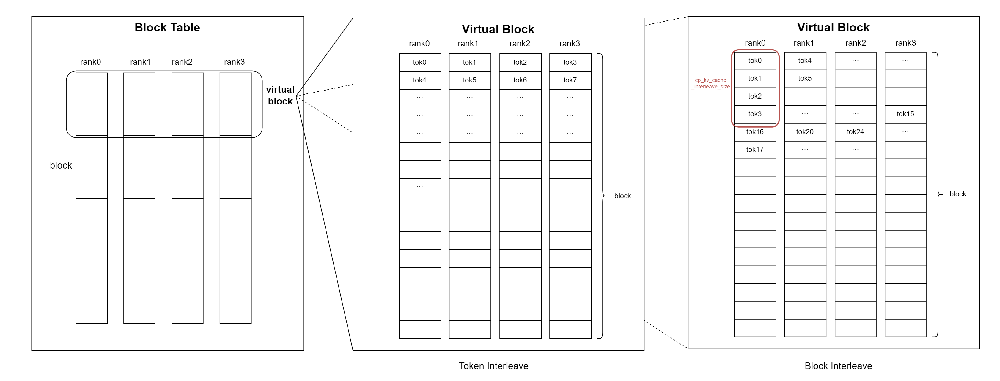
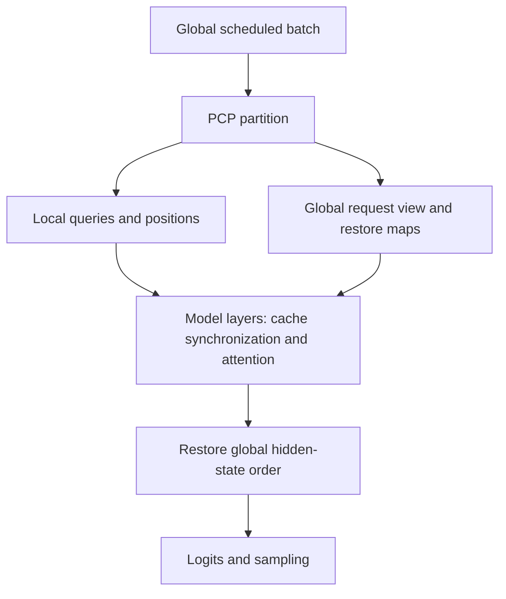
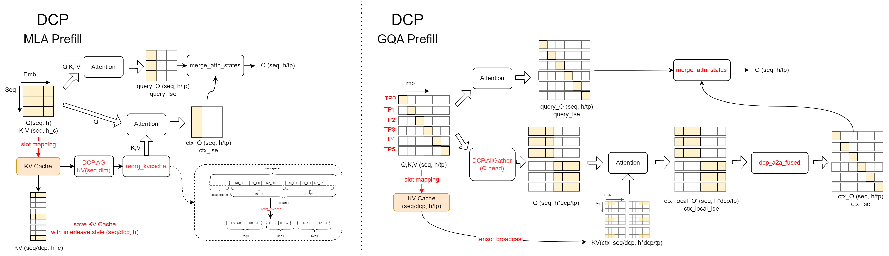
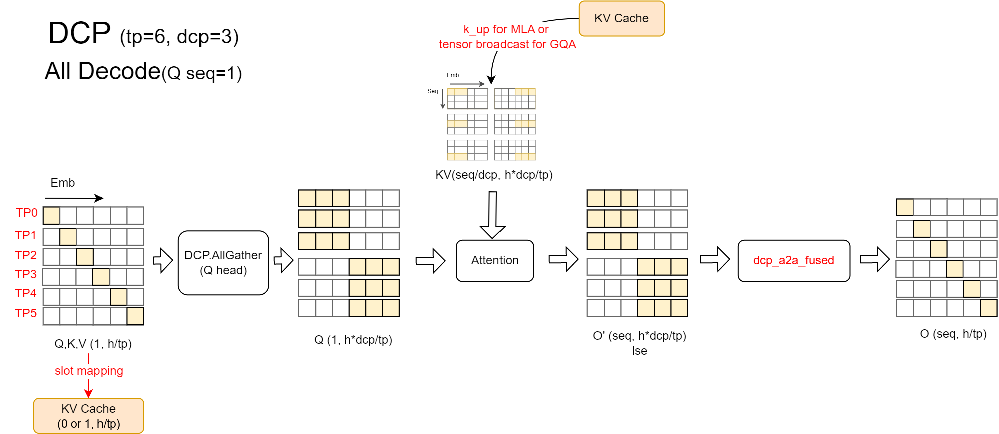

# Context Parallel

The context parallel features include Prefill Context Parallel (PCP) and Decode Context Parallel (DCP).

Prefill Context Parallel splits prefill tokens across additional ranks to reduce time to first token. See the [Context Parallel Guide](../../user_guide/feature_guide/context_parallel.md#prefill-context-parallel) for PCP configuration, supported feature combinations, and constraints.

Decode Context Parallel shards the KV cache along the sequence dimension across ranks in a DCP group, which may reuse TP ranks, PCP ranks, or both. It eliminates redundant KV-cache storage without adding devices to the process world.

This document describes PCP execution and DCP cache sharding. See the [PCP/DCP RFC](https://github.com/vllm-project/vllm-ascend/issues/12622) for the design rationale.

## KV-cache layout

DCP stores tokens in an interleaved layout across ranks. The interleaving granularity is controlled by `cp_kv_cache_interleave_size`, whose declared default is `1`.

SFA+DCP uses `block_size` as the effective interleave size; when KV transfer is enabled, set it explicitly to `block_size` to avoid a configuration error.

For a DCP size of `dcp_size`, a virtual block contains `block_size * dcp_size` tokens. For token `x`:

- `virtual_block_index = x // (block_size * dcp_size)`
- `offset_in_virtual_block = x % (block_size * dcp_size)`
- `interleave_index = offset_in_virtual_block // cp_kv_cache_interleave_size`
- `target_rank = interleave_index % dcp_size`

The slot-mapping calculation uses this layout so each DCP rank stores only its local sequence shard. The current implementation requires `block_size % cp_kv_cache_interleave_size == 0`.



PCP adds compute ranks but does not multiply the virtual block size. With DCP=1, each PCP rank retains the full sequence for its TP-local KV heads. With DCP enabled, only the owner of a token position writes its slot; other ranks and padding entries receive `PAD_SLOT_ID` (`-1`) and are excluded from cache writes.

PCP synchronizes cache data or cache-update inputs before attention. The exchange point depends on the backend. Sparse indexer and compressor state have their own layouts, separate from DCP-sharded attention storage.

## PCP execution

### Parallel topology

The model-worker count across a configured DP deployment is `DP * PP * PCP * TP`. Within one DP replica and PP stage, the TP×PCP grid contains `TP * PCP` workers. DCP reuses these workers.

For TP=2 and PCP=2:

| PCP coordinate | TP coordinate 0 | TP coordinate 1 |
| --- | --- | --- |
| 0 | rank 0 | rank 1 |
| 1 | rank 2 | rank 3 |

TP groups follow the table's rows: `[0, 1]` and `[2, 3]`. PCP groups follow its columns: `[0, 2]` and `[1, 3]`. DCP can span the PCP axis or the full grid:

| Configuration | Logical DCP groups | Query heads within a group |
| --- | --- | --- |
| DCP=1 | Single-rank groups | No sequence sharding |
| DCP=PCP=2 | `[0, 2]`, `[1, 3]` | Same TP-local heads |
| DCP=TP*PCP=4 | `[0, 2, 1, 3]` | Includes distinct TP head partitions |

The lists follow logical DCP rank order: the PCP coordinate varies first, then the TP coordinate.

MLA and SFA implement both stacked layouts; GQA/MQA stacking requires `DCP=PCP`. DSA and DSA V4.1 PCP use replicated caches, with DCP stacking outside their documented PCP configuration. With PCP=1, DCP groups lie within TP: MLA requires `TP % DCP == 0`, sparse SFA requires `DCP == TP` when DCP is enabled, and GQA has additional KV-head constraints. Deployment constraints are listed in the [Context Parallel user guide](../../user_guide/feature_guide/context_parallel.md).

### Batch lifecycle

The scheduler retains a global batch. Upstream `PCPManager` partitions each worker step into local virtual request rows and records how to restore global token order. `AscendPCPManager` adapts this lifecycle for Ascend buffers, attention metadata, graph padding, and decode-request assignment.



#### Prefill: head-tail partitioning

Causal attention gives later queries more preceding tokens to attend to. PCP balances this work using a head-tail partition, also called DualChunkSwap. For `L` scheduled query tokens and PCP size `P`, the request is divided into `2 * P` chunks of up to `ceil(L / (2 * P))` tokens. Rank `r` receives chunks `r` and `2 * P - 1 - r`. For P=4:

```text
Query chunks:  0  1  2  3  4  5  6  7
PCP rank 0:   [0]                  [7]
PCP rank 1:      [1]            [6]
PCP rank 2:         [2]      [5]
PCP rank 3:            [3][4]
```

Each fragment keeps its original positions and computed-prefix length, so tail queries can attend to earlier chunks. Local buffers are padded for collectives. Short requests can leave PCP-only ranks without queries; the PCP+DCP path replicates short prefills when splitting would leave an empty chunk.

#### Decode: request ownership and cache shards

With `PCP > 1` and `DCP == 1`, scheduled decode requests are assigned round-robin to PCP ranks. Each request's queries, including fixed-length speculative verification, stay with one owner for the step. Cache updates are synchronized across PCP, allowing ownership to change on subsequent steps. Ranks without queries still participate in the required collectives.

With PCP and DCP stacked, decode requests are replicated across PCP ranks. Each rank attends to its local DCP KV shard, then contributes its partial output and softmax statistics to the result merge.

#### Restoring global order

Attention metadata distinguishes global request order, local query order, and gathered KV order. `AscendPCPAttentionContext` carries the global view and the maps connecting these layouts. Gathered hidden states are restored to global token order at the runner boundary for sampling and supported draft-model processing.

## Attention execution

### Backend structure

DCP is implemented as a specialization of the corresponding v1 attention backend rather than as a parallel copy of it:

- `DCPMetadataBuilderMixin` owns DCP group/rank discovery and access to the per-rank context-length matrix.
- `DCPImplMixin` owns DCP collectives and the common partial-output/LSE merge.
- GQA, MLA, and SFA DCP builders inherit their v1 metadata builders. They only add DCP metadata fields or temporarily expose the DCP-specific cache view.
- GQA, MLA, and SFA DCP implementations inherit their v1 implementations and override only the kernel stages whose communication or cache layout differs.

The normal v1 builders remain the source of truth for request classification, padding, masks, graph metadata, and common KV-cache metadata. DCP-specific metadata is kept out of the normal v1 metadata schemas.

For PCP, `AscendPCPAttentionContext` supplies the global request view and restore maps to the backend metadata builders. The same local-query/global-cache distinction applies when PCP is stacked with DCP.

The concrete builder and implementation classes are resolved through `vllm_ascend/attention/context_parallel/registry.py`: every backend registers a `CPBackendProvider`, and the v1 backend classes obtain their metadata builder and attention implementation from `resolve_cp_classes`. The DCP specializations described above are therefore not hard-coded in each v1 module, and a new backend can be added without editing the existing ones; see [Extension interface](#extension-interface).

### Prefill and chunked prefill

During chunked or cached prefill, the local query must attend to KV-cache shards distributed across the DCP group.

- MLA gathers the context KV cache, restores request-contiguous order, and computes attention for the current query chunk.
- GQA gathers query heads across the DCP group, computes attention against each local KV shard, and combines partial outputs and LSE values.



PCP-only GQA and MLA gather current K/V or latent KV for cache insertion while computing local queries. With PCP+DCP, GQA maps merged history results back to local query fragments and combines them with attention over current-token causal prefixes. MLA gathers history KV in bounded chunks; senders derive a shared plan from the global batch so differing local fragment lengths produce matching collective sizes.

### Decode

Decode gathers the query heads required by each DCP rank, computes attention against the local KV-cache shard, and combines partial outputs and LSE values across the DCP group.



Causal multi-token decode can evaluate history and current tokens separately, then combine their results with LSE. This preserves current-token causality while history remains DCP-sharded.

### Combining DCP results

For a query/head, shard `j` returns normalized attention output `O_j` and log-sum-exp `L_j`. The complete result uses their softmax weights:

```text
m = max_j L_j
w_j = exp(L_j - m)
O = sum_j(w_j * O_j) / sum_j(w_j)
```

With DCP=PCP, Q heads are already identical within the group. The shared merge path gathers partial output/LSE contributions across PCP. With DCP=TP*PCP, distinct Q heads are first gathered across TP; the output exchange then combines TP and PCP contributions and restores the TP-local head range. TP-only DCP exchanges contributions within its DCP group. Common operations are implemented by `DCPImplMixin` and `dcp_a2a_fused`.

### GLM-5.2 SFA DCP replicated indexer

GLM-5.2 uses Sparse Flash Attention (SFA) with a LightningIndexer. For DCP, the indexer needs a full-sequence view to select the same sparse top-k blocks as non-DCP SFA, while the much larger SFA KV cache should remain sharded to retain DCP's memory benefit:

- The LightningIndexer cache is replicated on every DCP rank, so index selection uses the complete sequence.
- The SFA KV cache remains DCP-local. During decode, global indices from the replicated indexer view are remapped to local KV indices.
- During prefill or a mixed batch, KV blocks referenced by the request block table are compacted and all-gathered after the current layer writes its KV cache.
- Decode-only batches retain the DCP SFA Q-gather and result-merge path.

This mode is selected automatically for sparse SFA models when DCP is enabled (`decode_context_parallel_size>1`).

For a GLM-5.2 DCP deployment, keep `cp_kv_cache_interleave_size` equal to the KV-cache block size:

```bash
vllm serve <glm-5.2-model> \
  --tensor-parallel-size <N> \
  --prefill-context-parallel-size 1 \
  --decode-context-parallel-size <N> \
  --block-size <B> \
  --cp-kv-cache-interleave-size <B>
```

The replicated indexer increases indexer-cache memory in proportion to the DCP world size; the SFA KV cache itself remains sharded.

With PCP+DCP, the compact block-table plan is derived from the global request view. SFA PCP supports both KV-input gathering and fused prologs. A fused prolog first writes local cache rows; those rows are packed, gathered, and written to receiving caches. Indexer updates are synchronized separately.

### DSA and DSA V4.1 PCP

DSA PCP gathers hidden states and restores global order for cache updates, compression, and indexing. Attention then evaluates local query rows. DSA V4.1 follows the same local-query/global-cache structure with its sliding-window and compressor state, using backend-specific metadata.

## Integration with other features

- **Weight sharding:** Embedding and LM-head weights can be partitioned across TP×PCP. Supported SFA/DSA O-projections also use PCP weight shards: prefill can gather weights temporarily, while sharded decode exchanges activations and returns projected results to their owners. See the [PCP weight-sharding configuration](../../user_guide/feature_guide/context_parallel.md#usage) for the embedding, LM-head, and O-projection options.
- **Graph execution:** Local execution sizes and global batch metadata coexist. Input, slot, and restore buffers keep stable addresses across replay, and capture metadata must describe the runtime layouts. See [ACL Graph](ACL_Graph.md) for replay mechanisms and the CP user guide for supported modes.
- **Speculative decoding:** The target uses its PCP topology; supported draft paths run with logical PCP=1 on each peer. Target outputs are restored for draft processing and sampling. Draft DCP support remains model-specific.
- **KV transfer:** In the documented PCP P/D setup, the producer uses PCP and the consumer uses PCP=1. For standalone DCP and PCP+DCP, KV transfer requires `cp_kv_cache_interleave_size` to be set explicitly to the cache block size.

Configuration and connector compatibility are listed in the [Context Parallel user guide](../../user_guide/feature_guide/context_parallel.md).

Extensions need consistent topology checks, query/cache mappings, and output layouts for projection and sampling. Reuse the base metadata builders and shared DCP helpers. Compare against non-CP attention, including cached/chunked prefill and uneven local work; graph and draft paths need their own metadata coverage. See the [testing guide](../contribution/testing.md).

## Extension interface

The context-parallel implementation is split into layers with one-way dependencies. A new PCP/DCP backend adds its own adapter module and provider; existing adapters, v1 backend modules, and `vllm_ascend/platform.py` stay unchanged.

### Layered modules

| Layer | Modules | Responsibility |
| --- | --- | --- |
| L0 topology | `vllm_ascend/attention/context_parallel/topology.py` | Derives and validates the TP × PCP × DCP grid from `VllmConfig` without touching the distributed runtime. |
| L1 contracts and metadata math | `context_parallel/context.py`, `context_parallel/metadata.py`, `context_parallel/dcp_metadata.py` | `PCPAttentionContext`/`AscendPCPAttentionContext` global view; shared metadata helpers (`CPKVScope`, `use_history_current_split_decode`, `build_pcp_ordered_slot_mapping`, `DCPMetadataBuilderMixin`, `DCPImplMixin`); DCP local-length, slot-layout and cache-metadata helpers. |
| L2 adapters | `context_parallel/{attention_cp,mla_cp,sfa_cp,dsa_cp,dsa_v41_cp}.py` | Backend-specific metadata builders and implementations; each module registers one `CPBackendProvider` at import. |
| L3 registry | `context_parallel/registry.py` | `CPBackendProvider` plus the `register_cp_backend`, `get_cp_backend`, `list_cp_backends`, `resolve_cp_classes` and `find_cp_backend_for_builder` API. |
| L4 entry points | `vllm_ascend/attention/{attention_v1,mla_v1,sfa_v1,dsa_v1,dsa_v41}.py`, `vllm_ascend/worker/v2/pcp_manager.py`, `vllm_ascend/worker/dcp_utils.py` | v1 backend classes delegate `get_impl_cls`/`get_builder_cls` to the registry; `worker/v2/pcp_manager.py` re-exports `AscendPCPAttentionContext`, and `worker/dcp_utils.py` consumes the attention-layer module. |

```text
topology.py --> context.py, metadata.py, dcp_metadata.py     leaf modules: no adapter, v1-backend or worker imports
                        ^
                        | shared by
   *_cp.py adapters --> registry.py <-- *_v1.py backends     adapters register, backends resolve
                        ^
                        | consumed by
   worker/v2/pcp_manager.py, worker/dcp_utils.py             worker may depend on attention
```

### Topology

`CPTopology` is an immutable description of the rank grid inside one DP replica and PP stage. `resolve_cp_topology(vllm_config)` builds it from `vllm_config.parallel_config`: `prefill_context_parallel_size` and `decode_context_parallel_size` are required, while `tensor_parallel_size`, `cp_kv_cache_interleave_size` and `pipeline_parallel_size` fall back to `1` so partial configs used by tests and draft helpers resolve.

| API | Meaning |
| --- | --- |
| `tp_size`, `pcp_size`, `dcp_size`, `interleave_size`, `pipeline_parallel_size` | Frozen dataclass fields; `interleave_size` defaults to `1`, `pipeline_parallel_size` to `1`. |
| `is_pcp_enabled`, `is_dcp_enabled` | `pcp_size > 1` and `dcp_size > 1` respectively. |
| `dcp_axis` | `DCPGroupAxis` value describing which axis hosts the DCP groups. |
| `dcp_reuses_tp_ranks` | `True` for the `TP` and `TP_PCP` axes. |
| `pcp_face_ranks()` | One rank per PCP coordinate, with the TP coordinate fixed at `0`. |
| `dcp_logical_rank_order()` | Logical DCP rank order; the PCP coordinate varies before the TP coordinate. |
| `to_parallel_config_fields()` | The matching `ParallelConfig` fields (`tensor_parallel_size`, `prefill_context_parallel_size`, `decode_context_parallel_size`, `cp_kv_cache_interleave_size`, `pipeline_parallel_size`). |

`DCPGroupAxis` derives the layout from the sizes alone:

| Axis | Condition | Rank layout |
| --- | --- | --- |
| `DISABLED` | `dcp_size == 1` | No DCP groups. |
| `TP` | `pcp_size == 1` | The DCP group lies on the TP axis. |
| `PCP` | `dcp_size == pcp_size > 1` | The DCP group lies on the PCP axis. |
| `TP_PCP` | `dcp_size == tp_size * pcp_size` | The DCP group spans the whole TP × PCP grid. |

A rank maps to grid coordinates as `rank = pcp_coord * tp_size + tp_coord`, which matches the tables in [Parallel topology](#parallel-topology): for TP=2 and PCP=2 the PCP groups are `[0, 2]` and `[1, 3]`, and the full-grid DCP logical order is `[0, 2, 1, 3]`. DCP adds no devices; the world size stays `DP * PP * TP * PCP`.

`validate_common_topology(topology, model_config=None, cache_config=None, *, vllm_config=None)` covers the backend-agnostic checks only:

- PCP requires the v2 model runner (checked only when `vllm_config` is passed).
- GQA/MQA PCP+DCP stacking requires `pcp_size == dcp_size` (checked only when `model_config` is passed and the model does not use MLA).
- With `dcp_size > 1` and a `cache_config`, `cp_kv_cache_interleave_size` must be positive and divide `block_size`.

It does not cover the upstream DCP-size rule (valid sizes are `1`, `tp`, `pcp` and `tp * pcp`, already enforced by `ParallelConfig`) or backend-specific constraints such as MLA `TP % DCP == 0`, sparse SFA `DCP == TP`, or the GQA KV-head rules listed in the user guide. Those belong to the backend or deployment layer.

`dcp_axis` raises `ValueError` for a combination outside the four layouts above. That is a defensive derived-API check: it is not wired into platform validation and must not replace the upstream `ParallelConfig` checks.

### Backend providers

`CPBackendProvider` declares one backend. All fields except `name` have defaults:

| Field | Purpose |
| --- | --- |
| `name` | Registry key (`gqa`, `mla`, `sfa`, `dsa`, `dsa_v41` for the built-in backends). |
| `base_builder_cls`, `base_impl_cls` | Classes used when the backend keeps its base (non-CP) path. |
| `cp_builder_cls`, `cp_impl_cls` | Static CP specialization pair used when `cp_resolver` is not set. |
| `supports_pcp`, `supports_dcp` | Which axes this backend can serve; both default to `False`. |
| `validate` | Reserved per-backend validation hook. `resolve_classes` does not call it yet; its docstring states that routing validation through the provider is a follow-up change. |
| `cp_resolver` | Multi-layout hook `(vllm_config, topology) -> (builder_cls, impl_cls)`. When set it replaces the static `cp_*` pair; SFA uses it because it has three builder layouts and four implementation layouts. |
| `spec_decode_drafting_updater` | Optional hook for speculative-decoding drafting metadata. It returns `True` when it handled the update; otherwise the shared `dcp_metadata.validate_spec_decode_drafting_metadata` checks run. Only SFA registers it today. |

The registry module is the only selection entry point for CP backend and class selection; `vllm_ascend/platform.py` still selects the top-level attention backend and validates configuration:

- `register_cp_backend(provider)` stores a provider in the process-global registry. A duplicate name raises `ValueError` containing the backend name; adapters call it at import time.
- `get_cp_backend(name)` returns the provider or `None`, and `list_cp_backends()` returns the registered names as a sorted tuple.
- `resolve_cp_classes(name, vllm_config, topology)` returns the `(metadata builder class, attention implementation class)` pair. For the five built-in names a not-yet-imported adapter module is imported on demand from the internal lazy-loading table, so importing the registry alone stays lightweight; an unknown name raises `NotImplementedError` containing the name.
- `find_cp_backend_for_builder(attn_metadata_builder)` returns the provider whose `base_builder_cls` or `cp_builder_cls` matches the builder instance, or `None` for an unknown builder. `vllm_ascend/worker/dcp_utils.py` uses it to route speculative-decoding drafting updates through the optional hook.

Selection has two gates. First `uses_cp(topology)` is `(dcp enabled and supports_dcp) or (pcp enabled and supports_pcp)`. When it is false the backend keeps its base pair, so a topology that enables only an unsupported axis stays on the base path (PCP is inlined in the GQA and MLA v1 backends, and those providers declare `supports_pcp=False`). When it is true, `cp_resolver` is used if present, otherwise `cp_builder_cls`/`cp_impl_cls`. A missing pair raises `NotImplementedError` with the backend name (`no base implementation` or `requires CP but has no CP implementation`).

Provider registration is import-time and cached for the process lifetime; adapters are not reloaded. Tests that register a temporary provider must remove it again, as the `sim_provider` fixture in `tests/ut/attention/test_cp_registry.py` does for its `sim` backend.

### Adding a new PCP/DCP backend

1. Add an adapter module `vllm_ascend/attention/context_parallel/<name>_cp.py` containing the CP metadata builder and attention implementation. Reuse `DCPMetadataBuilderMixin`, `DCPImplMixin` and the `context_parallel/dcp_metadata.py` helpers, and inherit from the backend's v1 builder and implementation where possible. Register the provider at module scope as shown below. The adapter imports the v1 classes it extends, so the v1 module must not import the adapter at module scope (see step 2).
2. Make the backend's v1 module resolve through the registry. The existing `attention_v1`, `mla_v1`, `sfa_v1`, `dsa_v1` and `dsa_v41` modules already do this; a new v1 backend should mirror them:
   ```python
   @staticmethod
   def get_impl_cls():
       vllm_config = get_current_vllm_config()
       return resolve_cp_classes("<name>", vllm_config, resolve_cp_topology(vllm_config))[1]

   @staticmethod
   def get_builder_cls():
       vllm_config = get_current_vllm_config()
       return resolve_cp_classes("<name>", vllm_config, resolve_cp_topology(vllm_config))[0]
   ```
   Import the adapter lazily so the provider is registered before the first `resolve_cp_classes` call: either inside `get_impl_cls`/`get_builder_cls` (a function-level import) or at the bottom of the v1 module. A module-level import at the top would create a v1 ↔ adapter cycle because the adapter imports the v1 classes. The built-in adapters instead rely on the registry's internal lazy-loading table, which only covers the built-in backend names. Do not add a second selection table or edit `vllm_ascend/platform.py`.
3. Declare optional hooks only when the backend needs them: `cp_resolver` for more than one CP layout, `spec_decode_drafting_updater` for graph-stable drafting metadata (return `True` only for builders the hook handles), and `validate` once provider-routed validation exists.
4. Add an isolated test to `tests/ut/attention/test_cp_registry.py`: register the provider, resolve it for a base and a CP topology, and assert that the built-in providers are unchanged. `test_simulated_backend_registers_without_touching_existing_backends` is the reference; its `sim_provider` fixture removes the temporary provider during teardown.

Minimal registration and resolution example, using the same API that the test above exercises:

```python
from vllm_ascend.attention.context_parallel import registry
from vllm_ascend.attention.context_parallel.registry import CPBackendProvider, register_cp_backend
from vllm_ascend.attention.context_parallel.topology import CPTopology


class _MyBaseBuilder: ...
class _MyBaseImpl: ...
class _MyCPBuilder: ...
class _MyCPImpl: ...


register_cp_backend(
    CPBackendProvider(
        name="my_backend",
        base_builder_cls=_MyBaseBuilder,
        base_impl_cls=_MyBaseImpl,
        cp_builder_cls=_MyCPBuilder,
        cp_impl_cls=_MyCPImpl,
        supports_pcp=True,
        supports_dcp=True,
    )
)

assert registry.get_cp_backend("my_backend") is not None
cp_on = CPTopology(tp_size=2, pcp_size=2, dcp_size=1)
assert registry.resolve_cp_classes("my_backend", None, cp_on) == (_MyCPBuilder, _MyCPImpl)
cp_off = CPTopology(tp_size=2, pcp_size=1, dcp_size=1)
assert registry.resolve_cp_classes("my_backend", None, cp_off) == (_MyBaseBuilder, _MyBaseImpl)
```

### Dependency rules

1. Leaf modules: `topology.py`, `context.py`, `metadata.py` and `dcp_metadata.py` must not import v1 backend modules, adapter modules, or `vllm_ascend.worker.*` at runtime. `context.py` uses a type-checking-only import for `AscendInputBatch`, which is allowed. `registry.py` imports only the standard library at module scope and loads adapter modules lazily inside `resolve_cp_classes` and `find_cp_backend_for_builder`.
2. Adapters are independent: `attention_cp.py` (GQA) and `mla_cp.py` (MLA) must not import each other.
3. New backends are additive: adding a backend adds its own adapter file and v1 module; it does not edit an existing adapter or a central backend table.
4. Direction between layers: worker modules may import the attention layer, but attention modules must not runtime-import worker modules. `AscendPCPAttentionContext` lives in `context.py`, and `vllm_ascend/worker/v2/pcp_manager.py` re-exports it for compatibility.

Violations are caught by AST-based unit tests rather than by review only: `test_registry_module_is_a_leaf` in `tests/ut/attention/test_cp_registry.py` checks the registry's module-level imports, and `test_dcp_manager_has_no_backend_module_imports` in `tests/ut/worker/test_dcp_manager.py` checks the worker DCP manager. For a quick local check, grep the leaf modules for forbidden runtime imports before committing:

```bash
git grep -n "from vllm_ascend.attention.*_v1\|from vllm_ascend.attention.context_parallel.*_cp\|from vllm_ascend.worker" -- \
  vllm_ascend/attention/context_parallel/topology.py \
  vllm_ascend/attention/context_parallel/context.py \
  vllm_ascend/attention/context_parallel/metadata.py \
  vllm_ascend/attention/context_parallel/dcp_metadata.py
```

The only allowed match is the `if TYPE_CHECKING` import in `context.py`; any runtime import is a layer violation.

## Performance validation

The refactor must preserve output and must not add measurable overhead. Correctness is covered by the E2E matrix (`tests/e2e/pull_request/four_card/context_parallel/test_cp_matrix.py` compares CP-on against CP-off greedy tokens); this section describes the performance comparison, which requires NPU hardware. CPU unit tests do not measure performance.

### Baseline and workloads

Use `main@b87b0d881`, the branch point of the refactor, as the baseline and compare it with the refactor HEAD. Keep CANN, torch_npu and vLLM versions identical for both runs, run both on the same host, and alternate between them for at least three repetitions each; report medians so thermal and scheduling drift cancels out.

| Workload | Model | Topology | Requests and sizes | Purpose |
| --- | --- | --- | --- | --- |
| CP-off anchor | MLA model | TP2, PCP1, DCP1 | 200 prompts, 32768 input / 128 output tokens, max concurrency 8 | Absolute baseline and functional anchor |
| CP-off anchor | `Qwen/Qwen3-8B` | TP2, PCP1, DCP1 | Same prompt set as the GQA stacked run | Absolute baseline and functional anchor |
| PCP+DCP stacked | MLA model (for example `vllm-ascend/DeepSeek-V3.2-W8A8-Pruning`) | TP2, PCP2, DCP2 | Same as the MLA anchor | PCP+DCP overhead |
| PCP+DCP stacked | `Qwen/Qwen3-8B` | TP2, PCP2, DCP2 | Same as the GQA anchor | GQA stacking overhead |

Set `--block-size 128 --cp-kv-cache-interleave-size 128` for the DCP workloads; with `dcp_size > 1` the interleave size must divide the block size (see [KV-cache layout](#kv-cache-layout)). For SFA, keep `cp_kv_cache_interleave_size` equal to the block size.

Start the server with the topology under test, using the same model-specific flags (quantization, expert parallel, and so on) as the functional runs:

```bash
vllm serve <model> \
  --tensor-parallel-size 2 \
  --prefill-context-parallel-size 2 \
  --decode-context-parallel-size 2 \
  --block-size 128 \
  --cp-kv-cache-interleave-size 128 \
  --max-model-len 40960 \
  --gpu-memory-utilization 0.9
```

Then run the benchmark from another shell:

```bash
vllm bench serve \
  --backend openai-chat \
  --model <model> \
  --dataset-name random \
  --random-input-len 32768 \
  --random-output-len 128 \
  --num-prompts 200 \
  --max-concurrency 8 \
  --metric-percentiles 50,90,99 \
  --ignore-eos \
  --save-result \
  --result-filename <version>.json
```

Keep the benchmark flags, request sizes and concurrency identical between baseline and refactor.

### Metrics, thresholds and record template

Report time to first token (TTFT) p50/p90/p99 and time per output token (TPOT) p50/p90/p99 in milliseconds, output tokens per second, requests per second, and peak HBM per device. Read peak HBM in the server process before it exits with `torch.npu.max_memory_allocated()` and `torch.npu.max_memory_reserved()`: the counters belong to the process that owns the model, so a separate observer process cannot read them. If the in-process counters are unavailable, use `npu-smi info -t memory -i <device>` while the server is loaded.

A run passes when:

- Throughput and latency regressions stay within 2% of the baseline. Do not exceed 3%: that exceeds typical same-host run-to-run variance and must be profiled before merging.
- Peak HBM is at most baseline + 1%, for both allocated and reserved memory.
- Each metric comes from the median of three runs, not from a single run.

CP-off anchors are functional anchors; they are excluded from the performance KPI thresholds (2% / 3% / HBM +1%). Report their numbers only to confirm that the baseline and refactor hosts behave comparably.

Fill one row per run and attach the median rows to the pull request together with the functional results:

```text
| Workload | Version | TTFT p50/p99 (ms) | TPOT p50/p99 (ms) | out tok/s | req/s | Peak HBM (MiB) | Regression vs baseline |
| --- | --- | --- | --- | --- | --- | --- | --- |
| CP-off anchor, MLA TP2 | baseline main@b87b0d881 | | | | | | - |
| CP-off anchor, MLA TP2 | refactor HEAD | | | | | | |
| CP-off anchor, GQA TP2 | baseline main@b87b0d881 | | | | | | - |
| CP-off anchor, GQA TP2 | refactor HEAD | | | | | | |
| MLA TP2 PCP2 DCP2 | baseline main@b87b0d881 | | | | | | - |
| MLA TP2 PCP2 DCP2 | refactor HEAD | | | | | | |
| GQA TP2 PCP2 DCP2 | baseline main@b87b0d881 | | | | | | - |
| GQA TP2 PCP2 DCP2 | refactor HEAD | | | | | | |
```

Run this on an NPU machine (or the nightly/PR NPU CI); CPU unit tests do not cover it.

### Regression-guard design constraints

The extension interface is designed so that it does not add work to the model-step hot path:

- Topology derivation and provider/class resolution run during backend initialization, not during model steps: `get_builder_cls`/`get_impl_cls` call `resolve_cp_classes`/`resolve_cp_topology`, and builders and implementations store the CP flags and process-group handles (`use_dcp`, `use_pcp`, DCP size and rank) in their constructors. Per-step code reads those stored values instead of consulting the registry.
- `find_cp_backend_for_builder` is only called when speculative-decoding drafting metadata is updated (`vllm_ascend/worker/dcp_utils.py`), not on the normal attention path. When no provider hook matches, `dcp_metadata.validate_spec_decode_drafting_metadata` only checks metadata invariants and adds no copies; the SFA hook performs the same single device-buffer update as before.
- When CP is disabled or a backend does not support the requested axis, `resolve_cp_classes` returns the base pair, so no CP-specific builder, hook or collective is constructed.

These constraints are what make the expected performance outcome "no measurable overhead"; a regression outside the thresholds above points at a broken invariant rather than at an expected cost of the extension interface.

## Related Files

- Slot mapping: `vllm_ascend/worker/block_table.py`
- Input and attention metadata: `vllm_ascend/worker/v1/model_runner.py`
- CP topology derivation: `vllm_ascend/attention/context_parallel/topology.py`
- CP attention contract and shared metadata helpers: `vllm_ascend/attention/context_parallel/context.py`, `vllm_ascend/attention/context_parallel/metadata.py`, `vllm_ascend/attention/context_parallel/dcp_metadata.py`
- CP backend registry and selection: `vllm_ascend/attention/context_parallel/registry.py`
- Shared DCP backend capabilities: `vllm_ascend/attention/context_parallel/common_cp.py`
- GQA DCP backend: `vllm_ascend/attention/context_parallel/attention_cp.py`
- MLA DCP backend: `vllm_ascend/attention/context_parallel/mla_cp.py`
- SFA DCP backend: `vllm_ascend/attention/context_parallel/sfa_cp.py`
- DSA PCP backend: `vllm_ascend/attention/context_parallel/dsa_cp.py`
- Upstream PCP groups and virtual batches: `vllm/distributed/parallel_state.py`, `vllm/v1/worker/gpu/pcp_manager.py`
- PCP batch and metadata: `vllm_ascend/worker/v2/pcp_manager.py`, `vllm_ascend/worker/v2/attn_utils.py`
- PCP/DCP slot mapping: `vllm_ascend/worker/v2/block_table.py`
- Backend configuration and CP validation: `vllm_ascend/platform.py`
- DSA V4.1 PCP backend: `vllm_ascend/attention/context_parallel/dsa_v41_cp.py`
