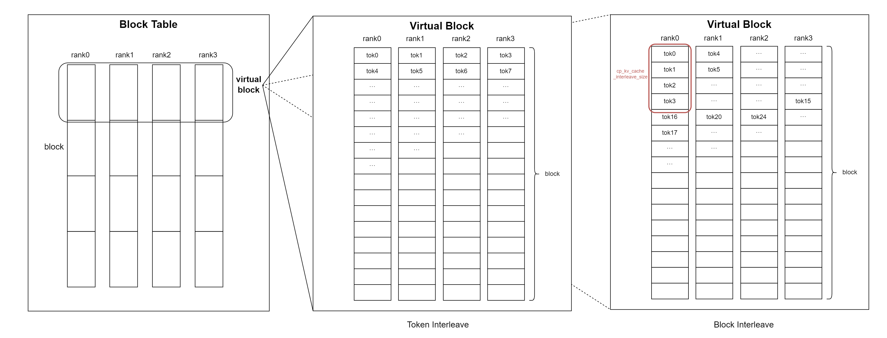
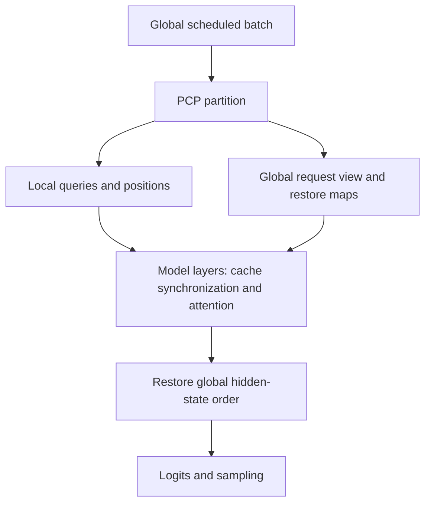
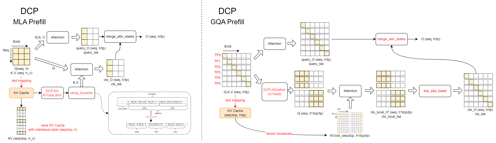
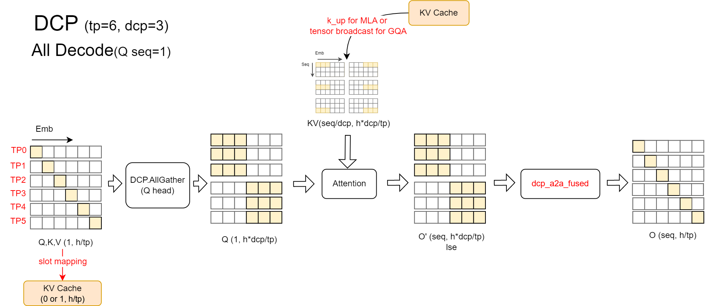

# Context Parallel

The context parallel features include Prefill Context Parallel (PCP) and Decode Context Parallel (DCP).

Prefill Context Parallel splits prefill tokens across additional ranks to reduce time to first token. See the [Context Parallel Guide](../../user_guide/feature_guide/context_parallel.md#prefill-context-parallel) for PCP configuration, supported feature combinations, and constraints.

Decode Context Parallel shards the KV cache along the sequence dimension across ranks in a DCP group, which may reuse TP ranks, PCP ranks, or both. It eliminates redundant KV-cache storage without adding devices to the process world.

This document describes PCP execution and DCP cache sharding. See the [PCP/DCP RFC](https://github.com/vllm-project/vllm-ascend/issues/12622) for the design rationale.

## KV-cache layout

DCP stores tokens in an interleaved layout across ranks. The interleaving granularity is controlled by `cp_kv_cache_interleave_size`, whose declared default is `1`.

SFA+DCP uses `block_size` as the effective interleave size; when KV transfer is enabled, set it explicitly to `block_size` to avoid a configuration error.

For a DCP size of `dcp_size`, a virtual block contains `block_size * dcp_size` tokens. For token `x`:

- `virtual_block_index = x // (block_size * dcp_size)`
- `offset_in_virtual_block = x % (block_size * dcp_size)`
- `interleave_index = offset_in_virtual_block // cp_kv_cache_interleave_size`
- `target_rank = interleave_index % dcp_size`

The slot-mapping calculation uses this layout so each DCP rank stores only its local sequence shard. The current implementation requires `block_size % cp_kv_cache_interleave_size == 0`.



PCP adds compute ranks but does not multiply the virtual block size. With DCP=1, each PCP rank retains the full sequence for its TP-local KV heads. With DCP enabled, only the owner of a token position writes its slot; other ranks and padding entries receive `PAD_SLOT_ID` (`-1`) and are excluded from cache writes.

PCP synchronizes cache data or cache-update inputs before attention. The exchange point depends on the backend. Sparse indexer and compressor state have their own layouts, separate from DCP-sharded attention storage.

## PCP execution

### Parallel topology

The model-worker count across a configured DP deployment is `DP * PP * PCP * TP`. Within one DP replica and PP stage, the TP×PCP grid contains `TP * PCP` workers. DCP reuses these workers.

For TP=2 and PCP=2:

| PCP coordinate | TP coordinate 0 | TP coordinate 1 |
| --- | --- | --- |
| 0 | rank 0 | rank 1 |
| 1 | rank 2 | rank 3 |

TP groups follow the table's rows: `[0, 1]` and `[2, 3]`. PCP groups follow its columns: `[0, 2]` and `[1, 3]`. DCP can span the PCP axis or the full grid:

| Configuration | Logical DCP groups | Query heads within a group |
| --- | --- | --- |
| DCP=1 | Single-rank groups | No sequence sharding |
| DCP=PCP=2 | `[0, 2]`, `[1, 3]` | Same TP-local heads |
| DCP=TP*PCP=4 | `[0, 2, 1, 3]` | Includes distinct TP head partitions |

The lists follow logical DCP rank order: the PCP coordinate varies first, then the TP coordinate.

MLA and SFA implement both stacked layouts; GQA/MQA stacking requires `DCP=PCP`. DSA and DSA V4.1 PCP use replicated caches, with DCP stacking outside their documented PCP configuration. With PCP=1, DCP groups lie within TP: MLA requires `TP % DCP == 0`, sparse SFA requires `DCP == TP` when DCP is enabled, and GQA has additional KV-head constraints. Deployment constraints are listed in the [Context Parallel user guide](../../user_guide/feature_guide/context_parallel.md).

### Batch lifecycle

The scheduler retains a global batch. Upstream `PCPManager` partitions each worker step into local virtual request rows and records how to restore global token order. `AscendPCPManager` adapts this lifecycle for Ascend buffers, attention metadata, graph padding, and decode-request assignment.



#### Prefill: head-tail partitioning

Causal attention gives later queries more preceding tokens to attend to. PCP balances this work using a head-tail partition, also called DualChunkSwap. For `L` scheduled query tokens and PCP size `P`, the request is divided into `2 * P` chunks of up to `ceil(L / (2 * P))` tokens. Rank `r` receives chunks `r` and `2 * P - 1 - r`. For P=4:

```text
Query chunks:  0  1  2  3  4  5  6  7
PCP rank 0:   [0]                  [7]
PCP rank 1:      [1]            [6]
PCP rank 2:         [2]      [5]
PCP rank 3:            [3][4]
```

Each fragment keeps its original positions and computed-prefix length, so tail queries can attend to earlier chunks. Local buffers are padded for collectives. Short requests can leave PCP-only ranks without queries; the PCP+DCP path replicates short prefills when splitting would leave an empty chunk.

#### Decode: request ownership and cache shards

With `PCP > 1` and `DCP == 1`, scheduled decode requests are assigned round-robin to PCP ranks. Each request's queries, including fixed-length speculative verification, stay with one owner for the step. Cache updates are synchronized across PCP, allowing ownership to change on subsequent steps. Ranks without queries still participate in the required collectives.

With PCP and DCP stacked, decode requests are replicated across PCP ranks. Each rank attends to its local DCP KV shard, then contributes its partial output and softmax statistics to the result merge.

#### Restoring global order

Attention metadata distinguishes global request order, local query order, and gathered KV order. `AscendPCPAttentionContext` carries the global view and the maps connecting these layouts. Gathered hidden states are restored to global token order at the runner boundary for sampling and supported draft-model processing.

## Attention execution

### Backend structure

DCP is implemented as a specialization of the corresponding v1 attention backend rather than as a parallel copy of it:

- `DCPMetadataBuilderMixin` owns DCP group/rank discovery and access to the per-rank context-length matrix.
- `DCPImplMixin` owns DCP collectives and the common partial-output/LSE merge.
- GQA, MLA, and SFA DCP builders inherit their v1 metadata builders. They only add DCP metadata fields or temporarily expose the DCP-specific cache view.
- GQA, MLA, and SFA DCP implementations inherit their v1 implementations and override only the kernel stages whose communication or cache layout differs.

The normal v1 builders remain the source of truth for request classification, padding, masks, graph metadata, and common KV-cache metadata. DCP-specific metadata is kept out of the normal v1 metadata schemas.

For PCP, `AscendPCPAttentionContext` supplies the global request view and restore maps to the backend metadata builders. The same local-query/global-cache distinction applies when PCP is stacked with DCP.

### Prefill and chunked prefill

During chunked or cached prefill, the local query must attend to KV-cache shards distributed across the DCP group.

- MLA gathers the context KV cache, restores request-contiguous order, and computes attention for the current query chunk.
- GQA gathers query heads across the DCP group, computes attention against each local KV shard, and combines partial outputs and LSE values.



PCP-only GQA and MLA gather current K/V or latent KV for cache insertion while computing local queries. With PCP+DCP, GQA maps merged history results back to local query fragments and combines them with attention over current-token causal prefixes. MLA gathers history KV in bounded chunks; senders derive a shared plan from the global batch so differing local fragment lengths produce matching collective sizes.

### Decode

Decode gathers the query heads required by each DCP rank, computes attention against the local KV-cache shard, and combines partial outputs and LSE values across the DCP group.



Causal multi-token decode can evaluate history and current tokens separately, then combine their results with LSE. This preserves current-token causality while history remains DCP-sharded.

### Combining DCP results

For a query/head, shard `j` returns normalized attention output `O_j` and log-sum-exp `L_j`. The complete result uses their softmax weights:

```text
m = max_j L_j
w_j = exp(L_j - m)
O = sum_j(w_j * O_j) / sum_j(w_j)
```

With DCP=PCP, Q heads are already identical within the group. The shared merge path gathers partial output/LSE contributions across PCP. With DCP=TP*PCP, distinct Q heads are first gathered across TP; the output exchange then combines TP and PCP contributions and restores the TP-local head range. TP-only DCP exchanges contributions within its DCP group. Common operations are implemented by `DCPImplMixin` and `dcp_a2a_fused`.

### GLM-5.2 SFA DCP replicated indexer

GLM-5.2 uses Sparse Flash Attention (SFA) with a LightningIndexer. For DCP, the indexer needs a full-sequence view to select the same sparse top-k blocks as non-DCP SFA, while the much larger SFA KV cache should remain sharded to retain DCP's memory benefit:

- The LightningIndexer cache is replicated on every DCP rank, so index selection uses the complete sequence.
- The SFA KV cache remains DCP-local. During decode, global indices from the replicated indexer view are remapped to local KV indices.
- During prefill or a mixed batch, KV blocks referenced by the request block table are compacted and all-gathered after the current layer writes its KV cache.
- Decode-only batches retain the DCP SFA Q-gather and result-merge path.

This mode is selected automatically for sparse SFA models when DCP is enabled (`decode_context_parallel_size>1`).

For a GLM-5.2 DCP deployment, keep `cp_kv_cache_interleave_size` equal to the KV-cache block size:

```bash
vllm serve <glm-5.2-model> \
  --tensor-parallel-size <N> \
  --prefill-context-parallel-size 1 \
  --decode-context-parallel-size <N> \
  --block-size <B> \
  --cp-kv-cache-interleave-size <B>
```

The replicated indexer increases indexer-cache memory in proportion to the DCP world size; the SFA KV cache itself remains sharded.

With PCP+DCP, the compact block-table plan is derived from the global request view. SFA PCP supports both KV-input gathering and fused prologs. A fused prolog first writes local cache rows; those rows are packed, gathered, and written to receiving caches. Indexer updates are synchronized separately.

### DSA and DSA V4.1 PCP

DSA PCP gathers hidden states and restores global order for cache updates, compression, and indexing. Attention then evaluates local query rows. DSA V4.1 follows the same local-query/global-cache structure with its sliding-window and compressor state, using backend-specific metadata.

## Integration with other features

- **Weight sharding:** Embedding and LM-head weights can be partitioned across TP×PCP. Supported SFA/DSA O-projections also use PCP weight shards: prefill can gather weights temporarily, while sharded decode exchanges activations and returns projected results to their owners. See the [PCP weight-sharding configuration](../../user_guide/feature_guide/context_parallel.md#usage) for the embedding, LM-head, and O-projection options.
- **Graph execution:** Local execution sizes and global batch metadata coexist. Input, slot, and restore buffers keep stable addresses across replay, and capture metadata must describe the runtime layouts. See [ACL Graph](ACL_Graph.md) for replay mechanisms and the CP user guide for supported modes.
- **Speculative decoding:** The target uses its PCP topology; supported draft paths run with logical PCP=1 on each peer. Target outputs are restored for draft processing and sampling. Draft DCP support remains model-specific.
- **KV transfer:** In the documented PCP P/D setup, the producer uses PCP and the consumer uses PCP=1. For standalone DCP and PCP+DCP, KV transfer requires `cp_kv_cache_interleave_size` to be set explicitly to the cache block size.

Configuration and connector compatibility are listed in the [Context Parallel user guide](../../user_guide/feature_guide/context_parallel.md).

Extensions need consistent topology checks, query/cache mappings, and output layouts for projection and sampling. Reuse the base metadata builders and shared DCP helpers. Compare against non-CP attention, including cached/chunked prefill and uneven local work; graph and draft paths need their own metadata coverage. See the [testing guide](../contribution/testing.md).

## Related Files

- Slot mapping: `vllm_ascend/worker/block_table.py`
- Input and attention metadata: `vllm_ascend/worker/v1/model_runner.py`
- Shared DCP backend capabilities: `vllm_ascend/attention/context_parallel/common_cp.py`
- GQA DCP backend: `vllm_ascend/attention/context_parallel/attention_cp.py`
- MLA DCP backend: `vllm_ascend/attention/context_parallel/mla_cp.py`
- SFA DCP backend: `vllm_ascend/attention/context_parallel/sfa_cp.py`
- DSA PCP backend: `vllm_ascend/attention/context_parallel/dsa_cp.py`
- Upstream PCP groups and virtual batches: `vllm/distributed/parallel_state.py`, `vllm/v1/worker/gpu/pcp_manager.py`
- PCP batch and metadata: `vllm_ascend/worker/v2/pcp_manager.py`, `vllm_ascend/worker/v2/attn_utils.py`
- PCP/DCP slot mapping: `vllm_ascend/worker/v2/block_table.py`
- Backend selection and configuration: `vllm_ascend/platform.py`
- DSA V4.1 PCP backend: `vllm_ascend/attention/context_parallel/dsa_v41_cp.py`
