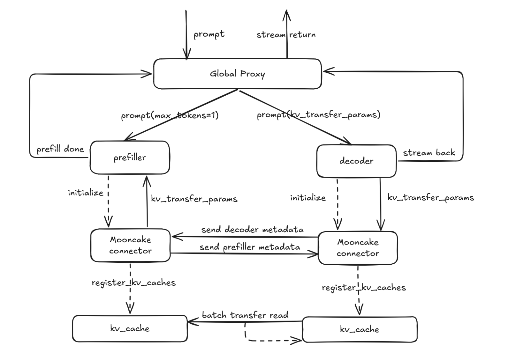
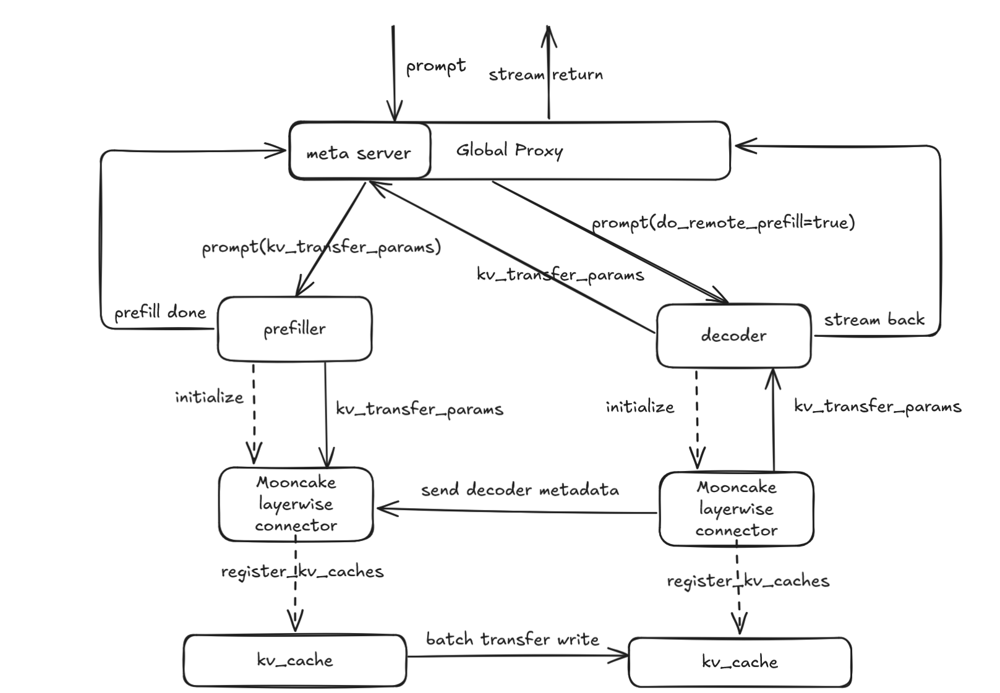
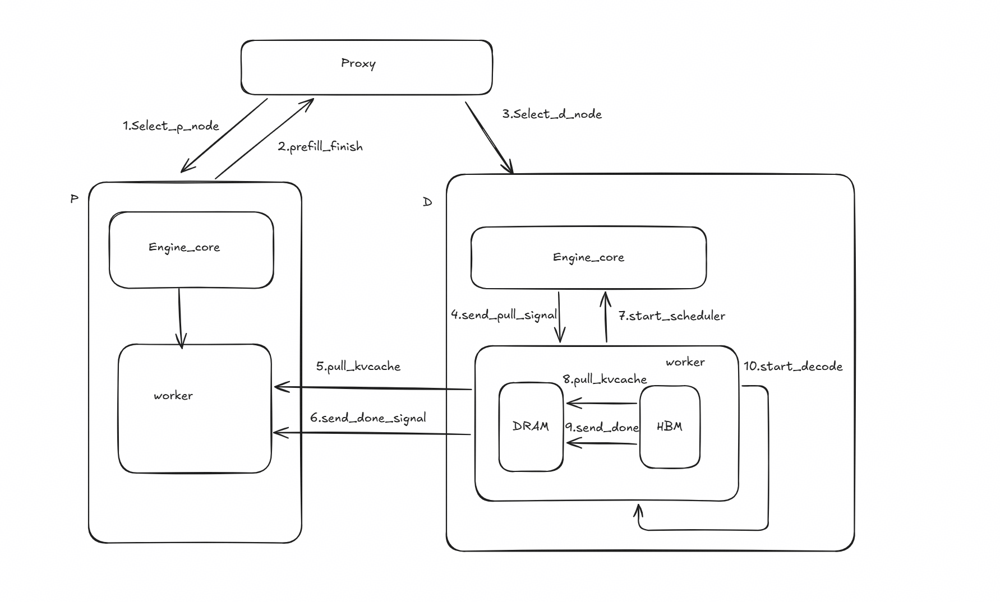

# Disaggregated-prefill

## Why disaggregated-prefill?

This feature addresses the need to optimize the **Time Per Output Token (TPOT)** and **Time To First Token (TTFT)** in large-scale inference tasks. The motivation is two-fold:

1. **Adjusting Parallel Strategy and Instance Count for P and D Nodes**  
   Using the disaggregated-prefill strategy, this feature allows the system to flexibly adjust the parallelization strategy (e.g., data parallelism (dp), tensor parallelism (tp), and expert parallelism (ep)) and the instance count for both P (Prefiller) and D (Decoder) nodes. This leads to better system performance tuning, particularly for **TTFT** and **TPOT**.

2. **Optimizing TPOT**
   Without the disaggregated-prefill strategy, prefill tasks are inserted during decoding, which results in inefficiencies and delays. Disaggregated-prefill solves this by allowing for better control over the system's **TPOT**. By managing chunked prefill tasks effectively, the system avoids the challenge of determining the optimal chunk size and provides more reliable control over the time taken for generating output tokens.

---

## Usage

vLLM Ascend supports the following KV cache transfer modes:

- **MooncakeConnector**: D nodes pull KV cache from P nodes.
- **MooncakeLayerwiseConnector**: P nodes push KV cache to D nodes in a layered manner.  
- **MooncakeD2RHConnectorV1**: D nodes pull KV cache into local host memory before loading it into device memory.

For step-by-step deployment and configuration, refer to the following guide:  
[PD disaggregation multi-node deployment guide](https://docs.vllm.ai/projects/ascend/en/latest/tutorials/features/pd_disaggregation_mooncake_multi_node.html)

---

## How It Works

### 1. Design Approach

Under the disaggregated-prefill, a global proxy receives external requests, forwarding prefill to P nodes and decode to D nodes; the KV cache (key-value cache) is exchanged between P and D nodes via peer-to-peer (P2P) communication.

### 2. Implementation Design

Our design diagram is shown below, illustrating the pull and push schemes respectively.

#### Mooncake Connector

1. The request is sent to the Proxy's `_handle_completions` endpoint.
2. The Proxy calls `select_prefiller` to choose a P node and forwards the request, configuring `kv_transfer_params` with `do_remote_decode=True`, `max_completion_tokens=1`, and `min_tokens=1`.
3. After the P node's scheduler finishes prefill, `update_from_output` invokes the schedule connector's `request_finished` to defer KV cache release, constructs `kv_transfer_params` with `do_remote_prefill=True`, and returns to the Proxy.
4. The Proxy calls `select_decoder` to choose a D node and forwards the request.
5. On the D node, the scheduler marks the request as `RequestStatus.WAITING_FOR_REMOTE_KVS`, pre-allocates KV cache, calls `kv_connector_no_forward` to pull the remote KV cache, then notifies the P node to release KV cache and proceeds with decoding to return the result.

#### Mooncake Layerwise Connector

1. The request is sent to the Proxy's `_handle_completions` endpoint.
2. The Proxy calls `select_decoder` to choose a D node and forwards the request, configuring `kv_transfer_params` with `do_remote_prefill=True` and setting the `metaserver` endpoint.
3. On the D node, the scheduler uses `kv_transfer_params` to mark the request as `RequestStatus.WAITING_FOR_REMOTE_KVS`, pre-allocates KV cache, then calls `kv_connector_no_forward` to send a request to the metaserver and waits for the KV cache transfer to complete.
4. The Proxy's `metaserver` endpoint receives the request, calls `select_prefiller` to choose a P node, and forwards it with `kv_transfer_params` set to `do_remote_decode=True`, `max_completion_tokens=1`, and `min_tokens=1`.
5. During processing, the P node's scheduler pushes KV cache layer-wise; once all layers pushing is complete, it releases the request and notifies the D node to begin decoding.
6. The D node performs decoding and returns the result.

##### Sparse SFA C8 cache transfer

For SFA models, `MooncakeLayerwiseConnector` can transfer the contiguous packed C8 main cache directly. Attention writes the quantized NoPE data, BF16 RoPE data and dynamic scales before recording the cache-write event. The connector waits for that event and copies the bytes without applying the legacy K/V INT8 quantization again. Indexer K and its scale tensor are transferred as separate components of the same physical layer.

For FP8 main and indexer caches, configure both P and D with `--kv-cache-dtype fp8 --attention_config.indexer_kv_dtype fp8`. Both ends must use matching cache layouts. This path requires main and indexer components to share one KV cache group with the same block-size scale. Noncontiguous packed main caches, TurboQuant, and DCP-replicated indexer layouts with different component block-size scales remain unsupported.

This transfer path still requires end-to-end validation on Ascend hardware, including configurations that combine it with `AscendStoreConnector` through `MultiConnector`.

#### Mooncake V2 Layerwise Push Connector

Set `kv_connector` to `MooncakePushConnector` on P and D, with `kv_role` set to
`kv_producer` and `kv_consumer`, respectively. Use
`examples/disaggregated_prefill_v1/load_balance_proxy_layerwise_server_example.py`
as the proxy. This experimental path supports PCP/TP routing and PP layer
lookup; workers currently require DCP=1 and do not support KVPP.

The proxy sends the request to D first. After allocating blocks, D's scheduler
submits an immutable destination snapshot to a 32-worker HTTP thread pool,
which posts to the proxy's `/v1/metaserver`. The scheduler continues scheduling
without waiting for HTTP. The proxy forwards the destination parameters to P;
no Mooncake bootstrap server or worker Ready handshake is used.

While P has outstanding transfers, its scheduler sets `has_sync_kv_loads=True`
so that `start_load_kv()` prepares request state before forward and layer hooks.
P queries D's scheduler metadata service for cache layouts. Its transfer
pool writes each layer and sends completion to D workers. D waits for all P
ranks, including ranks with no data to send, before reporting receive completion.
Completions that arrive before D's worker allocation metadata are buffered.
P waits for this step's metadata queries, WRITEs and terminal DONE callbacks
before returning worker results. Normal prefill completion releases KV without
delay-free; asynchronous scheduling remains enabled. This path currently assumes
successful transfer; request-level transfer failure reporting is TODO. Early
cancellation still retains the existing delayed-release protection.

P follows this lifecycle:

1. `update_state_after_alloc()` records source blocks. `build_connector_meta()`
   appends new chunk blocks and snapshots the scheduled prompt token range.
2. `start_load_kv()` installs the chunk metadata and starts or reuses the D
   metadata query. Destination topology is checked once per request after the
   query completes. The previous step's sends have already been drained.
3. `save_kv_layer()` records a device event for the layer's caches and submits
   available ranges to the transfer pool. SWA, circular and Mamba caches wait
   for the final chunk; non-owner ranks send DONE without a WRITE.
4. The runner calls `wait_for_save()` to publish remaining cache ranges and
   drain this step's transfers. With speculative decoding, this happens during
   finalization after draft execution. `get_transfer_results()` polls results
   without invoking this barrier or marking unfinished caches ready.
5. `request_finished()` releases normally completed requests immediately and
   sends a worker bookkeeping cleanup notice on the next step. Published
   requests cancelled before completion keep their blocks until workers report
   `finished_sending`; only those cancellations are forwarded to core for
   delayed release. P preemption remains unsupported and is a TODO.

Layer cache grouping uses the name prefix before the first numeric component
and the extracted layer index. For example, `model.layers.0.attn` and
`mtp.layer.0.self_attn` belong to separate namespaces even though both have index
zero. Names must still contain the numeric layer index expected by
`extract_layer_index()`. With multiple namespaces, layer hooks publish only
their own group's caches; final flushing and DONE submission happen in
`wait_for_save()` after draft execution rather than at the largest layer index.

The existing metaserver responds after P finishes. Consequently, outstanding
HTTP requests occupy pool threads for that duration. A multi-prompt request
must fit within both D's concurrent allocation capacity and the HTTP pool;
otherwise waiting sibling notifications can exhaust the pool. Connection
establishment failures are retried up to three attempts; response failures are
not replayed because P may already have been dispatched. Background HTTP
failures are collected in a later scheduling step and sent to D workers. A
connection-establishment failure finishes that receive as failed. Invalid
metaserver URLs and rejected pool submissions also fail new receives before
publishing their addresses. When P may
already have been dispatched, D marks the receive failed but retains its blocks
until all P ranks report drained writes. Late HTTP errors do not reopen completed
receives. Each request is assumed to use one P engine with a fixed topology.
On D, missing terminal completions and unconfirmed WRITE drain mark only the
affected receive as failed; they do not stop the worker. Failure is reported together with receive completion
once all source WRITEs are confirmed drained. Until then, the request and its
blocks remain pending (client cancellation can end the request but does not
release its blocks). A late drained DONE can complete the receive.
Cancellation/drain recovery for a permanently lost P is not yet
implemented, so repeated failures can exhaust D's available KV blocks. A failure
of the shared DONE listener remains fatal.

#### Mooncake D2RH Connector

D2RH (device-to-remote-host) splits KV cache transfer into two stages:
**P HBM → D DRAM → D HBM**. Once the first stage completes, P can release the
transferred KV cache without waiting for D's host-to-device (H2D) copy or decoding.

The pull arrows in the diagram represent requests, not the direction of KV data.

1. **Route the request (1–3):** The proxy selects P, waits for prefill to finish,
   and forwards the request and KV transfer metadata to D.
2. **Stage KV cache (4–6):** D's scheduler asks its workers to pull the required
   KV cache from P HBM into D DRAM. The workers notify P when the first-hop reads
   complete, allowing P to release the corresponding cache.
3. **Load and decode (7–10):** The workers notify D's scheduler that staging is
   ready. D allocates the required device blocks and loads the staged KV cache
   into HBM. Decoding starts only after the required H2D transfers complete.

Valid host-cache hits avoid repeated P-to-D transfers. Valid D-local HBM prefix
hits can also reduce H2D copies; a host-cache hit alone is not an HBM hit. Host
blocks remain pinned until all H2D reads using them finish.

To enable this mode, set `"kv_connector": "MooncakeD2RHConnectorV1"` in
`--kv-transfer-config` on both nodes, with `"kv_role": "kv_producer"` on P and
`"kv_role": "kv_consumer"` on D. Keep the `prefill` and `decode` parallelism
settings consistent with the deployment and reserve enough host memory on D
for staging.

For startup scripts and a proxy example, see
[D2RH deployment on Atlas 850E](../../tutorials/features/pd_disaggregation_mooncake_multi_node.md#d2rh-deployment-on-atlas-850e-uboe).

### 3. Interface Design

Taking MooncakeConnector as an example, the system is organized into three primary classes:

- **MooncakeConnector**: Base class that provides core interfaces.
- **MooncakeConnectorScheduler**: Interface for scheduling the connectors within the engine core, responsible for managing KV cache transfer requirements and completion.
- **MooncakeConnectorWorker**: Interface for managing KV cache registration and transfer in worker processes.

### 4. Specifications Design

This feature is flexible and supports various configurations, including setups with MLA and GQA models. It is compatible with A2 and A3 hardware configurations and facilitates scenarios involving equal TP setups and certain unequal TP setups across multiple P and D nodes.

| Feature                       |      Status    |
|-------------------------------|----------------|
| A2                            | 🟢 Functional  |
| A3                            | 🟢 Functional  |
| equal TP configuration        | 🟢 Functional  |
| unequal TP configuration      | 🟢 Functional  |
| MLA                           | 🟢 Functional  |
| GQA                           | 🟢 Functional  |

- 🟢 Functional: Fully operational, with ongoing optimizations.
- 🔵 Experimental: Experimental support, interfaces and functions may change.
- 🚧 WIP: Under active development, will be supported soon.
- 🟡 Planned: Scheduled for future implementation (some may have open PRs/RFCs).
- 🔴 NO plan/Deprecated: No plan or deprecated by vLLM.

---

## DFX Analysis

### 1. Config Parameter Validation

Validate KV transfer config by checking whether the kv_connector type is supported. On transfer failures, emit clear error logs for diagnostics.

### 2. Port Conflict Detection

Before startup, perform a port-usage check on configured ports (e.g., rpc_port, metrics_port, http_port/metaserver) by attempting to bind. If a port is already in use, fail fast and log an error.

### 3. PD Ratio Validation

Under non-symmetric PD scenarios, validate the P-to-D tp ratio against expected and scheduling constraints to ensure correct and reliable operation.

---

## Limitations

- Heterogeneous P and D nodes are not supported, for example, running P nodes on A2 and D nodes on A3.

- In non-symmetric TP configurations, only cases where the P nodes have a higher TP degree than the D nodes and the P TP count is an integer multiple of the D TP count are supported (i.e., P_tp > D_tp and P_tp % D_tp = 0).
