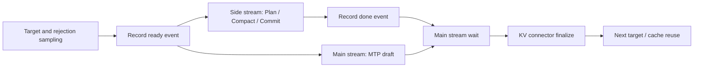

# GDN RecoverSSM execution

RecoverSSM commits the accepted target transition after sampling. The ordinary
path launches a Plan, convolution Compact and state Commit for each cache group
before drafting. This opt-in path submits the groups through a worker-owned
recovery stream and can capture the full recovery sequence in one ACL graph.
It changes scheduling and metadata movement, not the state recurrence or
Verify/Commit/Compact numerical algorithms. The same PR also registers audited
RecoverSSM and optional isolated PLE consumers with the existing Qwen CPU-length
policy, avoiding an unnecessary exact-count D2H snapshot and main-thread wait.

## Configuration

```json
{
  "gdn_recoverssm_execution_config": {
    "async_commit": true,
    "capture_commit": true,
    "merge_groups": true
  }
}
```

Both execution switches default to false. With both false, the inherited
RecoverSSM lifecycle remains active. No new environment variable is added.

`capture_commit` captures the post-sampling recovery sequence; it does not
enable `ascend_compilation_config.enable_static_kernel`. The operator provider
is still chosen independently. Optional providers use the same context API.

The initial implementation requires PP=PCP=DCP=1. Async overlap is restricted
to Qwen4Exp MTP, whose draft blocks use QSA rather than GDN. The loaded draft is
also checked for recurrent GDN modules. SP head shards and physical cache
strides are retained. These checks do not qualify wider parallel topologies.

## Dependencies and lifecycle



The join occurs when leaving the draft context, before upstream connector
finalize/save. A second entry fence protects preemption, page reuse and
metadata mutation before the next target. Sampling exceptions join in a
`finally` block. Shutdown synchronizes the recovery stream before releasing
graph workspaces. Normal steps use device event waits, not CPU event waits.
Dynamic input tensors are recorded on the recovery stream so the allocator
cannot recycle them before its reads finish.

Align mode has additional postprocessing and boundary-state copies in the
inherited Mamba lifecycle. It joins recovery before those operations and
therefore remains serialized; group graph capture can still apply. The initial
async path is intended for decode with prefix caching disabled. This preserves
correctness rather than assuming align bookkeeping is independent.

## Groups, pools and graphs

Separate groups may have different physical page IDs even when their shapes
match. They share one recovery graph but retain independent metadata and Plan
calls. Layer pointer tables are merged only when the request metadata buffers,
geometry and provider identity match. No device values are read on the CPU to
guess equivalence. Duplicate checkpoint owners are rejected.

Graph metadata is padded to bounded power-of-two request buckets, capped at
the configured sequence capacity. Padded requests use NULL pages, zero accepted
counts and zero query lengths. Each group stages its metadata with one Triton
launch, avoiding a chain of individual zero/copy kernels. Shared sampled counts
are copied by the first group only; later groups leave that buffer untouched.
Source page strides,
sampler mappings and group-specific block tables remain intact. Contexts cache
their convolution pointer-table views once rather than reconstructing them at
every commit.

Warmup and capture operate on zero metadata and NULL pages. They must never
warm against real accepted replay records: doing so would apply the accepted
transition more than once. Real metadata is staged only before replay. Graphs
and input buffers are owned by the worker, with no global Tensor cache.

Before allocating the real KV pool, startup creates a temporary one-block cache
using the configured cache planner and profiles recovery only on NULL pages.
It prepares all dispatch buckets with the int32 counts returned by V2 sampling
and both sampler-mapping staging variants. Unexpected dtypes keep eager recovery
and never trigger request-time capture. The measured reserve covers peak Torch graph
allocations and retained device-memory growth, including temporary context/cache
metadata conservatively. The worker deducts it from automatic or explicitly
requested KV budgets before physical-layout scaling. The temporary executor,
graphs and cache bindings are then torn down using upstream profiling cleanup.
Ascend target/draft graph-registration objects are isolated and restored around
this startup-only probe, including exceptional exits, so temporary NULL-cache
registrations cannot replace the real capture state.

After the real caches and target/draft graphs are initialized, startup captures
recovery against the actual contexts. Its measured footprint must fit the
pre-KV reserve; otherwise startup reports the mismatch. This extra footprint
also contributes to startup graph-memory reporting. No guessed fixed-size
reserve for the graphs or new environment variable is introduced. A separate
150 MiB non-Torch safety allowance is deducted before KV allocation, matching
the worker's existing estimation policy; the final measured guard stays strict.

Requests only update metadata and replay prepared graphs. An unprepared context,
group subset or metadata signature uses eager recovery on the same stream and
provider, with a warning; it never captures a graph during a request. Startup
capture still requires real NPU execution and compilation time. Reserving more
KV memory must also leave room for communication workspaces and in-flight
transfers. Memory utilization 0.96 is an experiment setting, not a safe default.

## CPU-length capability

For the exact audited Qwen4Exp model-state, MTP speculator and metadata-builder
pairs, initialization enables the runner's existing producer/consumer skip
together. Rejection-corrected device lengths remain authoritative. The optional
PLE builder from #23310 only isolates recovery flags at construction; it uses
the same audited metadata consumer and is registered explicitly. Unknown
builders, PCP/DCP, sparse KV offload and incompatible model/speculator paths
retain exact CPU lengths. No per-layer or unconditional synchronization removal
is introduced.

This incorporates the change previously tracked in #22866. Qwen4Exp cache and
provider wiring remains in #23310, and optional TileLang numerical kernels
remain in #22552.

## Validation

CPU tests cover event order, exception propagation, shutdown, target and
connector fences, group-specific page preservation, compatible group merging,
NULL-page startup capture, complete bucket coverage, no-capture request fallback,
pre-KV budget deduction and probe cleanup. The metadata staging kernel has a
separate exact integer reference test covering mappings, strided sources and
graph padding.
It also checks that later groups preserve the shared sampled-count buffer.

Before merge, NPU validation must check graph replay and state equivalence,
MTP acceptance, all three recovery kernels in the raw trace, and performance
against the same provider/configuration with these execution switches disabled.
Measure throughput without profiling and collect the short trace separately.
No end-to-end speedup is implied by CPU checks or offline compilation.

## Reading overlap evidence

Different device streams and intersecting kernel-task intervals establish
execution overlap, not an equal reduction in critical-path latency. Inspect
recovery completion relative to the final MTP task and compare MTP durations
with the control: shared compute/bandwidth resources can stretch main-stream
work even when recovery ends before MTP. Measure throughput in a separate,
unprofiled round. Do not label a task-interval overlap percentage as the
percentage of recovery cost eliminated.
