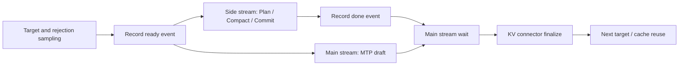

# GDN RecoverSSM execution

RecoverSSM commits the accepted target transition after sampling. The ordinary
path launches a Plan, convolution Compact and state Commit for each cache group
before drafting. This opt-in path submits the groups through a worker-owned
recovery stream and can capture the full recovery sequence in one ACL graph.
It changes scheduling and metadata movement, not the state recurrence or
Verify/Commit/Compact numerical algorithms.

## Configuration

```json
{
  "gdn_recoverssm_execution_config": {
    "async_commit": true,
    "capture_commit": true,
    "merge_groups": true
  }
}
```

Both execution switches default to false. With both false, the inherited
RecoverSSM lifecycle remains active. No new environment variable is added.

`capture_commit` captures the post-sampling recovery sequence; it does not
enable `ascend_compilation_config.enable_static_kernel`. The operator provider
is still chosen independently. Optional providers use the same context API.

The initial implementation requires PP=PCP=DCP=1. Async overlap is restricted
to Qwen4Exp MTP, whose draft blocks use QSA rather than GDN. The loaded draft is
also checked for recurrent GDN modules. SP head shards and physical cache
strides are retained. These checks do not qualify wider parallel topologies.

## Dependencies and lifecycle



The join occurs when leaving the draft context, before upstream connector
finalize/save. A second entry fence protects preemption, page reuse and
metadata mutation before the next target. Sampling exceptions join in a
`finally` block. Shutdown synchronizes the recovery stream before releasing
graph workspaces. Normal steps use device event waits, not CPU event waits.
Dynamic input tensors are recorded on the recovery stream so the allocator
cannot recycle them before its reads finish.

Align mode has additional postprocessing and boundary-state copies in the
inherited Mamba lifecycle. It joins recovery before those operations and
therefore remains serialized; group graph capture can still apply. The initial
async path is intended for decode with prefix caching disabled. This preserves
correctness rather than assuming align bookkeeping is independent.

## Groups, pools and graphs

Separate groups may have different physical page IDs even when their shapes
match. They share one recovery graph but retain independent metadata and Plan
calls. Layer pointer tables are merged only when the request metadata buffers,
geometry and provider identity match. No device values are read on the CPU to
guess equivalence. Duplicate checkpoint owners are rejected.

Graph metadata is padded to bounded power-of-two request buckets, capped at
the configured sequence capacity. Padded requests use NULL pages, zero accepted
counts and zero query lengths. Each group stages its metadata with one Triton
launch, avoiding a chain of individual zero/copy kernels. Source page strides,
sampler mappings and group-specific block tables remain intact. Contexts cache
their convolution pointer-table views once rather than reconstructing them at
every commit.

Warmup and capture operate on zero metadata and NULL pages. They must never
warm against real accepted replay records: doing so would apply the accepted
transition more than once. Real metadata is staged only before replay. Graphs
and input buffers are owned by the worker, with no global Tensor cache.

First use still needs runtime JIT, ACL graph capture and graph-private memory.
A cold request is not a performance sample. Reserving more KV memory must leave
room for this graph memory, communication workspaces and in-flight transfers.
Memory utilization 0.96 is an experiment setting, not a general safe default.

## Validation

CPU tests cover event order, exception propagation, shutdown, target and
connector fences, group-specific page preservation, compatible group merging,
and NULL-page capture warmup. The metadata staging kernel has a separate exact
integer reference test covering mappings, strided sources and graph padding.

Before merge, NPU validation must check graph replay and state equivalence,
MTP acceptance, all three recovery kernels in the raw trace, and performance
against the same provider/configuration with these execution switches disabled.
Measure throughput without profiling and collect the short trace separately.
No end-to-end speedup is implied by CPU checks or offline compilation.
