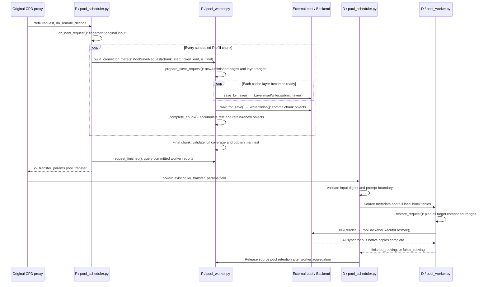
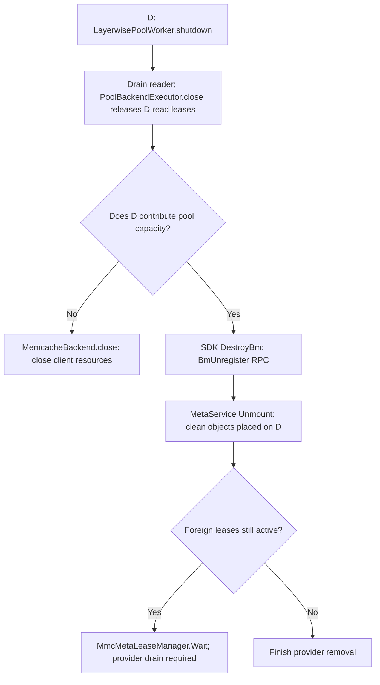

# Layerwise pool connector

This connector writes Prefill cache components to an external pool as each
layer completes in every scheduled Prefill chunk. Decode restores its whole
request before becoming runnable. Full older pages are not copied again;
the unfinished page of each cache group is revisited when a later chunk
extends it. The final handoff aggregates the committed chunk objects.
The connector is registered independently as `LayerwisePoolConnector`.
The [implementation task breakdown](layerwise_pool_development_tasks.zh.md)
maps the original extraction plan to the shared code and the remaining
deployment acceptance requirements.

The implementation is under development. Unit tests and small SDK probes do
not establish full-model correctness or production readiness. Ordinary GVA
pooling and pooled PD now call `PoolCacheLayout` for object descriptions and
the common writer/executor for I/O. Ordinary pooling keeps its existing
per-layer prefetch and rotating-HBM gates through `LayerwiseObjectAdapter`;
PD restores the request as a whole. Both call the same prefix query service.
Full objects use `pool-full-v1` content identities, including the actual byte
format. CP, strided, packed and state/tail components use `pool-component-v1`
identities. The backend key builder remains shared. Equal hashes and byte
counts alone cannot make different physical layouts compatible, so shared mode
does not silently borrow old, unqualified full-object keys. Explicit legacy
mode (`shared_pool_objects=false`) retains the old ordinary-pool path.
Committed compatible objects are borrowed under read protection. Partial
checkpoints without a complete prefix hash include the original input digest
and exact boundary. Non-GVA sessions still use private attempt identities.
CPU byte tests cover alias-buffer preservation, CP-to-TP restore, HND/NHD
format isolation, packed pages and whole-page circular-tail restoration.
The full ordinary worker test covers construction, registration, bound-step
hooks, original send/receive queues, attention-start gates and shutdown.
Non-prefix-cacheable groups remain excluded from ordinary prefix lookup:
GLM's transient tail manager seeds state at logical pool-aligned boundaries.
PD handoff can still carry an exact-boundary tail snapshot using the common
object reader. Shared object identity does not make that tail a reusable
ordinary prefix. The native
bidirectional probe is prepared but has not run: all eight NPU devices were
occupied during preflight, which refused to launch the test container.

The current object format is source-layout-based. Source metadata enables
heterogeneous PD restoration, while autonomous prefix queries reconstruct keys
for the querying worker's own layout. This is not the canonical Store TP/chunk
format of upstream vLLM Store: arbitrary TP endpoints cannot yet independently
discover each other's objects. Decode writeback in this new connector also
does not implement the upstream Store's complete per-group progress lifecycle.

## Accepted prefixes and temporary layer-reuse snapshots

PD writes the stable Prefill input. Decode runs its own MTP verification; it
does not send rejected drafts back to Prefill or roll back Prefill objects.
Reusable decode prefixes must have accepted token hashes. Computing a key
early does not make the corresponding bytes a readable pool object.

Ordinary pooling with `layerwise_offload` also has a different obligation:
save a layer's working bytes before its rotating HBM slot is overwritten.
That copy can precede speculative acceptance. `LayerwiseObjectAdapter` gives
unhashed work a `pool-step-v1` identity derived from the scheduler's
`ReqMeta.pool_snapshot_id`; prefix queries never generate this identity.
Known full hash-backed pages retain their shared identities. Ordinary pooling
without layer reuse saves only `save_end_token`, not scheduled draft capacity.

The next step restores the previous snapshot's recorded source descriptors
and clips token coverage to its accepted boundary. It must not reconstruct
the previous partial key from the shorter new boundary. Independent KDA/Mamba
caches remain model-owned in HBM; only aliased layers need this restore.
Replicated ranks use the same scheduler step identity, but only the writer
owns private-key cleanup. The configured TP step barrier precedes retirement.
Failed reads cancel pending saves before their callbacks can publish data.
This temporary-snapshot lifecycle does not add an MTP handoff protocol.

The actual installed vLLM Scheduler and KVCacheManager are covered by a CPU
integration test with real pointer copies and the production prefix-query
endpoint. A pooled eight-token prefix of a nine-token prompt resumes with
one scheduled token. Failed reads preserve `kv_load_failure_policy`: `fail`
ends the request, while `recompute` retries computation without probing the
same failed external prefix again. Cancellation retains blocks until I/O
drains. These tests do not establish NPU execution or full-model accuracy.

## Ownership of the code

| Responsibility | Module | Reused interface |
| --- | --- | --- |
| Framework entry and layer completion | `kv_p2p/mooncake/layerwise_pool_connector.py` | `build_layer_cache_bundles`, KVPP placement |
| CPD request scheduling and handoff | `kv_p2p/mooncake/pool_scheduler.py` | V2 prompt boundary helpers |
| Source commits and bulk restore | `kv_p2p/mooncake/pool_worker.py` | Pool backend and plans below |
| Source report query and retention release | `kv_p2p/mooncake/pool_control.py` | ZMQ control; carries no KV bytes |
| Key reconstruction | `kv_pool/ascend_store/key_codec.py` | Existing MemCache/Mooncake key functions |
| Layer write, bulk read, native sessions | `kv_pool/ascend_store/{layerwise_writer,bulk_reader,backend/executor}.py` | Existing backend GVA and key-range APIs |
| Required-layer completion before object publication | `kv_pool/ascend_store/layerwise_writer.py` | `LayerwiseWriteCompletion`, used by the PD writer and ordinary GVA/block-key range sender |
| Compute readiness, layer copy and checked publication | `kv_pool/ascend_store/layerwise_writer.py` | `LayerwiseWriteSession`, synchronously invoked on each caller's existing serial queue |
| Allocation batch planning and native result alignment | `kv_pool/ascend_store/layerwise_writer.py` | `LayerwiseAllocationPlan`, used for ordinary full/partial GVA objects, range sessions and private PD objects |
| GVA and key-range packet splitting and copy submission | `kv_pool/ascend_store/backend/copy_ranges.py` | Called by ordinary pool transfer threads, the layer writer and bulk restore executor |
| Heterogeneous cache restore | `kv_pool/ascend_store/{cache_layout,restore_planner,state_snapshot}.py` | Registered cache specs and actual tensor strides |
| Ordinary-pool object I/O and prefix discovery | `kv_pool/ascend_store/layerwise/object_adapter.py`, `pool_cache_layout.py`, `prefix_lookup.py` | Existing sender/receiver queues and slot/event gates; the same plans and queries as pooled PD |
| Mamba/GDN component offsets | `utils/state_layout.py` | The same calculation called by V2 `pull_worker.py` |

Paths in this table are relative to `vllm_ascend/distributed/kv_transfer/`.
The new worker does not inherit a V2 worker or construct a transfer engine.
Cache allocation distinguishes a model's shared hybrid pages from rotating
layer reuse. `apply_layerwise_kv_cache_plan()` marks a cache config only after
it rewrites the descriptors; both runners use that marker when allocating
aliases. Merely enabling layerwise pooling or observing a zero `layer_stride`
does not identify a reuse slot, since GLM's different cache components can
legitimately share a model-owned page backing.
Ordinary pooling still uses its existing worker and layer transfer threads;
sharing backend methods does not mean those orchestration paths are unified.
Their ownership contracts differ: an ordinary pool allocation can reference a
shared prefix object. The PD writer now distinguishes explicitly shared
full-prefix keys from private attempt objects. The
ordinary GVA sender deliberately avoids `WRITE_FAIL` removal on ambiguous
failures; the PD writer can abort its exclusive objects.
For ordinary block-key range sessions, a failed or malformed revoke keeps the
unresolved keys owned and fails the sending thread. Shutdown drains the thread
before retrying those keys. A successful sibling commit is removed from the
pending set before rollback begins, so it cannot be deleted by another key's
cleanup failure. The ordinary worker also retains its backend and read-lease
ownership if shutdown cleanup fails; closing the client is not a substitute
for confirming that cleanup succeeded.

The private PD writer also records per-key rollback progress. After a valid
partial abort response, only failed keys remain pending; successfully removed
SDK sessions are not sent again during shutdown retry. This progress is saved
before attempting expired-lease revocation, so a malformed fallback response
cannot reintroduce keys already cleaned by the first operation. An ambiguous
response keeps all keys from that operation pending until cleanup is confirmed.
The common `LayerwiseWriteSession` executes the layer operation on either
caller's existing serial queue: validate the step/layer, wait for the compute
event, copy the ranges, and record successful keys only after native I/O
returns. `publish()` checks that every required layer has completed before
calling the backend commit. It creates no extra queue and never allocates,
revokes or releases an object. Consequently ordinary pool slot-release events
and PD futures cannot report completion before this operation drains.
Both GVA and key-range writes check cancellation between native batches.
Cancellation waits for the current call to return, skips later batches, and
does not mark the partially copied layer complete. The object owner remains
responsible for aborting private attempts or handling shared prefix failures.
The ordinary pool facade also forwards the actual callback layer name. Its
worker checks the bound metadata identity and maps the name to the expected
stage-local layer before recording an event or submitting work. This preserves
its sequential prefetch schedule while rejecting stale-step or wrong-layer
callbacks instead of selecting buffers solely from an incrementing counter.
`LayerwiseAllocationPlan` snapshots selected keys and sizes, rejects conflicting
sizes for the same key, allocates repeated keys once, and expands aligned native
results back to the original slots. Range-session batches use the caller's
existing key limit. A malformed batch stops later submissions; the caller still
owns earlier or ambiguously created allocations. The plan does not interpret
an SSD sentinel as writable memory, commit objects, revoke keys, or choose
which prefix hits to skip. Those decisions remain in the existing callers.
Request-to-layer plan construction still uses the respective adapters; further
unification of that part is pending. Layer addresses remain lazily bound so
ordinary KVPP slot reuse does not require materializing every layer's addresses
before the forward step.
The write paths share an explicit required-layer completion check.
Ordinary pooling binds one plan to the tasks of each forward step, so queued
tasks keep their original plan even when another step is prepared. A final
publication task cannot commit a key after copying only some of its planned
layers. This check owns neither allocation nor rollback and does not change
ordinary pooling's shared-key failure policy. For block-key range writes,
completion is recorded separately for each successful key. A failed sibling
does not prevent complete keys from committing, and a successful sibling
does not make the failed key complete. Existing range-session revocation and
per-group commit ownership remain in the ordinary sender.
The shared GVA copy function preserves ordinary pooling's existing input-address
and per-packet byte limits. Pooled PD additionally bounds total bytes per SDK
submission and batches a layer's component ranges together. Allocation, native
leases, event creation and commit ownership remain with the callers; the
common session owns event waiting and the publication completeness check.

Configuration templates and commands are in
[`examples/disaggregated_prefill_v1/layerwise_pool/`](../../../../examples/disaggregated_prefill_v1/layerwise_pool/README.md).

## Request flow

`PoolSaveRequest.chunk_start` records the scheduler's preceding planned
boundary; the worker checks it against its committed progress. `token_end` is
the current valid boundary and `is_final` marks the last Prefill chunk.
Scheduler metadata uses authoritative full block tables.
Each group rounds `chunk_start` down to its own logical page boundary, so a
newly completed page includes its earlier tokens without rewriting complete
older pages. Unfinished components and recurrent/tail checkpoints receive
their own boundary-specific object identities.

The worker retains address-free object references across chunks. Committed
objects receive renewable source protection immediately; it shares the
executor's process-key reference counts with ordinary reads. The PD manifest
stays unpublished until the final union covers the complete required cache.
Only final recurrent/circular checkpoints enter that handoff; obsolete state
leases are released without deleting valid cached objects. Final handoff
retention starts at publication, rather than timing out from the first chunk.
Failed intermediate writes permanently prevent a successful handoff for that
attempt. Cancellation/finished-source metadata releases unfinished histories
at metadata binding, including V2 Runner steps without model computation.
Preemption drops active source pins and starts a new attempt; still-resident
immutable objects can be borrowed during recomputation. A CP rank with no
local tokens in an early chunk records empty progress and still participates
in the final worker-set barrier.

The proxy remains
`examples/disaggregated_prefill_v1/load_balance_proxy_server_example.py`.
It forwards the existing `kv_transfer_params` dictionary. The nested
`pool_transfer` value is the new connector's payload; the HTTP routing protocol
and proxy implementation do not change.

P retains its HBM only until its own compute and writes drain. D's completion
releases pool retention. A cancelled D attempt cannot report completion while
native writes into its destination buffers are still running.

## Source keys and heterogeneous layouts

`PoolTransferMetadata` carries source profiles, source key coordinates, immutable
object/component descriptions, the original request digest, and the valid token
interval. It carries neither source HBM addresses nor D's MTP requirements.

Both worker reports and the HTTP handoff encode `objects` as a
`layout-table-v1` dictionary. `layouts` interns the source profile, group,
source TP/head rank, PP rank, object size and component layouts. Each `rows`
entry carries a layout index, the original object ID, and per-component token
start/end/offset triples. Layer names, component formats, head ranges and byte
strides are stored once per distinct layout. No keys, ranges or state semantics
are inferred or discarded by compression. Decoding applies the same object and
byte-bound validation as expanded objects, and rejects invalid table indices.
The decoder also accepts the initial expanded object list. P and D should run
the same connector revision; the original proxy simply forwards either payload.

Payload size still grows with source workers and prompt pages. Long-context
acceptance must measure the complete P response and D request, including proxy
parsing and scheduler/worker serialization; compact JSON and short-request
correctness tests alone do not establish acceptable control-plane latency.

D calls `PoolObjectRef.resolve()` with the **source** `PoolKeyIdentity`.
Local TP, PP, CP, group numbering, and block IDs determine destinations only.
`RestorePlanner` intersects logical layers, components, token ranges and heads,
then emits key/offset/destination/length reads. It rejects incomplete coverage
before issuing any native copy. Source replicas can satisfy one destination
range without copying the same logical range twice.
Source token intervals are indexed once per component and byte format, so a
target page can skip unrelated source pages. Overlapping candidates retain
their original order: the index does not change which replica supplies bytes
or weaken the coverage check. This avoids the quadratic scan for ordinary
disjoint pages; it is not an end-to-end long-context latency guarantee.

Ordinary token KV can be reshaped through its actual strides, including
HND/NHD differences. MLA with no RoPE can register a zero-width second
component; it contributes no pool object or restore range. The latent
component keeps its original identity, and other empty layouts are rejected.
Packed SFA C8/TurboQuant pages are opaque bytes: a
token-shaped tensor view does not prove token rows can be copied independently.
Their kernel-page format must agree. A restore beginning inside a shared local
packed prefix page is currently rejected rather than overwriting that page.

## MTP follows Mooncake V2

MTP introduces no second negotiation or conversion protocol. D uses its own
speculator. The shared `prefill_boundary.py` functions preserve V2's rule for
leaving the final prompt token to D on stateful/compressed-cache models.

For Mamba/GDN, `state_snapshot.bind_mamba_checkpoint()` selects the checkpoint
using the existing none/align block-table convention. It describes all the
actual components that V2 transfers. `plan_mamba_restore()` selects the source
TP/PCP shards and calls `mamba_component_copy_slices()` for the exact V2 byte
offsets. GLM KDA uses the existing GDN projection order. There is no GLM-specific
MTP adapter, accepted-history filtering, or separate scratch-state conversion.

Circular/tail state follows V2's whole-page copy rule. The component shape and
byte format must match; different ring capacities are not converted.

V2's compatibility checks still apply. Equal-shard Mamba transfers require
equal component lengths; unequal-shard convolution transfers require compatible
projection widths and equal temporal row counts. A draft cache required by D
must be present in the source metadata. Different MTP settings are accepted
only when the resulting transfer layout satisfies these existing rules.

GLM-5.3 KPool indexing requires DCP=1 independently of RecoverSSM.
`attention/indexer_kpool.py::Glm5NextKPoolIndexerBackend.__init__()` rejects
DCP>1 before model execution; the guard predates this connector and does not
branch on connector type. A reduced-model DCP2 startup confirmed that rejection
after correcting interleave to the effective hybrid block size. GLM-5.2 DCP
validation therefore must not be reported as GLM-5.3 DCP support. Supporting
the latter requires a model/indexer change, not just a pool restore mapping.

GLM RecoverSSM accepts this connector through the existing
`models/glm5next/recoverssm_config.py` validation. It retains V2's requirements:
speculative decoding enabled, Mamba cache mode `none`, prefix caching disabled,
PP=PCP=DCP=1, and stochastic rounding disabled. Enabling the connector does not
relax these model execution restrictions.

KVPP also uses the existing configuration and placement rules. The new PD
connector follows V2's full-history KVPP prefetch path, even though its pool
writes happen layer by layer. It must not opt into the ordinary prefix pool's
rotating-slot layerwise-load mode. Like V2, decode-only KVPP is rejected.
Draft caches keep KVPP's independent allocations. Their save callbacks still
use attention completion bundles: an MTP indexer is saved when its enclosing
draft attention completes, rather than waiting for an indexer callback that
the model does not emit. Target and draft namespaces remain separate even when
they reuse a layer index. This grouping changes neither cache ownership nor
MTP execution.

GLM NoPE attention must also complete layers on a PCP rank without local query
tokens. Such a rank can own cache from earlier prefill chunks. Empty ranks in
a PCP sharded layout retain the metadata's padded input rows to participate in
cache and O-projection collectives; the query kernel remains skipped. Nonempty
queries keep their existing trimming to the indexer's actual query count.
An empty non-collective path still emits the composed main/indexer save callback
before returning. Skipping a rank's collectives can leave a later request
waiting even if the preceding request already returned a result.

A reduced GLM-5.3 checkpoint passed P TP1/PCP2 to D TP1/PCP1 with MTP3 on both
sides and V2 Runner eager execution. The original proxy handled 48-token and
258-token non-streaming requests followed by a 79-token streaming request;
each restored real pool bytes and matched the D-local baseline's 16 output
tokens. P/D exited normally without internal forced cleanup. This covers the
final-chunk empty-rank regression, not full-model accuracy or all PCP/MTP/graph
combinations.

The same reduced checkpoint also passed PP2-to-PP1 and PP1-to-PP2 transfers
with TP1, MTP3 on both sides, BF16 cache and V2 Runner eager execution. Each
direction covered the two HTTP requests and the streaming request above; all
16 output tokens matched the D-local baseline. Save/restore completions were
2/1 and 1/2 respectively, with real pool reads on the receiving workers. Both
roles exited normally without forced worker cleanup. This checks global-layer
ownership across PP stages, including KDA and the final stage's draft caches;
it does not extend the result to full weights or every combined topology.

For graph configuration, only P requires PIECEWISE to preserve per-layer
Python save callbacks. D restores before a request becomes runnable, outside
model graph execution, so the connector does not downgrade its selected graph
mode. `NPUPlatform.apply_config_platform_defaults()` derives a private role
marker before vLLM calls `requires_piecewise_for_cudagraph(extra_config)`.
An absent marker retains the conservative PIECEWISE requirement; a producer
rejects a decode exemption if platform setup was bypassed. This configuration
distinction does not itself verify NPU graph replay.

Multimodal preprocessing and vision encoding remain model-owned. Request identity
includes the media hash, modality and placeholder position; the proxy forwards
the original chat content. GLM-5.3's dummy video-frame search is bounded by the
temporally aligned pixel budget so image-only initialization does not probe
impossible video canvases. This model fix applies to ordinary serving as well.
The acceptance probe supports chat messages and requires exact generated tokens
and real pool transfer counters for changed and repeated media.

## Failure and validation boundaries

- Every expected P worker, including an explicitly empty KVPP owner, must
  report a committed attempt before a handoff is published.
- A D request cancelled before allocation validates its handoff and releases
  source retention without starting a reader. Cancellation after allocation
  is sent to the workers, including loads not dispatched yet; source retention
  is released only after their aggregated completion.
- Restore failures use request-level `failed_recving` for both single and
  multiple cache groups. The framework aggregates failures only after all D
  workers finish. The connector does not invalidate the full destination block
  table: that table can include untouched local prefix blocks shared by other
  requests. Recompute or abort therefore applies to the failed request without
  treating its shared prefix as corrupt.
  Collected asynchronous errors include the worker, request and attempt IDs in
  the worker log, including native failures that coincide with cancellation.
  Cancellation without a native error does not emit a restore-error log.
- Source retention starts before native protection is acquired. RPC latency
  consumes that window; it does not extend the manifest lifetime. If acquisition
  exhausts the window, only a failed report is published, retaining cleanup
  ownership for expiry or shutdown to retry.
  Expiry removes the manifest and releases P's native lease; it does not delete
  immutable pool objects immediately. A D that already has the complete handoff
  may still restore resident objects under its own read leases. If an object is
  unavailable, the request fails without consuming incomplete cache contents.
- GVA writes use a conservative deadline starting before allocation. Each
  native copy batch is checked before and after execution, and commit is
  checked separately. An expired attempt drains and aborts without publication.
  This does not renew uncommitted objects or guarantee safety of an SDK copy
  that itself outlives protection; that native contract still needs validation.
- GVA reads hold per-key native protection. Renewal acquires the next native
  lease before releasing the previous operation; repeated `AddLease` calls
  must not accumulate unmatched acquisitions. Renewal failure makes the
  request fail after native I/O drains. Each native read batch checks for a
  recorded renewal failure before submission, including after metadata lookup;
  remaining batches are not issued after protection becomes uncertain. This
  does not interrupt an in-flight SDK call or extend its native lease contract.
  Failed acquisition/cleanup obligations are tracked separately from active
  reads and retried during shutdown.
- Missing objects fail the affected request. MemCache's unmatched-key lease
  result requires an additional successful existence query confirming absence
  before removing that key's cleanup obligation. The same error can originate
  from local tracking after a server acquisition, so its code alone is not
  sufficient. Malformed responses, query failures and other errors retain
  cleanup ownership. Successfully acquired sibling keys are still released.
- Failed native cleanup quarantines further work instead of silently treating
  an uncertain session as released. Shutdown joins control and renewal work
  before closing the backend.
- A write lease can expire before all layers are ready. MemCache may then
  discard its local allocation tracker, causing `batch_write_finish(WRITE_FAIL)`
  to reject the key. After native I/O drains, the PD writer revokes only its
  unpublished private attempt keys whose abort failed after the lease deadline.
  Already-missing keys count as cleaned only after a successful existence query
  confirms absence. Uncertain results retain cleanup ownership. Ordinary shared
  prefix allocations do not use this fallback. Native tests with a real one-second
  lease and a three-second readiness delay cover expiry before the first layer,
  between layers, and an already-removed private object; cleanup and the next
  request's byte comparison passed. They do not cover expiry during native I/O
  or automatic eviction under memory pressure.
- An invalid or missing allocation response does not prove that the server
  allocated nothing. The PD writer retains ownership of all requested private
  keys before calling allocation. Keys without a usable GVA are revoked by key;
  registered allocations use the normal write-abort path. Partial or uncertain
  cleanup retains ownership and prevents new writes. This policy is not applied
  to ordinary shared prefix objects.
  A separate native pressure test committed 31 objects of 32 MiB and observed
  automatic eviction of five older objects. The next allocation returned GVA 0
  after local interval registration rejected a recycled server GVA. Private-key
  cleanup passed, the evicted read failed with zero copied bytes, and a resident
  object's subsequent 256-byte read matched its source. These results establish
  failure cleanup and read recovery, not successful allocation under sustained
  pressure: the SDK's recycled-GVA registration failure remains unresolved.
- Backend construction runs on the worker's main thread and restores the
  existing SIGINT/SIGTERM handlers afterward, including initialization failure.
  MemCache can replace native signal dispositions while Python's `getsignal()`
  still reports the original callback. Reapplying the handlers keeps vLLM in
  charge of request drain and connector shutdown before SDK teardown.
  Graph package imports also preserve those handlers: restoring only around
  the storage constructor is insufficient if a prior compiler import already
  replaced the framework callback. The worker's model-loading scope preserves
  them too, since CANN operator registration can import graph packages even in
  eager mode. Graph packages retain their atexit cleanup.
- A failed shutdown keeps the backend client and unresolved ownership alive
  for cleanup retry. An early executor close cannot stop renewal for a live
  copy. These rules do not turn the SDK's finite per-copy lease into an
  unlimited transfer timeout; native error results still fail the request.
  Pool membership has a separate lifetime from inference requests. A D
  process contributing pool memory can hold objects written and retained by
  P. Its shutdown then removes a storage provider, not just a reader. A
  model-free three-client test reproduced shutdown beyond the framework
  deadline without any P restart: D waited in `BmUnregister`, while
  MetaService waited in `MmcMetaLeaseManager::Wait()` during object cleanup.
  Releasing P's retention before closing D allowed all clients to exit
  normally. Draining D's own reads therefore does not establish that its
  contributed pool memory is free. Independent provider restart with live
  foreign leases remains unaccepted; extending the deadline or forcing
  process exit is not a fix.
- For independently managed D workers, a tested MemCache arrangement sets
  D's local DRAM/HBM pool capacity to zero and disables its storage tier.
  Other members supply the pool. In the SDK membership log these D clients
  join as `role=proxy`; this is unrelated to the CPD HTTP proxy. Native
  three-client validation kept P's retention active and confirmed exact D
  reads and normal D exit. This deployment choice does not establish safe
  removal of a storage provider with foreign leases.
  A reduced GLM-5.3 model also passed sequential P/D restart with this layout,
  P TP1 / D TP2, FP8 KV, MTP3 and the V2 runner in eager mode. The original
  CPD proxy and MetaService stayed alive; post-restart requests matched the
  local D baseline and both D workers reported actual pool reads. P/D exited
  normally without forced termination. This is bounded lifecycle evidence,
  not full-weight or production performance acceptance.
- GVA shared objects use content plus format identities. A shared writer must
  not revoke or mark another writer's content key failed. Existing committed
  objects are borrowed under a read lease and checked for the declared size;
  format compatibility is encoded in the content identity. Non-GVA private
  attempts retain their exclusive namespace and rollback behavior. Native
  in-flight TTL/eviction guarantees still require the SDK contract described
  above; CPU transport substitutes do not prove those guarantees.
- Full GLM-5.2/5.3 execution, NPU graph replay, the full heterogeneous topology
  matrix, and cross-machine accuracy/performance require runtime acceptance.
  CPU byte-copy tests establish planner behavior, not those acceptance claims.

