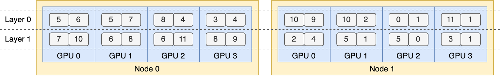

# Model Runner V1 EPLB Architecture

This page describes the legacy Model Runner V1 (MRv1) EPLB implementation, including Swift and the MRv1 policy factory. Model Runner V2 uses a different controller, policy, and asynchronous movement lifecycle; see [Model Runner V2 EPLB Architecture](model_runner_v2_eplb.md). User-facing configuration for both runners is documented in the [EPLB user guide](../../user_guide/feature_guide/expert_parallelism_load_balancer.md).

## Why We Need EPLB?

When using Expert Parallelism (EP), different experts are assigned to different NPUs. Given that the load of various experts may vary depending on the current workload, it is crucial to maintain balanced loads across different NPUs. We adopt a redundant experts strategy by duplicating heavily-loaded experts. Then, we heuristically pack these duplicated experts onto NPUs to ensure load balancing across them. Moreover, thanks to the group-limited expert routing used in MoE models, we also attempt to place experts of the same group on the same node to reduce inter-node data traffic, whenever possible.

To facilitate reproduction and deployment, vLLM Ascend supports the deployed EP load balancing algorithm in `vllm_ascend/eplb/core/policy`. The algorithm computes a balanced expert replication and placement plan based on the estimated expert loads. Note that the exact method for predicting expert loads is outside the scope of this repository. A common method is to use a moving average of historical statistics.



## How to Use EPLB?

Please refer to the EPLB section of the user guide for detailed information: [How to Use EPLB](../../user_guide/feature_guide/expert_parallelism_load_balancer.md)

## How It Works?

**EPLB Module Architecture**

```shell
vllm_ascend
└── eplb
    ├── adaptor
    │   └── vllm_adaptor.py
    ├── core
    │   ├── policy
    │   │   ├── policy_abstract.py
    │   │   ├── policy_default_eplb.py
    │   │   ├── policy_factory.py
    │   │   ├── policy_flashlb.py
    │   │   ├── policy_random.py
    │   │   └── policy_swift_balancer.py
    │   ├── eplb_device_transfer_loader.py
    │   ├── eplb_utils.py
    │   └── eplb_worker.py
    └── eplb_updator.py
```

**1. Adaptor Module**
*Handles registration and adaptation for different MoE model types*

- `vllm_adaptor.py`
  Registers MoE layers through the `VllmEplbAdaptor.register_layer` hook during layer initialization (missing pipeline layers are skipped naturally), exposes per-layer expert parameters to the policy algorithms, and applies placement updates back to the model. Model-level facts such as `first_k_dense_replace` are read from the model config; the expert count and EP rank are taken from the first registered MoE layer in `VllmEplbAdaptor.__init__`.

**2. Core Module**
*Implements core algorithms, updates, and asynchronous processing*

- **Policy Submodule**
  *Load balancing algorithms with factory pattern instantiation*
    - `policy_abstract.py`
      Abstract class for load balancing strategy interfaces
    - `policy_default_eplb.py`
      Default implementation of open-source EPLB paper algorithm
    - `policy_factory.py`
      Strategy factory for automatic algorithm instantiation
    - `policy_flashlb.py`
      Threshold-based adjustment reducing operational costs through layer-wise fluctuation detection
    - `policy_random.py`
      Random policy for basic testing
    - `policy_swift_balancer.py`
      Enhanced version optimizing expert swaps for low-bandwidth devices (e.g., A2)

- `eplb_device_transfer_loader.py`
  Manages expert table/weight transmission and updates
- `eplb_utils.py`
  Utilities for expert table initialization and mapping
- `eplb_worker.py`
  Asynchronous algorithm orchestration and result processing

**3. System Components**

- `eplb_updator.py`
  Central coordinator for load balancing during inference workflows

### Runtime Lifecycle

One full update cycle spans `expert_heat_collection_interval +
algorithm_execution_interval + num_moe_layers` forward iterations:

1. **Heat collection** (forward thread): every MoE layer accumulates
   physical-expert token counts into a per-layer load tensor. Iterations are
   classified as prefill or decode by comparing the padded scheduled token
   count with the maximum expected decode-iteration token count; iterations
   outside `eplb_heat_collection_stage` contribute nothing and do not advance
   the collection counter.
2. **Gather and wakeup**: at the end of the collection phase, per-layer loads
   are all-gathered over the `dynamic_eplb` process group and written into a
   manager-shared dict, then the algorithm subprocess is woken through a
   queue.
3. **Algorithm execution** (per-rank spawned EPLB subprocess): the configured
   policy computes a new placement, the result is validated (every logical
   expert placed exactly once per layer, replicas on distinct ranks), and a
   greedy per-layer send/receive plan is produced.
4. **Layer-by-layer weight update** (forward thread): one MoE layer per
   iteration. The D2D transfers for the layer are issued asynchronously
   before the forward pass and committed after it; expert maps and the
   logical-to-physical table are updated on the same iteration.

### Default Algorithm

#### Hierarchical Load Balancing

When the number of server nodes evenly divides the number of expert groups, we use the hierarchical load balancing policy to leverage group-limited expert routing. We first pack the expert groups onto nodes evenly, ensuring balanced loads across different nodes. Then, we replicate the experts within each node. Finally, we pack the replicated experts onto individual NPUs to ensure load balancing across them. The hierarchical load balancing policy can be used in the prefilling stage with a smaller expert-parallel size.

#### Global Load Balancing

In other cases, we use the global load balancing policy, which replicates experts globally regardless of expert groups, and packs the replicated experts onto individual NPUs. This policy can be adopted in the decoding stage with a larger expert-parallel size.

### Add a New EPLB Policy

If you want to add a new eplb policy to vllm_ascend, you must follow these steps:

1. Inherit the `EplbPolicy` abstract class of `policy_abstract.py` and override the `rebalance_experts` interface, keeping the input parameters `current_expert_table` (shape `[num_layers, num_ranks, num_experts_per_rank]`) and `expert_workload`, and returning the `(changed_flag, per_layer_priority, new_expert_table)` tuple that the shipped policies return, where `per_layer_priority` orders the layers by how much the computed placement changes them.
For example:

    ```python
    class RandomLoadBalance(EplbPolicy):
        def rebalance_experts(self, current_expert_table, expert_workload):
            new_table = copy.deepcopy(current_expert_table)
            num_layers = len(current_expert_table)

            for i in range(num_layers):
                # randomly choose two card
                # indices = random.sample(range(num_card), 2)
                indices = [3, 1]

                # swap redundant experts
                expert_id_to_exchange = new_table[i][indices[0]][-1].clone()
                new_table[i][indices[0]][-1] = new_table[i][indices[1]][-1]
                new_table[i][indices[1]][-1] = expert_id_to_exchange

            return 1, [-i for i in range(num_layers)], new_table
    ```

2. To add a new EPLB algorithm, include the policy type and its corresponding implementation class in the `PolicyFactory` of `policy_factory.py`. The policy type must be added to the allowed `eplb_policy_type` values in `EplbConfig` (`vllm_ascend/ascend_config.py`) as well.

Note that the placement returned by a new policy must keep every logical expert placed exactly once per layer (plus its redundant replicas on distinct ranks); invalid placements are detected in `eplb_worker.py` and rolled back to the previous table with an error log.

### Add a New MoE Model

**Implementation Guide for Model Integration**

1. **Adapter File Modification**
    - Extend `vllm_ascend/eplb/adaptor/vllm_adaptor.py`
    - The adaptor reads model-level facts from the model config (for example `first_k_dense_replace` for the dense-layer count); the global and local expert counts come from the registered MoE layers. Add model-specific parameters there when the config field names differ.

2. **MoE Feature Integration**
    - Extend `vllm_ascend/ops/fused_moe/routed_experts.py` with MoE-specific expert-weight bookkeeping if the new model stores expert tensors differently

3. **Registration Logic Update**
    - Ensure each MoE layer instance calls `VllmEplbAdaptor.register_layer` so the adaptor discovers the layer list for the current pipeline rank
    - Maintain backward compatibility with existing model types

4. **Validation & Testing**
    - Verify parameter consistency across layers
    - Test cross-device communication for expert tables
    - Benchmark against baseline implementations (e.g., Qwen3-MoE)

*Key Implementation Notes:*

- Preserve existing interface contracts in abstract classes
- Leverage `eplb_utils.py` for shared expert mapping operations

## DFX

### Parameter Validation

EPLB configuration is validated when the Ascend configuration is parsed
(`EplbConfig` in `vllm_ascend/ascend_config.py`):

- Integer fields (`expert_heat_collection_interval`,
  `algorithm_execution_interval`, `num_redundant_experts`) must be integers;
  negative values are rejected.
- `eplb_policy_type` must be one of `0`, `1`, `2`, `3`.
- `eplb_heat_collection_stage` must be one of `all`, `prefill`, `decode`.
- Dynamic EPLB additionally requires the `DYNAMIC_EPLB` or
  `EXPERT_MAP_RECORD` environment variable as a safety guard.
- At placement time, `(num_experts + num_redundant_experts)` must be
  divisible by the expert-parallel size.

### Consistency

#### Expert Map

The expert map must be globally unique during initialization and update. In a multi-node scenario during initialization, distributed communication should be used to verify the consistency of expert maps across each rank. If they are inconsistent, the user should be notified of which ranks have inconsistent maps.
During the update process, if only a few layers or the expert table of a certain rank has been changed, the updated expert table must be synchronized with the EPLB's context to ensure global consistency.

#### Expert Weight

When updating expert weights, ensure that the memory allocated for the expert weights has been released, or that the expert (referring to the old version) is no longer in use.

### Observability

- The balancing summary is logged on EP rank 0 once per cycle as
  `[eplb/worker] Expert hotness imbalance, current: mean=... max=..., updated: mean=... max=...`,
  where current/update are the mean and maximum per-layer peak-to-average
  load ratios before and after the computed placement.
- The same statistics are exported as `eplb:expert_hotness:*` gauges
  (`current_mean`, `current_max`, `update_mean`, `update_max`, and the
  per-layer `imbalance` series) when ms-service-metric collection is enabled.
- Subprocess failures stop further EPLB optimization for the process
  lifetime and are reported with `[eplb/worker]` warning logs.

## Limitations

Before using EPLB, start the script and add `export DYNAMIC_EPLB="true"`.
Before performing load data collection (or performance data collection), start the script and add `export EXPERT_MAP_RECORD="true"`.
MRv1 EPLB fields and MRv2 EPLB configuration are mutually exclusive; see the
[EPLB user guide](../../user_guide/feature_guide/expert_parallelism_load_balancer.md) for the validation rules.
