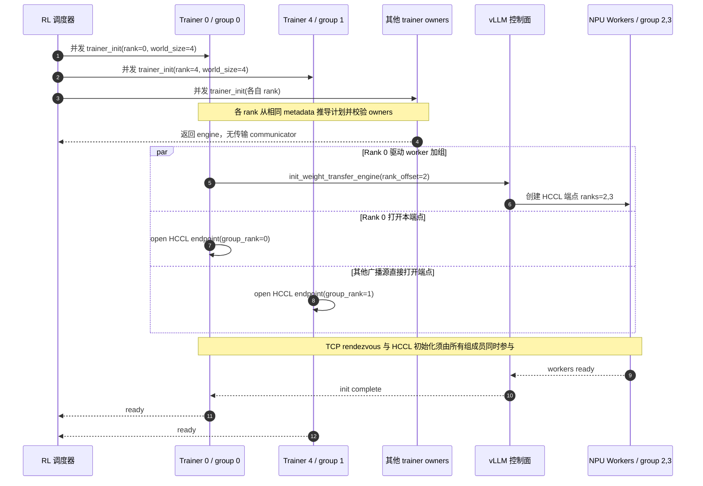
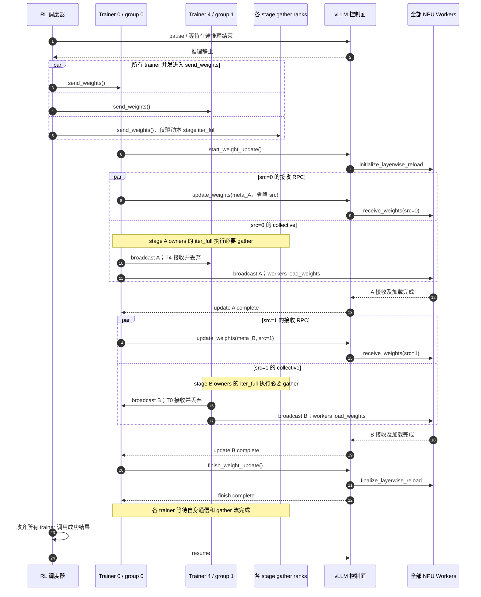
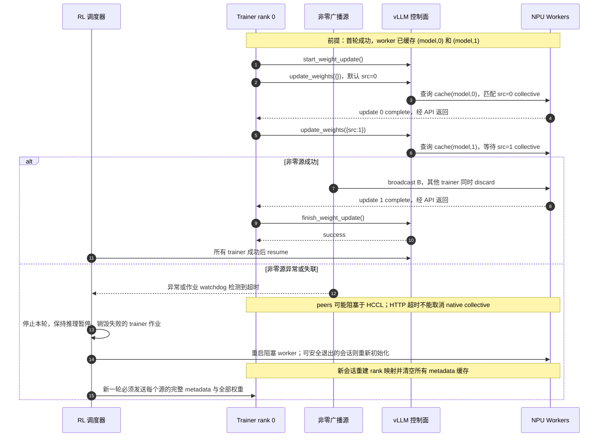

# RL 权重广播多源 rank：vLLM Ascend 继承设计

状态：本分支已实现 HCCL 多源适配、CPU 回归测试、示例和四卡验收入口；NPU 真机验收仍待完成。以下“下游现状”表保留设计时基线，当前实现说明见本节末。

核查日期：2026-10-31（Asia/Shanghai）。

## 1. 结论与代码基线

建议复用上游 vLLM 的所有权声明、广播计划和更新编排，通过继承扩展 HCCL 初始化与 NPU 收发路径。不要只把接收端的 `src=0` 改成可配置字段：训练端的 rank 压缩映射、非当前源的接收丢弃、逐源元数据缓存也必须同时适配。

上游 [PR #62557](https://github.com/vllm-project/vllm/pull/62557) 已于 2026-10-28 合入，合并提交为 `2b678ac739166bd0356883048673bbd1c34a3b0e`。它依赖 [PR #63256](https://github.com/vllm-project/vllm/pull/63256) 引入的 `ParamMeta.owners` 和 `WeightSource.iter_full()` 契约；该前置 PR 于 2026-10-26 合入，提交为 `50a184f43583dec8942a0494d1fec4f4acc4a2e9`。

| 对象 | 本次固定基线 | 用途 |
| --- | --- | --- |
| 上游 vLLM main | `17550580e932f15e772185847382d3ae4211f5ec` | 实际逐函数核查的源码快照，包含上述两个 PR |
| 下游 vllm-ascend origin/main | `f9e063e8761f87fa0847262cd2dbdf69c88658e7` | 差距分析和新分支起点 |
| 本地设计分支 | `codex/rl-multi-source-weight-broadcast-design` | 保存本文及文档导航 |

工作区中的 `vllm-v0.30.0` 目录原检出提交为 `ced6857afa0ea7b2e3f0846a62e1394e90f15607`，尚无本特性。本次通过 fetch 获取最新 main 对象并读取其源码，没有切换或修改该目录的工作树。目录名称与原检出代码均不能用作本特性的支持依据。

本文用“上游现状”描述已核实行为，用“下游设计”描述拟议修改；本文没有执行 GPU/NPU 功能或性能测试。

实现采用两个完整 trainer adapter，按上游是否提供 `_broadcast_plan` 集中选择。现代 adapter 继承上游初始化、源计划及发送循环，只覆盖 HCCL hooks、NPU broadcast/discard；legacy adapter 保留 v0.32.0 与当前 verified main 的单源接口。两者共享 NPU 发送、同步和失败状态逻辑，避免混用两种 `_broadcast` 签名。worker 为所有配套版本提供 `src` 与 model/source 隔离缓存，保留旧单源默认值及 per-update packed 参数。

新增 `examples/rl/rlhf_hccl_multi_source.py` 和 `tests/e2e/pull_request/four_card/rlhf/test_hccl_multi_source.py`；后者用 trainer ranks 0/4 到 TP2、W1/W2 两轮独立 startup-load oracle 验证。旧 vLLM 因缺少上游能力跳过多源用例；packed 真机 lane 沿用现有跨流问题的 skip，不视为已验证支持。

## 2. 目标和范围

目标场景是分离部署的 RL trainer 与 rollout inference：例如 trainer 按 PP stage 持有不同层，每个 stage 的首个 owner 向全部推理 worker 广播自己的完整 checkpoint 张量，推理端继续通过模型原生 `load_weights()` 完成 TP/PP 等本地加载。

本阶段覆盖 dense HCCL 广播、packed/unpacked 两条路径、HTTP/Ray 既有控制面、多轮更新，以及旧单源调用的兼容。多源指“一次 start/finish 生命周期内按源顺序轮转”，并不提供多个源同时向同一通信组并发广播的能力。

下列能力另行设计：分片直接 M-to-N 重分布、sparse HCCL、NPU IPC、GPU trainer 直连 NPU worker、自动容错和断点续传。NCCL unique-ID 的握手格式不能用于 HCCL；本方案继续使用下游已有 TCP rendezvous。

## 3. 上游实现分析

### 3.1 所有权与全局一致的源视图

实现位于上游 [`base.py`](https://github.com/vllm-project/vllm/blob/17550580e932f15e772185847382d3ae4211f5ec/vllm/distributed/weight_transfer/base.py) 与 [`nccl_engine.py`](https://github.com/vllm-project/vllm/blob/17550580e932f15e772185847382d3ae4211f5ec/vllm/distributed/weight_transfer/nccl_engine.py)。

| 字段或接口 | 上游语义 | 下游必须保持的契约 |
| --- | --- | --- |
| `TrainerInitInfo.rank` | 调用进程在 trainer 作业中的显式全局 rank | 不从不明确的默认训练进程组推断 |
| `ParamMeta.owners` | 持有该参数的 trainer ranks，顺序具有意义；`None` 表示所有 rank | 多广播源时，每个参数必须显式声明 owners |
| `owners[0]` | 该参数的 broadcaster | 按声明的第一个 owner 选源，不取 owner 中数值最小者 |
| `WeightSource.metadata` | 每个 trainer rank 都可见、内容及顺序相同的完整模型元数据 | PP stage 不能只声明自己的局部参数列表 |
| `WeightSource.iter_full()` | 本 rank 所有 owned 参数的完整张量，顺序与 metadata 一致 | 可以在 owner 子组执行 all-gather；仅广播源将结果发往 rollout |
| `mesh_shape` / `placements` | 描述训练侧所有权布局，供相关后端使用 | dense broadcast 不会据此发送局部分片，仍要求完整张量 |

每个 rank 都必须并发调用 `trainer_init()` 和 `send_weights()`，包括不加入传输组的 FSDP 等 gather 参与者。只有 trainer rank 0 发起控制面 RPC；其他广播源的 `is_sender` 仍为 False，因此不能用 `is_sender` 判断是否持有传输 communicator。

### 3.2 广播计划与三个 rank 空间

`NCCLTrainerWeightTransferEngine._broadcast_plan(meta)` 的逻辑可以写为：

```text
owner(m) = 0 if m.owners is None else m.owners[0]
slices[b] = 所有 owner(m) == b 的参数，保留 metadata 内的顺序
group_ranks = sorted({0} ∪ set(slices.keys()))
src(b) = group_ranks.index(b)
rank_offset = len(group_ranks)
transfer_world_size = rank_offset + inference_worker_count
worker_group_rank = rank_offset + dp_index * parallel.world_size + parallel.rank
```

`parallel.world_size` / `parallel.rank` 指推理侧现有并行配置。上面的 trainer 全局 rank、传输组 rank、本机 NPU device index 是三个不同概念；`src` 必须是传输组 rank。

例如 trainer 有 8 个 rank；前半层 owners 为 `(0, 1, 2, 3)`，后半层 owners 为 `(4, 5, 6, 7)`；rollout 为 DP=2、TP=2、PP=1：

| 角色 | Trainer rank 或推理位置 | 传输组 rank | 作用 |
| --- | --- | --- | --- |
| 控制面 + stage A 源 | trainer 0 | 0 | 广播前半层，发起全部 RPC |
| stage A gather 参与者 | trainer 1、2、3 | 不加入 | 驱动本 stage 的 `iter_full()` |
| stage B 源 | trainer 4 | 1 | 广播后半层 |
| stage B gather 参与者 | trainer 5、6、7 | 不加入 | 驱动本 stage 的 `iter_full()` |
| rollout workers | DP0/TP0、DP0/TP1、DP1/TP0、DP1/TP1 | 2、3、4、5 | 依次接收 src=0 和 src=1 |

此时 `rank_offset=2`、`world_size=6`。后半层的线上 `src=1`，不是 trainer rank 4；6 也不是训练作业总 rank 数加 worker 数。rank 0 即使不持有任何参数，也仍占据传输组 rank 0，参与其他源的广播并驱动控制面。

### 3.3 初始化约束

上游 `trainer_init()` 在进入 NCCL rendezvous 前基于一致 metadata 检查：

1. source 实现 `iter_full()`。
2. 多广播源时，任何参数的 owners 均不能缺省。
3. 同一个 trainer rank 所拥有的参数必须具有同一个 first owner，避免其 gather 跨越不同源的轮次。
4. rank 0 若是某参数的 owner，必须排在该参数 owners 的第一位。
5. `world_size > len(group_ranks)`，至少保留一个推理 worker。

`ParamMeta` 自身还校验 owners 非空、非负、无重复及 mesh 一致性。这里的“所有 rank 检查一致”依赖 source 正确提供相同 metadata；上游没有另建协调通道替 source 修复或比对不一致的声明。

### 3.4 更新协议、缓存与集体操作

上游 `NCCLWeightTransferUpdateInfo` 新增 `src: int = 0`；names、dtype_names、shapes 允许为空。worker 接收时检查 `0 <= src < rank_offset`，并将元数据缓存键由 model 扩展为 `(model, src)`。

每轮由 rank 0 调用一次 start，按 broadcaster 的 trainer-rank 顺序依次执行 update，最后调用一次 finish。每个 update 的接收 RPC 必须与训练侧 collective 同时执行，否则双方会相互等待。源与源之间在同一传输组内串行。

在某个源的轮次，**传输组内所有其他 trainer 端点也必须接收并丢弃该源数据**。上游通过 `_discard(meta, src)` 完成，packed 模式也必须遵循相同 chunk 边界。未持有 communicator 的 gather ranks 仅驱动自己的 `iter_full()`。

首轮发送每源完整 metadata；后续整轮 metadata 与上一成功轮相同，rank 0 对各源发送空 metadata 以复用缓存。对 src=0，trainer 序列化时删除 `src` 键，保留单源旧 payload；非零源必须显式带 `src`。重初始化清除所有 model/source 缓存。

空 metadata 且没有对应缓存时，上游语义是“不接收任何参数”，不能将其理解成 worker 自动发现参数。只有确定对端已有该源缓存时才能发送空列表。当前发送循环会重新计算计划，但已有 communicator 不会自动改成员；修改 owners 导致传输组成员变化时，应重新初始化。

### 3.5 时序图一：下游目标初始化

图中选两个广播源（trainer 0 和 4）、两个推理 worker；它们在 HCCL 组中的 ranks 分别为 0、1、2、3。



## 4. 下游现状与继承缺口

以下结论针对固定的 Ascend 基线，核心文件为 [`hccl_engine.py`](https://github.com/vllm-project/vllm-ascend/blob/f9e063e8761f87fa0847262cd2dbdf69c88658e7/vllm_ascend/distributed/weight_transfer/hccl_engine.py)。它已继承上游 NCCL engine，但若干覆盖方法保留了旧版单源假设。

| 位置 | 已有行为 | 直接升级上游后的问题 | 拟议修改 |
| --- | --- | --- | --- |
| `HCCLTrainerWeightTransferEngine.__init__` | 不接收、不透传 rank | 新父类 `trainer_init()` 传 rank 时发生签名不兼容 | 增加 `rank: int = 0` 并透传 |
| 下游 `trainer_init()` | `rank_offset=1`；非 sender 提前返回 | 非零广播源不建组，计划与实际组成员不一致 | 复用新父类编排，覆盖 HCCL endpoint/payload hooks |
| 下游 `_broadcast(source, meta)` | 旧签名；`src=0`；非 sender 调父类 | 新父类调用 `_broadcast(meta, src)`；参数含义冲突 | 迁移新签名，按 group rank 决定发送或 discard |
| 父类 `_discard(meta, src)` | 当前上游使用 CUDA 接收路径 | HCCL 不可直接继承这段设备操作 | 提供 NPU `_discard()` |
| worker `init_transfer_engine()` | 已支持任意 rank_offset 的 worker rank 算术，但未记录供收包校验使用 | receive 无法限定合法 source 区间 | 记录 rank_offset，验证整体 rank 布局 |
| worker `receive_weights()` | 两条路径都写死 `src=0` | 非零源无法匹配 collective | 两条路径贯穿当前 src |
| `_last_hccl_update_info` | 以 model 为键缓存整个 update 对象 | 不同 source 覆盖缓存，空更新可能使用错误参数清单或源 | 以 `(model, src)` 保存纯参数 metadata |
| `HCCLWeightTransferUpdateInfo` | 继承上游 metadata，另有 legacy packed 字段 | 新父类可自动带来 src 字段，但不足以改变实际收发 | 保持继承，联动以上所有路径 |
| `packed_tensor.py` | producer/consumer 已接收 src 并传递给 group.broadcast | 入口仍固定为 0；设备流约束仍需保持 | 复用数据面，改入口和相关说明 |
| `PyHcclCommunicator.broadcast()` | 已将 src 传入 native `hcclBroadcast` | 底层未写死 root=0 | 原则上无需修改，增加非零 root 验证 |

仅修改 dataclass、仅升级依赖、仅修改 worker 三种做法都不能完成继承。

## 5. 下游详细设计

### 5.1 复用边界与类职责

优先使用上游 [PR #63460](https://github.com/vllm-project/vllm/commit/c9dbc92630bc837ec666f68dab02853fa095c8ab) 已提供的 `_build_worker_init_payload()`、`_open_trainer_endpoint()` hooks。主路径不新增 monkey patch，也不复制 `_broadcast_plan()`、`_send_update()`、完整 `send_weights()`。

| 组件 | 继承或保留 | 本地实现 |
| --- | --- | --- |
| Trainer engine | 上游计划、ownership 校验、逐源 `_send_update`、`_checked_iter`、metadata 复用判断 | NPU device 绑定、HCCL endpoint、`_broadcast`、`_discard`、同步与失败状态 |
| Worker engine | layerwise start/finish、通用 update wrapper 和 model 选择机制 | HCCL 建组、wire 参数兼容、src 校验、NPU 接收与独立 metadata 缓存 |
| HCCL common | TCP stateless group 与现有 packed 配置校验 | endpoint 使用压缩后的 group rank；保持 close 释放语义 |
| Packed helpers | 现有 NPU producer/consumer | 保持显式 stream、跨 chunk 顺序与 buffer 生命周期；不另写多源打包协议 |
| Factory / API / worker 调度 | 现有 `hccl` 注册与字典 payload 分发 | 原则上无需新增 backend 名、HTTP endpoint 或 model runner 方法 |

上游 hook 为内部扩展点，合入前需用所支持 vLLM 的实际代码签名验证；不能只凭类名相同断言兼容。

### 5.2 Trainer 初始化和执行

1. `__init__` 接收 rank，调用新父类并保留 `device`、`_state` 等 HCCL 状态；每个进程绑定自己的 NPU。
2. 保留薄 `trainer_init()` 包装用于设备上下文、能力检查和异常清理，主体委派父类，避免继续保留旧版 `if not is_sender: return` 单源分支。
3. `_build_worker_init_payload()` 用 HCCL init-info 构造 TCP payload，携带 packed 参数；父类随后将 `rank_offset` 更新为计划中的 `len(group_ranks)`。
4. `_open_trainer_endpoint()` 调用 `hccl_common.trainer_init(init_info, rank=self._group_rank)`。此处不能传 trainer 全局 rank；例如 trainer 4 必须以 group rank 1 加组。
5. `_broadcast(meta, src)` 按 `self.model_update_group.rank == src` 判断当前是否广播源。等于时，校验本 source 的 `iter_full()` 并发送；不等于时，调用本地 NPU `_discard(meta, src)`。
6. 传输组外的 rank 由父类直接驱动 `iter_full()` 参加训练侧 gather，不调用 HCCL。参与 gather 的 rank 不应被误删或串行调用。
7. 保留既有 `send_weights()` 外层失败保护：ready 才能调用；异常后标记 failed，释放本端 communicator，拒绝继续复用。它仅包裹父类编排，不改变正常轮次。

`_broadcast` 与 `_discard` 的 packed/unpacked 分支都必须使用本轮 src。discard 的 unpacked 临时接收张量必须活到通信流完成；packed 则使用相同 metadata 和 chunk 算法消费后丢弃。不能只让非当前源“跳过本轮”。

### 5.3 Worker 收包与缓存

worker 初始化保存 `rank_offset`，验证 `0 < rank_offset < world_size` 及自身 group rank 位于 worker 区间。现有重初始化先 close 老组的逻辑继续保留，并清除所有 metadata 缓存。

每次接收按以下顺序执行：

```text
parse HCCLWeightTransferUpdateInfo
src = 当前请求的 src，缺省为 0
validate src 是整数且不是 bool，并满足 0 <= src < rank_offset
params = _wire_params(当前请求)  # 不能从缓存请求恢复 wire 参数
key = (当前 model 对象, src)
有完整 names 时：校验并缓存 names / dtype_names / shapes
空 metadata 时：仅查询 key 对应的 metadata
在分配的 NPU device 上，从 src 接收并 load_weights
等待接收和加载完成后，update RPC 才返回
```

严格检查 src 的类型是下游建议增加的校验；上游当前主要检查取值区间。兼容上游“空 metadata 无缓存则为空操作”的语义，并要求 trainer 首轮发送完整 metadata。缺缓存时应给出可诊断日志，不能在后台偷偷切换到 src=0。

建议缓存一个只包含参数清单的值对象，避免恢复整个旧 update 对象时覆盖本次 src 或 legacy packed 字段。缓存需隔离不同 model；这也避免未来 target/draft 共用 engine 时串用元数据，但不意味着本设计自动实现 draft HCCL 支持。

同一会话内若 names/shape/dtype 变化，必须重发受影响轮次的完整 metadata。若 ownership 变化导致 group_ranks 或 rank_offset 变化，则重建会话并重发所有源 metadata。

### 5.4 Wire 兼容

init payload 示例（两个 trainer 端点、两个 worker）：

```json
{
  "init_info": {
    "master_address": "10.0.0.10",
    "master_port": 29501,
    "rank_offset": 2,
    "world_size": 4,
    "packed": true,
    "packed_buffer_size_bytes": 67108864,
    "packed_num_buffers": 2
  }
}
```

非零源的首轮 update 示例：

```json
{
  "update_info": {
    "src": 1,
    "names": ["model.layers.1.input_layernorm.weight"],
    "dtype_names": ["bfloat16"],
    "shapes": [[1024]]
  }
}
```

第二轮同源 metadata 未变，可以发送 `{"update_info": {"src": 1}}`。src=0 的旧客户端仍可省略 src；默认行为保持 rank 0 广播。

下游已有 `_wire_params()` 支持 init 固定 packed 参数与 legacy per-update 参数。保留“init 明确设置时不得冲突；init 未设置时可由 update 指定”的语义，但同一次 collective 的所有 sender、discarder 和 worker 必须使用完全相同的 packing 配置。本设计不引入逐源不同 packing 配置。

| 组合 | 预期行为 |
| --- | --- |
| 旧单源客户端 → 新 HCCL worker | src 缺省 0，继续支持既有协议 |
| 新客户端单源 → 旧 HCCL worker | src=0 时不新增 src 键，保持旧 payload；需跨版本测试 |
| 新多源客户端 → 新 HCCL worker | 使用本方案，所有端点支持 src 与逐源缓存 |
| 新多源客户端 → 旧 HCCL worker | 不支持；部署配对检查必须在加组前阻止 |
| 未含 ownership / 多源 hooks 的旧 vLLM | 保留其单源路径；不得宣称支持多源 |

现有协议没有能力协商端点。第一阶段依赖经过验证的部署版本配对，不通过发送试探性 HCCL collective 来判断兼容性。若发布分支需要同时适配旧 vLLM，采用集中式兼容适配层或条件导出两种 trainer adapter；禁止把新 `_broadcast(meta, src)` 与旧 `_broadcast(source, meta)` 混在一个未经验证的调用链中。

### 5.5 时序图二：一次完整多源更新

图中每段 broadcast 实际包含 src、其他 trainer 端点、全部 worker 同时进入同一个 collective；箭头表达数据流，不表示独立点对点发送。



pause/resume 属于 RL 调度器职责，不是上游 trainer engine 的自动行为。start/finish 是一次加载生命周期，不提供权重回滚事务；中途失败可能留下部分新权重。只有所有源完成、finish 成功、trainer 调用均成功返回，调度器才能恢复推理。

## 6. NPU 通信正确性与资源约束

1. **设备绑定**：初始化、发送、discard、接收和父类 update wrapper 的同步都在分配的 `torch.npu.device(...)` 上执行，不能依赖 RPC 线程的默认设备。
2. **流顺序**：native HCCL 的 stream 与张量生产 stream 对齐。沿用 packed helper 的跨 chunk 排序；同一 communicator 上不同 stream 的 collective 顺序必须一致。
3. **buffer 生命周期**：发送暂存张量在 HCCL 读取完成前不能释放；接收张量在 loader 消费完成前不能被下一块覆盖。discard 路径同样需要同步和清理。
4. **完整张量要求**：TP/PP trainer 的导出需形成 checkpoint 全量 shape。`_checked_iter` 校验名称、dtype、shape 和顺序，但不能替代数值正确性测试。
5. **打包边界**：当前 HCCL helper 在累计 bytes 严格大于阈值时发送，并保留跨过阈值的整个张量。buffer_size 不是硬性显存上限；峰值还包括 rotating buffers、unpack clones、loader 保留张量及 discard 的接收占用。
6. **关闭与异常**：HCCL 使用 `close()`，不能继承 NCCL 的 `destroy()` 调用。局部 close 不保证中断所有 peer 的 native collective；需要作业级超时和进程清理。

多源减少向 trainer rank 0 汇集所有 PP stage 权重的必要性，但没有减少每个推理 worker 必须接收的完整 checkpoint 字节量。设整个 checkpoint 为 B 字节、传输组中 trainer 端点数为 G、worker 数为 W，则所有非源接收端累计处理约 `(W + G - 1) * B` 字节 payload（不等同于物理链路流量）。多个广播源也会接收并丢弃其他源的数据，不能承诺线性加速。

## 7. 失败处理与多轮更新

### 7.1 时序图三：缓存复用与失败后重建



失败时不得继续 finish 或 resume 来掩盖部分更新，也不得只重试失败源并复用不确定状态的旧组。上游说明同样将广播源异常视为本次传输的致命错误；其他成员可能仍然阻塞。[上游故障约定](https://github.com/vllm-project/vllm/blob/17550580e932f15e772185847382d3ae4211f5ec/docs/training/weight_transfer/nccl.md#broadcasting-ranks)。

下游运维实现应记录 session、更新轮次、trainer rank、group rank、src、参数数、packed 模式和当前阶段，便于区分握手失败、gather 未到齐、src 不匹配与加载异常。日志使用现有框架，不为本设计新增环境变量。

## 8. 拟议改动清单和实施顺序

| 阶段 | 文件或位置 | 可评审交付与完成条件 |
| --- | --- | --- |
| A：接口对齐 | `vllm_ascend/distributed/weight_transfer/hccl_engine.py`、`hccl_common.py` | rank 透传、hooks、NPU `_broadcast/_discard`、逐源缓存与 src 校验；旧单源回归通过 |
| B：多源验证 | `tests/ut/distributed/weight_transfer/test_hccl_engine.py`、`test_packed_tensor.py` | 扩展原有 suite，覆盖实际收发和错误布局；更新旧私有方法签名相关测试 |
| C：NPU 集成 | 现有 RLHF e2e 公共 oracle 及拟新增四卡测试目录 | 两个源到 TP2、连续两轮、packed/unpacked，验证所有参数及推理等价性 |
| D：使用与发布 | 拟新增 `examples/rl/rlhf_hccl_multi_source.py`、用户指南、release note | 示例中每个 trainer 正确声明 metadata/owners；发布支持矩阵与测试证据 |

实现前先固定被支持的 vLLM main SHA 或已包含所需提交的发行版，核对 CI 的旧发行版组合。不要仅因下游代码注释提到某版本，就假定该版本已有 owners/src/hooks。

示例以两段 partitioned source 和 HTTP 控制面起步；Ray 路径在同一协议上回归。训练框架的真实 PP/FSDP 导出适配另需验证全局 metadata 与本 stage `iter_full()` 的对应关系，不能照搬仅在每个进程加载整模型的演示当作真实训练内存方案。

## 9. 验证计划与验收标准

### 9.1 无 NPU 单元验证

复用现有测试文件与 fake communicator，重点断言外部行为：

| 用例 | 必须观察到的结果 |
| --- | --- |
| 非连续 trainer ranks 0/4 映射到组 ranks 0/1 | endpoint rank、update.src、worker rank 全部一致 |
| rank 0 不持有参数，只有 trainer 4 广播 | rank 0 仍建组并驱动 RPC，同时接收丢弃；不发起自身参数 gather |
| 非 broadcaster 的 FSDP owners | 不创建 HCCL communicator，但仍驱动 owned 参数 gather |
| 两源、两轮、交错空 metadata | 每源恢复自己的参数清单；src=1 不会退化为 0 |
| model 切换与 re-init | model/source 缓存隔离；re-init 后旧清单不可复用 |
| packed/unpacked 的发送、接收、discard | 所有 native collective 使用正确 src；其他源不会漏 collective |
| 非法 owners、跨 broadcaster owner、无 worker | 每个 trainer 在进入通信前明确失败 |
| 负数、越界、bool 或非整数 src | worker 在首个 native collective 前拒绝 |
| init/update packed 参数冲突 | 沿用既有异常，不进入错误的 chunk 流 |
| 某源发送或 RPC 异常 | trainer 标记 failed，拒绝在旧会话再次 send；close 幂等 |
| 单源缺省 src、旧版单源 payload | 原有行为和线格式保持兼容 |

建议命令（在已配套 vLLM 的 Ascend 开发环境中执行）：

```bash
pytest -q tests/ut/distributed/weight_transfer/test_hccl_engine.py \
  tests/ut/distributed/weight_transfer/test_packed_tensor.py \
  tests/ut/distributed/weight_transfer/test_rlhf_http_hccl.py
bash format.sh ci
```

### 9.2 NPU 集成与性能验证

最小功能拓扑为两个 trainer 源加一个 worker（三个 NPU）；推荐验收拓扑是两个源加 TP2（四个 NPU）。另外覆盖跨节点和 DP2 worker 编号；TP/PP 不同布局的支持必须由独立用例证明。

正确性应复用现有 RLHF 测试的独立 oracle：相同权重 W 通过正常启动加载与通过 live update 加载，应得到相同的确定性签名；dummy 更新前应与 oracle 不同。对于两轮测试，除“同 W 重放”外，再使用不同的 W2，并验证 `startup(W2) == live_update(W2)`，防止第二轮未生效也误通过。为每个 source、每个 worker 检查参数校验和或抽样数值，并用限定时间的故障注入验证清理。

packed 必须覆盖小阈值强制多 chunk、超过阈值的大张量、混合 dtype、标量和非连续输入。**当前下游基线的 HCCL e2e 仍显式跳过 packed lane**，理由为跨 chunk 的 NPU stream/readiness 问题；该 lane 通过前不能把 packed 多源标为已支持。现有单元测试不能替代真机跨流验证。[现有 e2e](https://github.com/vllm-project/vllm-ascend/blob/f9e063e8761f87fa0847262cd2dbdf69c88658e7/tests/e2e/pull_request/two_card/rlhf/state_transitions/test_hccl_weight_transfer.py)。

性能报告应在相同模型、相同总 payload、相同 worker 拓扑下，对比旧单源与新多源，分开记录训练侧 gather、控制 RPC、传输、load/finalize、总暂停时间，以及各源/worker 的峰值显存。报告 P50/P95 同步耗时和有效 GB/s，并注明 packed 参数、硬件、CANN/torch_npu/vLLM SHA；暂不设置没有实测依据的加速承诺。

上游 PR 提供的 A100 多源测试与示例结果仅证明其 CUDA 实现，不能算作 HCCL 验收结果。本次交付只完成源码核查、方案与文档检查；上述功能用例、模型评估和 NPU 性能测量均为实现后的验收事项。

### 9.3 设计初稿文档检查记录（历史）

- 新文档与设计目录索引的 Markdown lint：通过。
- 三个 Mermaid 时序图：全部通过语法解析，完成实际渲染和图片检查。
- `git diff --check`：通过。
- `bash format.sh ci`：已执行，未全通过。ruff、拼写、Markdown、YAML/actionlint 等检查通过；全仓检查中的 gitleaks/check-logger 缺少 `/bin/bash`，shellcheck 未安装，check-long-functions/check-symbolic-meta 返回 9009。该结果属于当前 Windows 校验环境限制，不能记作 CI 全绿。
- 本次修改范围为设计文档、设计目录索引与 MkDocs 导航；没有运行 NPU 功能测试。

### 9.4 当前实现的验证记录

Windows 本地通过源码隔离的 CPU harness 加载真实上游 base/common/engine/factory 模块，以及本分支 HCCL engine 和 packed helpers；仅替换配置、模型构建、loader、device/stream/native collective 等不可用边界。共覆盖 HCCL、packed、示例生命周期与共享 oracle 五个测试文件。该方式不等价于完整依赖环境下的 pytest 或 NPU 实测。

| vLLM 配对 | 本地 CPU 结果 | 跳过项 |
| --- | --- | --- |
| main `06f36c12229751e749116b4cf51d4511e51df99d` | 190 passed | 2 项 legacy 专属用例 |
| v0.32.0 | 167 passed | 25 项需要 ownership/多源接口的用例 |
| verified main `544f182d9f0c9bfe8bd7645525951d5e3692a542` | 167 passed | 同上 |

四卡真机用例与模型输出验收尚未运行；packed lane 保持 skip。PR 合并前需在包含上游 #62557 的 vLLM 配套上执行该四卡用例；只使用当前旧 verified commit 的 CI 不能验证新多源路径。

## 10. 评审决策与风险

建议先批准“上游控制面与计划继承 + 下游完整 NPU 数据面覆盖”的方向，再按阶段 A-D 实施。实施前需要明确目标 vLLM 配套组合、可用 NPU 拓扑，以及 packed lane 的修复依赖。

| 风险 | 影响 | 处理 |
| --- | --- | --- |
| 新旧父类私有方法签名混用 | TypeError 或进入错误源路径 | 固定 SHA，建立真实父类调用的兼容测试 |
| source metadata 在各 rank 不一致 | collective 次序或大小不匹配而挂起 | source 契约测试；必要时在训练框架导出层增加一次性 metadata 摘要一致性检查 |
| 只更新 worker src，漏改 discard | 某些 trainer 不进入 collective | 两条路径都覆盖非零源及其他源接收丢弃 |
| model-only cache | 源 B 用源 A 的 shape/chunk | 改为 model/source 隔离并测试二轮复用 |
| packed 跨流读取或释放过早 | 权重损坏或不稳定卡住 | 保留已有生命周期保护，解除真机测试 skip 前不发布支持声明 |
| 部分更新后恢复推理 | 模型同时含新旧权重 | 失败后整会话恢复，全量重放成功后再 resume |

## 11. 核查来源

- [上游多源实现 PR #62557](https://github.com/vllm-project/vllm/pull/62557)：合入状态、设计范围和上游测试声明。
- [所有权与迭代契约 PR #63256](https://github.com/vllm-project/vllm/pull/63256)：`owners`、layout、`iter_full/iter_local` 前置设计。
- [上游 trainer 实现](https://github.com/vllm-project/vllm/blob/17550580e932f15e772185847382d3ae4211f5ec/vllm/distributed/weight_transfer/nccl_engine.py)：计划、rank 映射、更新编排、discard、缓存。
- [上游 common helpers](https://github.com/vllm-project/vllm/blob/17550580e932f15e772185847382d3ae4211f5ec/vllm/distributed/weight_transfer/nccl_common.py)：payload 和 rendezvous 扩展点。
- [上游多源示例](https://github.com/vllm-project/vllm/blob/17550580e932f15e772185847382d3ae4211f5ec/examples/rl/rlhf_nccl_multi_source.py)、[上游测试](https://github.com/vllm-project/vllm/blob/17550580e932f15e772185847382d3ae4211f5ec/tests/distributed/test_weight_transfer.py)：两源到 TP2、packed/unpacked、两轮更新参考。
- [下游 HCCL engine](https://github.com/vllm-project/vllm-ascend/blob/f9e063e8761f87fa0847262cd2dbdf69c88658e7/vllm_ascend/distributed/weight_transfer/hccl_engine.py)、[HCCL common](https://github.com/vllm-project/vllm-ascend/blob/f9e063e8761f87fa0847262cd2dbdf69c88658e7/vllm_ascend/distributed/weight_transfer/hccl_common.py)：单源覆盖方法与 legacy 参数。
- [下游 packed helpers](https://github.com/vllm-project/vllm-ascend/blob/f9e063e8761f87fa0847262cd2dbdf69c88658e7/vllm_ascend/distributed/weight_transfer/packed_tensor.py)、[PyHccl communicator](https://github.com/vllm-project/vllm-ascend/blob/f9e063e8761f87fa0847262cd2dbdf69c88658e7/vllm_ascend/distributed/device_communicators/pyhccl.py)：src 透传、stream 与 buffer 生命周期。

后续重基于 main 时，先重新核对以上符号、覆盖方法签名及缓存行为，再更新本文基线；不要把本文固定 SHA 的结论无条件应用于未来版本。
