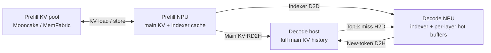
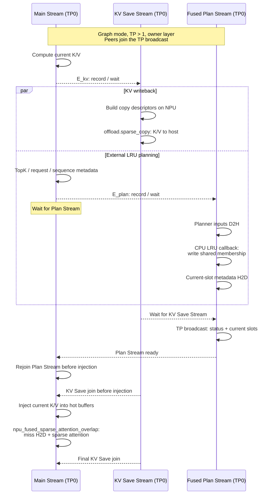
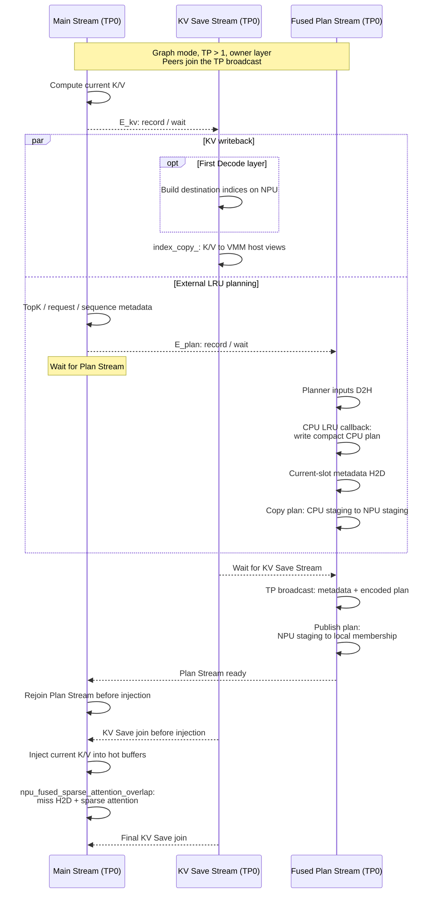

# Sparse Decode KV Cache Offloading Design

This document describes Decode DSA sparse KV cache offload in vLLM Ascend
0.26, covering the shared Decode flow and the memory operations specific to
the MemFabric and Mooncake host backends.

For installation and configuration, see the
[Layerwise and Sparse KV Cache Offloading Guide](../../user_guide/feature_guide/layerwise_and_sparse_kv_cache_offloading.md).
For the qualified Mooncake build and CANN requirements, see
[Mooncake dependencies](../../user_guide/feature_guide/layerwise_and_sparse_kv_cache_offloading.md#mooncake-dependencies).
The offload strategies follow
[RFC #48203](https://github.com/vllm-project/vllm/issues/48203).

## 1. Motivation

The full KV history of a long-context request can exceed NPU HBM capacity.
Host memory provides additional capacity, but moving the full history back to
the NPU at every Decode step would make transfer the dominant cost.

Prefill and Decode therefore use different strategies:

| Stage   | Compute pattern            | Offload strategy                                               | NPU-resident data                             |
| ------- | -------------------------- | -------------------------------------------------------------- | --------------------------------------------- |
| Prefill | High computation per layer | Transfer complete layers and overlap transfer with computation | A few reusable layer buffers                  |
| Decode  | Low computation per token  | Keep full KV in host memory and load only selected entries     | Indexer cache and per-layer hot top-k buffers |

Sparse Decode offload keeps the indexer cache in HBM so it can select top-k
tokens without loading the full main KV cache. A resident hot buffer retains
previous selections, reducing subsequent host-to-NPU traffic to top-k misses.

## 2. System Overview

The production design targets disaggregated Prefill/Decode deployment.

`AscendStoreConnector` manages the Prefill KV pool through Mooncake or
MemFabric-backed Memcache.

`SfaRemoteD2HConnector` uses MemFabric; `MooncakeConnectorV1` with
`dsa_pd_offload=true` uses Mooncake Transfer Engine. Both expose Prefill NPU
KV for Decode to pull main KV into host memory and indexer data into
rank-local NPU memory.

Decode keeps the full main KV history in host memory and the indexer cache
and hot top-k buffers in HBM, loading only missing KV entries for attention.

RD2H means remote device-to-host transfer, from Prefill NPU memory into Decode
host memory. D2H below refers to local Decode new-token writeback.

The Prefill KV pool and Decode sparse-offload host memory are separate
allocations with separate management, even when both use the same backend.
Prefill KV-pool allocation and eviction do not manage or reclaim Decode
sparse-offload memory.

### Transfer granularity

The data path uses different transfer granularities according to when the
required addresses become known:

| Path                             | Granularity                         | Purpose                                                   |
| -------------------------------- | ----------------------------------- | --------------------------------------------------------- |
| Prefill NPU to Decode host       | Layer/block ranges                  | Populate Decode's full main KV history                    |
| Prefill NPU to Decode NPU        | Block ranges within indexer tensors | Populate the rank-local Decode indexer cache              |
| Decode current KV to Decode host | Token rows                          | Append newly generated KV without a full NPU main cache   |
| Decode host to Decode NPU        | Top-k miss rows                     | Populate only missing entries in the per-layer hot buffer |

P/D transfer populates the request's KV history in block ranges. Decode miss
addresses become known only after top-k selection and residency lookup, so
they use sparse token-row copies.

## 3. Sparse Decode Offload

### Memory layout and ownership

Sparse Decode Offload keeps the full main KV cache in a pinned Decode host
pool. Decode NPU memory contains:

- the rank-local indexer cache used to select important tokens; and
- per-layer K/V hot buffers containing recently selected main-KV entries for
active Decode rows.

The allocator and address views differ between backends:

- **MemFabric:** the offload library initializes a TP-shared host allocation.
TP rank 0 allocates the storage and broadcasts global virtual addresses;
peer ranks restore views through the MemFabric offload path.
- **Mooncake:** `MooncakeHostPool` allocates a shared segment through\
`mooncake.shared_segment` using Ascend VMM. TP rank 0 owns the allocation\
and peers map the same physical host memory into their own processes.\
VMM address reservations are rounded to 1 GiB.

### Shared Decode step

The logical Decode flow is the same for both backends:

1. Generate current-token K/V without retaining a full NPU paged main cache.
2. Write the new rows to their logical slots in shared Decode host memory.
3. Use the NPU-resident indexer cache to select logical top-k token positions.
4. Consult the per-layer LRU state, retain resident hits, and assign hot-buffer
  slots to misses, evicting older entries when needed.
5. Load only missing main-KV rows from host memory into the hot buffers.
6. Remap logical selections to physical hot-buffer slots and run sparse
  attention.
7. Retain the updated residency state for the next step.

These steps describe data dependencies; computation and transfers can overlap.
Decode-produced K/V is replicated across TP ranks, so only TP rank 0 writes
new-token rows into their shared host allocation.

The full history remains available in DRAM. Main-KV H2D traffic depends on
top-k misses rather than total context length.

### Fused-overlap execution

With `use_fused_overlap=true`, the framework prepares the external LRU plan
and passes host K/V views, HBM hot buffers, and selection metadata to
`npu_fused_sparse_attention_overlap` for miss loading and sparse attention.

The diagrams show graph execution with TP > 1 and an owner layer that
computes a new plan, using the NPU descriptor builders. Cross-stream arrows
denote event or `wait_stream` dependencies; self-messages show stream-local
operations. Only TP0 performs the CPU LRU callback and current-token host
writeback. Peer ranks join the broadcast on their own Plan Streams before
consuming the plan.

#### MemFabric

The CPU planner writes directly into TP-shared mapped membership storage.
Only status and current-slot metadata need to be broadcast.

#### Mooncake

Mooncake's membership storage is NPU-addressable and local to each TP rank.
The CPU LRU planner cannot write directly to these NPU-addressable host
views. TP0's CPU plan is copied to NPU staging, broadcast, then copied into
each rank's membership.

The destination indices are built on the first Decode layer and reused by
later layers within the same step.

### New-token D2H writeback

Both backends write current-token K/V to its logical slots in Decode host
memory. The host allocation type determines the copy mechanism.

#### MemFabric

MemFabric builds source, destination, and byte-length descriptors and submits
the copies through `offload.sparse_copy`. Invalid or padded rows use zero
byte lengths.

#### Mooncake

Mooncake uses NPU `index_copy_` to write rows into local VMM-backed host
views. For graph execution, an NPU descriptor builder prepares destination
indices and `index_copy_` runs on the current-KV save stream.

Each host K/V component has one private sink row beyond its logical capacity.
Invalid or padded slots target that row, so they cannot overwrite a valid KV
entry. The sink row is excluded from the logical block capacity exposed to
the Connector.

## 4. Joint Prefill and Decode Design

The P/D Connector pairs with the selected Decode host backend:

| Host backend          | P/D connector                                    | Main KV destination          | Indexer destination   |
| --------------------- | ------------------------------------------------ | ---------------------------- | --------------------- |
| `memfabric` (default) | `SfaRemoteD2HConnector`                          | Decode MemFabric host memory | Decode rank-local HBM |
| `mooncake`            | `MooncakeConnectorV1` with `dsa_pd_offload=true` | Decode Mooncake host memory  | Decode rank-local HBM |

### MemFabric

The Prefill worker exposes its NPU KV cache. `SfaRemoteD2HConnector`
publishes source metadata and per-layer readiness, allowing Decode to pull
each ready range into its MemFabric host and rank-local HBM destinations.
Decode replies after each layer's read completes.

On Prefill, `MultiConnector` can combine `SfaRemoteD2HConnector` with
`AscendStoreConnector` to enable layerwise offload through Memcache. Before
an NPU layer buffer is reused, its KV-pool save and all Decode reads of its
previous contents must complete. This combination uses the layerwise P/D
proxy.

For the control protocol and P/D TP mapping, see
[SFA Remote D2H Connector Design](sfa_remote_d2h_connector.md).

### Mooncake

`MooncakeConnectorV1` extends its existing P/D receive path to support
Decode sparse offload with Indexer D2D and Main RD2H transfers. The handoff reuses
the existing P/D metadata exchange and completion signaling. Decode
validates the two transfer plans before issuing Indexer reads followed by
Main reads through Mooncake Transfer Engine.

To match the P/D cache layouts, descriptors map the uncached token range
across Prefill CP/DCP shards and P/D TP ranks. Decode TP ranks write disjoint
Main KV ranges into shared VMM host memory, while each receives a complete
Indexer copy in HBM. Cached prefixes and partial-block offsets are preserved.

Decode registers the Indexer HBM destination with Transfer Engine; the VMM
Main KV destination needs no local registration.

## 5. Current Boundaries

- Production support targets disaggregated Prefill/Decode deployment.
- Sparse Decode Offload supports Model Runner V1 with an SFA/MLA
    sparse-attention model. Model Runner V2 is not supported on this 0.26
    implementation.
- The main KV cache must use BF16; packed main caches are not supported.
    Indexer quantization is separate from main-KV storage.
- Hybrid KV cache layouts are not supported.
- Decode supports DP and TP; CP and PP are not supported. The Mooncake P/D
    path handles Prefill CP/DCP shards separately.
- The MemFabric P/D path requires Prefill TP to be greater than or equal to,
    and divisible by, Decode TP.
- The Mooncake sparse-offload path cannot currently be combined with
    Prefill layerwise KV cache offload.
- Connector-level data-read retry is not implemented.
