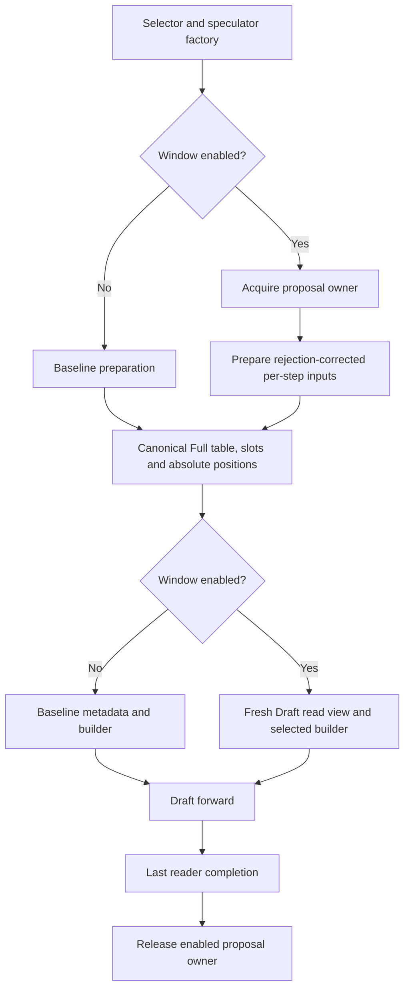

# Speculative Decoding KV Sliding Window

Speculative decoding draft models are typically trained on short contexts
(e.g. 4-8k tokens). At inference time, when the running context grows far
beyond the training length, the draft's attention over the full KV cache goes
out-of-distribution and acceptance collapses: on GLM-5.2 with an early DSpark
draft, the mean acceptance length dropped from ~5 to ~1 at 32k context, making
speculation a net loss.

The KV sliding window caps the **draft model's attention** to the most recent
`draft_window_size` tokens. The target model is untouched - it always attends
to the full context, so generation quality is preserved; only the draft reads
a shorter, in-distribution window. On acceptance-collapsed drafts this
restores acceptance (the same GLM-5.2 draft recovered from ~1.0 to ~4.7-5.5
at 32k, up to +381% end-to-end throughput in the original evaluation).

## Configuration

The window is enabled through `additional_config` for supported
EAGLE3 / DFlash / DSpark draft consumers. MRV2 requires an explicitly eager
Draft model; Target Graph selection remains independent. See the MRV2
consumer and validation limits below before choosing a configuration.

```json
{"draft_window_size": 2048}
```

It is disabled by default (key absent). On MRV2, MTP and the config-identified
built-in co-trained DeepSeek-V4 DSpark category ignore the window with a
warning while retaining their original speculative method. Eagle3 follows
the switch, including co-trained Eagle3 models. Checkpoint path names do not
identify the V4 exception. The existing MRV1 adapter and its policy remain
separate from the MRV2 implementation described below.

## Window math

Let `W` be the window size, `b` the kernel block size, `K = future_offset`
the number of draft query positions lying beyond the `seq_lens` value the
adapter sees. The MRV1 adapter computes, entirely on device:

```text
start        = floor(clamp(seq_lens + K - W, min=0) / b) * b   # block-aligned window start
windowed_len = seq_lens - start                                # <= W + b - 1
start_block  = start // b
needed       = ceil(windowed_len / b)  (capped at max_window_blocks = W//b + 1)
```

`future_offset` differs by draft family because their `seq_lens` semantics
differ:

| Method | future_offset | Why |
| --- | --- | --- |
| EAGLE3 | `num_speculative_tokens` | `seq_lens` is context-only; the K draft positions lie beyond it, so the window end must cover `seq_lens + K`. |
| DFlash / DSpark | `0` | the input-preparation kernel already bakes the query stretch (bonus + mask tokens) into `seq_lens`, so `final = seq_lens`. |

The block table is cropped by gathering columns
`start_block[i] + [0, max_window_blocks)` from the full table into a
zero-padded clone; columns past `needed` (and past the full-table width) are
zeroed. Zeroed columns are never read because every FIA KV-length input is
capped at the same `windowed_len`.

Two invariants hold throughout:

- **slot_mapping is never windowed.** Draft KV writes still go through the
  full block table at absolute positions, so the cache stays coherent for the
  target model and for window sizes changed between steps.
- **Only what FIA reads is capped.** The FIA kernel's KV-length inputs are the
  NPU `seq_lens` tensor plus CPU mirrors (`seq_lens_cpu`, `_seq_lens_cpu`,
  `seq_lens_cpu_upper_bound`); all of them are windowed with the same
  arithmetic so no path can read past the window.

## MRV1 implementation

`SlidingWindowAdapter` (`vllm_ascend/worker/v1/spec_decode/utils.py`) owns the math
above and a persistent `[max_num_reqs, max_window_blocks]` clone buffer. It is
constructed in `AscendSpecDecodeBaseProposer.__init__`
(`vllm_ascend/worker/v1/spec_decode/llm_base_proposer.py`) when `draft_window_size` is
set, then applied to the draft's `common_attn_metadata` **before** the
per-layer metadata is built.

There are two apply points because of how the drafts construct metadata:

- EAGLE3 / DFlash: applied once in `_propose` on the shared
  `common_attn_metadata` (`llm_base_proposer.py`).
- DSpark: that path is bypassed - the dspark branch of
  `build_draft_attn_metadata` overwrites
  `common_attn_metadata.block_table_tensor` with a per-group full table before
  building. The adapter is therefore applied **after** the per-group overwrite
  and before `builder.build_for_drafting`, so FIA reads the windowed clone of
  the per-group table instead of the full one.

## MRV2 implementation

MRV2 applies the window to fresh, per-group common metadata through the
existing `build_attn_metadata` callback, immediately before the actual backend
builder. It never temporarily replaces `input_buffers.seq_lens` or the
canonical Full tables. The factory resolves CONFIG_OFF and forced-OFF before
allocating any window runtime. The dedicated built-in DeepSeek V4 DSpark
category is identified from normalized model configuration, including Ascend's
V4.1 architecture normalization. This disables only the window; the original
speculative method is still constructed.

### Canonical reads and method phases

`DirectPrefixSource` borrows `AscendBlockTables.block_tables[gid].gpu` and
snapshots the current request-to-state-row mapping. Each build gathers a new
read table from that owner. It never clips a previous window result. The
canonical table is kernel-column addressed: physical allocator blocks may
have been expanded into several columns. `kernel_block_sizes[gid]`, not a
similarly named scheduler or physical block field, supplies the column span.

The first active group's span defines the historical alignment of `S`.
Other groups must represent that same logical start exactly. A larger LCM
alignment would change the feature's semantics and is not substituted. Each
group receives its own read table and backend-derived state. Initialized
column counts alone do not prove residency for recycled or offloaded caches.

DFlash and DSpark use their actual prepared query width and exact end; DSpark
may use `K` or `K+1` queries. Eagle3 freezes its proposal horizon and block
start at the first pass, then refreshes exact lengths at each AR step. The
startup bound `W >= 2*K+1` is sufficient for the configured rejection
range and first-pass query width of at most `K+1`; it is not the smallest
possible window for every favorable block alignment. For example, K=3 accepts
W=7 and rejects W=6 even when one particular block alignment would fit. A continuing
prefill row keeps its full read view; an Eagle3 first prefill pass also keeps
full reads so long prompt queries are preserved. Per-row phase decisions use
computed prompt tokens, prompt length, and scheduled tokens excluding draft
placeholders.

Eagle3's first pass preserves rejected query padding in the native layout.
Its logical proposal end is the current last valid query position plus one;
the padded native extent must not choose the frozen anchor. For example,
live E=1159, native extent=1160, K=3, W=1035 and B=128 require S=0, whereas
using the native extent would incorrectly choose S=128. Eligible ordinary
GQA reads keep the current live/native pair and frozen anchor on device,
including their admitted ragged and mixed layouts. Legacy consumers outside
that route take one combined current Host snapshot, shared across groups;
their synchronization is not removed by the dense reader.

An all-continuing ordinary GQA Eagle3 batch without draft placeholders has a
narrower exact producer: current computed prompt progress plus this batch's
scheduled prompt tokens. Before prompt completion the rejection sampler sets
rejected tokens to zero. The runtime retains this proposal's prompt-exact CPU
base and supplies a fresh, clamped `base + AR step` to the native builder. It
does not read the optimistic CPU sequence-length mirror. Full device lengths,
tables, positions, query padding and write slots remain unchanged; only the
fresh common metadata's CPU exact fields change. Their storage is retained
through the existing proposal completion event. Request mapping or prompt
preparation changes invalidate this base. Placeholder and replicated-PCP
batches continue through their existing exact path. This preserves the
required Full read rather than turning Window off for short contexts.

Native first-pass lengths retain the original padded query alignment. With R
rejected query slots, native extent=E+R and padded query count=Q+R, so their
difference still equals E-Q for the live causal queries. Shortening only the
native length would shift that causal mask. Positions, query rows and Full KV
writes therefore retain the existing layout; the logical anchor uses E, while
the native read extent accounts explicitly for its query padding. Subsequent
AR steps consume their newly prepared current exact lengths with the frozen S.

`DraftReadView` changes only the table, device exact length, both exact CPU
mirrors, scheduling upper bound, and maximum length. Positions, query layout,
Full KV write slots, and target metadata keep their original ownership.
Backend builders run after this projection. The Eagle3 metadata update that
would otherwise restore Full CPU lengths is bypassed only while an enabled
window proposal owns the metadata.

### Actual consumers and parallel execution

Window OFF and forced-OFF preserve the fixed official length selection,
including the GLM DSpark CPU-mirror choice in both runners. The known public
MRV2 length issue is outside this Window PR's repair scope; compatibility
does not establish that the official choice is exact after rejection.

Effective Window ON uses its current device-exact consumer or a certified
CPU/device read pair. Continuing-prompt Full reads retain their exact producer
and certificate; an optimistic CPU bound never authorizes a Window read.
Generic native-list consumers can still synchronize when converting current
device lengths. The existing ordinary MLA preparation's exact snapshot and
Target CP adaptation are unchanged.

Backend selection uses the actual backend, builder, spec, and layer names,
not the target model's architecture. For example, a DSA target can use a dense
MLA or GQA draft. Ordinary TP/EP and sequence-parallel hidden-state collectives
retain their original query/write coordinates. DSA-CP needs a distinct
provider for its local query ranges and global KV read coordinates.

Providers distinguish direct GQA, ordinary MLA, standard SFA with its indexer,
and uncompressed DSA. MRV2 Target DSA-CP is admitted for the uncompressed SFA
MLA route with sequence-parallel MoE, PP=1 and DCP=1. Its existing builder
receives padded model-input counts for TP token projection, while actual
query/write coordinates remain separate. The Draft provider is still chosen
from its own actual consumer; a Target CP flag does not turn a dense Draft
into a sharded reader. Compressed DSA and other PP/DCP compositions retain
their startup guard. A sharded Draft consumer without a corresponding
provider is rejected. PCP is separate and does not satisfy an unimplemented
DSA-CP route. MLA and SFA preserve full absolute rotary inputs
while taking ownership of scratch that would otherwise be overwritten.
DSA native-window reads must remain a subset of the baseline native read set;
the provider does not infer residency from stale prefix table entries.
Compressed, packed, offloaded, or unsupported context-parallel layouts require
specific providers and are rejected when the selected consumer lacks one.
An unsupported conditional layout is not evidence that a required model has
been validated through another backend.

### Asynchronous ownership

Every proposal owns independently allocated read views and all derived
metadata through a completion token. All Eagle3 steps belong to that proposal.
Mutable DSA builders are owned by lane and step. The owner enters its native
region before preparation can enqueue a copy or kernel. Successful completion
recording retains the owner until the event completes; capacity pressure may
wait for the oldest submitted proposal. Normal acquisition of a free lane
performs no global synchronization.

If host execution, event creation/recording, bookkeeping, or completion
query/wait fails after possible native submission, the pool retains the
backing and quarantines the execution context. Host return, process progress,
or a failed event cannot authorize reuse. A new pool is not a safe recovery
mechanism unless the executor separately establishes device completion. The
final event must cover all readers, including any secondary communication
stream; retaining a Python reference alone does not establish that boundary.

### Device exact consumers and remaining async-first constraint

Eligible ordinary ND GQA DSpark/DFlash proposals use current device exact
lengths to plan starts, valid KV addresses and attention masks in one Triton
kernel. Only initialized readable KV rows enter private scratch; capacity
padding repeats the last valid row and remains masked. FP32 native attention
consumes the mask without extracting exact device lengths on Host. Its
workspace and conversion costs remain part of the performance evaluation.

Eagle3 uses this consumer for admitted first-pass and later AR layouts,
retaining the proposal's frozen start. Continuing prefill rows keep Full reads
at every step. In a mixed decode/prompt batch, private cohorts separate Full
and windowed rows and their query widths; the device exact lengths still
select each valid read interval. A prompt-only producer may instead retain
the native Full reader under the certificate described below.

Legacy consumers obtain one current exact CPU snapshot per metadata build,
shared across groups. DSpark with ordinary MLA and no DCP is an explicit
exception: its existing preparation
already completes a fresh CPU copy of the current Draft lengths. The caller
binds that snapshot to the current device prefix and request mapping; the
proposal owner retains it, avoiding a second Window copy. This does not reuse
an optimistic common CPU field or remove the baseline copy. Other paths
retain the added synchronization. This is an unresolved
architecture constraint, not an approved performance tradeoff. It does not
meet the MRV2 async-first requirement. Hardware measurement can quantify its
cost but cannot by itself approve this design.

The existing runner copies completed request counts to the CPU for the next
Target input. Draft preparation subsequently consumes rejection results on
the device; that earlier CPU snapshot is not generally the current Draft
exact length. It is distinct from the post-preparation DSpark MLA snapshot
explicitly reused above. An upper bound also cannot replace exact: for W=1024, B=128,
E=1151 and upper=1152, exact planning starts at zero but upper-based planning
starts at 128, changing the read set.

Removing only the copy is insufficient. CPU planning chooses the table width
and validates the exact query interval. GQA eager builders materialize length
lists; MLA builders derive chunk loops and decode lists from CPU lengths.
Generic parallel GQA drafting already selects device lengths and calls
`tolist()`, adding a separate baseline synchronization. An enabled Window
projection now certifies its owned CPU/device exact pair to this selector,
so parallel GQA does not repeat that transfer. Replacing any certified read
operand invalidates the pair. OFF leaves no certificate on common metadata
and keeps the baseline selection. The initial legacy Window exact D2H remains;
this reuse does not resolve the whole async-first architecture constraint.
Default CPU-to-device
copies for projection indices also require an asynchronous staging contract.
SFA also has existing device-length consumers that can be reused; this does
not make the GQA and MLA CPU consumers disappear. A device projector for the
remaining paths therefore needs an explicit consumer contract separating
device exact lengths from host capacity bounds, together with verified native
tensor-length inputs and bounded chunk planning. That migration is not yet
implemented. No previous-step exact value or estimated acceptance is used as
a substitute, and Async is not disabled to hide this limitation.

Each group/build currently allocates a fresh read table sized to its active
column maximum, length tensors and owned starts. These survive until proposal
completion; Full KV is borrowed, not copied. Allocation and synchronization
costs require separate device evidence. CPU ownership tests are not proof of
NPU completion, overlap or a throughput improvement.

### Integration responsibilities

The baseline and Window flows share input preparation and canonical writes:



Persistent request state remains separate from per-step input ordering. Target
execution keeps its own baseline metadata.

| Change | Condition and responsibility |
| --- | --- |
| Selector blacklist removal | An explicit runner choice is preserved. Auto selection may now choose MRV2 when Window is requested; other existing exclusions still apply. Unsupported Window configurations are rejected by the factory/provider rather than silently ignored. |
| Fresh first Eagle3 metadata | Window reads cannot reuse Target metadata. Keep Full preparation, then build Draft metadata with the prepared query extent and chunked-prefill state. Replicated PCP preparation may already do this build; do not build step zero twice. |
| Skip baseline AR CPU update | Enabled Window metadata already carries the step's projected lengths. Restoring Full CPU lengths would corrupt the view. OFF retains the original update. |
| Callback and builder selection | Apply once to fresh common metadata per group before the last builder writes. Preserve query, positions, Full slots and baseline shared DSA kwargs. |
| Factory module interception | This is an existing Ascend mechanism extended with explicit callbacks. It assumes serial worker execution and LIFO nesting, restores the previous function on exceptions, and rejects callback conflicts. It is not a thread-local API. An instance-level upstream hook would remove the need for interception. |
| Completion | Retain all steps and mutable derived buffers until the last reader completes. Unknown completion quarantines the pool; capacity pressure may wait for a known submitted owner. |

CONFIG_OFF and forced-OFF allocate no Window runtime, owner or view. This does
not exempt shared backend changes from OFF regression testing. The selector
change is user-visible even for forced-OFF: it can permit auto-selected MRV2
while leaving the original speculative method enabled.

### Shared DSA changes and regression obligations

Noncausal DSpark uses K or K+1 query positions. An index buffer must cover the
native prefix plus the actual query width, including an alignment boundary
where W+K is exactly a multiple of 128 and the additional position needs
another column. Default capacity allows K+1; an explicitly known anchor width
may use K. Insufficient explicit capacity is rejected using host configuration,
without reading device query values to make that decision.

Noncausal index storage is allocated when its consumer is first enabled and
then reused by that builder. Causal builders do not need that storage. This
avoids multiplying unused buffers across proposal lanes and AR steps.
Device-metadata setup allocates before deferred work/capture. This changes the
shared OFF/MRV1 allocation time and requires eager reuse, warmup, profiling,
and existing capture/replay regressions. It is not a measured optimization.
The SFA Target DSA-CP input-count adaptation is separate from these Draft
capacity changes. It preserves the existing distributed projection and
collectives and requires its own all-rank correctness and Graph regression.
Compressed DSA and unsupported PP/DCP startup guards remain intact.

### Validation boundaries

Host tests exercise the paired source interfaces, current mapping, exact vs
upper arithmetic, phase transitions, final writers, and partial-submit owner
failures. Device validation must compare fixed queries and logical KV against an
independent reference for the same window and preserve Full/query operands.
The included device tests require an NPU run; Host results do not establish
that this validation has completed.
Separate real-model tests must establish actual backend/gid identity, prefix
hits, multiple chunks, mixed arrival, row reuse, parallel layouts, and the
last-reader completion boundary. OFF and ON may produce different draft
proposals; naturally decoded token positions are not a same-state numerical
oracle. Performance is measured only after correctness, using the same source
candidate for both OFF and ON.

## Performance considerations

A shorter Draft context can improve acceptance for drafts trained on short
contexts, but the result depends on the checkpoint and workload. A window
below a draft's training or native window can reduce acceptance. Both effects
must be measured for the selected model rather than inferred from input length.

End-to-end performance combines acceptance, Draft KV-read cost, metadata
preparation, and scheduling overlap. A smaller read view alone does not prove
a speedup. Compare OFF and ON on the same candidate and runtime, retain short
context regressions, and separately compare candidate OFF to the clean base.

## Related Files

- Shared window adapter: `vllm_ascend/worker/v1/spec_decode/utils.py`
- MRV1 proposer (apply points, config validation): `vllm_ascend/worker/v1/spec_decode/llm_base_proposer.py`

- MRV2 policy and integration: `vllm_ascend/worker/v2/spec_decode/`
- MRV2 source/math/ownership: `draft_window_read.py`, `draft_window_plan.py`, `draft_window_lifetime.py`
- MRV2 builder seam: `vllm_ascend/worker/v2/attn_utils.py`

## Parallel GQA device exact reader (candidate)

For ordinary ND FP16/BF16 GQA caches, DFlash and DSpark can prepare
the read set from the current device exact lengths. The owned read contains
physical token indices and a device exact attention mask. Each layer gathers
only valid tokens into private KV scratch; padding repeats the last valid
token and is masked. Host native lengths describe scratch capacity, explicitly
separate from device exact lengths. Capacity never selects the window start.
Directly masking an unwritten paged-cache tail is unsafe: NaNs in that tail
can contaminate the result despite zero attention weights.

This path requires ordinary unquantized cache layout and scheduling uppers
covered by initialized Full block-table columns. Each private cohort has a
uniform query width; packed Eagle3 queries retain explicit gather/output maps.
Combined K/V pages may have gaps between blocks and nonzero storage offsets;
the reader maps token indices through the actual page stride without copying
the full cache or reading the gaps.
The preparation contract supplies current-generation `0 < E <= U`; the CPU
upper checks address capacity for that contract, without reconstructing E.
Scratch capacity is bounded by both `W+B-1` and the current batch's maximum
Host upper, then rounded for allocation. This avoids gathering a large
window's padding on short contexts; it does not change exact `S` or `V`.
A continuing prefill row retains its Full read. Mixed Full/windowed rows
are partitioned by phase, query width and CPU-known aligned capacity, so short
Full rows do not inherit a long peer's allocation. These capacity decisions
never reconstruct exact lengths or choose S. Unsupported layouts retain their
existing exact consumer and its synchronization; dense-route evidence cannot
be extended to MLA, DSA, SFA or other providers without their own contract.

The GQA builder carries a typed device read only on enabled proposals. Its
capacity CPU fields are consumed exclusively by the dedicated eager reader;
the original Full write slots, absolute positions and canonical cache stay
unchanged. Copy sources and destinations are retained before submission,
including a submission that raises after work may have been queued. Scratch
is retained through the proposal completion boundary. Immediate attention
consumers reuse FP32 KV buffers only across sequential layers of the same
read, NPU stream and geometry. Other reads or streams receive distinct buffers;
standalone gather callers retain independent materializations. No early release
or new synchronization is used to obtain this bound. OFF, Target metadata and
dummy/profile paths create
no device read; Target Graph remains compatible with Draft eager execution.
Device-to-device gathering adds traffic and storage; actual
engine correctness, reader completion and performance must be measured before
declaring this candidate accepted. In the installed torch_npu version,
`torch._assert_async` itself synchronizes through a scalar copy and is not
used to validate device lengths in this path.

To keep Target Graph with Draft eager, set
`speculative_config.enforce_eager=true`. The MRV2 runtime checks this explicit
Draft override as well as the inherited model eager flag, matching the actual
Ascend speculator graph-manager selection.

The reader keeps attention scores and probabilities in FP32 on device, then
casts the output to the original query dtype. Fused BF16 attention reproduced
a small-result cancellation failure even with exact native lengths; the
FP32 path preserves the independent same-window numerical contract without
relaxing its tolerance. This adds intermediate storage and compute that must
be included in actual correctness, lifetime and performance measurements.

## Prompt-only exact producers

Ordinary GQA Eagle3 can reuse a current prompt producer when the entire batch
is prefilling without Draft placeholders, actual query widths equal scheduled
prompt widths, scheduling does not cross the prompt end, and terminal rows
have one Target logit. Replicated PCP and non-advancing positions are excluded.
Current prompt progress plus the actual scheduled count then gives the exact
native extent: continuing prompts reject zero tokens, and a terminal row has
no speculative candidates to reject. Request identity, state-row mapping and
preparation fields are bound to the proposal. AR steps advance and clamp that
retained base using the existing method preparation semantics. A changed
identity invalidates it; the optimistic CPU length mirror is not a producer.

Continuing rows retain Full reads; terminal rows preserve the method's frozen
window after the first prefill pass. The current device live/native pair and
frozen anchor remain available to later dense AR consumers. Mixed decode and
prompt batches use device exact planning rather than estimating accepted counts.

DFlash and DSpark have a separate certificate for all-unfinished, unsharded
prompt batches with no Draft placeholders and matching scheduled query widths.
Their preparation places the actual parallel query block after the last valid
Target position. The certified current prompt end plus the actual method query
width supplies the clamped native extent. Terminal, mixed or replicated-PCP
batches keep their device-exact or provider-specific route. This does not
extend the ordinary-MLA same-preparation snapshot contract to other backends.

## Memory and validation limits

Window bounds Draft reads; Full KV storage and writes remain allocated. Plan
batch capacity using the actual Full KV groups, model memory and private
workspace, including mixed long-prefill/decode workloads. Reducing W does not
make many long Full contexts fit automatically.

The dense planner and gather derive allocation extent from their actual Triton
grid and named padding constants. This avoids capacity-specific scalar
specialization without changing exact lengths, addresses, masks or alignment.
Full/windowed request cohorts are distinct from KV groups: they do not change
the historical group-start compatibility rule above.

Validate actual methods and backends with an independent same-window reference,
Full-write and Target-isolation checks, and device completion evidence. Keep
intrusive numerical observation separate from natural asynchronous lifetime
and unprofiled timing. Native operation schemas or a few trace samples alone
do not establish copy elimination for every fallback. Compare fixed-source OFF
and ON with matching warmup, cache state, request arrival and sampling settings;
report acceptance changes and low-load regressions alongside throughput.

## DFlash native SWA and an extra Draft Window

A mixed DFlash draft can contain ordinary causal `SlidingWindowSpec` groups
and a Full-attention group. A native SWA group is not a resident Full-prefix
provider: its older logical table entries may point at null or evicted pages.
The ordinary ND GQA route therefore keeps its native band and Full KV writes.
It does not convert a native SWA group to dense Full attention.

When the requested Window covers the complete native band for every supported
query, that native reader remains unchanged and only the Full group receives
a Window projection. For a native-SWA-only causal draft, each
native group retains the typed adapter even when the extra window covers
its band: there is no companion Full callback to certify preparation.
Otherwise a proposal-local adapter calls the original
concrete metadata builder first. The adapter reuses the native length list
that this invocation has already obtained from current device exact lengths.
The field named `seq_lens_cpu` alone does not certify a CPU snapshot: on the
parallel-Draft path it may still refer to the device tensor. No second D2H
length copy is introduced by the adapter. The original builder's list
conversion and its existing synchronization remain explicit.

For each native group, its actual kernel table column span B defines
`S = floor(max(E - W, 0) / B) * B`. Only the newly built Draft read metadata
receives the table starting at S and lengths E-S. The native causal window P
is unchanged. Its right-aligned query coordinates rebase by -S, so the
absolute read set is the original native band intersected with `[S, E)`.
Continuing prompt rows retain their original native read. Query positions,
write slots, canonical tables and Target metadata retain their original
coordinates and identities. Original metadata, DMA sources, private table
and length destinations remain owned until the existing native reader
completion releases the proposal.

The causal-band provider is limited to the concrete ordinary causal ND GQA consumer,
with no sinks, compression, offload or CP-sharded Draft layout. It requires
an unpadded current request extent. Native-only proposals are certified only
after every participating native group has built its fresh metadata. Mixed
Full/SWA proposals keep the existing Full-group authority. Unsupported
consumers and padding are rejected explicitly. This Draft-eager extension
does not select the Target Graph builders.

DFlash2 is identified by `DFlash2DraftModel` with `method="dflash"`. Its
inherited Ascend proposal wrapper encloses the original DFlash2 candidate
Top-K, selector, path walk and realized-probability cache. The final owner
event follows these consumers; their algorithm and probability semantics
are not replaced by ordinary DFlash. Window OFF returns before creating a
Window policy runtime, and keeps the baseline DFlash2 dispatch and checks.
An enabled Window rejects unknown DFlash architectures and a non-eager
Draft during initialization. Target Graph selection remains independent.

A supported DFlash2 checkpoint can explicitly declare `is_causal=False` while
using native `SlidingWindowSpec` layers. Its attention remains symmetric SWA:
for an absolute query position p, the allowed native interval is
`[max(0, p-(P-1)), min(E, p+(P-1)+1))`. The DFlash2 loader marks only the admitted
ordinary GQA native-SWA consumers. They use FIA's compressed SWA mask with
`sparse_mode=4`, `pre_tokens=P-1` and `next_tokens=P-1`; no causal mask is inserted.
This restores the model's native range in both OFF and ON. ON additionally
intersects that range with the aligned interval `[S,E)`.

For these marked DFlash2 layers, the Ascend MRV2 cache-spec hook retains the
complete KV backing using `FullAttentionSpec` while preserving the native window
in the attention implementation. This is a storage-compatibility measure:
Full retention does not enable Full attention. It avoids stale historical
pages in the full-prefix descriptor passed to the native paged SWA call.
It does not promote Target/GDN cache specs or disable the engine's other
hybrid-cache policies. OFF creates no additional Window runtime or projected
read table, but retains this necessary model-native SWA/cache correction.

The noncausal Window provider remains restricted to native-only DFlash2 groups
with `W + B - 1 + Q <= P`, where B is the kernel-column span and Q is the prepared
query width. Current exact lengths, request rows and generation still certify
each fresh read. Unknown architectures, unsupported providers and Draft Graph
with Window ON are rejected. Target Graph remains independent.

The verified BF16 Qwen DFlash2 deployment has five native P2048 layers and runs
TP2 with K7/Q8 and optional W1024. With the same 8 GiB/rank KV budget, retaining
these five layers reduced estimated engine cache-token capacity by about 6.89%
(179,973 to 167,573 tokens in that configuration). Actual capacity depends on
cache grouping and deployment settings. The additional W1024 is not currently
recommended as a speedup setting for this already-windowed checkpoint. Finite
native numerical tolerance failures remain separately reported; finite output
and successful requests are not a universal numerical PASS.

The native-SWA adapter pins its completed CPU int64 start vector before H2D.
The exact pinned DMA source remains held by the proposal owner; converting it
after pinning must not create a new pageable copy. Real warmed transfer and
model traces must distinguish this step from the baseline native-list sync.
