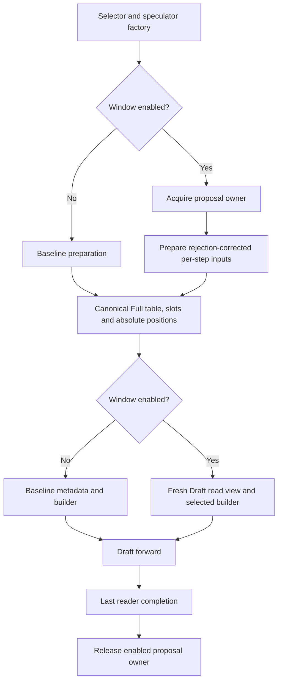

# Speculative Decoding KV Sliding Window

Speculative decoding draft models are typically trained on short contexts
(e.g. 4-8k tokens). At inference time, when the running context grows far
beyond the training length, the draft's attention over the full KV cache goes
out-of-distribution and acceptance collapses: on GLM-5.2 with an early DSpark
draft, the mean acceptance length dropped from ~5 to ~1 at 32k context, making
speculation a net loss.

The KV sliding window caps the **draft model's attention** to the most recent
`draft_window_size` tokens. The target model is untouched - it always attends
to the full context, so generation quality is preserved; only the draft reads
a shorter, in-distribution window. On acceptance-collapsed drafts this
restores acceptance (the same GLM-5.2 draft recovered from ~1.0 to ~4.7-5.5
at 32k, up to +381% end-to-end throughput in the original evaluation).

## Configuration

The window is enabled through `additional_config` for supported
EAGLE3 / DFlash / DSpark draft consumers. MRV2 requires an explicitly eager
Draft model; Target Graph selection remains independent. See the MRV2
consumer and validation limits below before choosing a configuration.

```json
{"draft_window_size": 2048}
```

It is disabled by default (key absent). On MRV2, MTP and the config-identified
built-in co-trained DeepSeek-V4 DSpark category ignore the window with a
warning while retaining their original speculative method. Eagle3 follows
the switch, including co-trained Eagle3 models. Checkpoint path names do not
identify the V4 exception. The existing MRV1 adapter and its policy remain
separate from the MRV2 implementation described below.

## Window math

Let `W` be the window size, `b` the kernel block size, `K = future_offset`
the number of draft query positions lying beyond the `seq_lens` value the
adapter sees. The MRV1 adapter computes, entirely on device:

```text
start        = floor(clamp(seq_lens + K - W, min=0) / b) * b   # block-aligned window start
windowed_len = seq_lens - start                                # <= W + b - 1
start_block  = start // b
needed       = ceil(windowed_len / b)  (capped at max_window_blocks = W//b + 1)
```

`future_offset` differs by draft family because their `seq_lens` semantics
differ:

| Method | future_offset | Why |
| --- | --- | --- |
| EAGLE3 | `num_speculative_tokens` | `seq_lens` is context-only; the K draft positions lie beyond it, so the window end must cover `seq_lens + K`. |
| DFlash / DSpark | `0` | the input-preparation kernel already bakes the query stretch (bonus + mask tokens) into `seq_lens`, so `final = seq_lens`. |

The block table is cropped by gathering columns
`start_block[i] + [0, max_window_blocks)` from the full table into a
zero-padded clone; columns past `needed` (and past the full-table width) are
zeroed. Zeroed columns are never read because every FIA KV-length input is
capped at the same `windowed_len`.

Two invariants hold throughout:

- **slot_mapping is never windowed.** Draft KV writes still go through the
  full block table at absolute positions, so the cache stays coherent for the
  target model and for window sizes changed between steps.
- **Only what FIA reads is capped.** The FIA kernel's KV-length inputs are the
  NPU `seq_lens` tensor plus CPU mirrors (`seq_lens_cpu`, `_seq_lens_cpu`,
  `seq_lens_cpu_upper_bound`); all of them are windowed with the same
  arithmetic so no path can read past the window.

## MRV1 implementation

`SlidingWindowAdapter` (`vllm_ascend/spec_decode/utils.py`) owns the math
above and a persistent `[max_num_reqs, max_window_blocks]` clone buffer. It is
constructed in `AscendSpecDecodeBaseProposer.__init__`
(`vllm_ascend/spec_decode/llm_base_proposer.py`) when `draft_window_size` is
set, then applied to the draft's `common_attn_metadata` **before** the
per-layer metadata is built.

There are two apply points because of how the drafts construct metadata:

- EAGLE3 / DFlash: applied once in `_propose` on the shared
  `common_attn_metadata` (`llm_base_proposer.py`).
- DSpark: that path is bypassed - the dspark branch of
  `build_draft_attn_metadata` overwrites
  `common_attn_metadata.block_table_tensor` with a per-group full table before
  building. The adapter is therefore applied **after** the per-group overwrite
  and before `builder.build_for_drafting`, so FIA reads the windowed clone of
  the per-group table instead of the full one.

## MRV2 implementation

MRV2 applies the window to fresh, per-group common metadata through the
existing `build_attn_metadata` callback, immediately before the actual backend
builder. It never temporarily replaces `input_buffers.seq_lens` or the
canonical Full tables. The factory resolves CONFIG_OFF and forced-OFF before
allocating any window runtime. The dedicated built-in DeepSeek V4 DSpark
category is identified from normalized model configuration, including Ascend's
V4.1 architecture normalization. This disables only the window; the original
speculative method is still constructed.

### Canonical reads and method phases

`DirectPrefixSource` borrows `AscendBlockTables.block_tables[gid].gpu` and
snapshots the current request-to-state-row mapping. Each build gathers a new
read table from that owner. It never clips a previous window result. The
canonical table is kernel-column addressed: physical allocator blocks may
have been expanded into several columns. `kernel_block_sizes[gid]`, not a
similarly named scheduler or physical block field, supplies the column span.

The first active group's span defines the historical alignment of `S`.
Other groups must represent that same logical start exactly. A larger LCM
alignment would change the feature's semantics and is not substituted. Each
group receives its own read table and backend-derived state. Initialized
column counts alone do not prove residency for recycled or offloaded caches.

DFlash and DSpark use their actual prepared query width and exact end; DSpark
may use `K` or `K+1` queries. Eagle3 freezes its proposal horizon and block
start at the first pass, then refreshes exact lengths at each AR step. The
startup bound `W >= 2*K+1` is sufficient for the configured rejection
range and first-pass query width of at most `K+1`; it is not the smallest
possible window for every favorable block alignment. For example, K=3 accepts
W=7 and rejects W=6 even when one particular block alignment would fit. A continuing
prefill row keeps its full read view; an Eagle3 first prefill pass also keeps
full reads so long prompt queries are preserved. Per-row phase decisions use
computed prompt tokens, prompt length, and scheduled tokens excluding draft
placeholders.

Eagle3's first pass preserves rejected query padding in the native layout.
Its logical proposal end is the current last valid query position plus one;
the padded native extent must not choose the frozen anchor. For example,
live E=1159, native extent=1160, K=3, W=1035 and B=128 require S=0, whereas
using the native extent would incorrectly choose S=128. For an eligible
uniform decode layout, the runtime keeps both values on device and freezes
the anchor there. Legacy first-pass consumers take one combined current Host
snapshot, shared across groups. Prefill, ragged layouts and other legacy
consumers retain their exact synchronization.

Native first-pass lengths retain the original padded query alignment. With R
rejected query slots, native extent=E+R and padded query count=Q+R, so their
difference still equals E-Q for the live causal queries. Shortening only the
native length would shift that causal mask. Positions, query rows and Full KV
writes therefore retain the existing layout; the logical anchor uses E, while
the native read extent accounts explicitly for its query padding. Subsequent
AR steps consume their newly prepared current exact lengths with the frozen S.

`DraftReadView` changes only the table, device exact length, both exact CPU
mirrors, scheduling upper bound, and maximum length. Positions, query layout,
Full KV write slots, and target metadata keep their original ownership.
Backend builders run after this projection. The Eagle3 metadata update that
would otherwise restore Full CPU lengths is bypassed only while an enabled
window proposal owns the metadata.

### Actual consumers and parallel execution

MRV2 parallel drafting consumes the current device sequence lengths even
with Window disabled. Its common CPU mirror can be an optimistic upper bound
after rejection and must not supply native attention's KV lengths. The GLM
DSpark CPU-mirror optimization is retained only for MRV1. A certified Window
read pair can reuse its own current exact CPU snapshot; generic native-list
consumers still synchronize when converting current device lengths.

Backend selection uses the actual backend, builder, spec, and layer names,
not the target model's architecture. For example, a DSA target can use a dense
MLA or GQA draft. Ordinary TP/EP and sequence-parallel hidden-state collectives
retain their original query/write coordinates. DSA-CP needs a distinct
provider for its local query ranges and global KV read coordinates.

Providers distinguish direct GQA, ordinary MLA, standard SFA with its indexer,
and uncompressed DSA. MRV2 Target DSA-CP is admitted for the uncompressed SFA
MLA route with sequence-parallel MoE, PP=1 and DCP=1. Its existing builder
receives padded model-input counts for TP token projection, while actual
query/write coordinates remain separate. The Draft provider is still chosen
from its own actual consumer; a Target CP flag does not turn a dense Draft
into a sharded reader. Compressed DSA and other PP/DCP compositions retain
their startup guard. A sharded Draft consumer without a corresponding
provider is rejected. PCP is separate and does not satisfy an unimplemented
DSA-CP route. MLA and SFA preserve full absolute rotary inputs
while taking ownership of scratch that would otherwise be overwritten.
DSA native-window reads must remain a subset of the baseline native read set;
the provider does not infer residency from stale prefix table entries.
Compressed, packed, offloaded, or unsupported context-parallel layouts require
specific providers and are rejected when the selected consumer lacks one.
An unsupported conditional layout is not evidence that a required model has
been validated through another backend.

### Asynchronous ownership

Every proposal owns independently allocated read views and all derived
metadata through a completion token. All Eagle3 steps belong to that proposal.
Mutable DSA builders are owned by lane and step. The owner enters its native
region before preparation can enqueue a copy or kernel. Successful completion
recording retains the owner until the event completes; capacity pressure may
wait for the oldest submitted proposal. Normal acquisition of a free lane
performs no global synchronization.

If host execution, event creation/recording, bookkeeping, or completion
query/wait fails after possible native submission, the pool retains the
backing and quarantines the execution context. Host return, process progress,
or a failed event cannot authorize reuse. A new pool is not a safe recovery
mechanism unless the executor separately establishes device completion. The
final event must cover all readers, including any secondary communication
stream; retaining a Python reference alone does not establish that boundary.

### Device exact consumers and remaining async-first constraint

Eligible ordinary ND GQA DSpark/DFlash proposals use current device exact
lengths to plan starts, valid KV addresses and attention masks in one Triton
kernel. Only initialized readable KV rows enter private scratch; capacity
padding repeats the last valid row and remains masked. FP32 native attention
consumes the mask without extracting exact device lengths on Host. Its
workspace and conversion costs remain part of the performance evaluation.

Eagle3 uses this consumer for eligible uniform non-prefill first passes and
later one-token AR steps, retaining the proposal's frozen start. Continuing
prefill remains on the exact Full-read path at every step, including mixed
batches. First prefill and ragged layouts also retain their legacy path.

Legacy consumers obtain one current exact CPU snapshot per metadata build,
shared across groups. DSpark with ordinary MLA and no DCP is an explicit
exception: its existing preparation
already completes a fresh CPU copy of the current Draft lengths. The caller
binds that snapshot to the current device prefix and request mapping; the
proposal owner retains it, avoiding a second Window copy. This does not reuse
an optimistic common CPU field or remove the baseline copy. Other paths
retain the added synchronization. This is an unresolved
architecture constraint, not an approved performance tradeoff. It does not
meet the MRV2 async-first requirement. Hardware measurement can quantify its
cost but cannot by itself approve this design.

The existing runner copies completed request counts to the CPU for the next
Target input. Draft preparation subsequently consumes rejection results on
the device; that earlier CPU snapshot is not generally the current Draft
exact length. It is distinct from the post-preparation DSpark MLA snapshot
explicitly reused above. An upper bound also cannot replace exact: for W=1024, B=128,
E=1151 and upper=1152, exact planning starts at zero but upper-based planning
starts at 128, changing the read set.

Removing only the copy is insufficient. CPU planning chooses the table width
and validates the exact query interval. GQA eager builders materialize length
lists; MLA builders derive chunk loops and decode lists from CPU lengths.
Generic parallel GQA drafting already selects device lengths and calls
`tolist()`, adding a separate baseline synchronization. An enabled Window
projection now certifies its owned CPU/device exact pair to this selector,
so parallel GQA does not repeat that transfer. Replacing any certified read
operand invalidates the pair. OFF leaves no certificate on common metadata
and keeps the baseline selection. The initial legacy Window exact D2H remains;
this reuse does not resolve the whole async-first architecture constraint.
Default CPU-to-device
copies for projection indices also require an asynchronous staging contract.
SFA also has existing device-length consumers that can be reused; this does
not make the GQA and MLA CPU consumers disappear. A device projector for the
remaining paths therefore needs an explicit consumer contract separating
device exact lengths from host capacity bounds, together with verified native
tensor-length inputs and bounded chunk planning. That migration is not yet
implemented. No previous-step exact value or estimated acceptance is used as
a substitute, and Async is not disabled to hide this limitation.

Each group/build currently allocates a fresh read table sized to its active
column maximum, length tensors and owned starts. These survive until proposal
completion; Full KV is borrowed, not copied. Allocation and synchronization
costs require separate device evidence. CPU ownership tests are not proof of
NPU completion, overlap or a throughput improvement.

### Integration responsibilities

The baseline and Window flows share input preparation and canonical writes:



Persistent request state remains separate from per-step input ordering. Target
execution keeps its own baseline metadata.

| Change | Condition and responsibility |
| --- | --- |
| Selector blacklist removal | An explicit runner choice is preserved. Auto selection may now choose MRV2 when Window is requested; other existing exclusions still apply. Unsupported Window configurations are rejected by the factory/provider rather than silently ignored. |
| Fresh first Eagle3 metadata | Window reads cannot reuse Target metadata. Keep Full preparation, then build Draft metadata with the prepared query extent and chunked-prefill state. Replicated PCP preparation may already do this build; do not build step zero twice. |
| Skip baseline AR CPU update | Enabled Window metadata already carries the step's projected lengths. Restoring Full CPU lengths would corrupt the view. OFF retains the original update. |
| Callback and builder selection | Apply once to fresh common metadata per group before the last builder writes. Preserve query, positions, Full slots and baseline shared DSA kwargs. |
| Factory module interception | This is an existing Ascend mechanism extended with explicit callbacks. It assumes serial worker execution and LIFO nesting, restores the previous function on exceptions, and rejects callback conflicts. It is not a thread-local API. An instance-level upstream hook would remove the need for interception. |
| Completion | Retain all steps and mutable derived buffers until the last reader completes. Unknown completion quarantines the pool; capacity pressure may wait for a known submitted owner. |

CONFIG_OFF and forced-OFF allocate no Window runtime, owner or view. This does
not exempt shared backend changes from OFF regression testing. The selector
change is user-visible even for forced-OFF: it can permit auto-selected MRV2
while leaving the original speculative method enabled.

### Shared DSA changes and regression obligations

Noncausal DSpark uses K or K+1 query positions. An index buffer must cover the
native prefix plus the actual query width, including an alignment boundary
where W+K is exactly a multiple of 128 and the additional position needs
another column. Default capacity allows K+1; an explicitly known anchor width
may use K. Insufficient explicit capacity is rejected using host configuration,
without reading device query values to make that decision.

Noncausal index storage is allocated when its consumer is first enabled and
then reused by that builder. Causal builders do not need that storage. This
avoids multiplying unused buffers across proposal lanes and AR steps.
Device-metadata setup allocates before deferred work/capture. This changes the
shared OFF/MRV1 allocation time and requires eager reuse, warmup, profiling,
and existing capture/replay regressions. It is not a measured optimization.
The SFA Target DSA-CP input-count adaptation is separate from these Draft
capacity changes. It preserves the existing distributed projection and
collectives and requires its own all-rank correctness and Graph regression.
Compressed DSA and unsupported PP/DCP startup guards remain intact.

### Validation boundaries

Host tests exercise the paired source interfaces, current mapping, exact vs
upper arithmetic, phase transitions, final writers, and partial-submit owner
failures. Device validation must compare fixed queries and logical KV against an
independent reference for the same window and preserve Full/query operands.
The included device tests require an NPU run; Host results do not establish
that this validation has completed.
Separate real-model tests must establish actual backend/gid identity, prefix
hits, multiple chunks, mixed arrival, row reuse, parallel layouts, and the
last-reader completion boundary. OFF and ON may produce different draft
proposals; naturally decoded token positions are not a same-state numerical
oracle. Performance is measured only after correctness, using the same source
candidate for both OFF and ON.

## Performance considerations

A shorter Draft context can improve acceptance for drafts trained on short
contexts, but the result depends on the checkpoint and workload. A window
below a draft's training or native window can reduce acceptance. Both effects
must be measured for the selected model rather than inferred from input length.

End-to-end performance combines acceptance, Draft KV-read cost, metadata
preparation, and scheduling overlap. A smaller read view alone does not prove
a speedup. Compare OFF and ON on the same candidate and runtime, retain short
context regressions, and separately compare candidate OFF to the clean base.

## Related Files

- Shared window adapter: `vllm_ascend/spec_decode/utils.py`
- MRV1 proposer (apply points, config validation): `vllm_ascend/spec_decode/llm_base_proposer.py`

- MRV2 policy and integration: `vllm_ascend/worker/v2/spec_decode/`
- MRV2 source/math/ownership: `draft_window_read.py`, `draft_window_plan.py`, `draft_window_lifetime.py`
- MRV2 builder seam: `vllm_ascend/worker/v2/attn_utils.py`

## Parallel GQA device exact reader (candidate)

For ordinary ND FP16/BF16 GQA caches, DFlash and DSpark can prepare
the read set from the current device exact lengths. The owned read contains
physical token indices and a device exact attention mask. Each layer gathers
only valid tokens into private KV scratch; padding repeats the last valid
token and is masked. Host native lengths describe scratch capacity, explicitly
separate from device exact lengths. Capacity never selects the window start.
Directly masking an unwritten paged-cache tail is unsafe: NaNs in that tail
can contaminate the result despite zero attention weights.

This path requires uniform parallel query width, ordinary unquantized cache
layout, and scheduling uppers covered by initialized Full block-table columns.
Combined K/V pages may have gaps between blocks and nonzero storage offsets;
the reader maps token indices through the actual page stride without copying
the full cache or reading the gaps.
The preparation contract supplies current-generation `0 < E <= U`; the CPU
upper checks address capacity for that contract, without reconstructing E.
Scratch capacity is bounded by both `W+B-1` and the current batch's maximum
Host upper, then rounded for allocation. This avoids gathering a large
window's padding on short contexts; it does not change exact `S` or `V`.
Continuing prefill, ragged queries and other consumers retain the existing
exact path. This preserves Window semantics rather than forcing Window OFF.
Eagle3, MLA, DSA and SFA exact-path synchronization remains separate work.

The GQA builder carries a typed device read only on enabled proposals. Its
capacity CPU fields are consumed exclusively by the dedicated eager reader;
the original Full write slots, absolute positions and canonical cache stay
unchanged. Every per-layer scratch is retained by the proposal owner through
its completion boundary. OFF, Target metadata and dummy/profile paths create
no device read; Target Graph remains compatible with Draft eager execution.
Device-to-device gathering adds traffic and storage; actual
engine correctness, reader completion and performance must be measured before
declaring this candidate accepted. In the installed torch_npu version,
`torch._assert_async` itself synchronizes through a scalar copy and is not
used to validate device lengths in this path.

To keep Target Graph with Draft eager, set
`speculative_config.enforce_eager=true`. The MRV2 runtime checks this explicit
Draft override as well as the inherited model eager flag, matching the actual
Ascend speculator graph-manager selection.

The reader keeps attention scores and probabilities in FP32 on device, then
casts the output to the original query dtype. Fused BF16 attention reproduced
a small-result cancellation failure even with exact native lengths; the
FP32 path preserves the independent same-window numerical contract without
relaxing its tolerance. This adds intermediate storage and compute that must
be included in actual correctness, lifetime and performance measurements.
