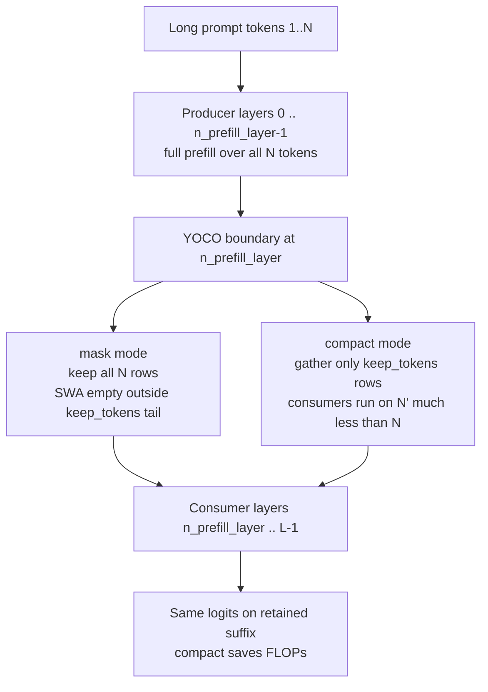

# YOCO Prefill Truncation (Mask / Compact) for DeepSeek-V4.1

DeepSeek-V4.1 Flash is a **YOCO-style** stack: early layers are **producers**
(full prefill over the prompt), later layers are **consumers** that only need a
sliding-window view of recent tokens. Running full attention and MoE through
every consumer token on a long prompt wastes work the SWA cannot use.

This feature ports DeepInfer’s YOCO prefill truncation into vllm-ascend:

| Mode | Behavior | Cost |
| --- | --- | --- |
| `off` (default) | Unchanged full-token consumer prefill | Baseline |
| `mask` | Keep all query rows; empty SWA visibility outside the keep-tail | Cheap correctness reference |
| `compact` | Gather onto ≤ `keep_tokens` rows at the first consumer layer (CP=1) | Real consumer FLOP savings |

**Invariant:** on the retained suffix, `mask` and `compact` SWA visibility must
match. `keep_tokens >= sliding_window + max_backtrack` (V4.1 Flash default:
140 = 128 + 12).

## Configuration

```json
{
  "yoco_prefill_truncation_mode": "compact",
  "yoco_prefill_keep_tokens": 140,
  "yoco_prefill_max_backtrack_tokens": 12
}
```

Requires a YOCO HF topology (`n_prefill_layer < num_hidden_layers`). **Executable
`mask` / `compact` are rejected at config/model init until runner + attention
wiring lands** (`prepare_yoco_prefill` has no caller today). CPU metadata helpers
and L1 tests remain available for the follow-up.

## YOCO truncation vs decoder bounded replay

These are related but **not** the same feature:

| | Decoder bounded replay (Ascend today) | YOCO mask/compact (this feature) |
| --- | --- | --- |
| When | Prefix-cache / SWA replay path | Every long prompt prefill (config-gated) |
| Where | After last KV-source cut (`max(kv_source_layer_ids)+1`) | At first YOCO consumer (`n_prefill_layer`) |
| Modes | One gather/replay path | `mask` (equivalence) + `compact` (savings) |
| Depends on draft window? | Partially (DSpark draft window checks) | **No** — target model topology only |

Do **not** reuse `draft_window_size` / `SlidingWindowAdapter` for this path:
that helper windows the **draft** KV read for speculative decoding, not the
target consumer prefill.



## Implementation map

| Piece | Location |
| --- | --- |
| Config + validation | `vllm_ascend/ascend_config.py` (`yoco_prefill_*`) |
| Keep-tail / pivot math, CP=1 gather | `vllm_ascend/models/deepseek_v41/yoco.py` |
| Consumer boundary gather in forward | `DeepseekV41Model` (`_apply_yoco_compact_boundary`) |
| L1 CPU equivalence tests | `tests/ut/models/test_deepseek_v41_yoco.py` |

DeepInfer sources of truth (concepts, not a wholesale copy):

- Boundary ops: `DeepInfer/.../v4_modules/yoco.py` (`compact_yoco_boundary`)
- Metadata: `DeepInfer/.../input_metadata/yoco.py`
- C++ keep/pivot math: `prepare_tensor_input_v4.cpp` (`yoco_swa_visibility`)
- Equivalence harness: `DeepInfer/examples/yoco/`

## Phase scope

**In this PR (scaffolding)**

- Config surface (modes fail closed until wiring); shared keep/backtrack defaults
- CPU mask/compact metadata (pivots, `query_indices`, `cu_seqlens`, store slots)
- CP=1 compact gather helper + model hook (inactive without metadata)
- Mask vs compact equivalence tests on the retained suffix
- Ascend-native length helper that clips to keep-tail ∩ SWA (`apply_yoco_mask_to_window_lengths`)

**Follow-ups (required for executable modes)**

- Runner: build metadata each prefill and call `prepare_yoco_prefill`
- Attention: apply length (and index) rewrite for mask; switch consumer view for compact
- CP>1 “compact then redistribute” (DeepInfer `yoco_cp_*` + TileLang)
- Engram-in-consumer edge cases (DeepInfer: compact disallows some Engram cases)
- Multi-node EP stress

## Testing

```bash
pytest tests/ut/models/test_deepseek_v41_yoco.py -q
```

L1 cases mirror DeepInfer’s mask-compact matrix (short / eq / gt keep, chunked
clips, history-window cuts, mixed batches). Compact must reduce consumer rows
to the keep-tail (plus a one-token placeholder when a whole chunk is clipped).

## Release note fragment

See `release_notes/fragments/19859.yaml`.
