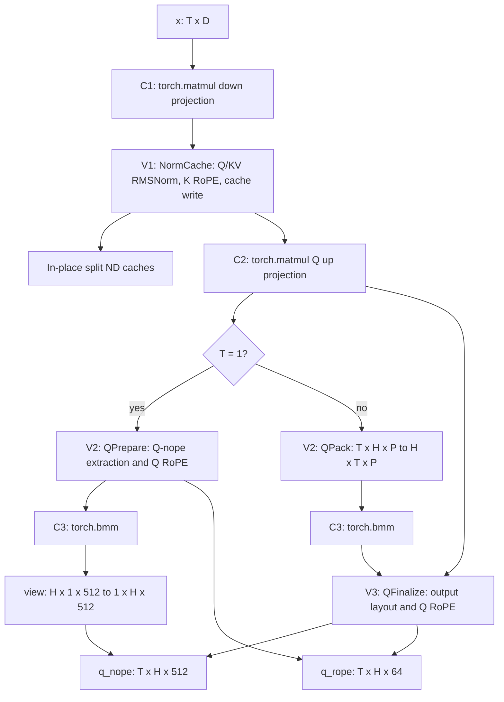

# Serial MLA Preprocess

This experimental BF16/no-quant/split-ND fallback prepares query tensors
and updates the compressed KV cache for Multi-head Latent Attention.
C stages use only two public `torch.matmul` calls and one `torch.bmm`.
V stages use Ascend C through `op_host`/`op_kernel`, generated ACLNN,
`EXEC_NPU_CMD` and Torch PrivateUse1/Meta registrations. There are no
custom Cube kernels. The installed Torch-NPU/CANN backend chooses Matmul.

The implementation follows CANNBot API, tiling and precision guidance,
pinned to `393564ae43f304426db2c206e361cd43b2811413`. The original fused
operator was used only as a binary black box. ATVOSS experiments are not
part of this implementation. SuperKernel is disabled.

## Data flow



Calls execute serially on the current stream. T>1 executes three C and
three V kernels. T=1 executes three C and two V kernels; its singleton
token dimension allows the final output layout to be a view.

Only four Vector interfaces are registered: NormCache, QPrepare, QPack
and QFinalize. QPrepare is the mutually exclusive T=1 V2 path. Legacy
QNorm, KvCache and QLayout interfaces have been removed.

QFinalize groups at most two adjacent tokens for its bounded UB tile.
QPack uses two bound queue buffers. Vector tiling uses platform Vector
core information and the runtime work size; C tiling is owned by Torch.

## Inputs and outputs

| Argument | Shape and meaning |
| --- | --- |
| `x` | BF16 NPU `[T,D]` |
| `weight_down` | Persistent BF16 ND `[L+576,D]`, rows `[KV,K-rope,Q]` |
| `weight_up` | Persistent BF16 ND `[H*(P+64),L]` |
| `weight_key` | Persistent BF16 ND `[H,P,512]` |
| `gamma_q`, `gamma_kv` | BF16 `[L]`, `[512]` |
| `cos`, `sin` | Paired BF16 `[T,64]`, or both absent |
| `slots` | NPU int32 `[T]`; negative slots preserve cache contents |
| `cache`, `cache_rope` | BF16 `[blocks,128,1,512]`, `[blocks,128,1,64]` |

Returns `(q_nope, q_rope, cache, cache_rope)`, with query shapes
`[T,H,512]` and `[T,H,64]`. Cache outputs alias their input tensors.
Only the cache block dimension may have a larger physical stride.
Valid nonnegative slots must be unique and within cache capacity.
RMS epsilon is `1e-5`; RMSNorm and RoPE use FP32 intermediates.

`prepare_mla_preprocess_serial_weights(wdqkv, wuq, wuk)` runs once at
model load. Its inputs use logical down rows `[Q,KV,K-rope]` and key
`[H,512,P]`; it preserves BF16 values while preparing the layouts above.
This logical-weight API differs from the original blocked/NZ weight ABI.
Persistent weight preparation is outside the timed call. Every runtime
layout kernel remains part of the performance measurement.

## Build and device test

The root CMake glob includes the C++ wrapper. `csrc/build_aclnn.sh` lists
the four operators in the A3 build. For a matching vLLM/Torch-NPU/CANN
development environment, build through the repository installation path:

```bash
source /usr/local/Ascend/ascend-toolkit/set_env.sh
COMPILE_CUSTOM_KERNELS=1 SOC_VERSION=ascend910_93 pip install -e . --no-build-isolation
```

To build only the four custom ACLNN Vector operators:

```bash
cd csrc
bash build.sh --pkg --soc=ascend910_93 --vendor_name=mla_serial \
  --ops=mla_serial_norm_cache,mla_serial_q_prepare,mla_serial_q_pack,mla_serial_q_finalize -j8
```

This builds a vendor package; it does not build the Torch extension.
Install/source the generated vendor environment before loading the
extension. The repository installation path handles both stages.

There is one self-contained device test file in the repository NPU
single-card operator directory. It contains its own independent FP32 CPU
oracle and does not depend on manual helpers, profiler scripts or the
original fused operator:

```bash
pytest -q tests/e2e/nightly/single_node/ops/singlecard_ops/test_mla_preprocess_serial.py
```

The test covers all 27 business shapes in eager and actual Graph replay,
plus no-RoPE, negative-slot, cache-stride and invalid-input cases.
BF16 acceptance requires `atol=rtol=2^-6`, matched fraction at least 0.99
and maximum absolute error at most 1. Untouched cache and physical stride
padding must match exactly.

The focused A3 validation rebuilt all four ACLNN operators and compiled the
production wrapper/adapter with the production registration fragments.
The single device test passed all 64 cases without skips. A full repository
extension build and model serving remain unvalidated.

## Tested shape matrix

Performance covers the Cartesian product below: **9 token counts x 3
head counts = 27 shapes**. Every point uses BF16, no quantization, split
ND caches with cache block-stride multiplier 1, supplied RoPE and valid
nonnegative slots.
Fixed dimensions are D=7168, Q latent L=1536, Q-nope P=128, KV rank=512
and RoPE dimension=64.

| Dimension | Tested values |
| --- | --- |
| Active tokens T | 1, 16, 64, 128, 256, 257, 512, 1023, 1024 |
| Local heads H | 16, 32, 128 |
| `x` | `[T,7168]` |
| Persistent `weight_down` | `[2112,7168]` |
| Persistent `weight_up` | `[H*192,1536]` |
| Persistent `weight_key` | `[H,128,512]` |
| `gamma_q`, `gamma_kv` | `[1536]`, `[512]` |
| `cos`, `sin`; `slots` | `[T,64]` each; `[T]` |
| Cache; RoPE cache | `[B,128,1,512]`; `[B,128,1,64]`, with B covering slots |
| C1: down projection | `[T,7168] @ [7168,2112] -> [T,2112]` |
| V1: normalized Q latent | `[T,1536]` |
| C2: Q up projection | `[T,1536] @ [1536,H*192] -> [T,H*192]` |
| V2: packed Q-nope | `[H,T,128]` |
| C3: Q-nope projection | `[H,T,128] @ [H,128,512] -> [H,T,512]` |
| Final queries | `q_nope [T,H,512]`, `q_rope [T,H,64]` |

T is the flattened active-token count, including bounded prefill/chunked
prefill cases through 1024. It is not a sequence-length-only axis and
does not establish full model prefill coverage. H is local to this call;
no TP configuration or model serving was validated by this matrix.
For T=1, QPrepare emits Q RoPE before C3; its Q-nope input and output
layouts can use singleton-token views without QFinalize.

Function/accuracy coverage is broader than performance coverage:

| Device test family | Cases | Performance measured? |
| --- | ---: | --- |
| The 27 business shapes, eager and Graph | 54 | Yes, the 27 normal-mode shapes |
| No RoPE + cache stride 2 + negative slot, eager and Graph | 8 | No |
| Invalid dtype or unpaired cos/sin | 2 | No |
| Total | 64 | |

The four extra boundary shapes are `(T,H) = (1,32), (2,16), (64,32),
(257,128)`. No-RoPE, strided-cache and negative-slot behavior are checked
together at these points. They are not additional performance modes.

## Historical M20 performance

The tables below reanalyze the existing M20-THREEWAY measurements from
2026-10-20, before packaging cleanup. The active Ascend C kernel/tiling
sources and Torch pipeline are unchanged; cleanup removes unused
registrations and test helpers. This documentation update does not
collect new NPU timings or establish fresh performance acceptance of
the cleaned package. Historical measurement source commit:
`b7841a355d46ed07a9af5811dd13c339ba2d1b2f`.

Environment: A3 Ascend910_9362, CANN 9.1.0, driver 26.1.1,
Torch 2.10.0+cpu and torch_npu 2.10.0.post4. The original fused operator
is the installed binary black box. SuperKernel is disabled for M20.
Both implementations use the same logical inputs and persistent weight
policy; load-time weight preparation and Graph capture are excluded.

### Primary metric: Graph replay

Per the updated evaluation requirement, **Graph replay is the primary
performance metric**. The existing measurement is unprofiled synchronized
batch wall time: `perf_counter_ns` surrounds 10 consecutive
`GraphRunner` calls, each executing one `graph.replay()`, followed by
`torch.npu.synchronize()`. Divide the elapsed time by 10. There are 10
warmup calls and 20 measured batches per implementation per order; two
balanced orders were collected. A pre-batch synchronization is outside
the timer; the final synchronization is inside.

This boundary includes Python replay submission, any submission gaps,
device execution and the amortized final synchronization. It is not a
device-event-only Graph duration or the sum of kernel times. In particular,
the roughly 290 us floor for small shapes is visible in this host-timed
measurement; a Graph speed ratio near 1 does not imply equal kernel work.

The latency columns average the two order means. For each order,
`speed = original_mean / M20_mean`; Min speed is the smaller of the two
ratios. A point meets the target only if both orders reach 0.8, equivalent
to M20 latency no greater than 1.25 times the original in each order.
No workload-weighted model aggregate is inferred from these 27 points.

**Historical Graph replay: 24/27 shapes meet 0.8. Full-range acceptance
remains unmet.** The failures are H=128 at T=512, 1023 and 1024.

| T | H | Original Graph us | M20 Graph us | Min speed | Meets 0.8 |
| ---: | ---: | ---: | ---: | ---: | --- |
| 1 | 16 | 296.827 | 289.955 | 1.0196 | PASS |
| 1 | 32 | 297.262 | 291.190 | 1.0188 | PASS |
| 1 | 128 | 313.742 | 293.219 | 1.0660 | PASS |
| 16 | 16 | 297.716 | 289.769 | 1.0241 | PASS |
| 16 | 32 | 297.909 | 291.586 | 1.0182 | PASS |
| 16 | 128 | 328.346 | 299.789 | 1.0871 | PASS |
| 64 | 16 | 303.462 | 290.471 | 1.0444 | PASS |
| 64 | 32 | 303.485 | 291.814 | 1.0385 | PASS |
| 64 | 128 | 326.350 | 311.139 | 1.0430 | PASS |
| 128 | 16 | 298.740 | 291.141 | 1.0238 | PASS |
| 128 | 32 | 299.699 | 294.994 | 1.0119 | PASS |
| 128 | 128 | 341.138 | 318.709 | 1.0600 | PASS |
| 256 | 16 | 307.832 | 292.792 | 1.0487 | PASS |
| 256 | 32 | 306.428 | 294.129 | 1.0414 | PASS |
| 256 | 128 | 336.784 | 351.396 | 0.9563 | PASS |
| 257 | 16 | 299.022 | 295.882 | 1.0041 | PASS |
| 257 | 32 | 298.923 | 294.769 | 1.0134 | PASS |
| 257 | 128 | 385.841 | 395.263 | 0.9705 | PASS |
| 512 | 16 | 298.369 | 294.155 | 1.0131 | PASS |
| 512 | 32 | 304.057 | 296.075 | 1.0200 | PASS |
| 512 | 128 | 442.739 | 605.529 | 0.7243 | FAIL |
| 1023 | 16 | 301.942 | 330.750 | 0.9114 | PASS |
| 1023 | 32 | 359.883 | 431.359 | 0.8254 | PASS |
| 1023 | 128 | 850.320 | 1178.788 | 0.7177 | FAIL |
| 1024 | 16 | 300.761 | 317.228 | 0.9316 | PASS |
| 1024 | 32 | 363.267 | 441.637 | 0.8198 | PASS |
| 1024 | 128 | 852.137 | 1128.330 | 0.7501 | FAIL |

### Diagnostic metric: C and V kernel time

C/V decomposition uses a separate full msprof capture of actual Graph
replay. Sum only per-kernel `Task Duration(us)` from a complete call,
including all runtime layout work; exclude Task Wait Time, host APIs,
markers and inter-kernel gaps. Each of two orders kept 20 calls after
dropping 5 warmup calls. The original is one `MIX_AIC` kernel, so these
records cannot separate its internal C and V work.

For M20, C is the sum of C1, C2 and C3 (`AI_CORE` tasks); V is the sum
of NormCache, QPrepare for T=1, or NormCache, QPack and QFinalize for T>1
(`AI_VECTOR_CORE` tasks). Each stage includes its own memory and scalar
work. C/(C+V) is a latency share, not Cube instruction utilization.
Average C and V over the two orders first, then compute the share.
The audited C+V totals equal the complete M20 kernel sums at every point.
They must not be substituted for the primary Graph replay latency or
subtracted from it to infer a precise host-overhead breakdown: the captures
are separate.

| T | H | C us | V us | C+V us | C/(C+V) |
| ---: | ---: | ---: | ---: | ---: | ---: |
| 1 | 16 | 51.220 | 8.683 | 59.903 | 85.50% |
| 1 | 32 | 57.852 | 12.402 | 70.254 | 82.35% |
| 1 | 128 | 107.023 | 12.998 | 120.020 | 89.17% |
| 16 | 16 | 34.601 | 14.504 | 49.105 | 70.46% |
| 16 | 32 | 43.277 | 17.265 | 60.543 | 71.48% |
| 16 | 128 | 122.718 | 21.293 | 144.011 | 85.21% |
| 64 | 16 | 44.788 | 27.303 | 72.091 | 62.13% |
| 64 | 32 | 50.251 | 31.081 | 81.333 | 61.79% |
| 64 | 128 | 153.429 | 37.196 | 190.625 | 80.49% |
| 128 | 16 | 48.663 | 35.783 | 84.446 | 57.63% |
| 128 | 32 | 56.265 | 35.706 | 91.971 | 61.18% |
| 128 | 128 | 180.828 | 44.218 | 225.046 | 80.35% |
| 256 | 16 | 76.613 | 42.787 | 119.400 | 64.16% |
| 256 | 32 | 90.563 | 42.117 | 132.680 | 68.26% |
| 256 | 128 | 282.126 | 64.882 | 347.008 | 81.30% |
| 257 | 16 | 110.501 | 42.331 | 152.833 | 72.30% |
| 257 | 32 | 134.653 | 42.511 | 177.164 | 76.00% |
| 257 | 128 | 324.526 | 63.383 | 387.909 | 83.66% |
| 512 | 16 | 123.518 | 52.928 | 176.446 | 70.00% |
| 512 | 32 | 153.337 | 58.541 | 211.879 | 72.37% |
| 512 | 128 | 421.117 | 178.736 | 599.853 | 70.20% |
| 1023 | 16 | 249.198 | 75.535 | 324.734 | 76.74% |
| 1023 | 32 | 336.160 | 88.462 | 424.622 | 79.17% |
| 1023 | 128 | 761.440 | 405.425 | 1166.865 | 65.26% |
| 1024 | 16 | 236.449 | 75.012 | 311.461 | 75.92% |
| 1024 | 32 | 348.354 | 87.786 | 436.141 | 79.87% |
| 1024 | 128 | 716.003 | 406.188 | 1122.191 | 63.80% |

The historical kernel-sum comparison meets 0.8 at 16/27 points. That is
a separate diagnostic result; the primary Graph replay result is 24/27.
The underlying local evidence set is `M20-THREEWAY`: `graph-stages.csv`,
`graph-summary.csv`, `kernel-sum-audit.json`, `wall-forward.json`,
`wall-reverse.json` and `threeway-results.json`. Raw samples and profiler
CSV files are retained outside the source branch.

Model dispatch integration, serving performance and full repository
extension-build validation are separate from the focused operator
checks. No serving or CI performance claim is made here.
