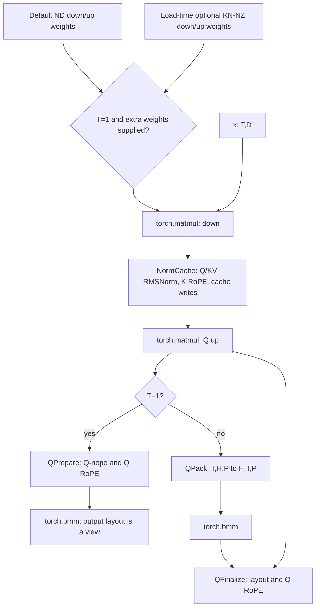

# Serial MLA Preprocess on A3

This BF16/no-quant/split-ND fallback prepares query tensors and updates the
compressed KV cache. C uses two public `torch.matmul` calls and one public
`torch.bmm`; V uses independent Ascend C through op_host/op_kernel, ACLNN,
EXEC_NPU_CMD and Torch PrivateUse1/Meta. There are no custom Cube kernels.
Original fused compute/tiling/golden/disassembly was not inspected.

The default path retains M20 ND weights and behavior. An explicit optional
single-token weight preparation uses public Torch-NPU NZ conversion at load
time. Only T=1 selects those extra weights. No Vector kernel/tiling, schema,
Meta implementation, environment variable or global weight cache is added.
SuperKernel remains disabled. This is standalone operator evidence, not
model-serving or complete-ABI acceptance.

## Data flow and interface



T>1 runs3 C and3 V stages; T=1 runs3 C and2 V stages. Four Vector interfaces
are registered: NormCache, QPrepare, QPack, QFinalize. QPrepare is mutually
exclusive with QPack/QFinalize. All run serially on the current stream;
Torch chooses the matrix kernels and their tiling.

| Argument | Shape and meaning |
| --- | --- |
| x | BF16 NPU `[T,D]` |
| weight_down | Default persistent BF16 ND `[L+576,D]`, rows `[KV,K-rope,Q]` |
| weight_up | Default persistent BF16 ND `[H*(P+64),L]` |
| weight_key | Persistent BF16 ND `[H,P,512]` |
| gamma_q, gamma_kv | BF16 `[L]`, `[512]` |
| cos, sin | Paired BF16 `[T,64]`, or both absent |
| slots | INT32 `[T]`; negative slots preserve cache contents |
| cache, cache_rope | BF16 `[blocks,128,1,512]`, `[blocks,128,1,64]` |
| single_token_weights | Keyword-only optional pair of prepared down/up tensors; default None |
| Returned queries | `q_nope [T,H,512]`, `q_rope [T,H,64]` |

Cache outputs alias their inputs. Only the cache block axis may have physical
stride padding. Nonnegative slots must be unique and within capacity.
RMS epsilon is1e-5; Norm/RoPE intermediates are FP32.

`prepare_mla_preprocess_serial_weights(wdqkv,wuq,wuk)` still returns exactly
three tensors and preserves the old API. Inputs use logical down rows
`[Q,KV,K-rope]` and key `[H,512,P]`. The new helper accepts its down/up outputs:

```python
from vllm_ascend.ops.mla_preprocess_serial import (
    mla_preprocess_serial,
    prepare_mla_preprocess_serial_weights,
    prepare_mla_preprocess_single_token_weights,
)

down, up, key = prepare_mla_preprocess_serial_weights(wdqkv, wuq, wuk)
single = prepare_mla_preprocess_single_token_weights(down, up)
outputs = mla_preprocess_serial(
    x, down, up, key, gamma_q, gamma_kv, cos, sin, slots, cache, cache_rope,
    single_token_weights=single,
)
```

The caller explicitly holds both weight versions and rebuilds them when
weights change. The optional helper prepares contiguous RHS `[K,N]`, converts
it to FRACTAL_NZ29, then returns a logical `[N,K]` transposed view. Forward's
existing `.t()` restores the RHS view. BF16 logical values are checked bit
exact. For T>1 the supplied extra pair is ignored; default None preserves
the previous path. No explicit format conversion is added to forward.
After replacing prepared tensors or their device addresses, recapture any
Graph that consumes them; an existing replay retains its captured addresses.

Extra logical weight storage is `2*(D*(L+576)+L*H*(P+64))` bytes:33.375–100.875
MiB for the tested H8–128, excluding allocator overhead. Preparation and
transient preparation storage are outside steady Graph timing. All runtime
projections, layouts, Norm/RoPE and cache updates remain inside the full call.

## CANNBot tiling experiments and selected scope

CANNBot generic core-shrink, DMA batching and transpose-fusion guidance was
consulted at revision393564ae43f304426db2c206e361cd43b2811413. A5 MicroAPI
templates are not imported into A3. Platform queries provide AIV capability;
the original fused tiling is never a source.

Retained V tiling uses one NormCache token task, grouped-head QPrepare,
bounded8192-element double-buffered QPack and up-to2-token/128-cell QFinalize.
The following additional V strategies were measured and rejected:

| Trial | Strategy | Paired M20/new result and decision |
| --- | --- | --- |
| MLA01 | Split small-T Finalize heads for more AIV tasks | 0.960–1.000x in8 probes; REJECT |
| MLA02 | Balance Pack token groups when head parallelism is low | 0.934–0.999x in6 probes; REJECT |
| MLA04 | Separate small-T Q norm and KV/cache tasks | 0.918–1.038x; protected regression; REJECT |
| MLA05 | Finalize64-cell double buffer at same total UB budget | 0.989–1.002x; no reliable gain; REJECT |
| MLA06 | Fill128-cell tiles across more tokens at few heads | 0.986–1.004x; no reliable gain; REJECT |

All probes passed independent precision/cache gates. More tasks did not
reliably improve full-call latency, so these branches are not retained.

MLA07 compared six public weight-format policies. NZ key/all paths passed
eager checks but failed Graph capture through aclop BatchMatMul; they have no
speed result. Unconditionally using KN-NZ down/up passed61 precision/Graph
points and met0.8x at57, but regressed protected points by up to9.3% against
M20. That general policy is REJECTED. MLA08 confines the optional choice to
the existing structural T=1 path, with no per-shape winner table.

MLA09 additionally tested down-only KN-NZ while up aliases ND, reducing extra
logical storage to28.875MiB. It passed61 checks,146 UTs and the14 False-option
checks, but was slower than the both-weight option at most small heads in the
paired five-head probe. The apparent H128 recovery did not repeat in full-range
confirmation. It is REJECTED as a performance/storage tradeoff, not a numerical
failure. No head-specific winner table is introduced; MLA08 is retained.

## Expanded shapes and accuracy

The61 business points retain all original27. Fixed dimensions are D7168,
Q latent L1536,Q-nope P128,KV512,RoPE64. Local H8/16/32/64/128 are compatible
subdivisions of128 global heads; no TP/model-serving run is claimed.
T counts flattened active tokens, not necessarily one sequence.

* Main grid: T1/2/4/8/16/32/64/128/256/512/1024 times H8/16/32/64/128.
* Protected prior points: T257/1023 times H16/32/128.
* Timed inputs: BF16/no quantization/split ND cache, block128, stride1,
  supplied RoPE, valid unique nonnegative slots.
* T>1024 is excluded because the installed fused ABI previously rejected it.
  FP16, quantization, combined/NZ cache and serving remain unvalidated.

The single device UT passed146 cases: original132 plus14 optional T=1 eager/
Graph cases across all five head counts and no-RoPE/negative-slot/stride2
variants. It verifies bit-exact prepared weights, Graph reads updated inputs,
numerical outputs, cache aliasing, untouched cache and physical padding.
Independent CPU FP32 BF16 acceptance is atol=rtol=2^-6,matched>=0.99,max_abs<=1.

The14 optional cases also pass in an isolated process explicitly setting
allow_internal_format=False. Native option readback is `disable` before and
after those tests. The product never writes this option. The public attribute
has no getter in this package and returns None; it is not the state readback.

## Graph measurement and workload-sorted results

Same A3 Ascend910_9362,CANN9.2.0,Torch2.10.0+cpu and
Torch-NPU2.10.0.post7.dev20261020. All three implementations are compared in
the same process on the same inputs. Graph captures20 complete calls; NPU
events bracket one replay and divide elapsed time by20. Two groups each use25
replays, discard5 and retain20, alternating order. Speed is the smaller
group-mean ratio. The event interval includes Graph runtime gaps, not pure
kernel sum. Weight preparation and CPU reference are outside timing.

Workload MACs is `T*D*(L+576)+T*L*H*(P+64)+T*H*P*512`; FLOPs is2*MACs.
It describes projection work and excludes vector/cache traffic. Rows sort by
MACs then T/H, not by observed latency. Costs can reverse locally with shape,
runtime placement and Torch dispatch. Times below average the two group means;
speed ratios remain conservative per-group values.

Same-capture default M20: 0.736–1.227x fused, 51/61 >=0.8x. Optional T1: 0.738–1.237x, 53/61 >=0.8x. Eight optional-path points remain below0.8x; there is no full-range performance pass.

Remaining points: t2-h64 (0.764x), t4-h32 (0.774x), t128-h128 (0.771x), t256-h128 (0.738x), t512-h128 (0.761x), t1024-h64 (0.750x), t1023-h128 (0.739x), t1024-h128 (0.778x).

| T | Local H | GMAC | Fused us | M20 us | Optional T1 us | Fused/optional | M20/optional |
| ---: | ---: | ---: | ---: | ---: | ---: | ---: | ---: |
| 1 | 8 | 0.018022 | 36.442 | 43.215 | 31.809 | 1.144x | 1.357x |
| 1 | 16 | 0.020906 | 39.604 | 45.365 | 35.224 | 1.123x | 1.287x |
| 1 | 32 | 0.026673 | 45.110 | 57.115 | 46.426 | 0.971x | 1.230x |
| 2 | 8 | 0.036045 | 39.347 | 45.358 | 45.412 | 0.864x | 0.999x |
| 1 | 64 | 0.038207 | 53.806 | 63.713 | 58.844 | 0.913x | 1.083x |
| 2 | 16 | 0.041812 | 42.812 | 46.675 | 46.705 | 0.916x | 0.998x |
| 2 | 32 | 0.053346 | 45.621 | 57.023 | 56.812 | 0.803x | 1.003x |
| 1 | 128 | 0.061276 | 108.320 | 100.260 | 100.078 | 1.081x | 1.001x |
| 4 | 8 | 0.072090 | 41.646 | 45.361 | 45.211 | 0.921x | 1.001x |
| 2 | 64 | 0.076415 | 54.393 | 71.873 | 71.029 | 0.764x | 1.012x |
| 4 | 16 | 0.083624 | 42.516 | 46.294 | 46.232 | 0.919x | 1.001x |
| 4 | 32 | 0.106693 | 45.430 | 58.576 | 58.665 | 0.774x | 0.998x |
| 2 | 128 | 0.122552 | 104.801 | 114.811 | 114.261 | 0.917x | 1.004x |
| 8 | 8 | 0.144179 | 42.579 | 43.928 | 43.686 | 0.975x | 1.005x |
| 4 | 64 | 0.152830 | 54.731 | 67.318 | 63.048 | 0.867x | 1.067x |
| 8 | 16 | 0.167248 | 42.689 | 47.301 | 47.522 | 0.898x | 0.995x |
| 8 | 32 | 0.213385 | 47.679 | 59.223 | 59.036 | 0.807x | 1.003x |
| 4 | 128 | 0.245105 | 113.795 | 108.232 | 105.981 | 1.073x | 1.021x |
| 16 | 8 | 0.288358 | 43.463 | 35.615 | 35.441 | 1.225x | 1.004x |
| 8 | 64 | 0.305660 | 55.602 | 65.174 | 64.698 | 0.859x | 1.007x |
| 16 | 16 | 0.334496 | 47.277 | 39.842 | 39.511 | 1.196x | 1.008x |
| 16 | 32 | 0.426770 | 51.143 | 46.793 | 45.911 | 1.114x | 1.019x |
| 8 | 128 | 0.490209 | 106.588 | 108.530 | 108.040 | 0.987x | 1.004x |
| 32 | 8 | 0.576717 | 51.649 | 42.079 | 42.243 | 1.222x | 0.996x |
| 16 | 64 | 0.611320 | 60.402 | 60.134 | 59.315 | 1.018x | 1.013x |
| 32 | 16 | 0.668991 | 55.535 | 45.483 | 44.885 | 1.237x | 1.013x |
| 32 | 32 | 0.853541 | 57.048 | 52.263 | 51.885 | 1.098x | 1.006x |
| 16 | 128 | 0.980419 | 122.835 | 117.106 | 118.456 | 1.037x | 0.988x |
| 64 | 8 | 1.153434 | 56.913 | 49.687 | 49.659 | 1.144x | 1.000x |
| 32 | 64 | 1.222640 | 70.866 | 71.835 | 72.299 | 0.980x | 0.993x |
| 64 | 16 | 1.337983 | 57.683 | 52.610 | 52.348 | 1.102x | 1.005x |
| 64 | 32 | 1.707082 | 61.531 | 67.391 | 62.068 | 0.991x | 1.086x |
| 32 | 128 | 1.960837 | 128.271 | 131.177 | 136.500 | 0.939x | 0.960x |
| 128 | 8 | 2.306867 | 67.734 | 60.913 | 60.474 | 1.120x | 1.007x |
| 64 | 64 | 2.445279 | 78.048 | 85.683 | 84.478 | 0.924x | 1.014x |
| 128 | 16 | 2.675966 | 69.266 | 65.516 | 65.673 | 1.055x | 0.997x |
| 128 | 32 | 3.414163 | 84.857 | 77.386 | 76.071 | 1.115x | 1.017x |
| 64 | 128 | 3.921674 | 154.611 | 161.299 | 164.426 | 0.940x | 0.981x |
| 256 | 8 | 4.613734 | 97.119 | 90.681 | 90.470 | 1.073x | 1.002x |
| 128 | 64 | 4.890558 | 97.655 | 111.570 | 115.691 | 0.844x | 0.964x |
| 256 | 16 | 5.351932 | 108.099 | 106.101 | 101.753 | 1.062x | 1.043x |
| 257 | 16 | 5.372838 | 157.993 | 129.137 | 127.826 | 1.235x | 1.010x |
| 256 | 32 | 6.828327 | 131.152 | 129.660 | 131.668 | 0.995x | 0.985x |
| 257 | 32 | 6.855000 | 180.374 | 157.431 | 158.300 | 1.139x | 0.994x |
| 128 | 128 | 7.843348 | 164.094 | 215.793 | 212.887 | 0.771x | 1.014x |
| 512 | 8 | 9.227469 | 154.228 | 142.937 | 142.141 | 1.085x | 1.006x |
| 256 | 64 | 9.781117 | 162.842 | 196.959 | 192.583 | 0.845x | 1.023x |
| 512 | 16 | 10.703864 | 165.910 | 162.486 | 161.223 | 1.029x | 1.008x |
| 512 | 32 | 13.656654 | 193.702 | 201.452 | 206.119 | 0.940x | 0.977x |
| 256 | 128 | 15.686697 | 252.054 | 340.847 | 341.567 | 0.738x | 0.998x |
| 257 | 128 | 15.747973 | 371.027 | 370.738 | 372.847 | 0.995x | 0.994x |
| 1024 | 8 | 18.454938 | 252.366 | 269.514 | 269.696 | 0.936x | 0.999x |
| 512 | 64 | 19.562234 | 262.224 | 312.407 | 314.128 | 0.835x | 0.994x |
| 1023 | 16 | 21.386822 | 280.558 | 309.131 | 310.870 | 0.902x | 0.994x |
| 1024 | 16 | 21.407728 | 279.350 | 296.828 | 296.054 | 0.943x | 1.002x |
| 1023 | 32 | 27.286634 | 353.981 | 417.264 | 411.404 | 0.860x | 1.014x |
| 1024 | 32 | 27.313308 | 355.135 | 420.411 | 418.450 | 0.849x | 1.005x |
| 512 | 128 | 31.373394 | 440.827 | 581.402 | 578.846 | 0.761x | 1.004x |
| 1024 | 64 | 39.124468 | 501.729 | 658.976 | 668.336 | 0.750x | 0.986x |
| 1023 | 128 | 62.685512 | 855.109 | 1161.245 | 1156.740 | 0.739x | 1.004x |
| 1024 | 128 | 62.746788 | 859.946 | 1101.779 | 1105.489 | 0.778x | 0.996x |

At T1,H8/16/32/64 paired M20/optional speed is1.357/1.287/1.230/1.083x.
H128 is1.001x in the main capture and0.976x in the swapped-capture repeat;
its benefit is unresolved. T>1 uses the original ND path and adds no device
work, but independent Graph measurements range0.960–1.086x. Three apparent
regressions remain visible. Targeted swapped-order and identical-function
controls also vary; these data do not establish universal zero regression or
attribute timing differences to added device work. No better repeat replaces
the primary61 rows. The different floor counts are observed counts, not proof
that all threshold crossings were caused by the optional T1 weights.

## Actual task counts and C diagnostics

Four single-shape msprof captures each retain the last20 of25 complete Graph
calls. T1 at H8/32/128 has5 tasks; T512/H8 has6. No extra runtime TransData
task is observed. T1 C1/C2 use the public MatmulWeightNz route, whose actual
kernel is still MatMulV2. T>1 uses the old Matmul route. There is no evidence
of a V2-to-V3 switch or task-count reduction causing the speedup; only the
public weight-format selection's observed benefit is established. Internal
tiling and finer scheduling mechanisms remain unproven.

C means three Torch matrix task durations; V means owned Vector durations.
Their fraction is not Cube pipeline utilization, and profiler time is separate
from the independent Graph metric above.

| Case | C task us | Owned V us | Kernel sum us | C fraction |
| --- | ---: | ---: | ---: | ---: |
| t1-h8 | 29.944 | 7.209 | 37.153 | 80.60% |
| t1-h32 | 40.121 | 14.438 | 54.559 | 73.54% |
| t1-h128 | 85.296 | 11.250 | 96.546 | 88.35% |
| t512-h8 | 107.230 | 66.367 | 173.597 | 61.77% |

## Build and test

No new Vector/schema/build integration is needed for the optional helper.
The original A3 vendor build remains:

```bash
cd csrc
bash build.sh --pkg --soc=ascend910_93 --vendor_name=mla_serial \
  --ops=mla_serial_norm_cache,mla_serial_q_prepare,mla_serial_q_pack,mla_serial_q_finalize -j8
```

This builds the Vector vendor package; standard repository installation also
builds the Torch wrapper. Source the vendor environment before loading it.

```bash
pytest -q tests/e2e/nightly/single_node/ops/singlecard_ops/test_mla_preprocess_serial.py
```

Focused vendor/wrapper builds, the device UT and Graph/profile gates above
are separate from full-repository builds, CI or model serving. Raw samples,
failed experiments and compiler/profile evidence stay in the task archive;
only this MD, the existing single device UT and Python source are updated.
