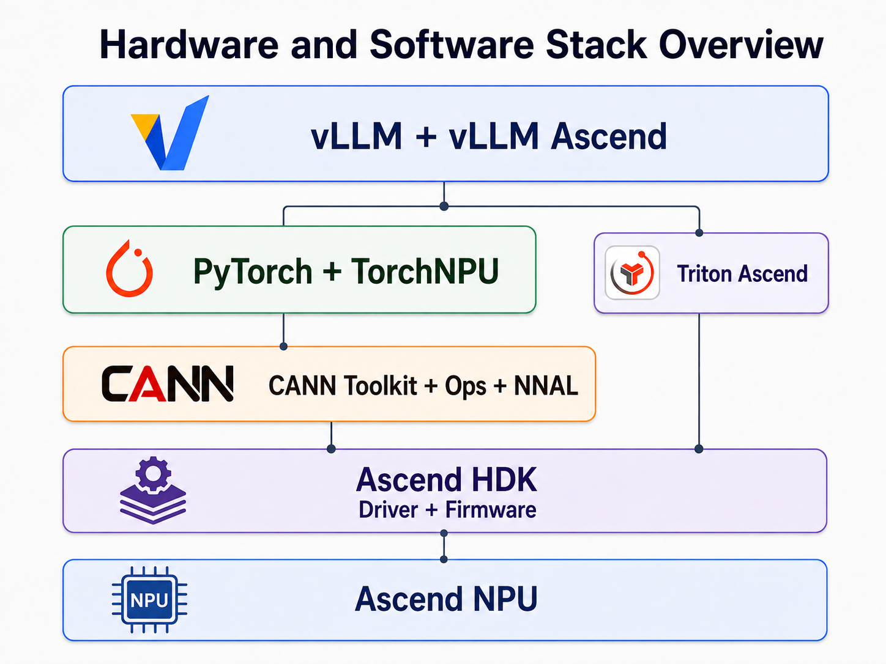

# Installation Guide

This document describes how to install vLLM Ascend manually.

## Requirements {: #installation-requirements }

### Environment requirements {: #installation-environment-requirements }

- Operating system: Linux
- Python: {{ release_python_version }}
- Hardware equipped with Ascend NPUs. This guide supports the following devices:



### Hardware and software stack {: #installation-hardware-software-stack }

vLLM Ascend runs on a layered hardware and software stack. The following overview shows how the main runtime components fit together.

??? note "Hardware and software stack overview"

    <p align="center">
      
    </p>

The following hardware and software stack is validated together for this release:

???+ important "Validated hardware and software stack"

    | Layer | Component | Validated version / requirement | Role |
    | --- | --- | --- | --- |
    | Runtime environment | Python | `{{ release_image_python_version }}` | Python version used by the validated release image |
    | Host enablement | Ascend HDK | `{{ release_hdk_version }}` | Driver and firmware requirements for the selected CANN release |
    | Ascend runtime | CANN Toolkit + Ops | `{{ release_cann_version }}` | Ascend user-space runtime, including the CANN Toolkit and hardware-specific Ops packages |
    | Ascend runtime | NNAL | `{{ release_nnal_version }}` | Provides `libatb.so` and ATB runtime capabilities |
    | Framework | PyTorch | `{{ release_pytorch_version }}` | Tensor framework used by vLLM |
    | Framework | TorchNPU | `{{ release_torch_npu_version }}` | Connects PyTorch to the Ascend runtime |
    | Kernel acceleration | Triton Ascend | `{{ release_triton_ascend_version }}` | Used on A2, A3, and 950DT Products; not used on Atlas 300I DUO or Atlas 200I Pro |
    | Inference engine | vLLM | `{{ release_vllm_version }}` | Model inference engine |
    | Hardware plugin | vLLM Ascend | `{{ release_vllm_ascend_version }}` | Connects vLLM to the Ascend software stack |

    The versions and requirements in the table above are validated as one compatibility set. Do not arbitrarily mix versions from different releases.

    For another release, select a complete row from [Versioning Policy > Release compatibility matrix](../community/versioning_policy.md#release-compatibility-matrix).

## Installation {: #installation }

### Set up the hardware environment {: #installation-hardware-environment }

First, run the following command to confirm that the Ascend NPU firmware and driver are installed correctly:

```bash
npu-smi info
```

The output should list the expected NPU devices, with `Health` shown as `OK` and no driver initialization errors. Device names, chip counts, and table columns vary by hardware and driver version. A missing device or a health status other than `OK` needs investigation before continuing.

```bash
+------------------------------------------------------------------------------------------------+
| npu-smi xx.x.x                   Version: xx.x.x                                               |
+---------------------------+---------------+----------------------------------------------------+
| NPU   Name                | Health        | Power(W)    Temp(C)           Hugepages-Usage(page)|
| Chip                      | Bus-Id        | AICore(%)   Memory-Usage(MB)  HBM-Usage(MB)        |
+===========================+===============+====================================================+
| 0     xxxxx               | OK            | 95.6        50                0    / 0             |
| 0                         | 0000:C1:00.0  | 0           0    / 0          xxxx / xxxxx         |
+===========================+===============+====================================================+
+---------------------------+---------------+----------------------------------------------------+
| NPU     Chip              | Process id    | Process name             | Process memory(MB)      |
+===========================+===============+====================================================+
| No running processes found in NPU 0                                                            |
+===========================+===============+====================================================+
```

The host Linux distribution and kernel must be supported by the selected Ascend hardware and driver/firmware release. For more information, see the [Ascend compatibility query](https://info.support.huawei.com/computing/tools/compatibility-query/enterprise/ascend-computing/system-compatibility) and [CANN installation resources](https://www.hiascend.com/cann/download?versionId=735&ids=d806%2Ch0501%2Ch0601%2Ch0702).

### Set up the software environment {: #installation-software-environment }

!!! danger "v0.30.0rc2 installation support"

    v0.30.0rc2 currently supports only the [official vLLM Ascend images](#installation-prebuilt-image-selection) or [building an image with `docker build`](#installation-prebuilt-image-build). Installation in a CANN image or a manually prepared CANN environment, including pip/uv wheel and direct source installation, is not yet supported for rc2.

Choose one complete path based on your requirements. Container-based paths require Docker; see the [Docker installation guide](https://docs.docker.com/get-started/get-docker/) if needed.

| Requirement | Recommended method | Intended users |
| --- | --- | --- |
| Get a working vLLM Ascend environment as quickly as possible | **Use a prebuilt image** | First-time users or users who want a quick deployment |
| Install vLLM Ascend on an existing CANN environment | **Install in a CANN environment** | Users of a CANN image or a host/container where CANN is already installed |
| Install and manage the complete software stack manually | **Install from a base environment** | Advanced users who need custom CANN or Python dependencies, development, or debugging |

??? tip "Components by installation method"

    **Status:** **✓ Already available** · **○ Installed during this path**

    | Component | Prebuilt image | CANN environment | Base environment |
    | --- | :---: | :---: | :---: |
    | CANN Toolkit + Ops | ✓ | ✓ | ○ |
    | NNAL | ✓ | ✓ | ○ |
    | PyTorch + TorchNPU | ✓ | ○ | ○ |
    | vLLM + vLLM Ascend | ✓ | ○ | ○ |
    | Triton Ascend | ✓ | ○ | ○ |

    **PyTorch and TorchNPU:** Installed as dependencies during the **Install vLLM and vLLM Ascend** step; no separate installation step is required.







### Verify the installation {: #installation-verification }

Go to [Quick Start > Inference](quick_start.md#quick-start-inference) and run a simple inference test to verify the installation.

## Additional guides {: #installation-more }

### CPU-only build verification {: #installation-cpu-build }

Use this workflow on the **main branch** to check Python package construction and editable installation without an NPU. It skips native extensions and custom kernels, so it does not require CANN, an Ascend driver, PyTorch, TorchNPU, or vLLM. It does not provide CPU inference or an environment for running the unit tests.

Use Linux (`x86_64` or `aarch64`), Git, and Python {{ main_python_version }} with `venv` support. For an isolated check, you can start a disposable Python container without device mappings or driver mounts:

```bash
docker run --rm -it --name vllm-ascend-build-check \
    python:3.12-slim bash -c \
    'apt-get update && apt-get install -y --no-install-recommends git && exec bash'
```

Run the remaining commands inside the container. Get the source and create a dedicated virtual environment. If you already have a main-branch checkout in your chosen environment, start from that repository's root instead of cloning again:

```bash
git clone --depth 1 --branch main https://github.com/vllm-project/vllm-ascend.git
cd vllm-ascend
python -m venv .venv
source .venv/bin/activate
python -m pip install --upgrade pip "setuptools>=64" "setuptools-scm>=8" wheel
```

Build and install the Python package:

```bash
# Skip custom-kernel compilation and record A2 as the package target.
COMPILE_CUSTOM_KERNELS=0 SOC_VERSION=ascend910b1 \
    python -m pip install --no-build-isolation --no-deps -e .
```

- `COMPILE_CUSTOM_KERNELS=0` skips building the native extensions and custom operators. These components are enabled by default for a normal NPU installation.
- `SOC_VERSION` supplies the package's target hardware without querying `npu-smi`. Use `ascend910b1` for A2, `ascend910_9391` for A3, `ascend310p1` for Atlas 300I DUO / Atlas 200I Pro, or `ascend950dt_9582` for 950DT Products. This selects build metadata; it does not emulate an NPU.
- `--no-build-isolation` uses the packaging tools installed in this virtual environment instead of installing the full `pyproject.toml` build requirements.
- `--no-deps` skips runtime dependencies from `requirements.txt`. Do not install those dependencies for this packaging-only check.

The variable assignments apply only to the installation command, so they do not disable custom-kernel compilation in a later shell command.

Verify the installed package metadata without importing the NPU runtime:

```bash
python - <<'PY'
from importlib.metadata import distribution

package = distribution("vllm-ascend")
print(f"{package.metadata['Name']} {package.version}")
print("CPU-only package build: OK")
PY
```

The installation command must finish successfully and the metadata check must print `CPU-only package build: OK`. This verifies packaging only. Runtime dependencies are intentionally absent, so `python -m pip check` will report missing dependencies in this environment; importing runtime modules or running inference is not a success criterion here.

For CPU unit tests, prepare a separate environment using [Testing > Set up a test environment](../developer_guide/contribution/testing.md#set-up-a-test-environment). When developing against main, install the exact vLLM commit recorded in `.github/vllm-main-verified.commit`; [Contributing > Run CI locally](../developer_guide/contribution/index.md#run-ci-locally) provides the checkout and installation commands.

Exit the disposable container when finished; `--rm` removes it and the files created inside it.

### Multi-node deployment {: #installation-multi-node }

Check the physical links, the status of each node, and inter-node connectivity in order.

The commands below use `hccn_tool` (Huawei Collective Communications Network Tool), the Ascend NPU cluster network management tool installed with the driver. if the command is missing, check the driver installation and executable path.

#### Physical link requirements {: #installation-multi-node-physical }

- The physical machines must be on the same LAN and able to communicate with each other.
- All NPUs must be connected through optical modules, and all connections must be healthy.

???+ important "950DT Products server precheck"

    This precheck applies only to 950DT Products servers. Other server series can skip it.

    **Prepare the HiXLEP configuration paths**:

    - When deploying a 950DT Products inference service, confirm on each server that `/lib/route.conf`, `/etc/hccl_rootinfo.json`, and the `/etc/hixlep` directory that describes the UB link topology exist and are configured correctly. If any item is missing or misconfigured, follow the [HiXLEP configuration file generation guide](https://gitcode.com/cann/hixl/wiki/A5%20LocalCommRes%E9%85%8D%E7%BD%AE%E6%8C%87%E5%8D%97.md) to generate the required content. Select the "D2D scenario" when generating `/etc/hixlep`.

#### Check each node {: #installation-multi-node-node-check }

Run the following commands on each node in order:

- `-link -g` should report `link status: UP`.
- `-net_health -g` should report `net health status: Success`.
- LLDP, network detection, gateway, and configuration queries print their respective settings. Check these against your cluster's network configuration; they do not all print a `success` message.

=== "A2"

    ```bash
    # Check the remote switch ports
    for i in {0..7}; do hccn_tool -i $i -lldp -g | grep Ifname; done
    # Get the link status of the Ethernet ports (UP or DOWN)
    for i in {0..7}; do hccn_tool -i $i -link -g ; done
    # Check the network health status
    for i in {0..7}; do hccn_tool -i $i -net_health -g ; done
    # View the network detected IP configuration
    for i in {0..7}; do hccn_tool -i $i -netdetect -g ; done
    # View gateway configuration
    for i in {0..7}; do hccn_tool -i $i -gateway -g ; done
    # View NPU network configuration
    cat /etc/hccn.conf
    ```

=== "A3"

    ```bash
    # Check the remote switch ports
    for i in {0..15}; do hccn_tool -i $i -lldp -g | grep Ifname; done
    # Get the link status of the Ethernet ports (UP or DOWN)
    for i in {0..15}; do hccn_tool -i $i -link -g ; done
    # Check the network health status
    for i in {0..15}; do hccn_tool -i $i -net_health -g ; done
    # View the network detected IP configuration
    for i in {0..15}; do hccn_tool -i $i -netdetect -g ; done
    # View gateway configuration
    for i in {0..15}; do hccn_tool -i $i -gateway -g ; done
    # View NPU network configuration
    cat /etc/hccn.conf
    ```

=== "950DT Products"

    ```bash
    # Check the remote switch ports
    for i in {0..7}; do hccn_tool -i $i -lldp -g | grep Ifname; done
    # Get the link status of the Ethernet ports (UP or DOWN)
    for i in {0..7}; do hccn_tool -i $i -link -g ; done
    # Check the network health status
    for i in {0..7}; do hccn_tool -i $i -net_health -g ; done
    # View the network detected IP configuration
    for i in {0..7}; do hccn_tool -i $i -netdetect -g ; done
    # View gateway configuration
    for i in {0..7}; do hccn_tool -i $i -gateway -g ; done
    # View NPU network configuration
    cat /etc/hccn.conf
    ```

#### Verify inter-node connectivity {: #installation-multi-node-interconnect }

##### Obtain NPU IP addresses {: #installation-multi-node-npu-ip }

=== "A2"

    ```bash
    for i in {0..7}; do hccn_tool -i $i -ip -g | grep ipaddr; done
    ```

=== "A3"

    ```bash
    for i in {0..15}; do hccn_tool -i $i -ip -g | grep ipaddr; done
    ```

=== "950DT Products"

    ```bash
    for i in {0..7}; do hccn_tool -i $i -ip -g | grep ipaddr; done
    ```

##### Run a cross-node ping test {: #installation-multi-node-ping }

On the source node, use a local NPU device ID and an NPU IP address obtained from the other node. The destination is the remote NPU's network address, not the host's management IP:

```bash
# Replace 0 with the source NPU device ID and x.x.x.x with the remote NPU IP.
hccn_tool -i 0 -ping -g address x.x.x.x
```

Successful output includes received replies and a summary with equal transmitted/received packet counts and zero packet loss, for example:

```text
3 packets transmitted, 3 received, 0.00% packet loss
```

Repeat for the NPU pairs used by your deployment in both directions. Missing replies or packet loss require checking the links, NPU IP addresses, and network configuration. This checks basic connectivity; it does not replace a distributed inference test.

#### Start containers on each node {: #installation-multi-node-container }

- Use the official vLLM Ascend containers described in [Quick Start > Installation](quick_start.md#quick-start-installation) to quickly prepare consistent multi-node runtime environments.

- Commands for multi-node model serving are outside the scope of this installation guide. Continue with the relevant [Feature Tutorial](../tutorials/features/index.md) or [Model Tutorial](../tutorials/models/index.md).
