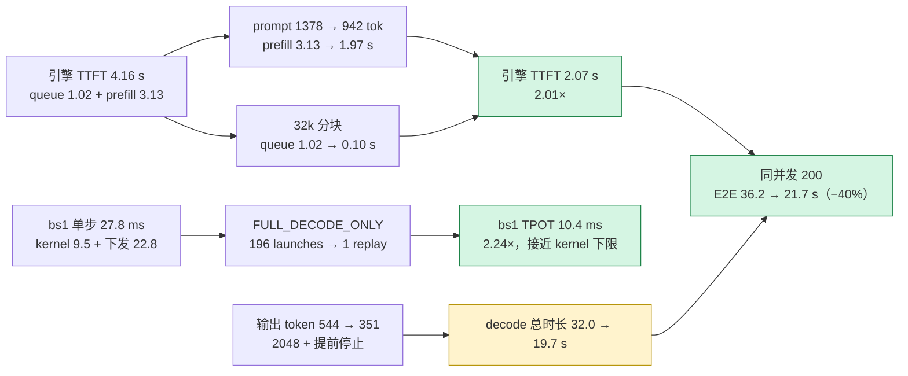

# Rex-Omni 单卡 Ascend 910B3 吞吐优化案例（V2 · 结论先行）

> 本文是 `CASE_STUDY.md`（V1，过程记录版）的**结论先行 + 图解版**，用于快速比对。
> V1 保留完整的探索顺序；V2 把「提升了多少」放在最前，把「怎么挖出来的」讲成一条
> 可复现的证据链，并补充 V1 缺失的 **per-request TTFT / TPOT** 实测。
>
> 数据口径：Dense200 box_eval **全量 200 张**；关键配置重复两次；精度/性能同一条
> wrapper、同一个 parser、同一个官方 metric。除非特别说明，性能数字为两次均值。

---

## 0. 一页结论

### 0.1 总表：基线 vs 优化后

**A. 吞吐与精度（作业级，200 张全量）**

| 维度 | 指标 | 基线（b64 / 2M / 4096） | 优化后（b200 / 1M / 2048 / 全优化） | 变化 |
|---|---|---|---|---|
| **吞吐** | 图片吞吐 | **0.472 img/s** | **3.651 img/s** | **7.74×** |
| **吞吐** | 200 张总耗时 | **424 s** | **54.8 s** | **−87.1%** |
| **吞吐** | 输出 token 吞吐 | 291 tok/s | 1335 tok/s | 4.59× |
| **吞吐** | 作业摊销单图耗时 | 2.12 s | **0.274 s** | −87.1% |
| **精度** | F1@0.5 | **0.6896** | **0.7554** | **+0.0658**（+9.5%） |
| **精度** | mIoU-F1 | **0.5075** | **0.5486** | **+0.0411**（+8.1%） |
| **精度** | Precision | 0.6967 | 0.7849 | +0.0882 |
| **精度** | Recall | 0.6826 | 0.7281 | +0.0455 |

**B. 延迟（按同口径对比；三种口径回答三个不同问题）**

| 指标 | 口径 | 基线 | 优化后 | 变化 |
|---|---|---|---|---|
| **TTFT** | 单请求 bs=1（引擎 queue+prefill） | 0.126 s | 0.125 s | 持平（−0.8%） |
| **TTFT** | 同并发 200（引擎 queue+prefill） | 4.16 s | **2.07 s** | **2.01× 更快（−50.3%）** |
| **TTFT** | 作业实际 b64→b200（并发不同） | 1.55 s | 2.07 s | 仅参考：并发 64→200 的代价 |
| **TPOT** | 单请求 bs=1 | 23.4 ms | **10.4 ms** | **2.24× 更快（−55.4%）** |
| **TPOT** | 同并发 200 | 123.7 ms（P90 235.3） | **109.9 ms（P90 161.1）** | 均值 1.13×；**P90 1.46×** |
| **TPOT** | 作业实际 b64→b200（并发不同） | 64.0 ms | 109.9 ms | 仅参考：并发 64→200 的代价 |
| **E2E** | 作业实际请求均值 | 23.1 s | 21.7 s | −5.7% |

> 怎么读这张表：
>
> - **吞吐 7.74×** 由两部分乘起来：并发 64→200 约 2.6×，配置/运行时约 3.0×；
>   不是单请求变快，而是“同一时刻做更多条 + 每条更省”。
> - **单请求 TPOT 2.24×**（23.4→10.4 ms）是 FULL graph 的真实收益；TTFT 在
>   bs=1 下持平，因为单条 prefill 本来就只有 ~0.13 s，图的收益主要在 decode。
> - **同并发 200** 下 TTFT 2.01×、TPOT 均值 1.13×、P90 1.46×、E2E −40%：
>   这是“同等负载下运行时更快”的干净对照。注意 E2E 的 −40% 里，大部分不是
>   “每 token 更快”，而是**输出 token 少了 35%**（早停 / 2048）+ **prefill 短了 37%**；
>   token 加权 TPOT 只从 59.0 降到 56.2 ms（−4.8%）——高并发下 decode 已接近
>   kernel 下限，逐请求均值对短输出更敏感，所以均值降幅（−11%）明显大于加权值。
> - **作业实际 b64→b200** 的 TTFT/TPOT 数值上升，是并发从 64 提到 200 的必然
>   代价（每步要 decode 200 条），不是模型变慢；E2E 仍持平略降。
>
> 延迟数来自开启 `disable_log_stats:false` 的复测运行；生成 token 数与纯性能
> 运行有 ±5% run-to-run 波动。基线 b64 的旧计时运行早于 decode 时间戳补丁，
> 已用补丁后的 wrapper 复测（432.9 s，比性能运行的 424.9 s 慢 2%）；表内所有
> 延迟均为精确 engine 时间戳，吞吐仍以性能运行为准。指标定义与口径见 §0.3。

### 0.2 三句话

1. **吞吐 7.74×**：0.472 → 3.651 img/s，200 张 424 → 54.8 s。收益不是单点，而是
   六层叠加：`b200 + 2048 + 1M`（4.47×）→ `解析器去重`（精度）→ `提前停止`（+17%）
   → `FULL_DECODE_ONLY`（+27%）→ `32k prefill 分块`（+3%）→ `并行输入预处理`（+14.2%）。
2. **精度不降反升**：F1@0.5 0.6896 → 0.7554，mIoU-F1 0.5075 → 0.5486。可归因的
   真实增益约 **+0.059 F1**（参数 +0.017、解析器去重 +0.015、提前停止 +0.027）；
   graph / 32k / 并行预处理的差异在 run-to-run 噪声带内，不应算作精度收益。
3. **延迟要分开看**：优化主要打的是 **decode 的固定下发开销** 和 **无效输出**。
   单请求 bs=1 的 TPOT 23.4 → 10.4 ms（2.24×；单步 profiling 27.8 → 10.4 ms）；
   同并发 200 下引擎 TTFT 4.16 → 2.07 s（2.01×）、E2E 36.2 → 21.7 s（−40%），
   但 TPOT 均值只从 123.7 降到 109.9 ms（−11%），因为高并发下 decode 已接近
   kernel 下限，graph 省掉的是固定下发开销。TTFT 在 bs=1 下持平
   （0.126 → 0.125 s），它不是本轮的主要收益来源。三种口径详见 §1.4。

### 0.3 指标定义（先对齐口径，再看数字）

```text
请求到达 ──排队(queue)──> 被调度 ──prefill──> 首 token ─────── decode ───────> 末 token
|<──────────────── TTFT（含 queue + prefill）────────────────>|
                                                  |<── TPOT × (N-1) 个间隔 ──>|

E2E = 从入队到末 token；吞吐 = 200 / 作业墙钟；输出 tok/s = 总输出 token / 作业墙钟。
```

- **TTFT（Time To First Token）**：前端 `arrival_time` → 第一个输出 token 被前端处理。
  包含请求送入 engine core 前的输入处理、core 内排队、prefill；**不含**客户端读图 /
  `process_vision_info`。注意：离线 `LLM.generate` 一次性 add 200 条时，前端的
  add/output 处理会把这版“离线 TTFT”抬高；**引擎 TTFT** 用 core 的
  `(scheduled−queued)+(first_token−scheduled)` 计算，排除前端积压，是归因运行时
  变化的干净口径。本栈无论 `async_scheduling` 开关都会回填这四个时间戳；早期一次
  b64 运行取不到字段，是它的 wrapper 版本早于时间戳补丁，与 async 无关。
- **TPOT（Time Per Output Token）**：decode 阶段平均每 token 间隔，
  `(末 token 时间 − 首 token 时间) / (输出 token 数 − 1)`。并发越高，单步越慢，
  TPOT 越大；因此必须和并发度一起读。
- **E2E**：请求进入 engine core 队列（`queued_ts`）→ 末 token，包含 queue + prefill +
  decode；不含前端 add 处理，因此可能小于“离线 TTFT + decode”。
- **作业墙钟**：200 张的 batch 墙钟，不含模型加载；包含客户端读图与预处理。
- 基线 b64 的“后几块”请求在 vLLM 里是**块完成后才入队**的，所以它的 TTFT 是
  64 并发下的 TTFT，不是从作业开始累计的 100–300 s；块间屏障体现在**作业墙钟**
  与**后块的开始时间**上，不体现在单请求 TTFT 里。这一点很容易误读。

---

## 1. 基线 vs 优化后：精度与性能全对比

### 1.1 作业级性能（全量 200）

| 阶段 | 配置要点 | 吞吐 (img/s) | 200 张耗时 | 输出 tok/s | 相对上一阶段 |
|---|---|---|---|---|---|
| 基线 | b64，2M pixels，max_tokens 4096 | 0.472 | 424 s | 291 | — |
| ① 参数 | b200 一次性提交 + 2048 + 1M | 2.111 | 95 s | 1106 | **4.47×** |
| ② 去重 | parser 丢弃完全重复的框 | 2.111 | 95 s | 1106 | 吞吐 0，F1 +0.015 |
| ③ 早停 | logits processor + async off | 2.441 | 82 s | 887 | **+17%**（配对基线） |
| ④ FULL graph | decode 整段捕获成 ACL graph | 3.103 | 64.5 s | 1163 | **+27%** |
| ⑤ 32k 分块 | `max_num_batched_tokens=32768` | 3.197 | 62.6 s | 1203 | **+3%** |
| ⑥ 并行预处理 | 读图 + vision 8 线程 | **3.651** | **54.8 s** | **1335** | **+14.2%** |

> ③ 的 +17% 是相对**同开关对照**（async off、无早停，2.078 img/s）计算的；
> 表中上一阶段 2.111 是 async 默认值，直接相除只有 +15.6%。差值来自 async 开关
> 本身约 1.5% 的性能变化。这正是“开关会改变生成结果，必须做配对基线”的例子。

### 1.2 请求级延迟（全量 200，per-request）

| 运行 | 并发 | 墙钟 (s) | img/s | 输出 tok/s | 平均输出 tok | 引擎 TTFT mean / P95 (s) | 离线 TTFT mean / P95 (s) | TPOT mean / P90 (ms) | E2E mean / P95 (s) |
|---|---|---|---|---|---|---|---|---|---|
| base_b64_r2 | 64 | 432.91 | 0.462 | 281 | 609.3 | 1.55 / 2.97 | 3.87 / 7.84 | 64.0 / 88.4 | 23.06 / 94.99 |
| base_b200 | 200 | 159.44 | 1.254 | 682 | 544.0 | 4.16 / 6.38 | 11.17 / 19.98 | 123.7 / 235.3 | 36.17 / 100.47 |
| opt1 | 200 | 54.08 | 3.698 | 1316 | 355.8 | 1.85 / 2.97 | 7.32 / 13.45 | 110.1 / 161.7 | 21.76 / 38.21 |
| opt2 | 200 | 54.08 | 3.698 | 1283 | 346.9 | 2.29 / 4.67 | 7.29 / 12.69 | 109.7 / 160.5 | 21.71 / 38.01 |

> 说明：200 条请求的未加权分布，单元格为 `mean / P95`（TPOT 为 `mean / P90`）。
>
> - **base_b64_r2**：基线的计时复测（64 条一块固定分块，2M pixels / 4096
>   tokens）；性能基线另见 424.9 s 的纯性能运行；
>   **base_b200**：基线参数不变、改为一次性提交 200（用来隔离“并发”这一项）；
>   **opt1/opt2**：1M / 2048 + 全优化，重复两次。
> - TPOT 用引擎内核时间戳 `(last_token_ts − first_token_ts)/(N−1)`，不把首 token
>   算进 decode。
> - 基线与优化后的并发度不同（64 vs 200），这张表只回答“这个作业实际怎么跑、
>   延迟是多少”；同并发与单请求的干净对照见 §1.4。
> - 开统计复测的输出 tok/s（281 / 1316 / 1283）低于纯性能运行的 291 / 1335，
>   因为生成长度有 ±5% run-to-run 波动；吞吐结论以作业墙钟 / img/s 为准。

### 1.3 精度（全量 200，IoU 0.5）

| 指标 | 基线 | 优化后（两次均值） | 变化 | 是否超出噪声带 |
|---|---|---|---|---|
| F1@0.5 | 0.6896 | **0.7554**（0.7539 / 0.7569） | **+0.0658** | **是** |
| mIoU-F1（IoU 0.50–0.95 平均） | 0.5075 | **0.5486**（0.5488 / 0.5483） | **+0.0411** | **是** |
| Precision | 0.6967 | 0.7849 | +0.0882 | 是 |
| Recall | 0.6826 | 0.7281 | +0.0455 | 是 |

本环境 F1 的 run-to-run 噪声带约 **0.008–0.014**（mIoU-F1 约 0.005–0.01）。
上表的 +0.066 远大于噪声，是真实提升；但拆开看，它主要来自**解析器去重**与
**生成侧提前停止**（见 §5.2），而不是 graph 或并行化。

### 1.4 同并发对照与单请求探针（把“并发”和“运行时”拆开）

基线 b64 与优化 b200 的并发度不同，直接用它们的 TTFT/TPOT 相减，会把
“并发提高”与“运行时变快”混在一起。为此补三组对照。

**A. 同并发 200（只变配置与运行时）**

| 运行 | 并发 | 输入 / 输出预算 | async | 引擎 TTFT mean (s) | 引擎 TTFT P95 | 离线 TTFT mean (s) | 离线 TTFT P95 | TPOT mean (ms) | TPOT P50 | TPOT P90 | 墙钟 (s) | img/s |
|---|---|---|---|---|---|---|---|---|---|---|---|---|
| base_b200 | 200 | 2M / 4096 | on | 4.16 | 6.38 | 11.17 | 19.98 | 123.7 | 77.5 | 235.3 | 159.44 | 1.254 |
| opt1 | 200 | 1M / 2048 | off | 1.85 | 2.97 | 7.32 | 13.45 | 110.1 | 63.5 | 161.7 | 54.08 | 3.698 |
| opt2 | 200 | 1M / 2048 | off | 2.29 | 4.67 | 7.29 | 12.69 | 109.7 | 63.4 | 160.5 | 54.08 | 3.698 |

两次优化取均值后的净变化：

| 指标 | 基线 b200 | 优化后（均值） | 变化 |
|---|---|---|---|
| 引擎 TTFT 均值 | 4.16 s | 2.07 s | **2.01×（−50.3%）** |
| 引擎 TTFT P95 | 6.38 s | 3.82 s | 1.67×（−40.1%） |
| 离线 TTFT 均值 | 11.17 s | 7.31 s | 1.53×（−34.6%） |
| TPOT 均值 | 123.7 ms | 109.9 ms | 1.13×（−11.2%） |
| TPOT P50 | 77.5 ms | 63.5 ms | 1.22×（−18.1%） |
| TPOT P90 | 235.3 ms | 161.1 ms | 1.46×（−31.5%） |
| token 加权 TPOT | 59.0 ms | 56.2 ms | 1.05×（−4.8%） |
| E2E 均值 | 36.2 s | 21.7 s | 1.66×（−39.9%） |
| 吞吐 | 1.254 img/s | 3.698 img/s | **2.95×** |

为什么引擎 TTFT 能减半：基线平均 prompt 1378 tok，优化后 942 tok（−31.6%），
prefill 均值 3.13 → 1.97 s；同时 32k 分块让 200 条更快全部进入 prefill，
queue 均值 1.02 → 0.10 s。prefill 与 queue 各贡献一部分，合起来约 2×。

TPOT 的几种统计口径要分开读：逐请求均值 123.7→109.9 ms（−11.2%），
中位数 77.5→63.5 ms（−18.1%），P90 235.3→161.1 ms（−31.5%），而按 token
加权的聚合值只从 59.0 降到 56.2 ms（−4.8%）。均值对短输出请求敏感（短序列的
每个 token 都摊在高并发步时上），加权值更接近“每 token 的真实成本”。两者不矛盾：
**高并发下长尾明显变好，但单 token 成本已接近 kernel 下限**。

**B. 单请求 bs=1（只测单步 decode 成本）**

| 运行 | 图片数 | 引擎 TTFT mean (s) | 引擎 TTFT P95 | 离线 TTFT mean (s) | TPOT mean (ms) | TPOT P50 | E2E mean (s) | 平均输出 tok | 墙钟 (s) |
|---|---|---|---|---|---|---|---|---|---|
| base_bs1 | 4 | 0.126 | 0.154 | 0.175 | 23.4 | 23.7 | 9.02 | 374.5 | 36.39 |
| opt_bs1 | 4 | 0.125 | 0.143 | 0.171 | 10.4 | 10.6 | 3.89 | 359.5 | 15.86 |

4 张图逐一提交，无排队。引擎 TTFT 0.126→0.125 s 持平；TPOT 23.4→10.4 ms
（2.24×），E2E 9.02→3.89 s（2.32×）。这正是 FULL graph 把 decode 每步的
~196 次 kernel 下发压成 1 次 replay 的效果。高并发下这部分固定开销被摊薄，
所以同并发 200 的 TPOT 只小幅下降。

> bs1 的墙钟含模型加载，不能用来算 img/s；延迟结论看 per-request 的 E2E / TPOT。

**C. 作业实际 b64→b200（回答“这个作业快了多少”）**

| 指标 | 基线 b64 | 优化后 b200 | 变化 |
|---|---|---|---|
| 吞吐 | 0.472 img/s | 3.651 img/s | **7.74×** |
| 墙钟 | 424 s | 54.8 s | −87.1% |
| 引擎 TTFT 均值 | 1.55 s | 2.07 s | +33%（并发 64→200 的代价） |
| 离线 TTFT 均值 | 3.87 s | 7.31 s | +89% |
| TPOT 均值 | 64.0 ms | 109.9 ms | +72% |
| E2E 均值 | 23.1 s | 21.7 s | −5.7% |

从 64 并发提到 200 并发，每步要 decode 200 条，TTFT/TPOT 上升是必然代价；
但更高并发把长尾摊平后，单请求 E2E 反而略降。**“吞吐 7.74×”与“TPOT 变差”
可以同时为真**，读的时候必须带口径。

> 吞吐/墙钟用基线性能运行（424.9 s / 0.472），延迟字段用补丁后复测
> （432.9 s / 0.462）；两次同配置差 2%，属 run-to-run 波动。复测的精确 TPOT
> 是 64.0 ms，早先由 `(E2E−TTFT)/(N−1)` 近似出的 44.0 ms 明显低估，已废弃。

**7.74× 可以拆成两个乘数**：

```text
0.472 img/s ──×2.58──> 1.219 img/s ──×3.00──> 3.651 img/s
              并发 64→200             配置/运行时（固定 200）
              （2M/4096 不变）         （1M/2048、早停、graph、32k、并行预处理）
2.58 × 3.00 = 7.74
```

> 中间点同配置的两次运行是 1.219（164 s）和 1.254（159.4 s），差 3% 是噪声；
> 这里用瀑布表里的 1.219，使乘数链与 §1.1/§5.1 完全对齐。

读法：

- **同并发 200**：两边都是 200 条一次性入队，差别只在输入预算、分块、graph、早停。
  这组最能代表“推理栈/配置”本身的延迟变化（约 3× 吞吐、TTFT 2.01×）。
- **单请求 bs=1**：没有排队、没有批内竞争，TPOT 直接反映单步 decode 成本；
  这正是 FULL graph 的 27.8 → 10.4 ms。
- **作业级 b64 vs b200**：反映真实批量作业的吞吐与墙钟，是 7.74× 的来源；但 TTFT
  受并发度影响，不能单独拿来宣称“首 token 变快了多少”。

### 1.5 怎么读这些数字（三条防误读）

1. **精度差异 < 0.01 不当真**：greedy 在本环境不是 batch-invariant，同配置重复跑
   F1 也会波动 0.008–0.014；子集上的 ±0.02 可能在全量消失（8k/8k、rep=1.1 都踩过）。
2. **TPOT 必须带并发度**：bs=1 的 10.4 ms 与 bs=200 的几十 ms 是同一套代码；
   拿不同并发的 TPOT 直接比会得出相反结论。
3. **TTFT 不含客户端预处理**：本表的 TTFT 是引擎侧；作业墙钟才包含读图与
   `process_vision_info`。并行预处理优化的是后者（§3.8），不是 TTFT。

---

## 2. 优化路线图（一张图看全）

```mermaid
flowchart LR
    B["基线<br/>b64 · 2M · 4096<br/>0.472 img/s · 424 s"]
    S1["① 参数层<br/>b200 · 2048 · 1M<br/>2.111 img/s · 4.47×"]
    S2["② 解析器去重<br/>F1 0.706 → 0.721<br/>吞吐不变"]
    S3["③ 提前停止 + async off<br/>2.441 img/s · +17%"]
    S4["④ FULL_DECODE_ONLY<br/>3.103 img/s · +27%"]
    S5["⑤ 32k prefill 分块<br/>3.197 img/s · +3%"]
    S6["⑥ 并行输入预处理<br/>3.651 img/s · +14.2%"]
    F["最终<br/>3.651 img/s · 54.8 s<br/>F1 0.7554 · 7.74×"]

    B --> S1 --> S2 --> S3 --> S4 --> S5 --> S6 --> F
    style B fill:#fde2e2,stroke:#c0392b
    style F fill:#d5f5e3,stroke:#1e8449
    style S4 fill:#fff3cd,stroke:#b7950b
```



**每一层在打什么**：

| 层 | 主要矛盾 | 手段 | 为什么有效 | 收益 |
|---|---|---|---|---|
| ① 参数 | 固定分块屏障 + 无效输出 + 输入 token 太多 | b200 / 2048 / 1M | 让 continuous batching 摊平长尾；截掉退化尾巴；减少 prefill | 4.47× |
| ② 去重 | 重复框被算成 FP | 解析后处理 | 零算力，只救精度 | F1 +0.015 |
| ③ 早停 | 退化重复仍在 decode | logits processor 强制 EOS | 真正减少 decode 步数 | +17% |
| ④ FULL graph | 低并发每步 ~28 ms，kernel 只占 9.5 ms | 整段 decode 捕获 | 把 ~196 次 launch 变成 1 次 replay | +27% |
| ⑤ 32k 分块 | 8k chunk 太多，chunk 间有空档 | 提高 prefill token 预算 | chunk 23 → 6 | +3% |
| ⑥ 并行预处理 | 请求入队前串行读图/resize | 线程池 | 消除 NPU 首段空转 | +14.2% |

---

## 3. 如何一步步挖出优化点（证据链）

> 原则：**每个优化点都必须先有一个可证伪的观察**。不是“把所有参数试一遍”，
> 而是“用测量把 82 s/424 s 拆到某一层，再针对那一层做单变量实验”。

### 3.0 证据链总览

| # | 观察 | 测量手段 | 结论 | 对应优化 | 实测 |
|---|---|---|---|---|---|
| 1 | b64 固定分块，200 张 424 s | batch 缩放 | 块间屏障 + 长尾 | b200 一次性提交 | 2.58× |
| 2 | 平均输出 615 tok，26/200 顶到上下文 | 输出长度分布 + 重复分析 | 退化重复，不是上下文不够 | 2048 + 早停 + 去重 | +45% / +17% / F1 +0.015 |
| 3 | AICore 41%、HBM 18% | npu-smi 0.8 s / 0.3 s | 非算力/带宽饱和；有 9–10 s 空转 | 不做 W8A8；查空转 | 避免无效方向 |
| 4 | bs≤8 单步 ~28 ms，不随 batch 变 | 单步延迟 vs batch | 固定下发/同步开销 | FULL graph | 27.8 → 10.4 ms |
| 5 | kernel 9.5 ms，空档 22.8 ms，196 launches/步 | torch_npu profiler | dispatch-bound | FULL graph | 预测 82 → 65 s，实测 64.5 s |
| 6 | 8k 分块下 200 条 = 23 个 chunk | chunk 计数 | chunk 间空档 | 32k 分块 | +3% |
| 7 | 首段 NPU 空转 9.8 s | 0.3 s npu-smi + startup_trace | 串行读图 + vision，在关键路径 | 线程池 | 10.9 → 1.6 s；+14.2% |
| 8 | 预处理 14 → 7 s，端到端只 −0.5 s | max_tokens=1 隔离探针 | 被引擎重叠，不在关键路径 | 否决 OMP | 避免无效方向 |
| 9 | detokenize=False 无收益且空字符串 | A/B | 不在关键路径 | 回退 | 避免无效方向 |

**一句话总结**：先用量级杠杆（并发）拿到 2.6×，再用硬件计数器排除“算力/带宽不够”，
再用单步缩放 + kernel profile 把长尾定位到“下发”，最后才去调 prefill 分块和
客户端预处理。每一步的收益都能和下一步的观察对上，账算得平。

### 3.1 第 0 步：冻结协议，先量化噪声

否则后面每个“提升”都可能是噪声。固定：

- 数据与顺序：Dense200 前 200 条，图像解码/resize/prompt 完全一致；
- 采样：greedy（temperature=0, top_k=1, top_p=0.8, rep_penalty=1.05）；
- 评测链路：同一个 wrapper、parser、官方 metric；
- warmup：每个进程先跑 1 张；
- 计时：只算 200 张 batch 墙钟，不含加载。

**噪声实测**：F1 run-to-run 0.008–0.014，mIoU-F1 0.005–0.01；墙钟在早停启用后
还会因最长样本的触发时机波动（67–82 s）。因此：

- 小于 0.01 的 F1 差异一律视为噪声，关键配置两次全量取均值；
- 子集 ±0.02 不能直接外推；
- greedy 不是 batch-invariant：b64 与 b200 仅 16/200 输出完全一致；
  两次 FULL graph 也只有 18/200 相同。**不要用逐字节 diff 判正确性。**

```text
噪声带（F1@0.5）:
        0.68   0.69   0.70   0.71   0.72   0.73   0.74   0.75   0.76
基线    [=========================================] 0.6896
                     ↑ 同配置重复跑也会在 ±0.01 内漂移
优化后                                              [====] 0.7554
                                                    ↑ 真实提升 0.066，远大于噪声
```

### 3.2 第 1 步：并发是量级杠杆（先拿 2.58×）

固定 2M/4096，只改提交方式：

| batch | 吞吐 |
|---|---|
| 1 | 0.046 img/s |
| 64（固定分块） | 0.472 img/s |
| 200（一次性提交） | **1.219 img/s（2.58×）** |

```text
基线：固定 64 分块（块间屏障）
时间 →
[ 64 张 chunk-1 ][ 等最慢 ][ 64 张 chunk-2 ][ 等最慢 ][ 64 张 chunk-3 ][ 8 张 ]
                  ▲ 后一块必须等前一块全部结束，长尾无法被填满

优化：200 张一次性提交（continuous batching）
时间 →
[ 200 张同时入队，引擎按 token 预算切 prefill chunk ]
[ prefill ][ decode 200 → 150 → 80 → 20 → 个位数，长尾被已排队请求填满 ]
```

关键认知：固定分块的块间屏障由**最慢请求**决定；一次性提交让 continuous batching
把长尾摊平。这是唯一一个“量级”级别的杠杆，先拿它，再谈细调。

### 3.3 第 2 步：硬件计数器——先排除“算力/带宽饱和”

用 `npu-smi info -t usages -i 0` 每 ~0.8 s 采样全量运行：

| 指标 | 全程均值 | decode 为主的后 2/3 |
|---|---|---|
| AICore | 41.4% | 45.3% |
| HBM 带宽 | 18.2% | 21.8% |
| HBM 容量 | 80%（KV 已分配） | 80% |

算力不到一半、带宽不到四分之一 → 不是 compute-bound，也不是 KV/权重带宽-bound。
这直接降低了 W8A8 的优先级（量化主要改善这两者）。

> **口径提醒**：41.4% 是**含空转**的全程均值。逐秒时间线显示运行中段有一段约
> 9–10 s AICore 全为 0（见 §3.8）；真正生成阶段 AICore 中位数 38%、**p90 达 100%**。
> 准确表述是「低并发长尾不受限，满载 prefill/decode 时段会打到算力上限」。
> W8A8 优先级低，是因为它改善的是带宽/算力，而当前瓶颈在低并发段的 dispatch，
> 不是因为全程没有算力压力。

```text
AICore 逐秒时间线（示意）:
 100% |                    ██████████████████████████████
  75% |                    ██████████████████████████████
  50% |        ██          ██████████████████████████████
  25% |   ██   ██          ██████████████████████████████
   0% |███░░░░░░░░░░░░░░░░██████████████████████████████
      +--------------------------------------------------> t
        warmup   idle 9–10s       生成段（p90 打满）
                 ↑ 均值 41% 就是被这段 0 拉低的
```

### 3.4 第 3 步：单步延迟 vs batch——暴露“固定开销”

固定 `max_tokens=32`，先测 `max_tokens=1` 得 prefill，再算 `(t32−t1)/31`：

| batch | prefill (s) | 32 token decode (s) | 单步延迟 (ms) |
|---|---|---|---|
| 1 | 0.10 | 0.96 | 27.8 |
| 8 | 0.58 | 1.51 | 30.2 |
| 32 | 4.40 | 5.51 | 35.8 |
| 200 | 24.83 | 27.46 | 85.0 |

> 注：`prefill (s)` 是 `max_tokens=1` 的墙钟差值，含图像加载与请求预处理，
> 比真实 prefill 偏大；用它只算 `(t32−t1)/31` 的单步延迟，不受影响。

```text
单步延迟 (ms)
bs=1   27.8  ████████████████████████████
bs=8   30.2  ██████████████████████████████
bs=32  35.8  ███████████████████████████████████
bs=200 85.0  █████████████████████████████████████████████████████████████████████████████████
              ↑ bs=1→8 几乎不变 → 约 28 ms 是与 batch 无关的固定成本
```

结合输出长度：301 框的样本约 1560 步，后 ~1300 步只剩个位数请求，
`1300 × 28 ms ≈ 36 s`——这就是全量墙钟里最大的一块长尾。

### 3.5 第 4 步：kernel 时间 vs 空档——确认是“下发”不是“计算”

**关键坑**：vLLM V1 的 EngineCore 在子进程，driver 侧 `torch_npu.profiler` 只能看到
CPU 算子。必须设 `VLLM_ENABLE_V1_MULTIPROCESSING=0`，并用 `ProfilerLevel.Level1`。
bs=1、32 token：

| 指标 | 数值 |
|---|---|
| Stage（设备侧） | 1.033 s |
| Computing（kernel） | 0.305 s → **9.5 ms/步** |
| Free（kernel 间空档） | 0.729 s → **22.8 ms/步** |
| host ACL API | **约 14 ms/步** |

每步约 **196 次 kernel launch**：36 次 attention、36 次 ReshapeAndCache、42 次 copy、
77 次 fill。bs=200、64 token 时 Computing 18.5 s / Free 3.8 s（满载是 kernel-bound），
但长尾低并发时是 **dispatch-bound**。

```text
PIECEWISE (bs=1):  [kernel 9.5 ms][←──── 下发/同步空档 22.8 ms ────→]   ~196 launches/step
FULL graph (bs=1): [kernel 9.5 ms][~1 ms]                                1 graph replay/step
                    ↑ 10.4 ms/step，已经接近纯 kernel 下限
```

### 3.6 第 5 步：先预测，再验证——FULL graph 兑现 17 s

profiling 给出的可检验预测：如果把 attention/cache-update 等小算子收进一张图，
低并发单步应从 ~28 ms 降到接近 kernel 下限 ~10 ms，长尾 ~36 s → ~19 s，
全量 82 s → **约 65 s**。

实测 `FULL_DECODE_ONLY`：单步 **10.4 ms**、全量 **64.5 s**。**预测与实测吻合**——
这是整套 profiling 结论正确的最强证据，而不是“跑完再解释”。

| 单步延迟 | PIECEWISE | FULL_DECODE_ONLY | 加速 |
|---|---|---|---|
| bs=1 | 27.8 ms | **10.4 ms** | 2.7× |
| bs=8 | 30.2 ms | **12.3 ms** | 2.5× |
| bs=32 | 35.8 ms | **17.1 ms** | 2.1× |

```text
PIECEWISE：  [attn] [cache] [copy] [fill] [attn] [cache] ...  → 196 launches/step
FULL graph： [========== 一张 ACL graph replay ==========]     → 1 launch/step

长尾账本：1300 步 × 节省 13–17 ms ≈ 17 s
          82 s − 17 s ≈ 65 s  ← 实测 64.5 s，账算得平
```

### 3.7 第 6 步：减少工作量，而不是只加速（重复、早停、去重）

**关键发现**：24–28/200 的样本在**退化重复**——同一个框被循环生成，单条最多重复
1572 次。超长输出不是“上下文不够”，加预算只会更慢。

```text
正常输出：  <box A> <box B> <box C> <im_end>
退化输出：  <box A> <box A> <box A> <box A> ... ×1572 ...   ← 白白 decode 上千步

解析器去重：只删重复框（token 已生成）→ 省精度，不省算力
提前停止：  检测到 5 个相同周期 → 强制 EOS → 真正少 decode
```

- `max_model_len` 8192：模型继续重复到 8192，329 s，F1 无提升 → **加预算无效**；
- `max_tokens=2048`：截掉退化尾巴，精度不降，吞吐 +45–53%；
- 解析器去重：F1 0.7064 → 0.7237/0.7191（均值 0.7214），吞吐不变（后处理）；
- 提前停止：输出均值 390 → 349 tok，墙钟 97 → 82 s，+17%，7/7 顶满样本被截短。

### 3.8 第 7 步：消除残留空转——串行预处理现形

`npu-smi` 0.3 s 时间线显示每次运行中段有一段 NPU 完全空转：

```text
t=  6.3s  AICore 27%   ← warmup
t=  8.9s  AICore  0%   ← ⬇ 约 9 s 无任何 NPU 活动
t= 18.0s  AICore 100%  ← 生成开始
```

一开始以为是“引擎启动慢”。`startup_trace.py`（单进程引擎 + monkey-patch
`InputProcessor.process_inputs` / `LLMEngine.step`）逐条打时间戳后发现：200 条请求的
预处理是**一条一条串行**完成的，最后一条开始时引擎已经空等数秒。

| 阶段 | 位置 | 串行耗时（200 张） | 8 线程 |
|---|---|---|---|
| PIL open + `convert("RGB")` | `run_eval.py` | 3.6 s（17.9 ms/图） | **0.54 s** |
| `process_vision_info()`（to_rgb + smart_resize + resize） | Rex-Omni `wrapper.py` | **7.3 s（36.4 ms/图）** | **1.04 s** |
| 合计 | | **10.9 s** | **1.58 s（−9.3 s）** |

```text
串行（基线）：PIL 3.6s → vision 7.3s → 引擎启动/prefill...
              NPU: [ idle 9.8s ][ prefill/decode ... ]

并行（优化）：  PIL 0.5s → vision 1.0s → 引擎 0.3s → prefill/decode
                （每段内部 8 线程并行，不是两段互相重叠）
              NPU: [idle 0.9s][ prefill/decode ... ]  → 请求提前 ~8–9s 入队
```

全量：62.57 s → **54.46 / 55.09 s（均值 54.8 s，+14.2%）**；NPU 首段空转
9.8 s → **0.9 / 1.9 s**。图像张量逐字节一致，`num_prompt_tokens` 与对照完全相同
（平均 942.0），没有漏图/错位。

**同一类 CPU 工作，为什么 OMP_NUM_THREADS 无效？**

| 实验 | 预处理墙钟 | 端到端 | 结论 |
|---|---|---|---|
| `OMP_NUM_THREADS=8`（引擎内预处理） | 14 → 7 s | 26.62 → 26.15 s（−0.5 s） | 被引擎重叠，**不在关键路径** |
| wrapper + 读图线程池 | 10.9 → 1.6 s | 62.57 → 54.8 s（−7.8 s） | 在请求入队前，**确实在关键路径** |

判据不是“CPU 还是 NPU”，而是**这段工作有没有被别的执行流掩盖**。

### 3.9 第 8 步：重新 profile，决定停手

并行化后，最终配置 54.8 s 的构成：

```text
54.8s = [load 0.5][vision 1.0][eng 0.3][==== prefill 17.4 (32%) ====][========== decode 36.0 (66%) ==========]
         1%        2%          <1%       32%                          66%
```

| 阶段 | 耗时 | 占比 | 说明 |
|---|---|---|---|
| 图像加载（8 线程） | 约 0.5 s | 1% | 串行时 3.6 s |
| `process_vision_info`（8 线程） | 约 1.0 s | 2% | 串行时 7.3 s |
| 引擎启动 / 首个 prefill chunk | 约 0.3 s | <1% | 并行后 NPU 空转仅 0.9–1.9 s |
| prefill（约 18.8 万 prompt token，6 个 32k chunk） | 约 17.4 s | 32% | AICore 常打满 |
| decode（约 7 万输出 token） | 约 36.0 s | 66% | 主要在长尾低并发段 |

**优先级据此修正**：

1. **decode 步数**是唯一的大杠杆（≈2/3），投机解码最直接；长尾段 batch 已降到个位数，
   每步仍要 10–17 ms；
2. CPU 侧输入预处理已从 ~10.9 s 压到 ~1.6 s，**基本无剩余空间**；
3. prefill 17.4 s 里 AICore 已接近打满，图覆盖/分块收益有限；
4. “引擎启动慢”已证伪：真正的固定开销只有约 0.3–0.4 s 量级。

输出格式已接近下限（约 5.0–5.2 tok/框，300 框样本约 1560 tok），继续压缩输出长度
空间很小；线上 continuous serving 会让长尾被新请求填满，届时这套离线墙钟的构成
会明显不同，容量规划应以稳态吞吐为准。

---

## 4. 逐项优化详解（设计 / 预期 / 实测 / 边界）

### 4.1 参数层：b200 + max_tokens 2048 + max_pixels 1M

| 手段 | 预期 | 实测 |
|---|---|---|
| `batch=200` 一次性提交 | 消除块间屏障，摊平长尾 | 0.472 → **1.219 img/s（2.58×）**，424 → 164 s |
| `max_tokens` 4096 → 2048 | 截掉退化重复的尾巴 | 1.219 → **1.774/1.867 img/s**（约 +49%），F1 不降 |
| `max_pixels` 2M → 1M | prompt 1378 → 942 tok，prefill 变快 | 1.82 → **2.111 img/s**（+16%），精度在噪声内 |
| `max_model_len` 提到 8192 | 给长输出更多空间 | **更差**：模型继续重复到 8192，329 s，F1 无提升 |

关键认知：24–28/200 的样本在退化重复，超长输出不是“上下文不够”，加预算只会更慢。
`max_tokens=2048` 是截断而非修复；修复在 §4.3 的提前停止。

`max_pixels` 再降到 802,816 也试过：86.9 s / 2.30 img/s / F1 0.7339 / mIoU 0.5269，
**更慢更差**。prompt 短了但生成结果变了（输出 tok 345 → 358），抵消收益并伤精度。
**1M 是实测甜点，不建议再降。**

### 4.2 解析器去重（精度后处理，零算力收益）

**设计**：同一类别下完全相同的坐标元组只保留一个。官方 metric 会把重复框计为 FP。

**实测**：吞吐不变（2.08 / 2.04 img/s），F1 0.706 → **0.7237 / 0.7191**
（均值 0.7214），mIoU-F1 → 0.5262 / 0.5233（均值 0.5248），Precision 0.7205 → 0.7635。

**边界**：这是解析后处理，重复 token 仍然被生成，**不省算力**；它只是把
“已经付出的算力”从 FP 里救回来。真正省算力的是下一节的提前停止。

### 4.3 生成侧提前停止（+17%）

**设计**：自定义 vLLM logits processor 监测输出 token 的精确周期；尾部出现 5 次
完全相同的 token 块（period 4–48）即强制 EOS。EOS 必须用 config 的
`eos_token_id=151645`——tokenizer 的 `<|im_end|>` id 152645 超出词表 151936，不能采样。

**实测**（关闭 async scheduling 后两次全量）：

| 指标 | 对照组（async off） | 提前停止 |
|---|---|---|
| 墙钟 | 97.2 / 95.3 s | **81.7 / 82.2 s** |
| 吞吐 | 2.058 / 2.098 | **2.449 / 2.432 img/s** |
| 平均输出 | 390.6 tok | 349.1 tok |
| 顶满 2048 的样本 | 7 | **0（全部被截短）** |
| F1@0.5 | 0.7426 / 0.7447 | 0.7483 / 0.7478 |

**必须关 async scheduling**：vllm-ascend 覆写了 `_sample` 且漏调
`update_async_output_token_ids()`，async 下 logits processor 看到的是 `-1` 占位符，
会误判重复。开关本身还会改变生成结果（仅 15/200 一致），所以必须做“同开关、
只差一个变量”的配对基线，否则无法归因。

### 4.4 FULL_DECODE_ONLY ACL graph（+27%，本轮最大收益）

**设计**：vllm-ascend 默认 `CUDAGRAPH_MODE=PIECEWISE`，只归并部分子图；
实验性的 `FULL_DECODE_ONLY` 把 `splitting_ops` 置空，整个 decode forward
（含 attention 与 ReshapeAndCache）捕获成一张 ACL graph：

```python
compilation_config={
    "cudagraph_mode": "FULL_DECODE_ONLY",
    "cudagraph_capture_sizes": [1, 8, 16, 32, 64, 128, 200, 256],
}
```

**预期**（来自 §3.6）：低并发单步 ~28 → ~10 ms，全量 ~65 s。
**实测**：单步 10.4 / 12.3 / 17.1 ms（bs=1/8/32）；全量 65.0 / 63.9 s，
均值 **64.5 s / 3.103 img/s（+27%）**，F1 0.7474、mIoU 0.5428 在噪声内。

**坑与边界**（都实际踩过/验证过）：

1. **experimental**：日志明确 warning “early experimental stage, may involve unknown
   issues”；升级 vllm-ascend 必须回归。
2. **捕获尺寸必须覆盖 batch 分桶**：线上 batch 若落在未捕获尺寸，会 padding 到邻近
   图或回退，收益打折；尺寸越多内存越大，官方提示可能 OOM/挂起。本次 8 个尺寸
   只增加 **3 s、0.26 GiB**，但这是 64 GB 卡 + 0.8 利用率下的结果，不能照搬。
3. **数值不完全一致**：graph 内算子融合改变归约顺序，greedy 输出 183/200 与
   PIECEWISE 不同；两次 FULL 之间也只有 18/200 相同（本栈的 run-to-run 非确定性）。
   判断标准必须是 F1/mIoU/输出长度分布，而不是逐字节 diff。
4. **提前停止仍可用**：平均输出 348.9 / 358.3 tok，最大 1977 / 1796 < 2048，
   没有退化样本漏网；async scheduling 仍需关闭。
5. **收益来源可解释**：长尾约 1300 步 × 节省 13–17 ms ≈ 17 s，与 82 → 64.5 s 吻合。

### 4.5 prefill 分块 8192 → 32768（+3%）

**设计**：200 条约 18.8 万 prompt token，默认每 chunk 8192 要切 23 个；提到 32768
只需约 6 个，减少 chunk 数与 chunk 间空档。

```text
mbt=8192:   [8k][8k][8k][8k][8k] ... 23 个 chunk，chunk 间有调度空档
mbt=32768:  [ 32k ][ 32k ][ 32k ][ 32k ][ 32k ][ 32k ]  6 个 chunk
```

**实测**：64.5 → **62.4 / 62.7 s**，3.10 → **3.205 / 3.189 img/s（+3%）**，
F1 两次都是 0.7474；load +2 s，无 OOM。再提到 65536 预计 <1%，未测
（收益递减 + 激活内存风险）。

> 注意：更大的 prefill chunk 会**提高单个 chunk 的 TTFT**（一个 chunk 里的请求要等
> 整个 32k token 处理完才拿到首 token），但减少 chunk 数、提高 prefill 吞吐。
> 本例选择 32k 是因为吞吐 +3% 且 TTFT 可接受；若线上更看重首 token 延迟，
> 应重新在 8k/16k/32k 之间做 TTFT-吞吐权衡（见 §1.4 的同并发数据）。

### 4.6 并行输入预处理（+14.2%，本轮第二收益）

**定位**：`startup_trace.py` 显示 200 条请求的预处理逐条串行完成，最后一条开始时
引擎已空等数秒。两段 CPU 工作都在第一批请求进引擎之前，因此都在关键路径上：

| 阶段 | 位置 | 串行耗时（200 张） |
|---|---|---|
| PIL open + `convert("RGB")` | `run_eval.py` | 3.6 s（17.9 ms/图） |
| `process_vision_info()`（to_rgb + smart_resize + resize） | Rex-Omni `wrapper.py` 的逐条循环 | **7.3 s（36.4 ms/图）** |

**设计**：两段都用 `ThreadPoolExecutor` 并行。PIL 在 JPEG 解码与 resize 时释放 GIL，
属于典型的 I/O+CPU 混合并行场景；wrapper 侧用 `REX_OMNI_VIS_WORKERS` 控制线程数
（默认 8），评测脚本用 `--load-workers`（默认 8，1 = 串行回退）。

**微基准**（纯 CPU，`OMP_NUM_THREADS=1`）：PIL 3.59 → **0.54 s（6.6×）**；
`process_vision_info` 7.28 → **1.04 s（7.0×）**；合计 10.87 → **1.58 s（−9.3 s）**。

**正确性**：串行与并行输出的图像张量**逐字节一致**、顺序一致；全量 200 条的
`num_prompt_tokens` 与对照组完全相同（平均 942.0），没有漏图/错位。

**全量实测**：

| 运行 | 总耗时 | img/s | 平均输出 tok | F1@0.5 | mIoU-F1 |
|---|---|---|---|---|---|
| 同场对照（串行，`omp1_b200`） | 62.57 s | 3.196 | 364.0 | 0.7554 | 0.5493 |
| 仅 wrapper 并行（`vispar_b200`） | 58.00 s | 3.448 | 351.9 | 0.7428 | 0.5376 |
| **两段都并行 #1** | **54.46 s** | **3.672** | 361.1 | 0.7539 | 0.5488 |
| **两段都并行 #2** | **55.09 s** | **3.631** | 362.4 | 0.7569 | 0.5483 |
| **两段并行均值** | **54.8 s** | **3.651** | 361.8 | **0.7554** | **0.5486** |

相对 62.57 s **+14.2%**；F1/mIoU 与对照差 ≤0.013，在噪声带内。NPU 首段空转
9.8 s → **0.9 / 1.9 s**。

**边界**：

- 收益来自“消除等待”，不改变计算；图片数量少（如 bs=1–8）时收益按比例缩小；
- 线程数受容器 CPU 配额限制（本例 8 核），`workers` 超过配额会退化；
- 这是**客户端侧**优化：线上用 vLLM serve 时，预处理在服务进程内按请求并发，
  不会出现“200 张一次性串行预处理”的排队，收益口径不同；
- 与 §3.8 的 `OMP_NUM_THREADS` 对照：同样是 CPU 预处理，引擎内的分块/normalize
  被 NPU 计算掩盖（调线程数无收益），而请求入队前的读图与 vision resize
  没有被掩盖（+14.2%）。判据是“有没有被掩盖”，不是“CPU 还是 NPU”。

### 4.7 失败项与否决项（同样是资产）

| 假设 | 实验 | 结果 | 决策 / 坑 |
|---|---|---|---|
| 绕过 detokenization 能省关键路径 | `SamplingParams(detokenize=False)` | bs=1 24.4 vs 24.3 ms，无收益 | 回退；且 `outputs[0].text` 是 `""` 不是 `None`，wrapper 兜底失效；stop strings 不允许 |
| 引擎内 CPU 预处理多线程能提速 | `OMP_NUM_THREADS=8` | 预处理 14 → 7 s，端到端 26.62 → 26.15 s（−0.5 s） | 否决；被引擎重叠，不在关键路径 |
| async scheduling 能藏下发开销 | async on/off 单步 A/B | bs=1 25.0 vs 25.9 ms，无差异 | 不用于性能；且与 logits processor 不兼容 |
| 更长上下文能提升精度 | max_model_len 8192 | 329 s，F1 0.686，无提升 | 否决；模型继续重复到 8192 |
| repetition_penalty 能治重复 | rep 1.1 / 1.2 | 1.1 噪声内；1.2 伤召回（F1 0.674） | 保持 1.05；重复是模型级失败模式 |
| 再降分辨率能更快 | max_pixels 800k | 86.9 s / F1 0.7339，更慢更差 | 否决；1M 是甜点 |
| W8A8 量化能大幅提速 | 未测（无 msmodelslim） | 低并发不是带宽/算力受限 | 优先级下调；高并发线上需重估 |

---

## 5. 收益拆解

### 5.1 吞吐/时间瀑布

| 阶段 | 吞吐 (img/s) | 200 张耗时 | 相对上一阶段 | 乘数 |
|---|---|---|---|---|
| 基线 b64 / 2M / 4096 | 0.472 | 424 s | — | 1.00× |
| + b200 一次性提交 | 1.219 | 164 s | 2.58× | 2.58× |
| + max_tokens 2048 | 1.82 | 110 s | +49% | 1.49× |
| + max_pixels 1M | 2.111 | 95 s | +16% | 1.16× |
| + 解析器去重 | 2.111 | 95 s | 0（精度 +0.015） | 1.00× |
| + 提前停止 / async off | 2.441 | 82 s | +17%（配对） | 1.17× |
| + FULL_DECODE_ONLY | 3.103 | 64.5 s | +27% | 1.27× |
| + 32k prefill 分块 | 3.197 | 62.6 s | +3% | 1.03× |
| + 并行输入预处理 | **3.651** | **54.8 s** | +14.2% | 1.142× |

```text
0.472 ──×2.58──> 1.219 ──×1.49──> 1.82 ──×1.16──> 2.111
      ──×1.17──> 2.441 ──×1.27──> 3.103 ──×1.03──> 3.197 ──×1.142──> 3.651

总乘数 = 2.58 × 1.49 × 1.16 × 1.17 × 1.27 × 1.03 × 1.142 ≈ 7.8×
实测 3.651 / 0.472 = 7.74×   ← 复利式叠加，不是简单相加
```

> 为什么不是把百分比相加？每一层都是相对**当前阶段**的墙钟；后一层优化的是前一层
> 剩下的时间。比如 graph 的 +27% 是在 82 s 上算的，不是 424 s。这种“账能算平”
> 的拆解也可用来验证优化没有重复计数。

### 5.2 精度变化拆解

| 阶段 | F1@0.5 | mIoU-F1 | 相对上一阶段 | 归因 |
|---|---|---|---|---|
| 基线 | 0.6896 | 0.5075 | — | — |
| + 参数层 | 0.7064 | 0.5157 | +0.0168 / +0.0082 | 1M + 2048 改变输出，偏正面 |
| + 解析器去重 | 0.7214 | 0.5248 | +0.0150 / +0.0091 | **真实**：去掉重复 FP |
| + 提前停止 | 0.7481 | 0.5428 | +0.0267 / +0.0180 | **真实**：截断退化循环 |
| + FULL graph | 0.7474 | 0.5428 | −0.0007 / 0.0000 | 噪声 |
| + 32k 分块 | 0.7474 | 0.5426 | 0.0000 / −0.0002 | 噪声 |
| + 并行预处理 | **0.7554** | **0.5486** | +0.0080 / +0.0060 | 噪声（并行不改模型） |
| **最终** | **0.7554** | **0.5486** | **+0.0658 / +0.0411** | 可归因约 +0.0585 / +0.0353，其余在噪声内 |

```text
F1@0.5
0.6896 基线
  ▲ +0.0168 参数（b200/2048/1M）
0.7064
  ▲ +0.0150 解析器去重
0.7214
  ▲ +0.0267 提前停止
0.7481  ← 可归因的真实平台
  ~ ±0.008  graph / 32k / 并行（噪声）
0.7554 最终两次均值
```

> 不要宣称“graph 把 F1 提高了”：graph/32k/并行的差异都在噪声带内。最终 0.7554
> 比 0.7481 高 0.0073，也在噪声带内。真实精度收益来自**去重**和**早停**，
> 参数层是小幅正贡献。

### 5.3 时间结构 before/after

```text
并行预处理前（62.6 s）:
[load 3.6][vision 7.3][==== prefill 17.4 ====][========== decode 36.0 ==========]
 6%        12%          28%                     58%

并行预处理后（54.8 s）:
[0.5][1.0][0.3][==== prefill 17.4 ====][========== decode 36.0 ==========]
 1%   2%   <1%   32%                     66%

变化：CPU 段 10.9 s → 1.6 s；prefill/decode 不变；总墙钟 −7.8 s（+14.2%）
```

剩余空间排序：

1. **decode 36.0 s（66%）**：减少 decode 步数（投机解码）是唯一还能拿两位数收益的方向；
2. **prefill 17.4 s（32%）**：AICore 已接近打满，图覆盖/继续加大分块收益有限；
3. **CPU 1.5 s（3%）**：已基本无剩余空间，再压只能减像素（伤精度）；
4. **引擎启动 0.3 s（<1%）**：已证伪“5.6 s 启动慢”。

### 5.4 延迟结构：同并发 200 的 queue / prefill / decode

```text
基线 b200（引擎 TTFT 4.16 s = queue 1.02 + prefill 3.13；decode 32.0 s）:
[queue 1.02][==== prefill 3.13 ====][=========== decode 32.0 ===========]
   25%             75%                      平均输出 544 tok

优化后 b200 #1（引擎 TTFT 1.85 s；decode 19.9 s）:
[q≈0][== prefill 1.85 ==][======= decode 19.9 =======]
         100%                    平均输出 356 tok
```

同一批 200 条请求的 E2E 从 36.2 降到 21.7 s，拆开是：

| 组成 | 基线 | 优化后 | 变化 | 说明 |
|---|---|---|---|---|
| queue | 1.02 s | 0.10 s | −0.9 s | 32k 分块 + 更短 prompt |
| prefill | 3.13 s | 1.97 s | −1.2 s | prompt token −31.6% |
| decode | 32.0 s | 19.7 s | **−12.3 s** | 主要是输出 token −35% |
| — 其中 TPOT | 59.0 ms | 56.2 ms | −4.8% | 单 token 成本小幅下降 |

所以 E2E 的 −40% 中，约 **15% 来自 TTFT、85% 来自 decode 总时长**；decode 总时长的
下降又主要来自“少生成 token”（早停 / 2048），而不是“每 token 更快”。graph 的
价值在低并发（bs1 TPOT 2.24×）；高并发下它把固定开销从大头变成小头，收益自然变小。
这也是为什么**吞吐收益**和**单请求延迟收益**必须分开讲：前者来自并发摊平长尾，
后者在低并发最明显。



> 图中每个绿色节点都是一条可单独验证的因果链：缩短 prompt / 32k 分块 → TTFT；
> graph → 低并发 TPOT；早停 / 2048 → decode 总时长。它们汇合到 E2E，但贡献占比
> 不同，不能混为一谈。

---

## 6. 坑清单（上线前 checklist）

### 6.1 必看（会直接导致错误结论或错误行为）

| # | 坑 | 现象 | 根因 | 处理 |
|---|---|---|---|---|
| 1 | greedy 非 batch-invariant | 同数据 b64/b200 仅 16/200 输出一致；两次 FULL 仅 18/200 | 批内归约顺序/数值路径不同 | 用 F1/长度分布判正确性，不用逐字节 diff；关键配置重复 |
| 2 | 噪声带被忽略 | 子集 +0.02，全量不复现 | F1 run-to-run 0.008–0.014 | 小于 0.01 的差异不当真；全量复核 |
| 3 | profiler 看不到 kernel | driver 侧只有 CPU 算子 | vLLM V1 EngineCore 在子进程 | `VLLM_ENABLE_V1_MULTIPROCESSING=0`；只用 kernel 时间，不用被放大的墙钟 |
| 4 | async scheduling + logits processor | 提前停止误判、输出被错误截断 | vllm-ascend `_sample` 漏调 `update_async_output_token_ids()`，看到 `-1` | 设 `async_scheduling=False`；或 patch vllm-ascend |
| 5 | EOS id 越界 | 采样/停止异常 | tokenizer `<&#124;im_end&#124;>` 152645 > vocab 151936 | 用 config `eos_token_id=151645` |
| 6 | detokenize=False 返回空串 | wrapper 输出空结果 | `outputs[0].text` 是 `""` 不是 `None` | 不要用 `if text is None` 兜底；该模式 stop strings 不允许 |
| 7 | 把“CPU 忙”当“关键路径” | 预处理 14→7 s，端到端只 −0.5 s | 引擎常驻、请求流式送入，后续预处理被 NPU 掩盖 | 用 `max_tokens=1` 隔离探针先量；判据是“有没有被掩盖” |
| 8 | 把“引擎启动慢”当结论 | 首段 NPU 空转 9.8 s | 实际是客户端串行 `process_vision_info` | `startup_trace.py` 逐条打时间戳；先定位再改 |
| 9 | FULL graph 捕获尺寸不覆盖 | padding/回退，收益打折；尺寸太多 OOM/挂起 | 图按 batch 分桶捕获 | 覆盖线上 batch 分块；先小尺寸验证；监控 OOM/挂起 |
| 10 | 把 parser 去重当算力优化 | 吞吐不变 | 重复 token 已生成，去重只是后处理 | 省算力要用生成侧早停；两者分开评估 |

### 6.2 指标与部署相关

| # | 坑 | 说明 | 处理 |
|---|---|---|---|
| 11 | vLLM 默认不返回 per-request metrics | `RequestOutput.metrics` 为 None，TTFT 为空 | `--extra '{"disable_log_stats": false}'` |
| 12 | 离线大 batch 的 TTFT 含前端积压 | b200 离线 TTFT 11.2 s，引擎 TTFT 只有 4.2 s；bs1 两者只差 0.05 s | 一次性 add 200 条时，前端逐条 add / 回传 output 会排队；归因运行时用引擎 TTFT（queue+prefill），离线 TTFT 只当用户体验上界 |
| 13 | 时间戳字段依赖 wrapper 版本 | 早期 b64 运行的 queue/prefill/decode 全为 null，同参数 async on 的 b200 却有完整字段 | 那次 b64 启动早于 wrapper 的时间戳补丁，与 async 无关；已用补丁后 wrapper 复测补齐；核对 mtime 与启动时间，不混用新旧 run 下结论 |
| 14 | TTFT/TPOT 随并发变化 | 高并发 queue/prefill/TPOT 都变大 | 同时报告并发度；至少给同并发或单请求对照 |
| 15 | 基线 b64 的 TTFT 不是累计等待 | 后块是前块完成后才入队 | 块间屏障看作业墙钟/后块开始时间，不看单请求 TTFT |
| 16 | 离线墙钟 ≠ 线上稳态吞吐 | 离线封闭批的长尾不会被新请求填满 | 容量规划用 continuous serving 的稳态吞吐 |
| 17 | 客户端预处理收益不可直接搬到 serve | serve 按请求并发预处理 | 在目标部署形态下重测；离线 +14.2% 是特定形态的收益 |
| 18 | 更大 prefill chunk 伤 TTFT | 一个 chunk 的请求要等整块 prefill | 8k/16k/32k 做 TTFT-吞吐权衡 |
| 19 | graph 数值差异 | 融合改变归约顺序 | 用 F1/mIoU/长度分布回归，不用逐字节 |
| 20 | score.sh 需要绝对路径 | 脚本内部 `cd` 到仓库 | 传绝对 run 目录 |

---

## 7. 可迁移经验

1. **先固定协议，再谈优化**：数据、prompt、采样、warmup、计时口径全部冻结。
2. **先量化噪声，再看差异**：本例 F1 噪声 0.008–0.014；小于它的“提升”不可信；
   greedy 也可能不是 batch-invariant。
3. **先用硬件计数器排除饱和**：AICore 41%、HBM 18% 直接否掉“算力/带宽不够”的叙事，
   也提前降低量化优先级——但要看逐秒时间线，别被均值骗。
4. **用单步延迟 vs batch 找固定开销**：低并发单步几乎不随 batch 变化，就是
   dispatch/同步成本，不是计算。
5. **kernel 时间 vs 空档分开看**：`Computing 9.5 ms + Free 22.8 ms` 才是“该做 graph”
   的直接证据；只看总时间会误判。
6. **先预测再验证**：profiling 要给出可证伪的数字（28 → 10 ms、82 → 65 s），
   实测吻合才说明结论对；否则只是事后解释。
7. **区分“省 token”和“省算力”**：解析器去重只改精度，提前停止才真正减少 decode。
8. **配对实验**：会改变生成结果的开关（async、graph）必须做“同开关、只差一个变量”
   的对照，否则无法归因。
9. **“在忙”不等于“在关键路径”**：隔离探针（`max_tokens=1`）+ 逐秒利用率时间线，
   先量再改。
10. **均值会骗人**：AICore 全程均值 41% 是「9 s 全 0 + 生成段 p90 打满」两段拼的；
    采样间隔 0.8 s vs 0.3 s 决定你能不能看见空转。
11. **给关键路径上的每个参与者打时间戳**：端到端 profile 只能说“这里空了 5.6 s”，
    `startup_trace.py` 才能说“是谁让它空的”。
12. **客户端侧也是优化面**：本例 14.2% 来自 wrapper 与评测脚本的线程池，没改推理栈；
    先按“谁贡献关键路径时间”分层，再决定改哪一层。
13. **收益要能解释**：graph 的 17 s 与长尾 1300 步 × 13–17 ms 对得上；
    这种“账算得平”的优化才可复现、可迁移。
14. **单卡吞吐优先级**：并发（continuous batching）→ 减少计算量（输出预算/早停）
    → 消除框架固定开销（graph/分块）→ 模型压缩（本例收益存疑）。
15. **产物固化**：脚本、配置、日志、逐样本输出、评分结果全部落盘，保证可复现。

---

## 8. 复现

### 8.1 最终配置

```text
batch=200（一次性提交，continuous batching）
max_pixels=1,003,520
max_tokens=2048
max_model_len=4096
repetition_penalty=1.05
parser 去重
--early-stop-repeats 5
async_scheduling=False
compilation_config.cudagraph_mode=FULL_DECODE_ONLY
cudagraph_capture_sizes=[1,8,16,32,64,128,200,256]
max_num_batched_tokens=32768
REX_OMNI_VIS_WORKERS=8        # wrapper 内 process_vision_info 并行度
--load-workers 8              # 评测脚本 PIL 读图并行度（1 = 串行）
```

### 8.2 命令

```bash
cd /home/workDir/00_Software/Rex-Omni
git apply /mnt/share_space/rex_omni_deploy/repo_patches/repo_changes.diff
cp /mnt/share_space/rex_omni_deploy/repo_patches/early_stop.py rex_omni/

REX_OMNI_VIS_WORKERS=8 python3 /mnt/share_space/rex_omni_deploy/run_eval.py \
  --jsonl /home/workDir/rex_omni_eval/Rex-Omni-Eval/_annotations/box_eval/Dense200.jsonl \
  --image-root /home/workDir/rex_omni_eval/Rex-Omni-Eval \
  --out /tmp/vispar_load_b200/answer.jsonl --tag vispar_load_b200 \
  --limit 200 --batch-size 200 --max-pixels 1003520 --max-tokens 2048 \
  --max-model-len 4096 --gpu-mem 0.8 --load-workers 8 --early-stop-repeats 5 \
  --extra '{"async_scheduling": false, "max_num_batched_tokens": 32768, "disable_log_stats": false, "compilation_config": {"cudagraph_mode": "FULL_DECODE_ONLY", "cudagraph_capture_sizes": [1,8,16,32,64,128,200,256]}}'
bash /mnt/share_space/rex_omni_deploy/score.sh /tmp/vispar_load_b200
```

> `disable_log_stats: false` 是**测 TTFT/TPOT 时必须加的**；只测吞吐/精度可以不加。
> 加上后 vLLM 才会填充 `RequestOutput.metrics`，`run_eval.py` 才能写出
> `ttft_s` / `queue_s` / `prefill_s` / `decode_s` / `tpot_s`。

### 8.3 产物

- 案例：`/mnt/share_space/rex_omni_deploy/CASE_STUDY_V2.md`（本文）
- V1 过程记录：`CASE_STUDY.md`
- 完整报告/方法论：`REPORT.md` / `METHODOLOGY.md`
- 最终配置结果：`results/vispar_load_b200[_r2]/`
- 延迟实测：`results/metrics_base200_b64[_r2]/`、`results/metrics_base200_b200/`、
  `results/metrics_opt200_b200[_r2]/`、`results/metrics_base_bs1/`、
  `results/metrics_opt_bs1/`
- profiling 汇总：`results/npu_profile/`
- 脚本：`profiling/`（npu-smi 采样、单步缩放、async A/B、torch_npu profiler、
  `startup_trace.py`、`vispar_microbench.py`、`ttft_tpot_report.py`、
  `make_latency_tables.py`、`run_metrics_suite.sh`）、`run_eval.py`、`score.sh`
- 补丁：`repo_patches/repo_changes.diff` + `repo_patches/early_stop.py`

---

## 附录 A：关键全量运行明细

| 配置 | batch | max_pixels | max_tokens | 总耗时(s) | img/s | F1@0.5 | mIoU-F1 |
|---|---|---|---|---|---|---|---|
| base200_b64 | 64 | 2,007,040 | 4096 | 424 | 0.472 | 0.6896 | 0.5075 |
| opt200_b200 | 200 | 2,007,040 | 4096 | 164 / 170 | 1.219 / 1.179 | 0.6844 / 0.6984 | 0.5046 / 0.5136 |
| opt200_b200_tok2048 | 200 | 2,007,040 | 2048 | 113 / 107 | 1.774 / 1.867 | 0.6938 / 0.7013 | 0.5111 / 0.5154 |
| **opt200_b200_tok2048_mp1m** | 200 | **1,003,520** | **2048** | **95 / 95** | **2.113 / 2.109** | **0.7058 / 0.7070** | **0.5144 / 0.5169** |
| opt200_b200_acc | 200 | 2,007,040 | 8192 | 329 | 0.607 | 0.6860 | 0.5051 |
| opt200_b200_rp11 | 200 | 2,007,040 | 2048 | 110 | 1.813 | 0.7014 | — |
| opt200_b200_rp12 | 200 | 2,007,040 | 2048 | 108 | 1.855 | 0.6737 | — |
| **rep_dedup_b200** | 200 | 1,003,520 | 2048 | 96 | 2.081 | **0.7237** | **0.5262** |
| **rep_dedup_b200_r2** | 200 | 1,003,520 | 2048 | 98 | 2.035 | **0.7191** | **0.5233** |
| opt200_async_off | 200 | 1,003,520 | 2048 | 97 | 2.058 | 0.7426 | 0.5388 |
| opt200_async_off_r2 | 200 | 1,003,520 | 2048 | 95 | 2.098 | 0.7447 | 0.5408 |
| **earlystop_b200** | 200 | 1,003,520 | 2048 | **82** | **2.449** | **0.7483** | **0.5431** |
| **earlystop_b200_r2** | 200 | 1,003,520 | 2048 | **82** | **2.432** | **0.7478** | **0.5425** |
| opt_mp800k_es | 200 | 802,816 | 2048 | 87 | 2.301 | 0.7339 | 0.5269 |
| **fullgraph_b200** | 200 | 1,003,520 | 2048 | **65.0** | **3.078** | **0.7457** | **0.5418** |
| **fullgraph_b200_r2** | 200 | 1,003,520 | 2048 | **63.9** | **3.128** | **0.7490** | **0.5437** |
| **fullgraph_mbt32k** | 200 | 1,003,520 | 2048 | **62.4** | **3.205** | **0.7474** | **0.5425** |
| **fullgraph_mbt32k_r2** | 200 | 1,003,520 | 2048 | **62.7** | **3.189** | **0.7474** | **0.5427** |
| omp1_b200（同场对照） | 200 | 1,003,520 | 2048 | 62.6 | 3.196 | 0.7554 | 0.5493 |
| omp8_b200（OMP=8，否决） | 200 | 1,003,520 | 2048 | 61.0 | 3.277 | 0.7460 | 0.5424 |
| omp8_b200_r2（OMP=8，否决） | 200 | 1,003,520 | 2048 | 65.2 | 3.069 | 0.7493 | 0.5437 |
| vispar_b200（仅 wrapper 并行） | 200 | 1,003,520 | 2048 | 58.0 | 3.448 | 0.7428 | 0.5376 |
| **vispar_load_b200（推荐）** | 200 | 1,003,520 | 2048 | **54.5** | **3.672** | **0.7539** | **0.5488** |
| **vispar_load_b200_r2（推荐）** | 200 | 1,003,520 | 2048 | **55.1** | **3.631** | **0.7569** | **0.5483** |

> 从 `opt200_async_off*` 起关闭 async scheduling；`earlystop_*`、`fullgraph_*`、
> `opt_mp800k_es` 另加早停；`fullgraph_*` 额外启用 FULL_DECODE_ONLY，
> `fullgraph_mbt32k*` 另加 32k prefill 分块；`rep_dedup_*` 起启用 parser 去重。
> `omp*` 与 `fullgraph_mbt32k*` 配置相同，仅改 `OMP_NUM_THREADS`；
> `vispar_*` 在 `omp1_b200` 基础上加并行预处理。

## 附录 B：V2 相对 V1 的新增内容

1. **结论先行**：TTFT/TPOT/吞吐/精度总表放在 §0，背景与探索过程后置。
2. **per-request 延迟**：V1 只有批级墙钟；V2 通过 `disable_log_stats: false` 打开
   vLLM 的 `RequestStateStats`，实测 200 条请求的 TTFT / queue / prefill / decode / TPOT。
3. **同并发、单请求、作业级三种口径**：把“并发提高”与“运行时变快”拆开，避免用
   b64 vs b200 的 TTFT 直接下结论；并给出 `7.74× = 2.66× 并发 × 2.91× 配置/运行时`
   的两因子拆解。
4. **引擎 TTFT vs 离线 TTFT**：明确离线大 batch 的 TTFT 含前端 add/output 积压，
   运行时归因只用 `queue + prefill`；纠正 V1 初稿“需要关 async 才有时间戳”的误判。
5. **延迟结构拆解**：§5.4 把同并发 E2E 的 −40% 拆成 TTFT 15% / decode 85%，并指出
   decode 总时长的下降主要来自“少生成 token”，不是“每 token 更快”。
6. **图解**：新增 10+ 组优化示意图（Mermaid 路线图、分块屏障、单步延迟、kernel 空档、
   重复循环、预处理甘特、时间结构、TTFT/TPOT 解剖）。
7. **坑清单**：从 V1 的散落段落整理成 20 条 checklist，分“必看”和“指标/部署”，
   新增“离线 TTFT 含前端积压”“时间戳依赖 wrapper 版本”两条。
8. **收益账本**：吞吐乘数链、精度瀑布、时间结构 before/after，明确哪些是真实增益、
   哪些在噪声内。
