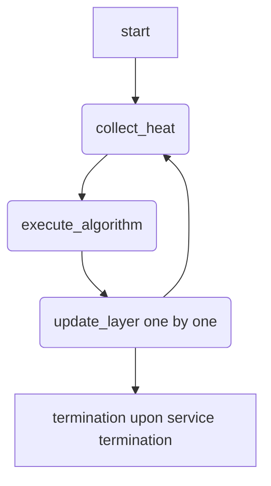

# Expert Parallelism Load Balancer (EPLB)

## Feature Introduction

Expert balancing for MoE (Mixture of Experts) models in LLM (Large Language Model) serving is essential for optimal performance.
Dynamically rearranging experts during inference can negatively impact TTFT (Time To First Token) and TPOT (Time Per Output Token), as it requires global synchronization pauses that stall all in-flight requests.
Our solution aims to minimize the impact of these pauses. EPLB feature provides the following benefits:

- Reduced Latency: Dynamically balances expert loads to minimize TTFT and TPOT by distributing workloads evenly across experts.
- Adaptive Scaling: Automatically adjusts to workload fluctuations while maintaining stable performance.

### Usage Scenarios

EPLB is not recommended in the following scenarios because the load-balancing benefit may not offset its runtime overhead:

- P node workloads with input sequences shorter than `1024` tokens.
- D node workloads where the number of experts per die is `> 8` (`> 16` on 950DT Products), or where the per-die load is below `128` tokens.

!!!WARNING

    Meeting the above conditions may lead to performance degradation.
    When there are around 8 experts per die, the EPLB benefit may be comparable to its overhead. Benchmark the actual workload and enable EPLB only after confirming a performance gain.

vLLM Ascend provides two EPLB integration paths:

- **Model Runner V2 (MRv2)** uses the upstream vLLM EPLB controller,
  configuration, load window, asynchronous worker, and rearrangement
  lifecycle. Ascend adds the STAIR policy (the default policy on Ascend),
  the HIXL and Gloo movement adapters, and the `load_collection_phase`
  extension.
- **Model Runner V1 (MRv1)** retains the legacy vLLM Ascend dynamic,
  recording, and static EPLB modes with their own policies
  (SwiftBalance, DefaultEplb, FlashLB, Random).

The two paths use different switches and configuration schemas:

| | Model Runner V2 | Model Runner V1 |
| --- | --- | --- |
| Enable | `--enable-eplb` with `VLLM_USE_V2_MODEL_RUNNER=1` | `eplb_config.dynamic_eplb: true` plus `export DYNAMIC_EPLB="true"` |
| Configuration surface | Upstream `--eplb-config.*` plus `additional_config.eplb_config` (`load_collection_phase`, `stair_config`) | `additional_config.eplb_config` only |
| Policies | `stair` (the Ascend default), `default` (the upstream algorithm) | `eplb_policy_type` 0–3 |
| Movement | Asynchronous only; HIXL by default, Gloo CPU staging as fallback | Layer-by-layer D2D transfers on the forward thread; the placement plan is computed in a per-rank EPLB subprocess |

!!!IMPORTANT

    Do not mix MRv1 environment variables (`DYNAMIC_EPLB`,
    `EXPERT_MAP_RECORD`) or legacy `eplb_config` fields with MRv2 EPLB
    configuration. Mixed configurations fail during startup with an explicit
    error instead of being silently ignored.

### Constraints and Limitations

#### Models

EPLB applies only to MoE models that support expert parallelism and whose MoE
quantization method exposes a complete expert-weight movement layout. Support
also depends on the selected model runner and hardware generation.

Legacy MRv1 performance has primarily been verified on DeepSeek-V3.1/R1. The
initial MRv2 model-level validation uses Qwen3-30B-A3B W8A8 with asynchronous
EPLB. Validate accuracy and performance with the target model, topology, and
traffic before production deployment.

!!!IMPORTANT

    A2 does not support redundant experts. On A2, `num_redundant_experts` must be set to `0` in both runners. Examples in this page that use a non-zero `num_redundant_experts` apply only to hardware that supports redundant experts, such as A3 or 950PR&950DT Products.

#### Model Runner V2 Weight Formats

The following table summarizes the code paths supported by MRv2 EPLB. W8A8 is covered by an in-repository model-level regression test that runs on Ascend NPUs (`tests/e2e/pull_request/four_card/test_qwen3_mrv2_eplb.py`). Other enabled formats have not undergone the same level of validation and must be validated with the target model and hardware configuration before production deployment.

| Weight format | MRv2 EPLB | Notes |
| --- | --- | --- |
| BF16 / FP16 | Enabled | Uses the unquantized expert weights and biases. |
| W8A8 / W8A8 Dynamic | Enabled | Uses persistent per-expert weight and scale tensors. |
| W4A8 | Enabled | Uses persistent per-expert weight, scale, and scale-bias tensors. |
| W4A4 MXFP | Enabled | 950PR&950DT Products; keeps native ND expert tensors. |
| W8A8 MXFP | Enabled | 950PR&950DT Products; keeps native ND expert tensors. |
| W4A8 MXFP | Enabled | 950PR&950DT Products; keeps native ND expert tensors. The layout is enabled in code but has not completed independent EPLB validation. |
| W4A16 | Rejected | The expert-weight layout does not support EPLB movement; startup fails with `EPLB is not supported ...`. |
| W4A16 MXFP | Rejected | The expert-weight layout does not support EPLB movement; startup fails with `EPLB is not supported ...`. |

"Rejected" means startup fails before serving: the quantization method does not
declare EPLB support (`supports_eplb = False`). This rejection is independent
of hardware generation.

#### Model Runner V1 Quantization and Hardware

| QuantType                       | Supported Hardware          |
| ------------------------------- | --------------------------- |
| W8A8 / W8A8-Dynamic             | A2, A3 |
| W4A8 (verified with fused MC2 enabled) | A2, A3 |
| MXFP4                           | 950PR&950DT Products         |
| MXFP8                           | 950PR&950DT Products         |

## Feature Usage

### Model Runner V2: Asynchronous EPLB

On Ascend, Model Runner V2 is selected with the environment variable
`VLLM_USE_V2_MODEL_RUNNER=1` (DeepSeek V4.1 on 950PR&950DT Products
additionally requires MRv2: startup fails with an explicit error unless the
variable is set).
Enable expert parallelism and upstream EPLB. Ascend selects the STAIR policy
by default and automatically uses the HIXL communicator when it is available
on every EPLB rank, falling back to Gloo otherwise. Movement is asynchronous
only.

The STAIR defaults do not require tuning; see
[Tuning Suggestions](#tuning-suggestions) for the advanced STAIR parameters.
A minimal production configuration only needs the redundant-expert budget:

```bash
export VLLM_USE_V2_MODEL_RUNNER=1
unset DYNAMIC_EPLB
unset EXPERT_MAP_RECORD

vllm serve Qwen/Qwen3-30B-A3B \
  --tensor-parallel-size 16 \
  --enable-expert-parallel \
  --enable-eplb \
  --eplb-config.num_redundant_experts 16
```

For short benchmark or accuracy-validation runs where you want quicker load
feedback instead of production stability, shrink the load window and the
rearrangement interval together (for example to `200`). These values
increase rearrangement frequency; do not use them as production defaults:

```bash
vllm serve Qwen/Qwen3-30B-A3B \
  --tensor-parallel-size 16 \
  --enable-expert-parallel \
  --enable-eplb \
  --eplb-config.window_size 200 \
  --eplb-config.step_interval 200 \
  --eplb-config.num_redundant_experts 16
```

MRv2 uses the upstream `EPLBConfig` fields:

| Parameter | Required | Value range | Default | Description |
| --- | --- | --- | --- | --- |
| `window_size` | No | positive integer | `1000` | Number of recent steps used for expert-load recording. |
| `step_interval` | No | positive integer | `3000` | Interval between expert rearrangements. If it exceeds `window_size`, only the last `window_size` steps of metrics are used. |
| `num_redundant_experts` | No | non-negative integer | `0` | Number of redundant physical experts. Must be `0` on A2. `(num_experts + num_redundant_experts)` must be divisible by the expert-parallel size. |
| `use_async` | No | `true` / `false` | `true` | Ascend MRv2 always runs asynchronously. `false` is normalized to `true` with a warning. |
| `policy` | No | `stair`, `default` | `stair` on Ascend | Select `stair` for the Ascend policy or `default` for upstream-policy comparison experiments. |
| `log_balancedness` | No | `true` / `false` | `false` | Log expert balancedness metrics. Incurs extra communication; recommended to leave disabled and only enable it temporarily when debugging. Do not set it in production configuration. |
| `log_balancedness_interval` | No | positive integer | `1` | Interval between balancedness log entries. Only relevant when `log_balancedness` is explicitly enabled for debugging. |
| `communicator` | No | `hixl`, `torch_gloo`, unset | Auto (`None`) on Ascend | Leave unset to use HIXL when available and Gloo otherwise; set `hixl` or `torch_gloo` to select a backend explicitly. |

Every field is optional: the engine starts with the defaults. Why the examples
above deviate from them, and when to do the same:

- `num_redundant_experts`: the default `0` means no redundancy, so EPLB can
  only shuffle whole experts between ranks. For production, budget a small
  hot-expert reserve that keeps `(num_experts + num_redundant_experts)`
  divisible by the expert-parallel size — for example `16` for
  Qwen3-30B-A3B with EP 16, which gives every rank one spare expert slot.
- `window_size` / `step_interval`: keep the `1000` / `3000` defaults in
  production. The `200` / `200` values in the validation example exist only
  to shorten the feedback loop of short benchmark or accuracy runs; they
  increase rearrangement frequency and trade stability for faster response.

These fields may also be passed together as JSON through `--eplb-config`.
They must not be placed in `--additional-config` for MRv2: the only MRv2 EPLB
fields under `additional_config.eplb_config` are `load_collection_phase` and
`stair_config`; any other field is rejected at startup.

Ascend extends the upstream `policy` field without adding a second selector.
For example, use `--eplb-config.policy default` to run the upstream policy;
omit it or set it to `stair` to run STAIR.

#### MRv2 Communicator Selection

Automatic selection requires the same HIXL binding class on every EPLB rank:
each rank resolves either the official `hixl` Python package distributed with
CANN HIXL or vllm_ascend's ctypes binding, which drives the local toolkit
libraries directly (`libcann_hixl.so`, for CANN distributions that ship the
library without the package). The ranks reach a group-wide consensus at
startup; if any rank has no usable HIXL binding, or the binding classes
differ between ranks, the whole group falls back to `torch_gloo` CPU staging
and the decision is logged.

STAIR leaves both per-rank and cross-node migration limits unrestricted by
default (`-1`) so that HIXL can use the available bandwidth. When the
communicator falls back to Gloo automatically, Ascend clamps only the limits
you have not set explicitly to `1` to avoid excessive CPU-staged transfers,
and logs the clamp; explicitly configured values are kept (for example
`cross_node_transfer_limit: 0` still forbids cross-node migrations) with a
warning. Explicitly setting `torch_gloo` or `hixl` also keeps your configured
limits untouched.

HIXL requires the CANN HIXL runtime and working device connectivity on every
EPLB rank. HIXL initialization or runtime failures fail fast instead of
falling back mid-flight, because ranks may disagree on transfer progress.

#### MRv2 Load Collection Phase

`load_collection_phase` is an MRv2 EPLB field under
`additional_config.eplb_config`. It controls which batch phases contribute to
the load window when the STAIR policy is active; it has no effect with
`--eplb-config.policy default`, and it does not disable routing or MoE
computation for non-matching batches.

| Value | Behavior | Typical use |
| --- | --- | --- |
| `all` | Collect load from every batch. This is the default. | General and mixed workloads. |
| `prefill` | Collect only from batches containing at least one prefill request. | Optimize prefill balance and TTFT. |
| `decode` | Collect only from batches containing decode requests and no prefill request. | Optimize decode balance and TPOT. |

Additional rules:

- A value other than `all` requires `--enable-eplb`.
- Classification is performed once per batch. A batch containing any prefill
  request is classified entirely as prefill; otherwise it is decode. On
  disaggregated decode nodes, requests that recompute a prompt tail segment
  are not counted as prefill, so such batches are classified as decode.
- A batch that does not match `load_collection_phase` contributes zero load
  but still advances the shared EPLB window. This keeps load-window slots,
  scheduling, and communication aligned across data-parallel ranks.
- If no rank has recorded fresh load since the last rearrangement (for
  example, `prefill` is selected but traffic is pure decode), the next
  rearrangement is skipped instead of running on an empty window.

For example, to collect only prefill load:

```bash
vllm serve Qwen/Qwen3-30B-A3B \
  --enable-expert-parallel \
  --enable-eplb \
  --additional-config '{"eplb_config":{"load_collection_phase":"prefill"}}'
```

#### MRv2 Constraints

MRv2 supports asynchronous EPLB only and normalizes `use_async=false` to
asynchronous movement. It rejects:

- elastic expert parallelism,
- legacy `dynamic_eplb`, recording/static-map fields, `DYNAMIC_EPLB`, and
  `EXPERT_MAP_RECORD` (these are MRv1 controls),
- communicators other than Gloo and HIXL,
- weight offload and prefetch: enabling EPLB with `cpu_offload_gb > 0` or
  `offload_group_size > 0` raises a configuration error.

Validate the target model, topology, graph mode, and traffic independently
before production use.

### Model Runner V1: Legacy EPLB

Legacy MRv1 EPLB has three usage modes:

| Mode | Config in `eplb_config` | Env Variable |
| ---- | ----------------------- | ------------ |
| **Dynamic EPLB** | `dynamic_eplb: true` | `DYNAMIC_EPLB=true` |
| **Recording** (generate expert map) | `expert_map_record_path` | `DYNAMIC_EPLB=true` or `EXPERT_MAP_RECORD=true` |
| **Static EPLB** (load pre-recorded map) | `expert_map_path` | none required |

!!!IMPORTANT

    For Dynamic EPLB and Recording modes, the env variable acts as a safety guard: setting `dynamic_eplb: true` in config alone is not enough — the assertion requires `DYNAMIC_EPLB` set to `true` (case-insensitive) or `1`, or `EXPERT_MAP_RECORD` set to exactly lowercase `true`. Use lowercase `true` in scripts to be safe everywhere.
    Static EPLB (loading a pre-recorded map via `expert_map_path`) does **not** require an env variable.

#### Dynamic EPLB

We need to add environment variable `export DYNAMIC_EPLB="true"` to enable vLLM-Ascend EPLB. Enable dynamic balancing with auto-tuned parameters. Adjust expert_heat_collection_interval and algorithm_execution_interval based on workload patterns. In the current version, we recommend using the following: policy of SwiftBalanceEplb(2).

| Parameter | Description | Default |
| --- | --- | --- |
| dynamic_eplb | Enable dynamic EPLB. | False |
| expert_heat_collection_interval | Interval for collecting expert heat. | 600 |
| algorithm_execution_interval | Interval for executing the balancing algorithm. | 50 |
| eplb_policy_type | EPLB policy type. | 2 |
| num_redundant_experts | Number of redundant experts. Must be `0` on A2. `(num_experts + num_redundant_experts)` must be divisible by the expert-parallel size. | 0 |
| eplb_heat_collection_stage | Request stage used to collect expert heat. Available values: `all`, `prefill`, and `decode`. | `all` |



```shell
# D node or colocation
vllm serve Qwen/Qwen3-235B-A22B \
  --tensor-parallel-size 16 \
  --enable-expert-parallel \
  --additional-config '{ "eplb_config": {
    "dynamic_eplb": true,
    "expert_heat_collection_interval": 600,
    "algorithm_execution_interval": 50,
    "eplb_policy_type": 2,
    "num_redundant_experts": 16
    }}'

# P node
vllm serve Qwen/Qwen3-235B-A22B \
  --tensor-parallel-size 16 \
  --enable-expert-parallel \
  --additional-config '{ "eplb_config": {
    "dynamic_eplb": true,
    "expert_heat_collection_interval": 50,
    "algorithm_execution_interval": 5,
    "eplb_policy_type": 2,
    "num_redundant_experts": 16
    }}'
```

One full MRv1 update cycle spans `expert_heat_collection_interval +
algorithm_execution_interval + num_moe_layers` forward iterations: expert
heat is collected first, the balancing algorithm then runs in a per-rank
EPLB subprocess, and the resulting plan is applied one MoE layer per forward
iteration.

##### EPLB Policy Types

The `eplb_policy_type` parameter selects the balancing algorithm used during dynamic expert redistribution:

| Value | Policy | Description |
|-------|--------|-------------|
| `0` | Random | Test-only policy that swaps a fixed expert pair between two ranks each cycle; it requires at least four EP ranks and is not a real random balancer. |
| `1` | DefaultEplb | Open-source EPLB algorithm. Adds redundant experts to the hottest, packs via balanced assignment with local constraint exchange. |
| `2` | SwiftBalanceEplb | Optimized for low-bandwidth environments. Supports intra-node and inter-node expert redundancy, joint optimization of expert placement. **(Recommended)** |
| `3` | FlashLB | Statistical method using sliding-window mean/variance/covariance of expert loads. Uses FlashTree layered search for optimal replica allocation and `minimize_redeploy` for incremental adjustment. Best for high-frequency load fluctuations. |

##### Selective Expert Heat Collection

The `eplb_heat_collection_stage` option is intended for prefill-decode aggregation scenarios. Prefill requests usually process many tokens in one iteration, while decode requests usually process fewer tokens. As a result, the expert workload distribution can differ between the two stages. Collecting heat from both stages may hide the imbalance of the stage whose latency you want to optimize.

!!!IMPORTANT

    This section describes the MRv1-only `eplb_heat_collection_stage` field.
    MRv2 uses `load_collection_phase` as described above; the two fields have different batch-classification semantics and are not interchangeable.

Use `eplb_heat_collection_stage` to select the stage whose expert heat contributes to EPLB:

| Value | Behavior | Typical use |
| ----- | -------- | ----------- |
| `all` | Collect expert heat from both prefill and decode iterations. | General workloads; this is the default. |
| `prefill` | Collect expert heat only from iterations classified as prefill. | Optimize prefill workload balance and TTFT. |
| `decode` | Collect expert heat only from iterations classified as decode. | Optimize decode workload balance and TPOT. |

Choose the stage according to the actual workload. The following values can be used as initial tuning guidance:

- For workloads whose typical input sequence length is greater than `1024` tokens, start with `prefill`.
- For workloads whose typical input sequence length is less than `1024` tokens but concurrency is greater than `1024`, try `decode` or `all`.
- For other or mixed workloads, benchmark `all`, `prefill`, and `decode` against the target TTFT or TPOT before choosing a setting.

These thresholds are empirical starting points rather than strict requirements. Production traffic distribution, concurrency, model configuration, and hardware topology can all affect the optimal stage.

For example, to collect only prefill heat:

```shell
export DYNAMIC_EPLB="true"

vllm serve Qwen/Qwen3-235B-A22B \
  --tensor-parallel-size 16 \
  --enable-expert-parallel \
  --additional-config '{ "eplb_config": {
    "dynamic_eplb": true,
    "expert_heat_collection_interval": 600,
    "algorithm_execution_interval": 50,
    "eplb_policy_type": 2,
    "num_redundant_experts": 16,
    "eplb_heat_collection_stage": "prefill"
  }}'
```

To collect only decode heat, set:

```json
{
  "eplb_config": {
    "dynamic_eplb": true,
    "eplb_heat_collection_stage": "decode"
  }
}
```

!!!NOTE

    Stage selection applies to dynamic EPLB heat collection. Internally, vLLM-Ascend classifies each forward iteration by comparing its padded scheduled token count with the maximum expected token count of a decode iteration. An iteration above the threshold is treated as prefill; an iteration at or below the threshold is treated as decode. Classification is therefore performed per forward iteration rather than per individual request.

When an iteration does not match the selected stage, its expert load is not accumulated and it does not advance the heat-collection interval. Once heat collection is complete, balancing calculation and layer-by-layer expert weight updates continue normally.

#### Static EPLB

Static EPLB applies a fixed expert placement computed offline. Use recording mode once to capture the placement generated under representative traffic, then reuse the recorded map in subsequent deployments to avoid recalculating distributions at runtime. Static EPLB does not require any environment variable.

!!!NOTE

    Static EPLB and the recording mode are legacy MRv1 features. They are
    retained for compatibility with existing deployment pipelines; new
    deployments should prefer MRv2 asynchronous EPLB, which re-learns the
    placement online.

##### Initial Setup (Record Expert Map)

We need to add environment variable `export EXPERT_MAP_RECORD="true"` to record expert map. Generate the initial expert distribution map using expert_map_record_path. This creates a baseline configuration for future deployments.

```shell
export EXPERT_MAP_RECORD="true"

vllm serve Qwen/Qwen3-235B-A22B \
  --tensor-parallel-size 16 \
  --enable-expert-parallel \
  --additional-config '{ "eplb_config": {
    "expert_map_record_path": "/path/to/eplb.json",
    "num_redundant_experts": 16,
    "expert_heat_collection_interval": 400,
    "algorithm_execution_interval": 30
  }}'
```

Use an absolute path for `expert_map_record_path`: the parent directory is
created automatically, and a bare relative file name fails directory
creation. Only global rank 0 writes the JSON file.

##### Subsequent Deployments (Use Recorded Map)

Load the pre-recorded expert map for consistent performance. This avoids recalculating distributions at runtime.

```shell
vllm serve Qwen/Qwen3-235B-A22B \
  --tensor-parallel-size 16 \
  --enable-expert-parallel \
  --additional-config '{
    "eplb_config": {"expert_map_path": "/path/to/eplb.json"}
  }'
```

## Tuning Suggestions

The default STAIR policy already covers general workloads; change the
advanced parameters below only after measuring a specific need. They live
under `additional_config.eplb_config.stair_config`. Numeric fields must not
be booleans, and each field is range checked at startup.

| Parameter | Default | Range | Description |
| --- | --- | --- | --- |
| `load_window_bins` | `64` | 2–256 | Maximum chronological bins used to compress the upstream EPLB load window. |
| `load_risk_quantile` | `0.75` | (0.5, 1.0) exclusive | One-sided standard-normal quantile converted to a z-score for mean-plus-deviation expert and rank risk. |
| `relative_balance_threshold` | `0.95` | (0, 1] | Rebalance when current balance divided by the last committed balance is at or below this value. |
| `absolute_balance_threshold` | `0.90` | (0, 1] | Rebalance when current balance is at or below this value. |
| `rank_transfer_limit` | `-1` | -1 or positive | Maximum outgoing and incoming expert transfers for each rank in one layer plan. `-1` removes the limit. |
| `cross_node_transfer_limit` | `-1` | -1 or non-negative | Maximum outgoing and incoming cross-node expert transfers for each node in one layer plan. `-1` removes the limit; `0` disables cross-node transfers. |
| `replica_search_num_stages` | `4` | 1–8 | Number of risk-ordered expert groups handled by the FlashTree-style replica search. |
| `replica_search_radius` | `8` | 0–32 | Maximum distance from the greedy extra-replica budget explored at each search stage. |
| `replica_search_beam_size` | `64` | 1–128 | Maximum unique replica-count candidates kept after each search stage. |
| `placement_search_backtrack_limit` | `32` | 0–64 | Maximum feasible-branch reversals while constrained LPT places one candidate. `0` disables them. |

Example:

```bash
vllm serve Qwen/Qwen3-30B-A3B \
  --enable-expert-parallel \
  --enable-eplb \
  --additional-config '{"eplb_config":{"stair_config":{"rank_transfer_limit":2,"cross_node_transfer_limit":0}}}'
```

Balance is the reciprocal of the mean max-to-average rank-load ratio; STAIR
rebalances a layer only when the hysteresis gates above fire, so lowering
`step_interval` alone does not force continuous movement.

## Critical Considerations

1. Parameter Tuning:
    - For MRv2, tune `window_size` and `step_interval` against the target
      workload. For MRv1, tune `expert_heat_collection_interval` and
      `algorithm_execution_interval`.
    - `num_redundant_experts` must make `(num_experts +
      num_redundant_experts)` divisible by the expert-parallel size.

2. Hardware Requirements:
    - Ensure that all NPUs have identical memory capacity and compute capabilities.
    - Network bandwidth must support expert redistribution traffic (≥ 10 Gbps recommended).
    - shm needs to be mounted for container

3. Monitoring & Validation:
    - MRv1: search for `Expert hotness imbalance` lines (logged as
      `[eplb/worker] Expert hotness imbalance, current: mean=... max=...,
      updated: ...`) on EP rank 0 once per balancing cycle. We calculate the
      peak-to-average ratio of the load for each layer at different ranks,
      and then find their mean and maximum values. Current means actual
      peak-to-average ratio, update means estimated peak-to-average ratio
      after algorithm adjustment. The same values are exported as
      `eplb:expert_hotness:*` metrics when ms-service-metric collection is
      enabled.
    - MRv2: temporarily enable `--eplb-config.log_balancedness true` to log
      `EPLB step: ... balancedness=...` per window sample, and check
      `Ascend async EPLB cycle committed` lines for the per-cycle movement
      summary (`mean ... -> ...`, changed layers, transfer counts).
    - Use vLLM monitor to detect imbalances during runtime.
    - Always verify expert map JSON structure before loading (validate with jq or similar tools).
