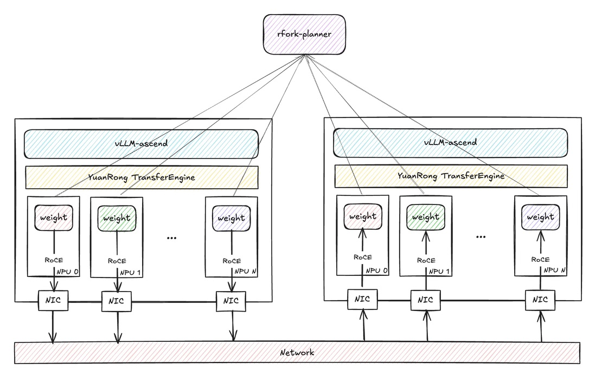
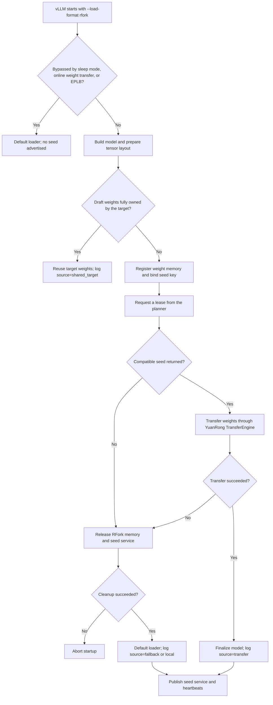

# RFork Guide

This guide explains how to use **RFork** as a model-loader plugin in **vLLM Ascend**.

---

## Overview

RFork is a warm-start weight loading path for vLLM Ascend. Instead of always reading model weights from storage, a new instance can request a compatible **seed** instance from an external planner, then pull weights directly from that seed through `YuanRong TransferEngine`.

The RFork loading flow in the current implementation is:

1. vLLM starts with `--load-format rfork`.
2. RFork initializes the model structure on the local NPU, prepares the required tensor layout, and registers local weight memory.
3. RFork builds a **seed key** from the configuration fingerprint, structural digest, and deployment topology, then asks the planner for a compatible seed.
4. If a seed is returned, RFork fetches its transfer metadata and copies weights into the registered local buffers through `YuanRong TransferEngine`.
5. If no compatible seed is returned, or RFork setup, seed acquisition, or transfer fails with one of the error classes RFork handles (import, I/O, runtime, and value errors) in a stage that can be retried, RFork releases its registered memory and seed service, then falls back to the default loader. Fallback is conditional on that cleanup succeeding: if registered memory or the seed service cannot be released, RFork raises instead of allocating a second model while the old weights are still pinned.
6. A successfully loaded model can publish a local seed service and send heartbeats to the planner. Publication waits for any source lease to be released.

If the seed service or its planner advertisement fails after the model is loaded, inference continues. RFork logs the failure and keeps the model available, but that instance is not advertised as a seed.

A draft model whose transferable weights are already owned by the loaded target model skips registration, seed acquisition, and transfer, and reports `source=shared_target`; see [MTP draft weight reuse](#when-does-a-draft-model-report-shared_target).

Engram host-table handling and deployment-wide coordination are covered in the [FAQ](#faq).

## Key Concepts

| Term | Meaning |
| --- | --- |
| **Seed** | A loaded instance that advertises its NPU weight memory and can serve weights to compatible receivers. |
| **Planner** | External control-plane service that matches seed keys, allocates leases, tracks heartbeats, and optionally removes seeds. |
| **Seed key** | Opaque identifier derived from the compatibility fingerprint, structural digest, and shard topology. It is also the credential for the seed metadata service. |
| **Compatibility fingerprint** | Digest of configuration that changes tensor contents but not shapes, such as the RFork protocol version, model revision, quantization config, architecture, RoPE settings, `kv_role`, and `mix_placement`. |
| **Structural digest** | Digest of the built model's transferable tensor inventory: stable IDs, shapes, dtypes, and NPU formats. |
| **Lease** | Temporary allocation of seed capacity for one receiver, released through `/put_seed` after use. |
| **Load source** | Final result reported in the load summary: `transfer`, `local`, `fallback`, or `shared_target`. |

## Architecture



## Loading Flow



## Application Scenarios

- **Scale-out after a first successful load**: The first instance may still load from storage, but later instances with the same deployment identity can reuse it as a seed and shorten startup time.
- **Elastic serving clusters**: Because RFork asks a planner for available seeds, it fits clusters where instances are created and reclaimed dynamically.
- **Topology-sensitive deployments**: RFork derives the seed key from a configuration fingerprint, a structural digest of the built model's transferable tensors, and the shard topology (`tp_rank`, optional `pp_rank`, optional `ep_rank`, an optional `sharded_dp_rank`, and an optional `draft` marker), so only structure- and topology-compatible instances are matched together.

---

## Usage

To enable RFork, pass `--load-format rfork` and provide the required settings through a JSON object in `--model-loader-extra-config` or through the environment variables listed in the fallback table below.

### RFork Prerequisites

- Install the runtime dependency `YuanRong TransferEngine` on every RFork instance.
- Run a planner service that implements the RFork seed protocol. A simple mock planner script is provided at [`rfork_planner.py`](https://github.com/vllm-project/vllm-ascend/blob/main/examples/rfork/rfork_planner.py).

### Configuration Fields

| Field Name | Type | Description | Allowed Values / Notes |
| ------------ | ---- | ----------- | ---------------------- |
| **model_url** | String | Logical model identifier used to build the RFork seed key. | Required for RFork transfer. Instances that should share seeds must use the same value. A non-empty JSON string takes priority over `MODEL_URL`; an absent, empty, or non-string JSON value falls back to the environment variable. |
| **model_deploy_strategy_name** | String | Deployment strategy identifier used together with `model_url` to build the seed key. | Required for RFork transfer. Instances that should share seeds must use the same value. A non-empty JSON string takes priority over `MODEL_DEPLOY_STRATEGY_NAME`; an absent, empty, or non-string JSON value falls back to the environment variable. |
| **rfork_scheduler_url** | String | Base URL of the planner service used for seed allocation, release, and heartbeat. | Required for planner-based matching. Example: `http://127.0.0.1:1223`. A non-empty JSON string takes priority over `RFORK_SCHEDULER_URL`; an absent, empty, or non-string JSON value falls back to the environment variable. |
| **rfork_seed_timeout_sec** | Number | Timeout for waiting until the local seed HTTP service becomes healthy after startup; together with `rfork_request_timeout_sec`, it also bounds the shutdown wait for the heartbeat thread. | Optional. Default: `5.0`. Must be finite and greater than `0`; a numeric string such as `"7.5"` is also accepted. A valid JSON value takes priority over `RFORK_SEED_TIMEOUT_SEC`; an invalid or absent JSON value uses a valid environment value, otherwise the default. |
| **rfork_request_timeout_sec** | Number | HTTP connect/read timeout for planner and seed metadata requests. | Optional. Default: `10.0`. Must be finite and greater than `0`; a numeric string such as `"7.5"` is also accepted. The startup health probe uses a separate bound: the remaining `rfork_seed_timeout_sec`, capped at 10 seconds. A valid JSON value takes priority over `RFORK_REQUEST_TIMEOUT_SEC`; an invalid or absent JSON value uses a valid environment value, otherwise the default. |
| **rfork_model_identity_headers** | Boolean | Attach readable model identity headers to every planner request. | Optional. Default: `false`. Explicit JSON `true` or `false` overrides `RFORK_MODEL_IDENTITY_HEADERS`; otherwise the environment variable accepts `0`, `1`, `true`, or `false`, ignoring case and surrounding whitespace. |
| **rfork_heartbeat_interval_sec** | Number | Interval between planner heartbeat reports. | Optional. Default: `30.0`. JSON configuration only. Must be a finite positive number; invalid values fail configuration initialization. |
| **rfork_lease_release_max_attempts** | Integer | Fast-attempt count before transient lease-release failures continue at a slower background interval. | Optional. Default: `3`. JSON configuration only. Must be a positive integer; invalid values fail configuration initialization. Permanent planner rejection still stops retries. |
| **rfork_lease_release_retry_interval_sec** | Number | Interval between fast lease-release retries. | Optional. Default: `30.0`. JSON configuration only. Must be a finite positive number; invalid values fail configuration initialization. |
| **rfork_seed_removal_supported** | Boolean or `null` | Whether the planner implements the optional `/remove_seed` and draining contract. | Optional. JSON configuration only. If omitted, defaults to `false` (skip removal). Explicit `true` requires the administrator to confirm that `200` means removed, `409` means draining, and `404` means that the seed record is absent. `false` skips removal, and `null` enables auto-detection. In auto mode, only `200` or `409` confirms support; an unknown `404` is not treated as successful removal, and `405` or `501` means unsupported. |
| **rfork_seed_bind_host** | String | Local address used by the seed HTTP service. | Optional. Default: `0.0.0.0`. A non-empty JSON string takes priority over `RFORK_SEED_BIND_HOST`; an absent, empty, or non-string JSON value falls back to the environment variable, then to the default. |
| **rfork_seed_port_base** | Integer | Base port for deterministic seed HTTP endpoints. | Optional. Default: `0`, which lets the OS assign a port. JSON configuration only. The base must be an integer in `[0, 65535]`; invalid values fail configuration initialization. For a nonzero base, main and draft models reserve adjacent slots per worker: main uses `base + 2 * global_rank`, draft uses `base + 2 * global_rank + 1`. If the calculated port exceeds `65535` or is already in use, the seed service falls back to OS assignment. Keep this range separate from TransferEngine, its HIXL endpoint range, and other service ports. |
| **rfork_seed_advertise_host** | String | Address advertised to the planner as `SEED_IP` and returned to receivers as the seed metadata address. This field does not configure the TransferEngine data-plane endpoint. | Optional. When unset, the advertised address comes from `VLLM_HOST_IP` when set, otherwise from vLLM's default-route detection, which may be unreachable by peers on multi-NIC hosts. TransferEngine independently calls `get_ip()` during initialization, so multi-NIC deployments must pin the data-plane interface with `VLLM_HOST_IP` (or fix the default route) in addition to setting this field for planner reachability. A non-empty JSON string takes priority over `RFORK_SEED_ADVERTISE_HOST`; an absent, empty, or non-string JSON value falls back to the environment variable, then to automatic detection. |

RFork validates this configuration at startup. Invalid values for JSON-only fields, and required values
missing from both the JSON object and the environment, abort startup instead of falling back to the
default loader — unless RFork is bypassed first by one of the configurations listed under
[Constraints and Limitations](#constraints-and-limitations), in which case the default loader runs
without validating RFork settings. For the fields with an environment-variable fallback, an unusable JSON value is skipped
in favor of the environment variable or the documented default, as described below. Whether a runtime
failure falls back depends on the exception class and, with Engram enabled, on the loading stage:
the handled classes — import, I/O, runtime, and value errors — fall back in retryable loading stages,
exceptions outside those classes abort startup, and coordinated stages that cannot be safely retried
(model construction, shared-weight finalization, fallback cleanup, and local loading) abort on any
failure. Unknown `model_loader_extra_config` keys are ignored with a warning, so check the
spelling of every field.

### Environment Variable Fallback

RFork manages its own environment variables: they are read and validated inside the RFork loader, not registered in `vllm_ascend/envs.py`, so they do not appear on the generated [Environment Variables](../configuration/env_vars.md) page. Treat this section as the source of truth for RFork deployments.

The following fields fall back to an environment variable when the JSON config does not provide a usable value:

| JSON Field | Environment Variable |
| ---------- | -------------------- |
| **model_url** | `MODEL_URL` |
| **model_deploy_strategy_name** | `MODEL_DEPLOY_STRATEGY_NAME` |
| **rfork_scheduler_url** | `RFORK_SCHEDULER_URL` |
| **rfork_seed_timeout_sec** | `RFORK_SEED_TIMEOUT_SEC` |
| **rfork_request_timeout_sec** | `RFORK_REQUEST_TIMEOUT_SEC` |
| **rfork_model_identity_headers** | `RFORK_MODEL_IDENTITY_HEADERS` |
| **rfork_seed_bind_host** | `RFORK_SEED_BIND_HOST` |
| **rfork_seed_advertise_host** | `RFORK_SEED_ADVERTISE_HOST` |

Resolution rules:

- A valid JSON value always wins: a non-empty string for the string fields, a finite positive number (or numeric string) for the timeout fields, and an explicit `true` or `false` for `rfork_model_identity_headers`.
- A JSON value that is absent or unusable — an empty string, `null`, the wrong type, or a number that is not finite and positive — is skipped silently: it does not fail configuration initialization, and the environment variable is consulted next. An empty environment variable counts as unset, so the documented default applies (`0.0.0.0` or automatic detection for the optional string fields, the built-in defaults for the timeouts). String values are used exactly as written and are not trimmed. A whitespace-only `model_url` or `model_deploy_strategy_name` counts as set and enters the seed key, producing an unexplained seed miss; whitespace-only values for `rfork_scheduler_url`, `rfork_seed_bind_host`, or `rfork_seed_advertise_host` instead fail when the URL, bind, or advertisement is used.
- `rfork_model_identity_headers` is the exception: its environment fallback only applies when the JSON key is absent. A JSON value of another type fails configuration initialization, and so does an environment value outside `0`, `1`, `true`, or `false` — including an empty one — because a bad value cannot be told apart from an intentional setting.
- `model_url`, `model_deploy_strategy_name`, and `rfork_scheduler_url` have no default. When neither the JSON config nor the environment variable provides a non-empty value, startup aborts with a configuration error instead of falling back to the default loader.

Both sources are supported configuration inputs. The environment route suits deployments where a platform injects the settings into every worker environment so the vLLM command line stays identical across instances; these variable names are fixed for RFork compatibility and are not migrated to the `VLLM_ASCEND_*` namespace. Guidelines:

- Environment variables are read once when the RFork loader is constructed; changing them after startup has no effect.
- Resolve each field from exactly one source per deployment. Precedence is decided per field, so a valid JSON value silently overrides the environment while an unusable one silently loses to it, which makes a mixed setup hard to audit.
- Keep `model_url` and `model_deploy_strategy_name` identical across all instances that should share seeds. A mismatch between instances shows up as a seed miss and a fallback to storage loading, not as an error.

## Example Commands & Placeholders

> Replace parts in `<...>` before running.

### 1. Install YuanRong Datasystem

```shell
pip install openyuanrong-datasystem
```

Verify the installation can import the types RFork uses to initialize the TransferEngine:

```shell
python -c "from yr.datasystem import ErrorCode, MemoryRegistration, TransferEngine; print('YuanRong Datasystem is ready')"
```

### 2. Start the Planner

A simple planner implementation is provided at [`rfork_planner.py`](https://github.com/vllm-project/vllm-ascend/blob/main/examples/rfork/rfork_planner.py).

```shell
python examples/rfork/rfork_planner.py --host 127.0.0.1 --port <planner_port>
```

The example planner gives every seed **one capacity point** by default. A seed that already has an active lease is treated as unavailable, and `/get_seed` returns `404` both when no compatible seed exists and when all seeds are out of capacity, so the receiver reports `source=local`. For concurrent scale-out, raise the capacity with `--default-resource-points <N>` (or `RFORK_MOCK_DEFAULT_RESOURCE_POINTS`). See [Troubleshooting](#troubleshooting) for how capacity exhaustion appears in the load summary.

The example planner serves an unauthenticated `GET /debug/snapshot` route that lists every registered `seed_key` plus every active lease keyed by `USER_ID`, with its seed identity and allocated capacity. Those lease IDs authorize `/renew_seed_lease` and `/put_seed`, so anything that can reach the route can not only learn keys but also renew or release active allocations. Run it only on a trusted or isolated network segment (see the [FAQ](#faq)). The command above binds it to `127.0.0.1` for local testing; when other hosts must reach the planner, bind a trusted internal interface instead of `0.0.0.0`.

### 3. Start vLLM Instances

Use the same RFork startup command for both the first instance and later instances in the same deployment.

For the first instance, the planner usually has no compatible seed yet, so RFork falls back to the default loader. After loading finishes, the instance can publish a local seed service and report itself to the planner.

For later instances, RFork tries to transfer weights when the planner allocates a compatible seed. A seed miss or transfer failure triggers fallback subject to cleanup and the constraints described below.

```shell
export RFORK_CONFIG='{
  "model_url": "<model_url>",
  "model_deploy_strategy_name": "<deploy_strategy>",
  "rfork_scheduler_url": "http://<planner_ip>:<planner_port>"
}'

vllm serve <model_path> \
  --tensor-parallel-size 1 \
  --served-model-name <served_model_name> \
  --port <port> \
  --load-format rfork \
  --model-loader-extra-config "${RFORK_CONFIG}"
```

The same settings can be provided through environment variables instead of `--model-loader-extra-config`; a JSON value for a field still takes priority over its variable:

```shell
export MODEL_URL=<model_url>
export MODEL_DEPLOY_STRATEGY_NAME=<deploy_strategy>
export RFORK_SCHEDULER_URL=http://<planner_ip>:<planner_port>

vllm serve <model_path> \
  --tensor-parallel-size 1 \
  --served-model-name <served_model_name> \
  --port <port> \
  --load-format rfork
```

### 4. Scale Out Across Ranks

RFork derives the seed key per worker, so every rank must start with the same deployment identity and layout settings. For a single-node TP8 deployment:

```shell
vllm serve <model_path> \
  --tensor-parallel-size 8 \
  --served-model-name <served_model_name> \
  --port <port> \
  --load-format rfork \
  --model-loader-extra-config "${RFORK_CONFIG}"
```

Each worker has its own `global_rank`. With a nonzero `rfork_seed_port_base`, reserve two ports per worker: main uses `base + 2 * global_rank`, draft uses `base + 2 * global_rank + 1`, so the base range must cover `2 * world_size` slots.

For pipeline, expert, or data parallelism, pass the same `--pipeline-parallel-size` value, the same `--enable-expert-parallel` setting, or the same `--data-parallel-size` value on every instance. The seed key then includes `pp_rank`, `ep_rank`, and, when weights are actually sharded across DP, `sharded_dp_rank`; a mismatch shows up as `source=local`, not as a startup error.

On multi-NIC or multi-node deployments, pin both planes per node: set `rfork_seed_advertise_host` (or `VLLM_HOST_IP`) so peers can reach the seed HTTP service, and set `VLLM_HOST_IP` so TransferEngine uses the intended data-plane interface.

### Placeholder Descriptions

- `<model_path>`: Model path or model identifier passed to `vllm serve`.
- `<served_model_name>`: Service name exposed by vLLM.
- `<planner_ip>`: IP address or hostname of the RFork planner.
- `<planner_port>`: Listening port of the RFork planner.
- `<model_url>`: Stable model identity string used to build the RFork seed key.
- `<deploy_strategy>`: Stable deployment-strategy name used to build the RFork seed key.
- `<port>`: Serving port of the vLLM instance being started.

Successful loads log `source=transfer`, `local`, `fallback`, or `shared_target`.
Successful TP0 weight reads also log transfer elapsed time, bytes, chunks, and
throughput at INFO; other TP ranks and per-chunk timings remain at DEBUG.
Every successful registration, receiver-before-read, and final receiver stage
emits one bounded `RFork tensor layout summary` at INFO per rank. The summary hashes all
tensor IDs, shapes, strides, dtypes, NPU formats, logical byte counts, storage byte
capacities, storage offsets, and NPU descriptor element counts into fixed-size
semantic and physical digests. It also reports aggregate counts and at most
three representative tensors, preferring storage views or tensors whose NPU
descriptor size differs from logical `numel`. Match a receiver's `peer_session`
to the seed's `session`. Digest differences are diagnostic and do not by
themselves reject a transfer. On checkpoint-layout transfers, compare
`receiver_before_read` with `receiver_after_post_load` to determine whether the
post-load hook rebuilt the layout. Processed-layout transfers instead emit
`receiver_after_transfer_finalize`, because their layout processing happened
before the read. The summary does not copy tensor data or prove value equality;
validate output accuracy separately on NPU hardware.
Set `VLLM_LOGGING_LEVEL=DEBUG` for per-rank registration, metadata, transfer,
lease-release, and publication timing.

---

## How RFork Matches Seeds

RFork does not match instances by `model_url` alone. The local seed key is derived from three layers:

- a **compatibility fingerprint** over value-semantic configuration,
- a **structural digest** over the built model's transferable tensors, and
- the **shard topology**: `tp_rank`, optional `pp_rank`, optional `ep_rank`, a conditional `sharded_dp_rank`, and an optional `draft` marker.

The compatibility fingerprint covers configuration that changes tensor *contents* without changing tensor *shapes*: the RFork protocol version, `model_url`, `model_deploy_strategy_name`, the resolved model revision, the checkpoint quantization config digest, the architecture list, RoPE settings, the effective P/D role (`kv_role`), and `mix_placement`.

The structural digest is computed from the same transferable tensor inventory the transfer manifest validates: stable tensor IDs, shapes, dtypes, and NPU formats. Any setting that changes tensor structure is captured automatically, including weight dtype, TP/PP/EP sharding, NZ and fused MC2 layout switches, quantization post-processing, and speculative draft topology.

Shard ranks distinguish same-shaped shards: `tp_rank` picks the TP slice, `pp_rank` the pipeline stage, `ep_rank` the expert set (expert weights are same-shaped across EP ranks), and `sharded_dp_rank` the DP position — but only when weight content is actually sharded across the DP dimension. Two deployment forms break DP replication: fine-grained TP (`finegrained_tp_config`) shards selected modules across the DP dimension, and MoE models with `data_parallel_size > 1` shard expert weights across the DP×TP plane — with or without expert parallelism enabled, since with EP off the DP position is the only thing distinguishing same-shaped different-content expert shards. In those cases the DP rank joins the seed key as a shard selector; replicated DP ranks leave it unset and keep sharing one seed pool.

Because the structural digest exists only after the model is built and its memory is registered, the seed key is computed lazily and logged together with the digest right after registration (INFO on TP rank 0, DEBUG elsewhere). A seed miss therefore leaves a debuggable trail of the exact key and digest that did not match. The key doubles as the seed service credential, so worker logs — like every other path that sees the key — must stay inside the trust boundary described in the [FAQ](#faq).

This means two instances must agree on model identity, tensor structure, and deployment topology before the planner will treat them as interchangeable seeds.
The final manifest is still validated before transfer, and RFork falls back rather than copying incompatible tensors.

### Planner Responsibilities

The planner treats the seed key as an opaque compatibility identifier. RFork derives it from the model/configuration fingerprint, the structural digest of transferable tensors, and shard topology. A planner should:

- Match exact seed keys, track seed availability through heartbeats, and expire stale advertisements according to the planner's configured policy.
- Allocate leases according to seed capacity and accept lease releases. A planner that advertises `LEASE_TTL_SEC` can additionally reclaim abandoned or expired leases; a legacy planner without that header must provide its own operational recovery for failed releases.
- Make seed selection and lease state observable for operations.

Lease release is asynchronous. An unresolved release delays advertising the receiver as a seed, but does not block inference. The bundled planner is a functional example, not a production scheduler.

#### Sizing and availability

- Start with one concurrent receiver per seed and increase capacity only after measuring seed-side inference latency and NIC throughput. The example planner defaults to one capacity point per seed.
- Register more than one seed per seed key when receivers scale out; the planner should spread leases across seeds instead of always selecting the first.
- Keep the heartbeat interval below the planner's stale-seed TTL, and make the lease TTL longer than the expected transfer plus a safety margin. Enable lease renewal when the planner advertises `LEASE_TTL_SEC`.
- Treat the planner as a control-plane dependency, not a data-plane one: keep seed-to-receiver transfers independent of planner availability, and make initial advertisements, lease releases, and removals retry safely.
- Expose seed count, per-seed capacity, lease age, and hit/fallback rate so capacity exhaustion is visible before it turns into `source=local`.
- The example planner keeps seeds and leases in memory. After a planner restart, seeds re-register through heartbeats, but in-flight leases are lost; RFork treats a `/put_seed` `404` as released. Production planners must persist state or make lease release idempotent.

### Protocol Endpoints

The planner control plane and the per-worker seed HTTP service implement the endpoints below. `SEED_KEY` carries the opaque seed key, `SEED_REFCNT` is always sent as `0` and carries no scheduling meaning, and `SEED_RANK` is required on the wire but must not be used for compatibility decisions (see Constraints and Limitations). When `rfork_model_identity_headers` is enabled, `MODEL_URL`, `DEPLOY_STRATEGY`, and `IS_DRAFT` are attached to every planner request.

Planner endpoints:

| Endpoint | Method | Purpose | Required request headers | Response |
| --- | --- | --- | --- | --- |
| `/add_seed` | POST | Heartbeat and seed advertisement. | `SEED_KEY`, `SEED_IP`, `SEED_PORT`, `SEED_RANK`, `SEED_REFCNT` | `200`; `400` on missing or invalid headers |
| `/get_seed` | GET | Request a lease on a compatible seed. | `SEED_KEY` | `200` with `SEED_IP`, `SEED_PORT`, `SEED_RANK`, `USER_ID`, and optional `LEASE_TTL_SEC` response headers; `404` when no compatible seed is available |
| `/put_seed` | POST | Release a lease after use. | `SEED_IP`, `SEED_PORT`, `SEED_RANK`, `USER_ID` | `200`; `404` when the lease is unknown |
| `/renew_seed_lease` | POST | Renew a lease when the planner advertises `LEASE_TTL_SEC`. | `SEED_IP`, `SEED_PORT`, `SEED_RANK`, `USER_ID` | `200`; `404` when the lease is unknown |
| `/remove_seed` | POST | Withdraw an advertisement (optional extension gated by `rfork_seed_removal_supported`). | `SEED_KEY`, `SEED_IP`, `SEED_PORT`, `SEED_RANK` | `200` removed; `409` draining; `404` record absent; `405` or `501` unsupported |

Seed HTTP endpoints served by each advertised worker:

| Endpoint | Method | Purpose | Request | Response |
| --- | --- | --- | --- | --- |
| `/health_check_with_key` | GET | Keyed liveness probe. | `seed_key` query parameter | `200` for the valid key; `400` for a wrong key |
| `/get_rfork_transfer_engine_info` | GET | Fetch transfer metadata (TransferEngine session and format info). | `seed_key` query parameter | `200` with the transfer metadata; `404` for a wrong key |

The reference planner additionally serves `GET /healthz`, and as a mock-only debugging aid the unauthenticated `GET /debug/snapshot` described in the [FAQ](#faq).

#### Network Reachability

| Path | Transport / port | Direction | Configured by |
| --- | --- | --- | --- |
| Planner control plane | HTTP, `rfork_scheduler_url` | worker → planner | `rfork_scheduler_url` |
| Seed metadata | HTTP, seed port | receiver → seed | `rfork_seed_bind_host`, `rfork_seed_port_base` or OS assignment, `rfork_seed_advertise_host` |
| Weight transfer | TransferEngine RPC and HIXL | receiver ↔ seed | `YR_TE_RPC_PORT_MIN`/`YR_TE_RPC_PORT_MAX`, `YR_TE_HIXL_BASE_PORT` |
| vLLM serving | HTTP | client → instance | `--port` |

The planner never connects to seed services; it only returns the advertised `SEED_IP` and `SEED_PORT`. Receivers must be able to open the seed HTTP port, and seed and receiver must be able to reach each other's TransferEngine and HIXL endpoints.

---

## Supported Models

RFork targets mainstream model families such as DeepSeek, Qwen, and GLM, but compatibility is determined by the transfer contract rather than the model family name. A model is eligible when its built NPU tensor inventory passes the structural-digest, tensor-ID, manifest, dtype, NPU-format, alias-graph, and non-NPU-state checks. DeepSeek V4.1 Engram CPU offload and checkpoint preparation for `AscendDeepSeekMTP` and DeepSeek V4/V4.1 DSpark drafts have model-specific handling. For other models, quantization variants, or NPU formats, qualify RFork on the target model and hardware by confirming `source=transfer` and comparing output accuracy with the default loader.

## Speculative Decoding { #speculative-decoding }

With speculative decoding, each worker loads the target model first and then the draft model, and both go through the RFork loader. RFork handles the draft as a separate model:

- **Draft detection.** A model is a draft when its model config has `runner_type="draft"`, or its Hugging Face config has a `model_type` ending in `_mtp` or an architecture ending in `MTPModel`.
- **Separate seed.** The draft has its own RFork session and seed key. The seed key includes the `draft` marker, so a draft never matches a target seed. With a nonzero `rfork_seed_port_base`, the draft seed service uses `base + 2 * global_rank + 1`. When planner model identity headers are enabled, draft requests carry `IS_DRAFT: true`.
- **Weights shared with the target.** Before registering the draft, RFork takes a snapshot of the weight blocks the target registered. If every transferable draft tensor lies inside those blocks, the draft reports `source=shared_target` and is neither transferred nor published (see [When does a draft model report `shared_target`?](#when-does-a-draft-model-report-shared_target)). Otherwise RFork registers and transfers only the draft tensors outside those blocks.
- **Checkpoint-dependent draft state.** Many drafts decide in `load_weights`, from the checkpoint weight names, whether they own their embedding and LM head; the proposer then replaces the parts a draft does not own with the target's modules. RFork does not run `load_weights`, so it restores this state before registration for `AscendDeepSeekMTP` and DeepSeek V4/V4.1 DSpark drafts (see the draft checkpoint metadata entry in the [FAQ](#faq)). Other drafts, such as EAGLE/EAGLE3, DFlash, `Glm5NextMTP`, and Qwen3, GLM, or Kimi K3 DSpark, keep their constructor defaults under RFork, which can make the proposer use the wrong embedding or LM head.
- **Weights rewritten after loading.** With a QuaRot-quantized target, Qwen3, GLM, and Kimi K3 DSpark drafts and DFlash2 drafts rotate a draft projection in place in `post_process`, after the loader has returned and the draft seed may already be published. A receiver can then copy weights that the seed has already rotated, and its own `post_process` rotates them again. RFork does not bypass these configurations.
- **Qualifying a draft.** Wrong draft state usually lowers the draft acceptance rate rather than changing the output, because the target model still verifies every drafted token. When qualifying a draft with RFork, compare the acceptance rate with the default loader in addition to checking `source=transfer` and output accuracy.

## Performance Considerations

RFork indexes tensor address ranges to find backing allocations and uses binary search for memory-coverage checks during registration. Registration still adds seed startup cost, so RFork is most beneficial when later replicas reuse a seed rather than for a single cold start.

For processed-layout transfers, RFork reuses the full registration inventory to compute the initial structural digest and reuses the final post-eval layout digest for immediate seed publication. Deferred publication scans the live model again; a structural mismatch prevents publication. Checkpoint-layout processing rebuilds memory registration and the transfer manifest after post-load processing, while retaining the initially bound digest and seed key without a publication-time digest check. This allows compatible post-load reshapes to keep the receiver's original lookup identity. Tensor names, element counts, dtypes, and NPU formats are still validated against the seed manifest before transfer.

Performance depends on model size, shard topology, NPU tensor layout, TransferEngine registration time, network bandwidth, and the number of concurrent destinations. Compare with the default loader using:

- Time from process start until the service is ready.
- Registration, metadata, and read timings in the DEBUG `RFork transfer stages` log, plus bytes and throughput in `RFork weight transfer completed` (INFO on TP rank 0, DEBUG on other ranks).
- Seed inference latency and storage/host-memory traffic while transfers are active.
- Seed hit rate, transfer failure rate, and fallback rate.

---

## Constraints and Limitations { #constraints-and-limitations }

- RFork requires `YuanRong TransferEngine` at runtime. If the package is missing, RFork cannot initialize the transfer backend.
- A worker that is advertised as an RFork seed binds a seed HTTP listening port. With the default
  `rfork_seed_port_base=0`, the OS assigns the port. A nonzero base reserves adjacent main and draft slots for each
  worker; an occupied slot or a resolved port above `65535` falls back to OS assignment. Keep seed HTTP ports
  separate from the vLLM serving port, TransferEngine RPC port, and HIXL endpoint range. RFork is supported on
  Linux, and this port-conflict fallback follows Linux `EADDRINUSE` semantics.
- RFork transfer is bypassed entirely — the model loads through the default loader and no seed is advertised — under any of the configurations below. RFork registers live NPU weight memory and serves it to other instances, so it cannot be used when that memory may later be released or rewritten, nor when expert placement is not fixed at load time. The bypass is decided before any session or TransferEngine setup and is logged as `RFork transfer is disabled when <reason> is enabled; using the default model loader.`
    - **Sleep mode** (`enable_sleep_mode` on either the model config or `vllm_config.model_config`), because sleeping discards and reallocates weight storage.
    - **Online weight transfer** (`weight_transfer_config` is set), because weights can be replaced after loading.
    - **Static expert placement** (`eplb_config.expert_map_path` is set), because the placement map is applied outside the transferred tensor set.
    - **Dynamic EPLB**, because expert weights and placement can change after the seed service starts. This covers `parallel_config.enable_eplb`, `eplb_config.dynamic_eplb`, and `eplb_config.expert_map_record_path`.
- Falling back to the default loader requires releasing the RFork seed service and registered memory first. RFork makes at most two cleanup attempts (`FALLBACK_CLEANUP_MAX_ATTEMPTS`, currently 2), with a short backoff before the second attempt, and only then reclaims memory and reruns the default loader. A pending legacy `/put_seed` for an unpublished receiver does not block native finalization, but if required local cleanup still fails, tensor owners remain pinned and RFork raises rather than allocating a second copy of the model; a session that already reached the finalized state raises as well. Both cases abort startup instead of degrading to a slow load.
- The example [`rfork_planner.py`](https://github.com/vllm-project/vllm-ascend/blob/main/examples/rfork/rfork_planner.py) is only a simple mock implementation. If you need stronger scheduling, capacity management, or production-grade availability behavior, implement your own planner based on the RFork seed protocol. Its unauthenticated `GET /debug/snapshot` endpoint lists every registered `seed_key` and every active lease `USER_ID`; those IDs authorize lease renewal and release, so anything that can reach the mock planner can learn cluster keys and disrupt active allocations. Keep it reachable only inside the trusted network segment (see the [FAQ](#faq)).
- The planner protocol headers `SEED_REFCNT` and `SEED_RANK` carry no scheduling meaning, but they are not optional on the wire today:
    - `SEED_REFCNT` is always sent as `0` on advertisement and is ignored for capacity decisions (seed capacity is controlled by planner configuration). A planner must still accept the header.
    - `SEED_RANK` remains a **required** field. RFork rejects a `/get_seed` response that omits it or carries a negative value, and sends it on every seed advertisement, lease renewal, lease release, and seed removal request. A planner must echo it back on `/get_seed` and accept it on the other routes. What is deprecated is using it for compatibility decisions: it duplicates the `tp_rank` already encoded in the seed key, so a planner must match on the seed key alone and treat `SEED_RANK` as an opaque part of the seed's identity tuple.
- Each heartbeat checks that the seed service thread is still running; it does not send a keyed HTTP health probe on every
  interval. A keyed `/health_check_with_key` request is issued only while the service starts, so a thread that stays alive
  while its HTTP listener is unresponsive can still keep heartbeating. Monitor the advertised seed port at the network
  level if that distinction matters. If the thread exits, RFork stops sending heartbeats and
  attempts to withdraw the advertisement when the planner supports removal. A heartbeat failure alone does not stop
  the metadata service; shutdown or fallback cleanup handles that teardown. If removal is unsupported or unknown, RFork
  retains the published seed's registered memory and storage owner until a later withdrawal is confirmed and native
  cleanup succeeds, or the process exits, while keeping the loaded model available for inference.
- Temporary planner outages do not stop inference. Retryable initial advertisements and lease releases continue in the
  background. Supported removal retries are bounded or happen during later cleanup; other removal failures keep the HTTP
  service and registered memory available for retry. Permanent planner rejections prevent seed promotion. Outage logs are
  limited to the first failure, periodic summaries, and recovery events.
- Validate transfer accuracy and the logical-payload contract for newly supported NPU formats on the intended NPU and
  model combination; CPU tests cannot establish NPU storage correctness. This qualification is required when adding a
  format, but it is not a runtime requirement to copy allocator or descriptor padding outside a tensor's declared payload.

---

## Upgrade and Rolling Restart

Seed reuse requires exact agreement on the compatibility fingerprint, structural digest, and shard topology. After any of the following changes, existing seeds no longer match new receivers, and new instances load from storage until a new generation of seeds is published:

- A vLLM Ascend or vLLM upgrade that changes the RFork protocol version or the built tensor layout.
- A model revision, checkpoint, or quantization configuration change.
- An architecture, RoPE, `kv_role`, `mix_placement`, or layout switch such as NZ or fused MC2.
- A TP/PP/EP/DP topology or fine-grained TP configuration change.

During a rolling restart, expect mixed old and new instances to report `source=local` rather than transfer. Stop or drain old seeds before reusing the same `model_url` and `model_deploy_strategy_name`, let the first upgraded instance load from storage and publish a new seed, then start the remaining receivers. Account for the planner's stale-seed TTL so old advertisements expire before capacity is reused.

If you intentionally start a new seed pool without upgrading, change `model_deploy_strategy_name` so old and new seeds cannot match.

---

## Troubleshooting { #troubleshooting }

- **Startup aborts with an RFork configuration error.** A required field is missing from both the JSON object and its environment variable, or a JSON-only field holds an invalid value. Check the spelling of every field — unknown keys are only warned — and re-read the resolution rules under Environment Variable Fallback.
- **Startup aborts during RFork setup or transfer.** The failure was not a fallback-eligible error class, or it happened in a stage that cannot be retried. The exception in the log identifies the failed step; fix it and restart the workers.
- **`source=local` in the load summary.** No usable lease was acquired: no compatible seed was available, all seeds were out of capacity, or the planner request or response failed validation. Compare the logged `seed_key` and `structural_digest` against the seed instance's values, and check the planner's lease and capacity state. The example planner allows one concurrent lease per seed unless `--default-resource-points` is raised. A lease rejected after allocation is retained for release, so the planner may still show a short-lived allocation for this attempt.
- **`source=fallback` in the load summary.** RFork failed with a handled error in a retryable stage and fell back to the default loader. This does not imply a lease was acquired: registration initializes the TransferEngine before any seed lease. Inspect the `RFork transfer failed` WARNING and the planner warning next to it.
- **`source=shared_target` in the load summary.** A draft model reused weights already owned by its target model. No planner request or transfer occurred; this is expected when every draft tensor is shared, and it is not a fallback.
- **Every instance reports `source=local`.** Usually a seed-key mismatch across instances: different model revisions or quantization configs, different `model_url` or `model_deploy_strategy_name` values, or different shard and layout settings. Diff the identity log (`RFork ... seed identity bound`) across instances. If the keys match, check whether the planner has exhausted each seed's capacity.
- **Fingerprints match but structural digests differ.** The tensor inventories differ. Check weight dtype, NZ or fused MC2 layout switches, TP/PP/EP sharding, and quantization post-processing; use the `RFork tensor layout summary` to locate the differing tensors.
- **Planner heartbeat or advertisement failures.** Temporary planner outages do not stop inference; retries continue in the background and logging is bounded to the first failure, periodic summaries, and recovery events. Check `rfork_scheduler_url` reachability and `rfork_request_timeout_sec`.
- **TransferEngine import or initialization errors.** Run the import check above. A missing package is a handled error class: RFork falls back to the default loader instead of transferring.
- **Seed HTTP port conflicts.** A nonzero `rfork_seed_port_base` with an occupied slot falls back to OS assignment; keep the base range separate from the serving port, the TransferEngine RPC port, and the HIXL endpoint range.
- **Startup hangs with Engram enabled.** Coordinated stages abort rather than split the group, so a hang usually points to a collective outside those stages or an external dependency such as storage or the planner. Collect per-rank stack traces and check the distributed timeout.

---

## FAQ { #faq }

### How does Engram work with RFork?

With Engram CPU offload enabled, RFork transfers NPU weights while offloaded DeepSeek V4.1 Engram tables are loaded
from the local checkpoint. Every receiver therefore needs the matching indexed
safetensors checkpoint, including the Engram weights and scales, even when a seed
is available. RFork reuses the Engram shard reader and supports `dp_shared_memory=true`
through its existing shared-writer synchronization. Host tables and process-local
UVA pointers are not transferred.

> **Coordination scope:** Whenever `engram_config` is set — with or without CPU offload — the loader stages wrapped by
> the deployment-wide coordinator run over the deployment world's CPU group: session setup, model construction,
> model-state preparation, host weight loading, shared-weight inspection, transfer-layout preparation, weight transfer,
> transferred-model finalization, fallback cleanup, and local model loading. A fallback-eligible failure in one of those
> stages — such as a seed miss, registration failure, or transfer failure — on any rank makes every rank load locally,
> while failures in wrapped stages that cannot be safely retried, such as model construction, shared-weight
> finalization, fallback cleanup, and local loading, abort every rank instead of splitting the group. Bypass selection
> and processed-layout detection run before the coordinator is created, so they are not covered by this coordination.
> This coordination is not yet covered by dedicated distributed tests; validate group fallback behavior on target
> hardware before relying on it.

The host-table rules below apply only with Engram CPU offload. The host table must finish loading before destination registration or shared-weight
reuse. RFork records completion for the supported DeepSeek table implementation
and checks tensor identity, storage address, and checkpoint binding before exempting
its host tensors from the non-NPU state check. Other registered parameters and
buffers that remain on CPU are still rejected. After the default loader successfully returns, RFork records the same
state so the locally loaded instance can publish its NPU weights as a seed.
The model implementation and its default loading path require no RFork hooks.

A seed miss or transfer failure can trigger the coordinated default-loader fallback
described above and cause the Engram tables to be read again.
The discarded host tables are explicitly released before constructing the fallback
model; cleanup failure stops loading instead of allocating a second copy.
RFork accelerates the NPU portion; it does not remove host-table disk I/O. Keep the
local checkpoint and seed on the same model revision, and use a distinct model
identity for different checkpoints.

If model construction fails before returning a complete model with Engram CPU
offload enabled, RFork stops instead of retrying through the default loader.
Partially constructed host tables cannot be safely released through the model;
fix the initialization error and restart the worker.

### How do I enable planner model identity headers?

Set `"rfork_model_identity_headers": true` in `--model-loader-extra-config`, or set `RFORK_MODEL_IDENTITY_HEADERS=1` in the vLLM worker environment. An explicit JSON `true` or `false` overrides the environment variable; other JSON types, or other environment values, fail configuration initialization. When enabled, RFork adds the `MODEL_URL`, `DEPLOY_STRATEGY`, and `IS_DRAFT` headers to every planner request, and `model_url`/`model_deploy_strategy_name` must contain only ASCII characters. The headers are sent in plain text; avoid model URLs containing credentials.

### How is the seed HTTP service secured?

It is not secured by the service itself. The seed HTTP service is a trust boundary: the `seed_key` acts as a credential, and anyone who learns it can fetch the transfer metadata (tensor addresses and the TransferEngine session) and read the instance's NPU weight memory through the TransferEngine. Requests are plain HTTP without authentication or rate limiting, so RFork must be deployed on a trusted or isolated network segment. `rfork_seed_bind_host` defaults to `0.0.0.0`; keep that only when every reachable interface is inside the trust boundary, and bind the internal interface on multi-NIC hosts.

RFork itself does not handle the key as a secret, so that segment must include everything that sees it:

- **Worker logs.** The full key is logged when the seed identity is bound (INFO on TP rank 0, DEBUG on other ranks) and again in heartbeat, advertisement, and seed-service failure and recovery messages at INFO, WARNING, or ERROR (including the planner-rejection withdrawal reason). Treat log aggregation and storage as part of the trust boundary.
- **HTTP intermediaries.** Seed metadata and health-check requests send the key as a URL query parameter, so anything on the plain-HTTP path — proxies, access logs — sees it.
- **The planner.** Seed advertisements plus `/get_seed` and `/remove_seed` requests carry the key in the `SEED_KEY` header, so the planner and anything inspecting that traffic hold every key it serves; lease renewal and release requests identify the lease by seed address, rank, and user ID instead. The bundled example planner exposes all registered keys and active lease `USER_ID` values without authentication on `GET /debug/snapshot`; because those IDs authorize lease renewal and release, keep the route unreachable from outside the segment.

Wrong-key metadata requests return `404`, but the valid/invalid distinction itself remains observable. If a key reaches anything outside the boundary above, rotate `model_deploy_strategy_name`.

### Can I use a legacy planner?

Yes. RFork keeps the original seed protocol as the required baseline: `POST /add_seed`, `GET /get_seed`, and `POST /put_seed`. `SEED_KEY` is an opaque value and must be matched as the complete string, and `SEED_RANK` remains required in `/get_seed` responses and in the corresponding seed and lease requests. `SEED_REFCNT` is always sent as `0` and carries no scheduling meaning, but a planner must still accept it.

`LEASE_TTL_SEC` is an optional response header. When it is absent, RFork accepts the lease, does not start `/renew_seed_lease`, and applies no local expiration timer, but still sends `/put_seed` after successful or failed use, including when transfer validation fails. Heartbeats report seed liveness; they do not renew a receive lease. A present but invalid TTL is a protocol error. When the header is present, RFork renews the lease at one third of the TTL, clamped to 0.1–30 seconds; renewal failures are retried at that cadence and do not stop inference, but the lease may still expire on the planner side. A failed legacy `/put_seed` is retained as pending bookkeeping and does not prevent native finalization; shutdown makes one best-effort release attempt unless a release request is already in flight.

Seed removal and draining are optional control-plane extensions controlled by `rfork_seed_removal_supported`. The outcome depends on the planner response. A confirmed removal (`200`, `409`, or a `404` confirmed as absent) stops heartbeats and the metadata service. When removal is unsupported (`405`/`501`, or the default `false` setting) or unconfirmed (an unexplained `404`), RFork stops heartbeats and attempts to stop the metadata service, but retains the published seed's registered memory until cleanup succeeds or the process exits. Permanent rejections keep the metadata service and registered memory available for a later retry, while timeouts, `408`/`429`, and `5xx` are retried.

### What is transferred for quantized and NZ models?

RFork transfers live NPU tensors after Ascend weight post-processing instead of raw checkpoint parameters. The receiver builds the same post-load tensor layout as the seed, and RFork copies the live NPU tensors used by inference. This handles weight transposition, NZ conversion, packed weights, derived scale tensors, and MLA/SFA runtime tensors such as `W_UV` and `W_UK_T`. Empty tensors released during post-processing are not included in the manifest.

The processed-layout path also applies to non-quantized models when the Ascend configuration sets `weight_nz_mode=2` or the hardware weight-layout policy is `FORCE_NZ`; other non-quantized configurations use checkpoint-layout transfer. To validate, use the same vLLM Ascend code, compatible vLLM versions, the same model revision and quantization configuration, and matching shard and layout settings on both sides, then confirm `source=transfer` and compare output accuracy on NPU hardware. Tensor layout summaries help diagnose structural differences but do not prove tensor value equality.

### How do I tell a seed miss from a transfer failure?

Seed acquisition that produces no usable lease — whether because no compatible seed is available, all seeds are out of capacity, or because the planner request or response fails validation — logs `seed acquisition was unsuccessful; loading locally` (INFO on the summary rank, DEBUG elsewhere) and reports `source=local`. A failure during RFork setup or transfer, such as registration, metadata, or weight-read errors, logs `RFork transfer failed` at WARNING and reports `source=fallback`. Inspect the planner warning to distinguish the two. A draft model that reuses target-owned weights reports `source=shared_target` instead and does not contact the planner. If the response fails validation after an allocation was created, RFork keeps that allocation for release and still reports `source=local`.

### Why do tensor IDs differ between seed and receiver?

Tensor IDs are readable canonical paths such as `layers.0.self_attn.impl.scales["w"]`. Registered parameters and buffers are named first through module registration edges, so their module paths stay canonical even when an implementation object exposes a shorter alias. Remaining tensors take the shortest path through supported tensor attributes, choosing the smallest path when several have the same length. Container keys use typed labels (strings are quoted, while integers, floats, booleans, `None`, dtypes, and tuples of these are tagged; ordinary Enum members use their canonical member names (aliases share that name), while Flag and IntFlag members use their integer values), and collection rejects any other key type, as well as distinct entries of one container that share a label, instead of guessing. IDs do not contain memory addresses and are independent of attribute insertion order. Exact aliases of the same tensor range are deduplicated, while distinct storage views remain separate entries. Seed and receiver must have compatible tensor and alias graphs.

### Does RFork copy padding outside a tensor's payload?

No. RFork intentionally reads exactly `numel * element_size` bytes for each tensor entry, including processed NZ, packed-weight, and derived-scale tensors. Allocation capacity, descriptor-only padding outside the tensor's dense logical range, and adjacent or shared storage are not part of that tensor's payload and are not copied implicitly. A future NPU format that requires bytes outside this range needs explicit manifest and transfer-protocol support. For dense transposes and reshapes, RFork transfers the one continuous byte range covered by a non-overlapping dense tensor and does not require a separate stride-equality check; gapped or overlapping layouts are rejected.

### What happens when draft checkpoint metadata cannot be read?

For MTP drafts using `AscendDeepSeekMTP` and DeepSeek V4/V4.1 DSpark drafts, RFork prepares checkpoint-dependent
state before registering tensors: head ownership and module aliases for `AscendDeepSeekMTP`, and embedding and head
ownership for DSpark. It reads the names in the selected safetensors headers using the default loader's source,
revision, and file-selection rules. Uncached remote checkpoints may be downloaded during this preparation. If the
metadata cannot be read, including checkpoints selected in PT/bin format, RFork uses the default loader and does not
publish that model as a seed. This adaptation stays within the RFork loader. For `AscendDeepSeekMTP`, it reuses the
model's head-ownership helper. For DSpark, it reuses the model's checkpoint-name mapping together with the
embedding/head naming rule from its `load_weights`. It currently covers only these drafts. Other draft
implementations, such as `Glm5NextMTP` and other DSpark drafts, also derive head ownership from checkpoint weights,
and RFork does not run their normal `load_weights` before registration; qualify `source=transfer` and output accuracy
on the target model and hardware before relying on draft weight reuse.

### When does a draft model report `shared_target`? { #when-does-a-draft-model-report-shared_target }

When a draft model is loaded after its target model, RFork checks whether every transferable draft tensor already falls
inside a weight block registered by the target. If all draft weights are shared, no draft weight is independent, and no
non-NPU state remains, RFork skips destination registration, seed acquisition, and the TransferEngine copy. It also
skips post-load processing, because reprocessing can mutate target-owned storage, then finalizes the model and logs
`source=shared_target`. This path never contacts the planner and does not publish the draft as a separate seed.

If any draft tensor is independent or any non-NPU state exists, RFork follows the normal `transfer`, `local`, or
`fallback` path instead. With Engram enabled, every deployment rank must reach the same decision; a split decision
aborts startup rather than mixing shared and transferred draft weights.

### How do I configure TransferEngine ports?

The YuanRong TransferEngine RPC port is not a configuration field: RFork initializes the engine with port `0`, and the
engine binds and holds an OS-assigned port that RFork reads back via `get_rpc_port()` and publishes as the transfer
session endpoint. The endpoint host is chosen independently by vLLM's `get_ip()`, which honors `VLLM_HOST_IP`;
`rfork_seed_advertise_host` changes only the planner advertisement. To constrain the engine to a fixed port range (for example, for firewall rules), set YuanRong's
`YR_TE_RPC_PORT_MIN` and `YR_TE_RPC_PORT_MAX` environment variables (both required, valid within `1024-65535` and
outside the ephemeral range `32768-60999`); invalid values fall back to OS assignment. Keep this range separate from
the seed HTTP ports and the HIXL endpoint range. The HIXL data-plane endpoints default to base port `22000`
(`YR_TE_HIXL_BASE_PORT`, 100 ports per physical device), which stays clear of Mooncake ADXL's default `20000`-based
segments on nodes that co-locate both engines.

---

## Related Documentation

- [Netloader Guide](netloader.md) for peer-to-peer weight loading without a planner.
- [Sleep Mode](sleep_mode.md) and [Expert Parallelism Load Balancer](expert_parallelism_load_balancer.md) for configurations that bypass RFork.
- [Environment Variables](../configuration/env_vars.md) for the standard `VLLM_ASCEND_*` variables; RFork-specific variables are documented above.
- [Supported Features](../support_matrix/supported_features.md) and [Release Notes](../release_notes.md) for support status and changes.
