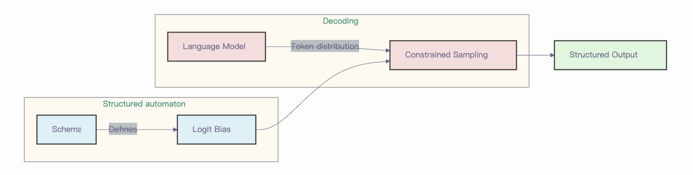

# Structured Output Guide

## Overview

### What is structured output?

LLMs can be unpredictable when you need output in specific formats. Think of asking a model to generate JSON without guidance: it might produce valid text that breaks the JSON specification. **Structured Output (also known as Guided Decoding)** enables LLMs to generate outputs that follow a desired structure while preserving the non-deterministic nature of the system.

In simple terms, structured decoding gives LLMs a "template" to follow. Users provide a schema that "influences" the model output, ensuring compliance with the desired structure.

Diagram of a schema constraining model output to the desired structure.

## Usage in vLLM-Ascend

Currently, the usage of structured output feature in vLLM-Ascend is totally the same as that in vLLM.

Find more examples and explanations about these usages in [vLLM official document](https://docs.vllm.ai/en/stable/features/structured_outputs/).
