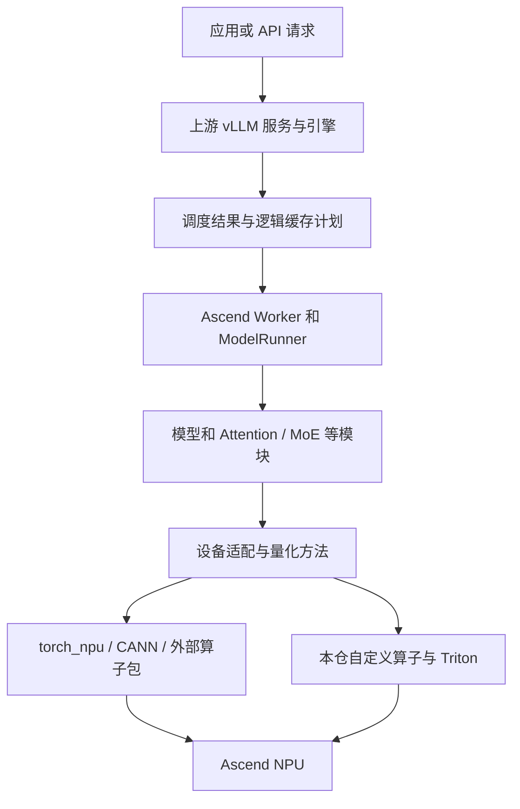
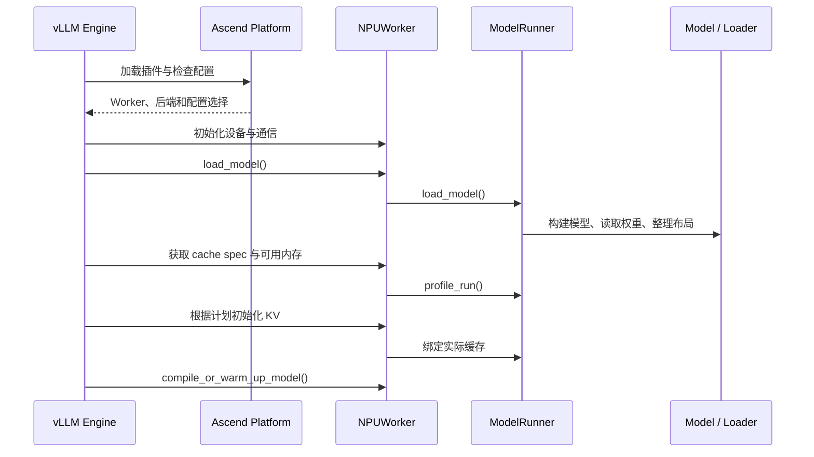
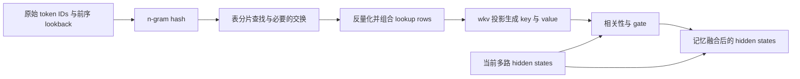
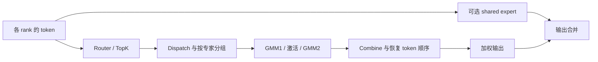
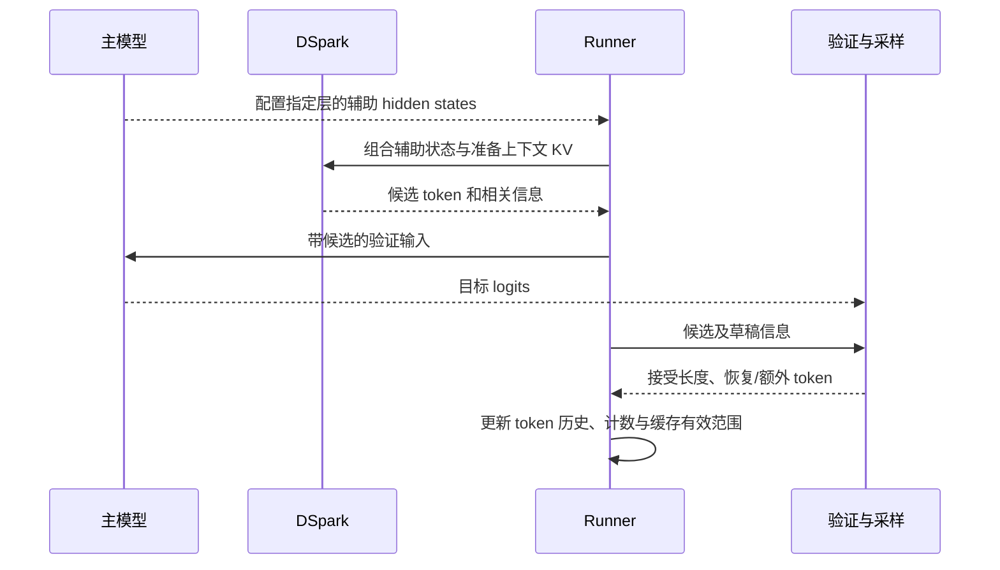
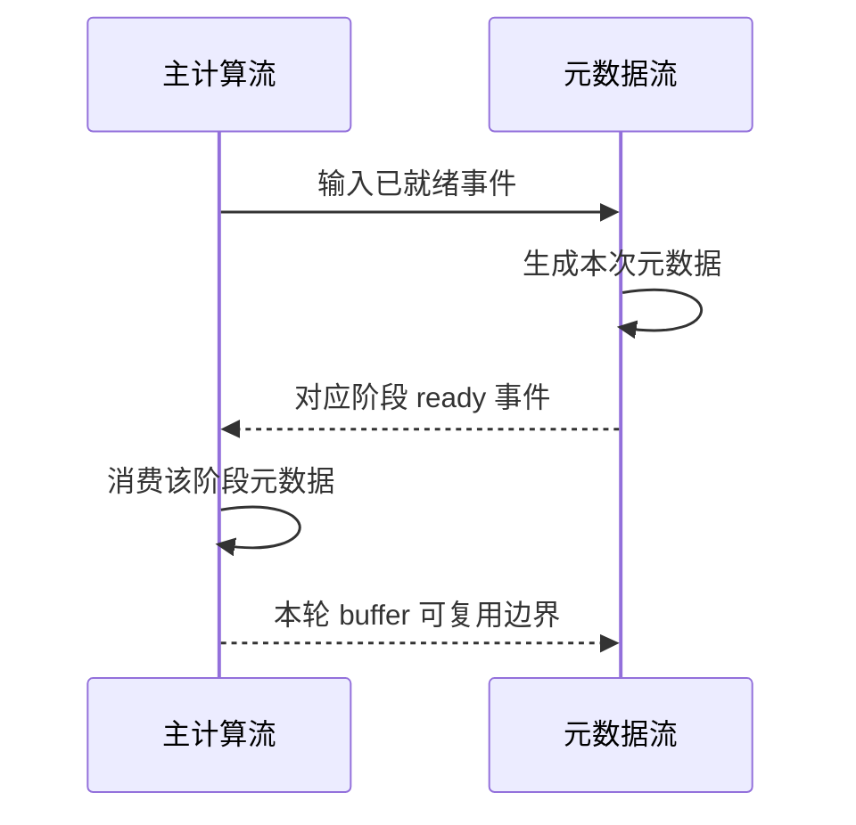

# vLLM Ascend 详细设计：从基础原理到代码实现

阅读导航：

- [1. 文档目标、版本与阅读方式](#1-文档目标版本与阅读方式)
- [2. 零基础需要先理解什么](#2-零基础需要先理解什么)
- [3. 仓库边界与总体架构](#3-仓库边界与总体架构)
- [4. 系统启动与运行时对象](#4-系统启动与运行时对象)
- [5. 权重准备：从文件到 NPU 可执行参数](#5-权重准备从文件到-npu-可执行参数)
- [6. 输入准备、Tokenizer 与组批](#6-输入准备tokenizer-与组批)
- [7. Attention 基础：后续模块共同依赖的原理](#7-attention-基础后续模块共同依赖的原理)
- [8. ViT：图像如何进入语言模型](#8-vit图像如何进入语言模型)
- [9. Compressor：怎样减少长程历史的表示数量](#9-compressor怎样减少长程历史的表示数量)
- [10. Indexer：从长程表示中选出相关位置](#10-indexer从长程表示中选出相关位置)
- [11. SFA：真正计算选中历史的注意力](#11-sfa真正计算选中历史的注意力)
- [12. Engram：怎样使用学习到的 token 历史记忆](#12-engram怎样使用学习到的-token-历史记忆)
- [13. mHC：为什么一层内有多路残差流](#13-mhc为什么一层内有多路残差流)
- [14. MoE：一个 token 为什么只计算部分专家](#14-moe一个-token-为什么只计算部分专家)
- [15. KV 管理：历史计算结果怎样保存与定位](#15-kv-管理历史计算结果怎样保存与定位)
- [16. DSpark：一次提出多个 token 为什么可能更快](#16-dspark一次提出多个-token-为什么可能更快)
- [17. 分布式并行：多张卡怎样一起工作](#17-分布式并行多张卡怎样一起工作)
- [18. 异步流、事件与图执行](#18-异步流事件与图执行)
- [19. Logits、采样与输出](#19-logits采样与输出)
- [20. 一次完整请求如何经过这些模块](#20-一次完整请求如何经过这些模块)
- [21. 配置边界、回退和扩展方法](#21-配置边界回退和扩展方法)
- [22. 怎样验证设计和定位问题](#22-怎样验证设计和定位问题)
- [23. 建议的学习路线与自查问题](#23-建议的学习路线与自查问题)
- [24. 术语速查](#24-术语速查)
- [25. 本目录的文档关系](#25-本目录的文档关系)

## 1. 文档目标、版本与阅读方式

本文面向尚未接触大模型推理、vLLM 或 Ascend 开发的读者。阅读目标是：理解一次请求为什么需要这些模块，知道数据在模块之间怎样变化，并能沿着代码找到实现。

本次分析依据本地分支 `integrate/dsnext-megamoe-vllm-cann`，提交 `203fbd7d43268cbca4ecb6b2a8a8aa4f43e57839`，日期为 2026-10-15。基线为 `rfc/vllm_cann` 的 `0040652a66d31a2b277588ac90d7d37e92757bc5`。版本参考文件为 [vllm-release-tag.commit](../../.github/vllm-release-tag.commit) 和 [vllm-main-verified.commit](../../.github/vllm-main-verified.commit)。

本文描述这个提交中的设计。结论来自源码静态分析，没有在本文编写过程中启动模型或验证 NPU 性能。代码中存在某条路径，表示它具有实现入口；实际可用性仍取决于模型、硬件、CANN/算子包、上游 vLLM 版本和配置组合。

为了便于学习，文中的内容分为三类：

| 内容类型 | 阅读方法 |
| --- | --- |
| 基础原理 | 理解通用概念，例如注意力公式、分页和量化 |
| 教学示例或伪代码 | 用较小数字解释过程；不是默认模型参数或可直接替换源码的实现 |
| 当前源码实现 | 对应文件、类和方法，保留当前分支的布局、异步及硬件约束 |

建议先阅读第 2～5 章，再按“输入 → 模型层 → 输出”的顺序阅读各计算模块。首次阅读可以跳过具体 packed-cache 字节布局和图更新接口，理解完整流程后再回看。

简版地图见 [代码仓介绍与模块划分](repository-module-overview.md)。本文在其基础上补充原理、数据结构、时序、约束和维护方法。

### 1.1 DeepWiki 的使用方式与本次修订

本次先阅读 [README 链接的 DeepWiki](https://deepwiki.com/vllm-project/vllm-ascend)，再按当前源码补齐系统设计。阅读主题和版本差异见 [DeepWiki 阅读记录](deepwiki-reading-notes.md)。

本文采用“框架执行 → 模型计算 → 状态与部署 → 设备实现”的结构。DeepWiki 帮助识别问题与入口；当前接口、模型投影、缓存布局和配置限制由本地源码核对。尤其是 DeepSeek V4.1、Engram、DSpark、KVPP 和本地 MegaMoE 适配，不能直接从其他快照的通用章节推断。

查文件时使用 [目录导读](code-directory-guide.md)，理解为什么需要某个对象时回到本文对应章节。

## 2. 零基础需要先理解什么

### 2.1 推理是在反复预测下一个 token

语言模型不会一次性从程序中取出整段答案。以文本生成路径为例，它把已有上下文变成数字表示，计算下一个 token 的分数，选出一个 token，再把它加入上下文继续计算。

“token”是 tokenizer 使用的文本片段，可以是一个字、一段词、标点或其他编码单元。一个 token 不一定等于一个汉字或一个英文单词。

```text
文本 → token IDs → 数值向量 → 多层模型计算 → 词表分数 → 选中 token
                                 ↑                         │
                                 └──── 进入下一步生成 ──────┘
```

token ID 是词表中的编号，没有“编号越大含义越强”的意义。模型先用 embedding 表查出对应向量，后续层逐步更新向量，最后的 LM Head 把向量变成词表分数。

训练负责学习参数；推理主要读取这些参数并处理输入。推理过程会生成 KV Cache 等运行状态，但通常不通过反向传播更新模型权重。

### 2.2 张量、shape、dtype 与 device

张量可以先理解成带有维度信息的数值数组。读代码时，先确认四件事：存什么、shape 是什么、数值格式是什么、存在哪里。

| 符号/属性 | 本文含义 | 教学示例 |
| --- | --- | --- |
| `T` | 当前推理步实际参与计算的 token 数 | 两个请求各处理 3、2 个 token，`T=5` |
| `H` | 一个 token 的 hidden 向量宽度 | `H=8` 表示每个 token 用 8 个数表示 |
| `L` | 历史上下文长度或模型层数，按章节说明 | 注意力章节用作上下文长度 |
| `Nq`、`Nkv` | 查询头数、KV 头数 | 多头注意力的不同表示子空间 |
| `D` | 一个 attention head 的宽度 | `[T, Nq, D]` |
| `R` | mHC 残差流数，即 `hc_mult` | `[T, R, H]` |
| `dtype` | 数值编码格式 | FP32、BF16、INT8、打包 FP4 |
| `device` | 张量所在位置 | CPU 内存或 NPU 设备内存 |

例如 `[5, 8]` 是 5 个 token，每个 8 维；`[5, 4, 8]` 则多出 4 路表示。`view`、`reshape`、`unflatten` 经常改变维度解释；`transpose`、`permute` 改变维度顺序。shape 相同不保证内存 stride、数值含义或缓存坐标相同。

NPU 的高带宽设备内存常称为 HBM。CPU 与 NPU 之间复制张量需要传输时间。`tensor.item()` 对设备张量取值会要求主机等待设备结果；设备张量参与 Python 条件判断也可能产生同步。因此，循环中“只取一个数”有时比一段设备计算更影响延迟。

### 2.3 Linear、Norm、激活和残差

**Linear 层**做线性投影。教学写法为 `Y = XW + b`。若 `X` 是 `[T,H]`，`W` 是 `[H,F]`，输出就是 `[T,F]`。PyTorch 的 `nn.Linear` 保存的权重通常是 `[F,H]`，执行时相当于乘其转置；阅读源码要区分数学记法与权重存储方式。

**RMSNorm**调整一个向量的数值尺度。简化公式为：

```text
rms(x) = sqrt(mean(x²) + eps)
RMSNorm(x) = x / rms(x) * learned_weight
```

`eps` 防止除零。归一化帮助保持深层网络的数值尺度；它不会把所有 token 变成相同内容。

**激活函数**提供非线性。只有 Linear 连续叠加仍可合并成一个 Linear；加入 SiLU、GELU 等非线性后，网络才能表达更复杂的变换。

**残差连接**保留原始状态，典型写法是 `y = x + F(x)`。它使某个子层可以在原表示上增加信息。本文后面的 mHC 会将单路残差推广成多路混合。

### 2.4 Prefill 与 Decode

| 阶段 | 工作内容 | 典型输入特点 |
| --- | --- | --- |
| Prefill | 处理初始上下文，建立后续生成需要的状态 | 一个请求一次可能处理很多 token，也可能分块处理 |
| Decode | 基于历史上下文继续生成 | 普通自回归常每请求一步处理一个 token；投机解码验证可能处理多个 |

例如输入 100 个 token 后生成 20 个 token，首先处理输入，再逐步推进生成。模型每一步需要历史信息，但不必每次重新计算所有历史 token 的 K/V，这就是 KV Cache 的价值。

不同请求可以处于不同阶段，并在同一个批次中执行。不能仅因为 `T` 较大就认定全部是 Prefill，也不能把一个批次等同于一个请求。

## 3. 仓库边界与总体架构

### 3.1 vLLM 与 vLLM Ascend 分别负责什么

vLLM 可以理解为推理服务引擎：接收请求、组织批次、分配逻辑缓存、执行模型、处理采样结果并推进请求。vLLM Ascend 通过插件接口把这些能力接到 NPU 上，并提供必要的模型和硬件实现。



| 层次 | 设计职责 | 入口 |
| --- | --- | --- |
| 插件 | 向上游声明平台、模型、加载器和连接器 | [setup.py](../../setup.py)、[__init__.py](../../vllm_ascend/__init__.py) |
| 平台 | 选择后端、修正配置、验证组合、指定 Worker | [platform.py](../../vllm_ascend/platform.py)，`NPUPlatform` |
| 执行 | 设备生命周期、组批、前向、缓存及采样衔接 | [worker](../../vllm_ascend/worker/) |
| 模型 | 模型层结构、模型专有逻辑、checkpoint 映射 | [models](../../vllm_ascend/models/) |
| Attention | 后端选择、元数据和注意力实现 | [attention](../../vllm_ascend/attention/) |
| 通信 | 各并行组、KV/权重传输 | [distributed](../../vllm_ascend/distributed/) |
| 算子 | Python 封装、Triton、自定义 C++/Ascend C | [ops](../../vllm_ascend/ops/)、[csrc](../../csrc/) |

### 3.2 注册、继承和补丁

**注册**让上游根据一个名字找到实现。例如 [模型注册表](../../vllm_ascend/models/__init__.py) 把 `DeepseekV41ForCausalLM` 映射到本仓的多模态包装类。配置中的 architecture 名称影响实际加载哪个类。

**继承**让本仓复用上游行为，再补充 NPU 差异。例如 [V2 NPUModelRunner](../../vllm_ascend/worker/v2/model_runner.py) 继承上游 `GPUModelRunner`。上游类名中有 GPU，不意味着运行时仍然使用 GPU；设备行为由平台、实现和适配决定。

**补丁**在既有组件缺少扩展点时修改其行为。全局补丁和 Worker 补丁分别位于 [patch/platform](../../vllm_ascend/patch/platform/) 和 [patch/worker](../../vllm_ascend/patch/worker/)。`_ensure_global_patch()` 使用进程内标志避免重复安装，同时考虑 EngineCore 子进程不会执行测试入口这一事实。

这也解释了版本升级的难点：本仓即使没有语法错误，上游函数签名、配置字段或状态生命周期变化，也可能使继承和补丁不再满足原约定。

### 3.3 通用能力与模型专有能力

Worker、量化、采样、分布式及一般 KV 管理是框架能力。ViT 只对多模态路径有意义；Engram、mHC 和特定 Compressor 拓扑依赖模型。当前仓库还注册了 Gemma、Kimi、Qwen、GLM、MiniMax 等实现，所以不能把整仓等同于 DeepSeek。

本文用 DeepSeek V4.1 串起用户关心的全部模块。V4 与 V4.1 各自具有模型文件和缓存路径，即使模块同名，也应分别核对实现。

### 3.4 注册的时机也属于设计

“插件已安装”与“本进程已完成适配”是不同的初始化条件。一个服务可能包含 API、EngineCore、Worker 等多个进程；子进程需要执行自身所需的初始化。

| 阶段 | 当前入口 | 解决的问题 |
| --- | --- | --- |
| 安装时声明 | `setup.py` 的 `vllm.platform_plugins`、`vllm.general_plugins` | 告诉上游到哪里寻找平台、模型、连接器等注册函数 |
| 平台发现 | `vllm_ascend.register()` 返回平台类路径 | 让上游构造 NPU 平台 |
| 全局适配 | `_ensure_global_patch()`；平台的 `pre_register_and_update()` | 确保相应进程完成平台补丁、配置接口及解析器适配 |
| Worker 适配 | `utils.adapt_patch(is_global_patch=False)` | 导入 Worker 补丁并处理依赖顺序 |
| 层实现注册 | `utils.register_ascend_customop()` | 将上游逻辑层名称映射到 Ascend 实现 |

对应 [包初始化](../../vllm_ascend/__init__.py)、[平台](../../vllm_ascend/platform.py) 与 [工具函数](../../vllm_ascend/utils.py)。`register_model()` 有自己的模型注册路径，不能笼统地认为所有 general-plugin hook 都做相同初始化。补丁导入还要避免循环依赖，例如依赖完整 Runner 类的包装需要等该类定义完成。

## 4. 系统启动与运行时对象

### 4.1 启动时序



这是启动的逻辑关系图，具体调用顺序和初始化细节还受上游引擎版本影响。入口见 [NPUWorker](../../vllm_ascend/worker/worker.py) 的 `init_device`、`load_model`、`determine_available_memory`、`initialize_from_config` 和 `compile_or_warm_up_model`。

### 4.2 核心对象与生命周期

| 对象 | 作用 | 大致生命周期 |
| --- | --- | --- |
| `VllmConfig` | 描述模型、并行、缓存、调度和投机等配置 | 引擎初始化及必要的受控更新 |
| `AscendConfig` | Ascend 扩展配置 | Worker/平台配置阶段及运行期读取 |
| `HardwareProfile` | 当前设备能力与策略 | 设备识别后供各模块查询 |
| `NPUWorker` | 管理设备与 Worker 级资源 | Worker 进程 |
| `NPUModelRunner` | 管理输入、模型调用、缓存绑定与输出衔接 | Worker 进程 |
| 输入批次与请求状态 | 当前活跃请求、token 历史及请求坐标 | 请求加入、推进、移除期间 |
| Attention metadata | 当前执行的长度、映射、索引和算子参数 | 当前 forward，部分底层 buffer 持久复用 |
| 模型参数与量化 scale | 学习到的参数及表示信息 | 模型加载至卸载/更新 |
| KV pages | 特定请求已计算的注意力状态 | block 分配至回收/迁移 |

配置入口是 [ascend_config.py](../../vllm_ascend/ascend_config.py) 和 [envs.py](../../vllm_ascend/envs.py)。硬件能力入口是 [hardware_profile.py](../../vllm_ascend/device/hardware_profile.py)。配置描述想执行什么；硬件能力、模型结构和验证函数共同决定这个组合能否执行。

### 4.3 设备内存预算

不能将“设备总内存减去权重”全部分配给 KV。还需要激活峰值、通信 buffer、算子 workspace、图执行资源和其他设备分配。

教学预算式为：

```text
KV 可用预算 ≈ 允许使用的设备内存
             - 模型权重
             - 激活峰值增量
             - 其他设备内存增量
             - 需要额外计入的保留资源
```

[determine_available_memory](../../vllm_ascend/worker/worker.py) 执行 profile，区分 torch 峰值、非 torch 增量和权重占用，还处理多缓存组、Offload 与 KVPP 的预算转换。显式指定 `kv_cache_memory_bytes` 会走独立分支；代码仍会执行必要的 profile/编译准备。

V4.1 Compressor 的持久输出 buffer 在内存分析前分配，就是为了避免“预算计算后又永久增加一块内存”。预算中的逻辑容量与实际每 rank 的物理分配还可能因共享、padding 或 KVPP 不同。

### 4.4 Worker、V1 Runner 与 V2 Runner 的分工

Worker 可以理解为管理一张设备上工作资源的负责人；Runner 负责把本轮调度结果组织成一次具体执行。两者都长期存在，但处理的对象层级不同。

| 组件 | 当前代码 | 负责什么 | 阅读时关注 |
| --- | --- | --- | --- |
| Worker | [worker.py](../../vllm_ascend/worker/worker.py) | 初始化设备/通信、加载、内存预算、缓存初始化、预热与执行入口 | 启动阶段与资源生命周期 |
| V1 Runner | [model_runner_v1.py](../../vllm_ascend/worker/model_runner_v1.py) | 在继承上游 Runner 的基础上保留较多输入、执行和图相关实现 | 请求状态、prepare inputs、上下文和模型调用 |
| V2 Runner | [v2/model_runner.py](../../vllm_ascend/worker/v2/model_runner.py) | 复用上游 V2 框架，并用 NPU model-state、图管理和缓存逻辑接入 | `super()` 调用前后、model-state 与异常收尾 |
| V2 模型状态 | [v2/model_states](../../vllm_ascend/worker/v2/model_states/) | 管理当前模型输入、Attention 元数据及执行结束处理 | 默认状态与 Engram 等专用状态差异 |

V1、V2 的 `NPUModelRunner` 都继承名为 `GPUModelRunner` 的上游类，导入来源和复用范围不同。阅读 V2 时必须沿继承关系继续看上游；仅看到本地短方法不能代表执行缺失。当前 V2 的执行包装会在上游执行可能复用缓存页之前处理抢占，并通过 `finally` 结束本轮异步状态。

本地 [V2 README](../../vllm_ascend/worker/v2/README.md) 仍包含实验性描述与开发清单，清单状态不能单独用来判断某项功能是否已经在当前代码实现。

### 4.5 配置从用户输入走到执行选择

```text
命令行 / 配置文件
  → 上游 VllmConfig 与 Ascend 扩展配置
  → 平台修正、能力检查和组合验证
  → Worker / Runner / 模型构建
  → 每轮 Forward Context 选择本次执行路径
```

[envs.py](../../vllm_ascend/envs.py) 管理环境开关，[ascend_config.py](../../vllm_ascend/ascend_config.py) 管理 Ascend 配置，[platform.py](../../vllm_ascend/platform.py) 负责多项组合验证，[hardware_profile.py](../../vllm_ascend/device/hardware_profile.py) 描述硬件能力和策略。

例如开启 MoE 融合只是一个意图，还必须检查 EP、量化、硬件能力、LoRA、专家形状和可用算子。模型的固定配置与本轮实际 token 数也不同：前者在初始化时验证，后者参与运行时通信选择。

## 5. 权重准备：从文件到 NPU 可执行参数

### 5.1 模型文件中保存的是什么

checkpoint 保存 embedding、Linear、Norm、专家等参数。有量化时，还保存 scale、分组信息等。模型配置描述层数、维度、专家数和其他结构。必须先据配置建立正确结构，再把文件中的张量放到对应参数上。

加载的完整链路可以分成：识别模型 → 实例化层 → 分配参数 → 名称映射 → 分片加载 → 格式后处理 → 校验和执行准备。

### 5.2 为什么需要名称映射和分片

教学示例：checkpoint 分别存 `gate_proj` 和 `up_proj`，本地融合实现用一个 `gate_up_proj`。加载器需要把两个参数按约定拼到同一张量的对应区域。拼接顺序反了，即使 shape 相同也会算错。

如果一个 `[H,F]` 权重按输出维度切给两个 TP rank，每个 rank 可能只保存 `[H,F/2]`。EP 则将不同专家放到不同 rank。两种切分的语义不同：TP 切同一计算，EP 分配不同专家。

### 5.3 量化原理

以对称 INT8 量化为教学例子：

```text
q = clamp(round(x / scale), -127, 127)
x_approx = q * scale
```

较低精度减少存储和传输量，但会引入近似误差。scale 可以对应整个张量、每通道或每个小组；W4A8 的 W/A 分别指权重/激活的位宽类别。MXFP 等格式还有自己的分组和 scale 编码规则，不能按上面的 INT8 公式解释全部细节。

教学数字：同样一百万个值，BF16 的纯数值部分约占两百万字节，INT8 约占一百万字节。但实际占用还包括 scale、padding、布局和其他元数据，不能简单用位宽比预测整个模型的内存。

### 5.4 内存布局与数值格式是两个问题

转置、ND/NZ、打包和分片决定“值在内存哪里”；量化决定“这些位表示什么数”。两个张量即使都叫 W4A8，也可能因为分组、scale、融合顺序或 kernel ABI 不同而不能互换。

| 原理/阶段 | 当前代码对应 |
| --- | --- |
| Worker 与 Runner 加载模型 | [worker.py](../../vllm_ascend/worker/worker.py)、[model_runner_v1.py](../../vllm_ascend/worker/model_runner_v1.py)、[V2 Runner](../../vllm_ascend/worker/v2/model_runner.py) 的 `load_model` |
| 模型参数映射 | [V4.1 model.py](../../vllm_ascend/models/deepseek_v41/model.py) 与 [vl_model.py](../../vllm_ascend/models/deepseek_v41/vl_model.py) 的 `load_weights` 等路径 |
| 选择量化配置 | [configs](../../vllm_ascend/quantization/configs/)、[quant_parser.py](../../vllm_ascend/quantization/quant_parser.py) |
| 上游层到 Ascend 方法的适配 | [method_adapters.py](../../vllm_ascend/quantization/method_adapters.py) |
| 各种格式的实现接口 | [methods/base.py](../../vllm_ascend/quantization/methods/base.py)，`AscendLinearScheme`、`AscendMoEScheme` |
| 格式与层类型的注册 | [methods/registry.py](../../vllm_ascend/quantization/methods/registry.py)，`register_scheme`、`get_scheme_class` |
| 网络和 RFork 可选加载 | [netloader](../../vllm_ascend/model_loader/netloader/)、[rfork](../../vllm_ascend/model_loader/rfork/) |

阅读量化方法时，建议依次找参数创建接口、`process_weights_after_loading` 和 `apply`/GMM 接口，分别确认“分配什么”“怎么变换”“怎么使用”。不要只读 `apply` 就推断磁盘上保存的布局。

### 5.6 量化如何接到模型层上

量化涉及四个相互配合的步骤：识别 checkpoint 格式，创建参数及 scale，加载后整理布局，执行兼容的算子。仅把权重转成整数 dtype 不能完成这些步骤。

| 步骤 | 当前代码入口 | 需要保持一致的约定 |
| --- | --- | --- |
| 识别配置 | [configs](../../vllm_ascend/quantization/configs/)、[quant_parser.py](../../vllm_ascend/quantization/quant_parser.py) | 哪些层量化、使用什么格式与参数名 |
| 接上游层接口 | [method_adapters.py](../../vllm_ascend/quantization/method_adapters.py) | `create_weights`、`process_weights_after_loading`、`apply` 的调用约定 |
| 选择具体方案 | [methods/registry.py](../../vllm_ascend/quantization/methods/registry.py)、[methods/base.py](../../vllm_ascend/quantization/methods/base.py) | 量化类型与 Linear、MoE、Attention 等层类型匹配 |
| 执行格式特定逻辑 | 例如 [w4a8_mxfp4.py](../../vllm_ascend/quantization/methods/w4a8/w4a8_mxfp4.py) | packed weight、scale 分组、激活表示及算子 ABI |

W4A8 表示权重和激活使用不同的位宽，但具体存储和缩放还要看实现。MX 格式的 scale 也不能当作任意 FP32 scale 直接替换。TP 分片可能切过量化分组，因此本地 adapter 还处理 scale 的全局分组相位，防止每个 rank 机械等分后读错 scale。

权重量化、激活量化和 KV 量化作用于不同对象；一种权重量化可用不意味着所有 KV 布局和 MoE 融合都可用。

## 6. 输入准备、Tokenizer 与组批

### 6.1 Tokenizer 与 embedding 不同

Tokenizer 根据词表和分词规则把文本变成整数序列；embedding 根据这些整数查模型参数表，得到浮点向量。

```text
原始文本 --Tokenizer--> [整数 ID] --Embedding--> [T,H] hidden states
```

chat template 还会加入角色、边界等标记。此过程通常由上游 vLLM 组织。本仓的 [lopt_tokenizer.py](../../vllm_ascend/tokenization/lopt_tokenizer.py) 提供可选长文本并行编码，[patch_lopt_tokenization.py](../../vllm_ascend/patch/platform/patch_lopt_tokenization.py) 负责接入。

### 6.2 为什么并行分词需要重叠区

若直接把字符串任意切两段分别编码，切点附近可能丢失原本应合并的词片段。LoPT 使用片段重叠、边界匹配与结果合并来处理这种问题，并保留回退路径。其代价还包括线程组织和合并，所以不能从“有并行”直接推导短文本也更快。

### 6.3 连续批处理与展平张量

推理引擎同时服务多个请求。某一步可以只取各请求本次需要处理的 token，把它们拼成一个展平数组，减少补齐到统一长度的浪费。

教学示例：请求 A 当前处理 3 个 token，请求 B 当前处理 2 个 token。

```text
input_ids:        [A0, A1, A2, B0, B1]
query_start_loc:  [0, 3, 5]
当前 token 数 T:  5
```

`query_start_loc[i+1] - query_start_loc[i]` 是本次请求 i 的查询长度。若 A 已计算 10 个 token，A 当前的位置可能是 `[10,11,12]`，因此 `positions` 与展平数组下标不是一个概念。

`seq_lens` 则描述当前注意力可见的序列长度，通常包含已计算历史和本次相应 token。KV 映射还会决定这些历史位于哪个物理页。

### 6.4 Padding、有效长度与原始 token

为了图执行或通信对齐，实际分配容量可能大于有效 token 数。例如容量为 8，但本次只有 5 个真实 token。padding 部分可以参与某些固定形状准备工作，却不能作为真实请求更新历史、路由或缓存状态。

多模态还需要区分原始占位 token 与已经合入图像 embedding 的输入。Engram 的历史和视觉专家路由可能需要原始 token IDs，因此不能在 embedding 替换后随意丢弃它们。

| 概念 | 当前代码对应 |
| --- | --- |
| V1 输入准备 | [model_runner_v1.py](../../vllm_ascend/worker/model_runner_v1.py)，`_prepare_inputs`、`_prepare_multimodal_fields` |
| V2 输入准备 | [V2 model_runner.py](../../vllm_ascend/worker/v2/model_runner.py)，`prepare_inputs`；[input_batch.py](../../vllm_ascend/worker/v2/input_batch.py) |
| 缓存位置映射 | [block_table.py](../../vllm_ascend/worker/block_table.py) |
| 模型状态与请求历史 | [model_states/default.py](../../vllm_ascend/worker/v2/model_states/default.py)，`AscendModelState` |
| Compressor/Indexer/Attention 元数据 | [device_metadata.py](../../vllm_ascend/worker/device_metadata.py) |

### 6.4 Forward Context：把本轮状态带进模型深处

调度器决定哪些请求本轮执行，Runner 准备输入，深层 Attention 和 MoE 还需要知道本轮是否处于图捕获、真实 token 有多少、使用哪种通信方式。把这些参数逐层加到所有 `forward()` 签名会增加耦合，因此框架提供当前 forward 的上下文入口。

上下文用于当前调用范围内访问执行信息；它不是请求历史的永久存储，也不拥有模型权重或 KV 内容。Attention metadata、图执行描述及 Ascend 扩展字段可以从这个入口取得。

| 内容 | 例子 | 不应混淆的对象 |
| --- | --- | --- |
| 本轮长度与模式 | `num_tokens`、padding、capture/profile、draft 标记 | 模型最大长度和静态配置 |
| Attention 元数据 | `query_start_loc`、`seq_lens`、block table、slot mapping | 缓存中真正存放的 K/V 数值 |
| MoE 执行选择 | `moe_comm_type`、`moe_comm_method`、`use_mega_moe` | checkpoint 中的专家参数 |
| 设备任务衔接 | metadata executor 等引用 | 持久请求状态和已经完成的结果 |

当前入口是 [ascend_forward_context.py](../../vllm_ascend/ascend_forward_context.py)。V1 的 `set_ascend_forward_context()` 包装上游上下文并设置扩展字段；V2 通过平台 [set_additional_forward_context](../../vllm_ascend/platform.py) 接入额外字段。`_ExtraForwardContextProxy` 将 V1 对象属性和 V2 `additional_kwargs` 两种存放方式统一起来；不属于代理白名单的字段仍应按上游接口访问。

本地还在 V1 context 范围发布当前 `VllmConfig`，支持某些层在 eager 执行中首次构建时取得配置。作用域退出需要恢复状态，不能把上一轮配置或 target/draft 标记遗留给下一次调用。

### 6.5 用两个请求理解元数据转换

假设本轮请求 A 新计算 2 个 token、请求 B 新计算 1 个 token；它们已有的历史不同。这是教学数字，不是某个模型的固定批次。

```text
展平输入：[A 的第 1 个新 token，A 的第 2 个新 token，B 的新 token]
query_start_loc：[0，2，3]          ← 各请求在本轮输入中的边界
seq_lens：[6，10]                 ← 本轮完成后各请求的逻辑长度
positions：[4，5，9]              ← 各新 token 在所属请求中的位置
slot_mapping：由位置与各自 block table 转换得到的物理写入槽位
```

`query_start_loc` 沿当前批次的 token 维度计数，`seq_lens` 沿各请求的上下文计数。它们不是同一种长度。Attention Builder 会继续把这些通用坐标转成后端需要的形式；压缩存储还需要把原始 token 位置映射到压缩单元，不能用压缩长度覆盖原始序列长度。

沿 [V1 Runner](../../vllm_ascend/worker/model_runner_v1.py) 或 [V2 model state](../../vllm_ascend/worker/v2/model_states/) 追踪，再看 [V4.1 MetadataBuilder](../../vllm_ascend/attention/dsa_v41.py)。设备元数据的异步生产、等待和回收见第 18 章。

## 7. Attention 基础：后续模块共同依赖的原理

### 7.1 Q、K、V 各表示什么

可以把 Q 理解成当前 token 要查找什么，K 是历史 token 供匹配的表示，V 是匹配后要聚合的内容。它们由 hidden states 经过不同的投影得到。

单头的教学公式为：

```text
Q = X Wq，K = X Wk，V = X Wv
scores = Q Kᵀ / sqrt(D) + mask
weights = softmax(scores)
output = weights V
```

`D` 是头宽度；softmax 把一组分数变成和为 1 的权重。`mask` 禁止某些位置参与：文本自回归通常屏蔽未来 token，ViT 的图像内部则可使用双向注意力。

教学示例：当前 token 对三个历史位置的权重是 `[0.1,0.7,0.2]`，输出就是三份 V 按该比例的加权和。得到的是向量，后面仍需多层计算和 LM Head 才会得到 token。

### 7.2 多头、位置编码与 MLA

多头让不同子空间分别计算关联，再组合结果。RoPE 根据 token 位置对 Q/K 的某些分量做旋转，使匹配分数携带相对位置信息。图像需要二维网格位置信息，不能只按文本的一维位置理解。

MLA 等设计使用较小的 latent 和特定投影组织 KV，以减少缓存成本。其实际 kernel 可能使用吸收后的权重或共享 latent，因此不能把源码中所有 cache 强行解释成独立的标准 K 和 V 两张量。

### 7.3 稠密、窗口和稀疏注意力

| 方式 | 读取哪些历史位置 | 主要目的 |
| --- | --- | --- |
| 稠密注意力 | 所有允许的历史位置 | 完整历史交互 |
| 滑动窗口 SWA | 当前位置附近一段范围 | 限制单次访问量 |
| 稀疏注意力 | 选择的一部分历史位置，可能结合局部窗口 | 保留长程访问能力并控制开销 |

标准全序列稠密 Attention 的配对数量随长度近似按平方增长。Decode 时单个新查询对历史的访问则随历史长度增长。实际时间还受内存访问、kernel 实现和并行影响，这两个阶段不能用同一个复杂度数字代替。

当前 V4.1 的 Compressor、Indexer 和 SFA 是一条配合工作的链：前者产生长程表示，Indexer 找相关位置，SFA 完成最终的注意力计算。

### 7.4 结合当前 DeepSeek V4.1 理解 MLA

MLA 是 Multi-head Latent Attention，即多头潜在注意力。可以先抓住两点：查询仍有多个头，历史主要保存共享的 latent 表示。latent 是模型学习出的中间向量，“潜在”不表示不可查看，只表示它没有预先指定的人类语义。

在一般 MLA 原理中，可以用较小的向量 `c_j` 表示历史 token j，再通过投影表达各头的 K/V。某些线性投影还可以合并到查询或输出计算中，因此执行时不必先将全部历史恢复成完整的多头 K/V。这个向量是模型学习的表示，不保证能无损恢复任意原始信息。

**当前仓库的 V4.1 应直接按它的共享 latent 路径理解，不能把其他版本的 K/V 升投影步骤逐个套进来。** [init_attention_projections](../../vllm_ascend/models/deepseek_v41/model.py) 创建多头查询投影和一个输出宽度为 `head_dim` 的共享 `wkv`。具体为：

```text
输入 hidden：[T,H]

查询支路：wq_a → q_norm → wq_b → 多个查询头 [T,Nq_local,D]
历史支路：wkv → kv_norm → 共享表示 [T,D] → 位置处理 → 缓存

注意力：各查询头读取可见历史表示 → 每头输出 [T,Nq_local,D]
输出支路：逆位置处理 → 分组 wo_a → wo_b → [T,H]
```

`Nq_local` 是当前设备执行的查询头数；普通 TP 路径下等于总查询头数除以 TP 大小，相关 CP 路径另有组织方式。图中的 `D` 是模型的 `head_dim`。`q_lora_rank/o_lora_rank` 在这里描述投影中间宽度，不能仅凭名字就认为是在运行 LoRA 微调适配器。

查询与共享缓存的 shape 在 [dsa_v41.py](../../vllm_ascend/attention/dsa_v41.py) 的 `_project_q/_project_kv` 中最直观。后者使用 `view(-1,1,head_dim)`，表示每个位置一份共享历史向量；多个查询头则使用不同 Q 计算不同的注意力权重。查询头数多，不意味着每个历史位置必须保存同样数量的独立 K/V。

教学例子：两个查询头读取三个历史 latent `c0/c1/c2`，可能分别得到关注权重 `[0.1,0.8,0.1]` 与 `[0.7,0.2,0.1]`。共享历史表示并没有让两个头得到相同输出，因为各头的查询不同。这个加权示例省略了位置变换、sink、mask 和实际算子布局。

当前实现还将通道分为 RoPE 与非 RoPE 部分；在注意力前处理位置，在输出后执行相应逆变换，再走输出投影。因此不能简单把共享 latent 当成未经变换的标准 V。见 `AscendDSAV41Impl.forward` 与 [dsa_v1.py 的 `_forward_o_proj`](../../vllm_ascend/attention/dsa_v1.py)。

V4.1 的其他模块继续减少历史开销，但分工不同：

| 机制 | 控制什么 | 当前实现中的体现 |
| --- | --- | --- |
| 共享 latent/MLA 路径 | 每个历史位置如何表示、各头如何读取 | `wkv` 和共享 cache，多头 Q |
| Compressor | 长程历史位置怎样合并 | ratio-1/ratio-2 与 ring pooling |
| Indexer | 当前查询挑选哪些长程位置 | 候选 block 和最终 TopK |
| SFA | 怎样执行选中位置的注意力 | 稀疏 MLA/packed-cache 算子 |
| KV 量化 | 每个表示用多少字节存储 | FP8/FP4 与相应 scale |

局部窗口缓存由当前层 `wkv` 支路生成；长程缓存则由源层 Compressor 生成，可以跨层共享。两条路径产生不同用途的历史表示，所以不能把 Compressor 直接等同于 MLA 的 `wkv` 投影。

当前 A5 packed-cache ABI 要求 latent head width 为 512；这是该算子布局的检查条件，不是所有 MLA 模型固定为 512。实际容量还要计算窗口、长程压缩比例、源层共享、Indexer、ring state 和量化 scale，不能仅用查询头数推算整个缓存占用。

### 7.5 Backend、MetadataBuilder 与 Impl 分别是什么

Attention 的数学公式没有规定系统应该怎样组批、分页和调用设备算子。本仓把这些工程职责放在不同对象中。

| 对象 | 可以怎样理解 | 职责 |
| --- | --- | --- |
| Backend | 后端的接口说明与工厂入口 | 向引擎提供实现类、元数据构建类、缓存形状等约定 |
| MetadataBuilder | 当前批次的参数准备器 | 把通用请求坐标转换成算子所需的长度、索引和工作参数 |
| Impl | 当前后端的计算组织者 | 投影/缓存操作衔接、选择设备路径、调用内核、整理输出 |
| Cache layer/spec | 向缓存系统登记状态需求的对象 | 描述哪些状态要分配、如何分组及绑定到层 |

在 [dsa_v41.py](../../vllm_ascend/attention/dsa_v41.py) 中可分别找到 `DeepseekV41CacheBackend`、`AscendDSAV41MetadataBuilder`、`AscendDSAV41Impl`、`DeepseekV41CacheLayer`。其中 cache backend 的实现类用于缓存接口，模型计算由自身持有的 DSA Impl 组织，不能机械理解为每个 Backend 都直接返回这个 DSA Impl。

对其他模型，入口可以是 [attention_v1.py](../../vllm_ascend/attention/attention_v1.py)、[mla_v1.py](../../vllm_ascend/attention/mla_v1.py) 或 [sfa_v1.py](../../vllm_ascend/attention/sfa_v1.py)。最终选择应沿 [NPUPlatform.get_attn_backend_cls](../../vllm_ascend/platform.py)、模型注册和模型自身创建后端的逻辑一起核对。

这解释了为什么更换一个 Attention kernel 时，元数据、cache spec 和图更新逻辑也可能需要同步修改：这些对象共同约定了输入怎样解释。

## 8. ViT：图像如何进入语言模型

### 8.1 Patch 化与二维位置

图像由像素组成，而 Transformer 处理序列。ViT 将图像划成 patch，每个 RGB patch 的原始值可展平为 `3×p×p` 个数，再投影到视觉 hidden 维度。

教学示例：`4×4` 像素图像按 `2×2` patch 切分，会得到 4 个 patch。真实模型的图像大小、切分和裁剪由预处理配置决定。

patch 有行列坐标，ViT 使用二维位置处理和图像内 Attention，使一个 patch 可以结合其他 patch 的内容。它和文本 Decoder 的因果注意力使用不同的可见关系。

### 8.2 Aligner 为什么需要空间合并

视觉 token 太多会增加语言模型的处理成本。V4.1 Aligner 先按配置将相邻视觉网格合并，再通过 MLP 投影到语言 hidden size。合并边缘不足的位置会按代码规则补齐。

```text
[P, 3p²] patch
  → PatchEmbed
[P, vision_dim]
  → ViT blocks
[P, vision_dim]
  → 空间合并 + Aligner MLP
[P', H]
  → 图像开始/结束/换行等表示
  → 与文本 embeddings 合并
```

`P` 是视觉 patch 数，`P'` 是对齐后视觉位置数，两者不必相同。

### 8.3 原理与代码对应

| 原理 | 当前入口 | 重点看什么 |
| --- | --- | --- |
| Patch 投影 | [vision.py](../../vllm_ascend/models/deepseek_v41/vision.py)，`DeepseekV41PatchEmbed` | 输入展平宽度和输出维度 |
| 二维位置与双向 Attention | 同文件的 `get_vision_cos_sin`、`DeepseekV41VisionAttention`、`DeepseekV41ViT` | 网格坐标、QKV 和 Attention 输入 |
| 空间合并与语言维度对齐 | 同文件的 `DeepseekV41Aligner.forward` | `view/permute/unfold` 和两层投影 |
| 图像序列构造 | [vl_model.py](../../vllm_ascend/models/deepseek_v41/vl_model.py)，`_encode_image`、`_build_image_span`、`embed_multimodal` | 网格、特殊图像表示、返回 embeddings |
| 视觉编码执行辅助 | [encoder_acl_graph.py](../../vllm_ascend/worker/encoder_acl_graph.py) | 图捕获和编码结果组织 |

当前 V4.1 的视觉塔在本地实现中采用复制路径，没有沿用文本骨干的 TP/DP 分片方式。图像预处理接口来自配套上游 `vllm.models.deepseek_v41.common.mm_preprocess`；本仓 V4 目录中的预处理文件不自动等于 V4.1 实际调用的文件。

常见检查点：patch 数与 grid 是否匹配、Aligner 输出宽度是否为 `H`、占位位置是否与视觉序列一致、图像 token 是否被 Engram/专家路由按正确规则处理。

## 9. Compressor：怎样减少长程历史的表示数量

### 9.1 为什么局部窗口之外还需要历史

只看最近窗口，可能错过很早出现的人名、约束或代码定义；保留所有原始历史又会增加存储与访问成本。Compressor 生成较少的长程表示，与局部窗口一起提供上下文。

这不是把 checkpoint 压成压缩包，也不是单纯把 BF16 改成 INT8。它是模型中的学习计算，会改变历史信息的表示方式和数量。缓存量化则是在这些表示上进一步改变数值格式，两者可以同时存在。

### 9.2 投影和加权池化

教学上，可以把每个 token 的 hidden 投影成内容 `u` 和评分 `s`，在一个压缩组内做加权汇总：

```text
u_i = Wkv x_i
s_i = Wgate x_i
a_i,d = exp(s_i,d) / Σ_j exp(s_j,d)
c_d = Σ_i a_i,d * u_i,d
输出 = RMSNorm(c)
```

`i` 是组内 token，`d` 是 latent 通道，`j` 遍历组内 token。这里评分可以按通道变化，不应简单理解成整个 token 共用一个标量权重。

教学示例：4 个 token、压缩比例 2，可以形成 2 份组表示。若每组两个 token 的某通道权重分别为 0.25 和 0.75，该通道就按此比例合成。实际完成时机、位置和槽位由元数据决定，不是直接对当前批次数组执行 `reshape` 后取平均。

### 9.3 为什么需要 ring state

如果一组需要 2 个 token，本次请求只到来第 1 个，下次才到第 2 个，模型必须保留未完成组的信息。循环状态让新步骤可以接着旧步骤计算，而不用重新处理全部历史。

读取旧状态和覆盖新状态存在依赖：若提前覆盖了当前计算还要读取的槽位，就会改变结果。因此，kernel 的读、池化和状态更新顺序属于正确性设计的一部分。

### 9.4 当前 V4.1 的内部设计

| 路径/状态 | 实现与含义 |
| --- | --- |
| ratio-1 | `wkv` 投影后归一化，不减少位置数量 |
| ratio-2 | FP32 `wkv/wgate` 投影，调用 ring pooling，再归一化 |
| `state_cache` | 保存跨步骤的循环状态，使用 circular-buffer 类型的 cache spec |
| `_ring_pooled` | 持久输出 buffer，在内存分析前分配 |
| `STATE_RING_ROWS` | 当前循环状态布局常量为 32；不是“压缩比例为 32” |

原理与代码对应：

- [DeepseekV41Compressor](../../vllm_ascend/models/deepseek_v41/compressor.py)：构建权重和状态，`forward` 处理直接投影，`pool_projected` 处理池化。
- [compressor_triton.py](../../vllm_ascend/ops/triton/compressor/compressor_triton.py)：投影、加权池化及 ring 处理的底层实现。
- [dsa_v41.py](../../vllm_ascend/attention/dsa_v41.py) 的 `_write_compressed_source`：组织压缩表示的生产、索引 K 更新和长程 KV 写入。

### 9.5 为什么先更新 Indexer K，再处理长程 KV

同一个 latent 被两条支路消费：Indexer 将其投影成用于评分的索引 K；长程注意力缓存还需要自己的位置处理和存储格式。当前代码先让 Indexer 读取所需 latent，再对长程 KV 执行后续处理，避免把已经变换的内容当成原始 latent。

层是否负责生产由 [build_layer_plan](../../vllm_ascend/models/deepseek_v41/model.py) 决定。源层生产一次，后续消费者复用；不能假设所有层都独立压缩和写入同一类缓存。

## 10. Indexer：从长程表示中选出相关位置

### 10.1 为什么还需要一个选择器

压缩后历史仍可能很长。Indexer 使用较小的查询和索引 K 估计相关性，只把少量位置交给最终注意力。这相当于先进行较便宜的筛选，再对选中位置进行更完整的计算。

教学例子：历史有 8 个长程表示，对当前查询的评分为 `[0.2,0.8,0.1,0.7,0.3,0.4,0.9,0.5]`。若取 TopK=3，按分数可能选中位置 `[6,1,3]`。实际输出还可能经过排序、因果限制、有效长度和压缩位置转换，不能把教学排序当成算子输出格式。

### 10.2 查询、head 权重与索引 K

当前实现从注意力的查询低秩表示 `qr` 产生索引查询，从 hidden states 产生索引 head 权重。索引 K 则由缓存源层从 Compressor latent 产生。

```text
当前 qr ──wq_b──→ 索引查询 ──位置处理/量化──┐
当前 hidden ──weights_proj──→ head 权重 ───┼→ 索引评分与 TopK
源 latent ──wk + Norm──→ 索引 K 缓存 ──────┘
```

可以用“各 head 的查询与历史索引 K 匹配，再按 head 权重汇总”理解评分意图。准确的激活、量化和 kernel 计算由当前 QLI 算子定义，不应直接拿标准 softmax Attention 公式替代 Indexer 的评分实现。

### 10.3 两级位置：候选 block 与最终 TopK

候选筛选先选 block，再在相应范围内做位置选择。例如候选 block size 为 4，block ID 为 2，教学上代表位置 8～11 所在的一组；它不等于“位置 2”。实际还需要结合压缩坐标和缓存布局解释。

当前 `select_projected` 明确约定候选为 block IDs，候选 buffer 形状为 `[T,1,candidate_topk_blocks]`。最终 TopK 与各自有效长度使用不同 buffer。空历史和空 token 路径会设置相应无效索引或长度，防止读取上一次执行遗留的内容。

### 10.4 原理与代码对应

| 原理 | [DeepseekV41Indexer](../../vllm_ascend/models/deepseek_v41/indexer.py) 中的入口 |
| --- | --- |
| 从 latent 生成索引 K | `update_keys`：`wk`、Norm、部分 RoPE、量化和 scatter |
| 生成查询 | `project_query`、`apply_query_rope` |
| 生成 head 权重 | `project_weights` |
| 查询量化 | `quantize_query`，按 packed-cache 能力分派 |
| 候选/TopK 计算 | `select_projected`，调用 packed backend 或 `npu_quant_lightning_indexer_v3` |
| 最终位置整理 | [prepare_indexer_indices.py](../../vllm_ascend/ops/triton/prepare_indexer_indices.py) |

当前正确性路径在各 TP rank 复制索引 heads，让各 rank 无需为此做 all-reduce 就产生一致位置。这个选择避免了索引不一致，但也意味着不能随意将这些 heads 改成普通 Linear 的分片方式。

### 10.5 跨层共享的所有权

[DeepseekV41Topology](../../vllm_ascend/models/deepseek_v41/model.py) 区分 KV 源层、Index 源层和候选源层。它们不一定是同一层。`DeepseekV41SharedAttentionState` 保存本次 forward 的 TopK 和候选结果，源层覆盖有效行，消费者读取相应结果。

其 `reset()` 不清零底层存储，是为了保持图执行地址和避免依赖 Python 重置来改变图语义。因此正确性依靠“读取前源层已经写过有效范围”和长度/mask，不能依靠“每步新建一个全零张量”。

## 11. SFA：真正计算选中历史的注意力

### 11.1 位置选择之后还要算什么

Indexer 返回的是位置，不是最终答案。SFA 仍需要在局部窗口和选中长程位置上计算查询匹配、归一化和内容加权聚合。

教学上，把最终允许参与的历史位置集合记作 `S`：

```text
S = 本次可见局部位置与选中长程位置的集合
score_j = dot(q, k_j) / sqrt(D)，j 属于 S
a_j = exp(score_j) / Σ_(u 属于 S) exp(score_u)
out = Σ_(j 属于 S) a_j * v_j
```

这表达的是注意力的基本意义。当前 MLA、attention sink、位置变换及量化算子具有更具体的实现，真实代码不一定显式构造这个集合或完整分数矩阵。

### 11.2 Flash 的意义

直接保存完整分数矩阵会占用大量中间内存。Flash 类实现将数据分块，在计算中维护归一化所需统计，减少大中间矩阵的反复读写。它优化执行方式；稀疏选择改变读取哪些位置，两者解决不同层面的问题。

因此，不能把“SFA 已优化”理解成不需要 Indexer，也不能把“只选 TopK”理解成注意力结果已经计算完毕。

### 11.3 当前前向设计

1. 根据层角色定位局部缓存与长程缓存的 owner。
2. 准备 Q、位置表示、Compressor 和 Indexer 所需输入。
3. 源层写入缓存，索引源层产生 TopK，其他层复用结果。
4. 等待本次需要的设备元数据就绪。
5. 选择 packed-cache 量化路径或普通稀疏 MLA 路径。
6. 对注意力输出执行后续位置变换和输出投影，交回模型层。

| 设计内容 | 代码入口 |
| --- | --- |
| V4.1 编排 | [dsa_v41.py](../../vllm_ascend/attention/dsa_v41.py)，`AscendDSAV41Impl` |
| 实际计算分派 | 同文件 `_forward_attention`：packed `qsmla` 或 `npu_sparse_flash_mla` |
| 通用后端与元数据 | [sfa_v1.py](../../vllm_ascend/attention/sfa_v1.py) |
| MLA 算子适配 | [sparse_flash_mla.py](../../vllm_ascend/attention/sparse_flash_mla.py)、[mixed_quant_sparse_flash_mla.py](../../vllm_ascend/attention/mixed_quant_sparse_flash_mla.py) |
| CP 协同 | [context_parallel](../../vllm_ascend/attention/context_parallel/) |

### 11.4 元数据中的两套坐标

`AscendDSAV41Metadata` 保留原始 token 坐标的 `seq_lens/query_start_loc`，同时使用 `cache_seq_lens`、`compress_ratio`、`storage_block_size` 等描述缓存平面。`DeepseekV41LayerMetadata` 再把 SWA、Compressor、Indexer 与 Attention 所需元数据组装起来。

如果原上下文 100 个 token 被压缩成较少缓存行，原序列长度仍然用于调度和因果语义，缓存长度则用于实际存储访问。直接把前者除以某个比例并覆盖所有长度字段，会破坏其他模块的坐标约定。

## 12. Engram：怎样使用学习到的 token 历史记忆

### 12.1 从 n-gram 开始理解

n-gram 是连续 n 个 token。序列 `[A,B,C,D]` 中，2-gram 包括 `[A,B]`、`[B,C]`、`[C,D]`，3-gram 包括 `[A,B,C]` 和 `[B,C,D]`。

Engram 根据这些局部历史生成 hash 索引，读取模型学习到的表项，形成额外表示。hash 可以理解为把一组 token IDs 确定地映射到有限表位置。不同 n-gram 可能发生碰撞，实际系统使用多个表/head 等设计；不能把它理解成无冲突的字典查询。

它读取的是模型参数，不是联网搜索结果，也不是外部文档检索。模型推理时通常查既有表，不会因为本次用户输入就把答案训练进表里。

### 12.2 完整数据流



为什么需要 lookback：若上一块以 `[A,B]` 结束，下一块以 `C` 开始，计算 `[A,B,C]` 的记忆索引必须取得前一块历史。只拿当前块 token 就会在分块边界改变模型含义。

### 12.3 Gate 的实际含义

查到的记忆不应无条件大幅改变 hidden states。当前代码用 hidden 与投影 key 的相关性生成 gate，再将 value 加入各路残差。

以 [common.py 的 `engram_gate`](../../vllm_ascend/models/deepseek_v41/engram/common.py) 为依据，可概括为：

```text
dot_r = 归一化后的 hidden_r 与 key_r 的带通道权重内积
gate_r = sigmoid(sign(dot_r) * sqrt(max(abs(dot_r), eps_small)))
若 token 无效：gate_r = 0
new_hidden_r = hidden_r + gate_r * value
```

`r` 表示 mHC 残差流。代码还处理 checkpoint 的旋转基，使用 FP32 中间运算，最终转换回 hidden dtype。value 可共享给各路，gate 则随残差流变化。公式用于解释当前门控结构；准确 epsilon、mask 和旋转顺序以函数为准。

### 12.4 表存储与并行设计

| 组件 | 职责与入口 |
| --- | --- |
| 表格式和权重加载 | [embedding.py](../../vllm_ascend/models/deepseek_v41/engram/embedding.py)，`AscendParallelEngramEmbedding` |
| BF16/INT8/MXFP8 | 表示不同的表存储与反量化路径；INT8 与 MXFP8 的 scale 编码不同 |
| NPU/host UVA | [npu.py](../../vllm_ascend/models/deepseek_v41/engram/npu.py)，管理表位于设备或注册的主机内存 |
| 分片与交换 | [parallel.py](../../vllm_ascend/models/deepseek_v41/engram/parallel.py)，按 Engram 分片语义组织 lookup |
| 历史与 hash 状态 | [hash_state.py](../../vllm_ascend/models/deepseek_v41/engram/hash_state.py)，复用配套上游 hash 规则 |
| Hidden 融合 | [layer.py](../../vllm_ascend/models/deepseek_v41/engram/layer.py)，`AscendEngram.forward` |

UVA 路径提供从设备访问注册主机内存的机制，不代表主机内存具有 HBM 相同的访问性能。表的分片布局与查找交换方式必须一致，不能仅按张量大小任意拆表。

### 12.5 异步 lookup 与当前配置限制

模型可以提前发起 lookup，让早期层先算，在第一个真正需要记忆结果的位置才等待事件。这样既保持依赖，也给计算与查询重叠创造机会；是否获益需要实测。

[EngramModelState](../../vllm_ascend/models/deepseek_v41/engram/model_state.py) 准备持久 lookback 和图输入，在 `finish_execution` 中回收 lookup 状态；[模型 forward](../../vllm_ascend/models/deepseek_v41/model.py) 在对应层消费 lookup，并处理有效 token mask 和序列并行分片。

当前 [platform.py 的 `_validate_engram_config`](../../vllm_ascend/platform.py) 要求 DeepSeek V4.1，拒绝 `embedding_across_dp` 和 elastic EP；限制 TP 为 1/2/4/8、PP=DCP=1，并限制加载格式为 auto/safetensors/dummy。表实现还检查相关 TP/共享组的节点局部性。因此，“支持 Engram”不等于支持所有并行和加载方式的组合。

## 13. mHC：为什么一层内有多路残差流

### 13.1 从普通残差到多路连接

普通残差是 `y=x+F(x)`，只有一路 `x`。mHC 维护 `R` 路状态，既要从这些状态中形成子层输入，也要决定子层结果怎样写回，并在各路之间传播已有信息。

教学上可以分成三个系数对象：

- `pre`：如何将多路状态混成子层输入。
- `post`：如何把子层结果加回各路。
- `comb`：如何把已有多路残差混合到下一状态。

示意公式为：

```text
z = Σ_r pre_r * X_r
u = F(Norm(z))
Y_r = Σ_s comb_(r,s) * X_s + post_r * u
```

这是解释数据流的简化公式，系数实际如何计算、约束和复用由 mHC 算子决定。manifold-constrained 的约束使混合不是任意无约束矩阵；代码使用 `hc_sinkhorn_iters` 等参数进行相关处理，不能把 mHC 简化成自由相加。

### 13.2 小尺寸例子

若 `R=2`、`H=3`，一个 token 的状态是两份 3 维向量，而不是一份 6 维向量随意展平使用。Attention 需要单路输入时，先混合得到 3 维输入；结果再按 post/comb 写回两路。最终输出词表分数前，再 collapse 成单路。

### 13.3 当前层的精确位置

```text
可选 Engram 融合
→ hc_pre → input_layernorm → Attention → hc_post
→ hc_pre → post_attention_layernorm / cast → MoE → hc_post
→ 下一层
最后一层后：hc_collapse → final Norm
```

[DeepseekV41DecoderLayer](../../vllm_ascend/models/deepseek_v41/model.py) 的 `hc_pre` 调用 `npu_hc_pre_v3`，`hc_post` 调用 `npu_hc_post`，`hc_collapse` 对 `pre_mix` 与多路状态加权求和。`pre_mix` 的延迟传递意味着不能随意把各层之间的状态提前 collapse。

算子源码见 [hc_pre](../../csrc/moe/hc_pre/) 和 [hc_post](../../csrc/moe/hc_post/)。目录归在 `csrc/moe`，但它们承担的是残差混合。

DSpark 的辅助状态也来自指定层入口的多路状态，经代码规定的规约取得；Engram 融合发生在这一提取之后。这些边界决定了辅助模型看到的表示，不能为了简化层内结构随意调整顺序。

## 14. MoE：一个 token 为什么只计算部分专家

### 14.1 先理解普通 FFN

Transformer 的 FFN 对每个 token 的 hidden 向量进行非线性变换。门控 FFN 的教学形式为：

```text
gate = activation(X Wgate)
up = X Wup
Y = (gate * up) Wdown
```

`gate * up` 是逐元素相乘。中间宽度通常与 hidden size 不同。实际模型可能采用不同激活、截断和量化融合。

### 14.2 专家与路由

MoE 保存多个 FFN，称为专家。Router 根据 token 选择少数专家，计算其输出再加权合并：

```text
logits = X Wrouter
(expert_ids, weights) = select_experts(logits, 其他路由条件)
Y_routed = Σ_(e 被选中) weight_e * Expert_e(X)
Y = Y_routed + Y_shared（如果有共享专家）
```

教学例子：8 个专家、每 token 选择 2 个，token A 选择专家 1 和 6，权重为 0.4 和 0.6。它只执行这两个 routed experts；若有 shared expert，还要按模型定义执行共享分支。专家总参数多，不等于每 token 都执行全部参数。

### 14.3 当前模型路由不只有 softmax

某些层依据 token ID 查确定性的专家映射，视觉 token 可以采用不同 bias 和动态选择；另有 grouped TopK、不同评分激活和 EPLB 映射。因此，`softmax(logits).topk()` 只适合解释基本概念，不能直接替换当前 router。

入口见 [V4.1 DeepseekV41MoE](../../vllm_ascend/models/deepseek_v41/model.py)、[router_factory.py](../../vllm_ascend/ops/fused_moe/router/router_factory.py)、[fused_topk_router.py](../../vllm_ascend/ops/fused_moe/router/fused_topk_router.py)。后者包括文本/视觉选择和 sqrt-softplus 评分相关实现。

### 14.4 Dispatch、GMM 与 Combine

如果专家分布在不同 NPU，token 必须先送到对应专家。一个 token 选多个专家，会形成多份专家任务。任务按专家分组后，使用 grouped matrix multiplication（GMM）计算，再依据路由信息送回并合并。



`GMM1` 通常对应上投影/门控投影，`GMM2` 对应下投影。Combine 需要还原 token 顺序、应用正确权重和处理多个来源，不是只把各 rank 的输出简单拼接。

### 14.5 当前接口设计

| 接口 | 设计含义 | 文件 |
| --- | --- | --- |
| `AscendMoERunner` | 协调 routed/shared 分支、路由变换及输出归约 | [fused_moe.py](../../vllm_ascend/ops/fused_moe/fused_moe.py) |
| `MoECommMethod` | 将 prepare、dispatch/计算、finalize 与后端策略隔离 | [moe_comm_method.py](../../vllm_ascend/ops/fused_moe/moe_comm_method.py) |
| `MoETokenDispatchInput` | hidden、TopK IDs/weights、routing 和 quant 参数 | [dataclass/token_dispatcher.py](../../vllm_ascend/ops/fused_moe/dataclass/token_dispatcher.py) |
| `MoETokenDispatchOutput` | 分组后 hidden、group list、恢复元数据、动态 scale | 同上 |
| 各后端 CombineMetadata | 保存接收计数、排列映射、split 和原 shape 等 | 同上 |
| `RoutedMoEMilestones` | 用计算阶段事件表达共享专家的重叠时机 | [dataclass/shared_experts.py](../../vllm_ascend/ops/fused_moe/dataclass/shared_experts.py) |

这些结构将“数值/布局”和“异步就绪”分开。例如 `PreparedSharedExpertInput.is_gathered` 描述数据布局，`ready_event` 描述调度依赖。有事件不代表张量已经按正确布局收集完成。

### 14.6 通信策略与共享专家重叠

AllGather、AllToAll 和 MC2 有不同的输入组织与返回方式。MC2 路径将通信和计算的配合放到相应设备实现中。具体选择受 EP、硬件、token 规模和配置影响。

共享专家不必等待全部 routed 工作完成才开始。当前 milestones 使用“Router 输出就绪”“Dispatch 开始”“共享激活可重叠阶段”“Combine 开始”等语义边界，让共享分支在依赖满足后运行。完全融合的后端可能不暴露内部事件，此时使用对应回退组织方式。

### 14.7 MegaMoE 与当前分支的融合设计

融合把多个原本独立的阶段放入更大的算子，减少中间 buffer 往返或执行开销，但对 dtype、shape、通信上下文和 ABI 的要求更严格。

当前 [FusedMC2CommImpl](../../vllm_ascend/ops/fused_moe/moe_comm_method.py) 管理 CANN MegaMoE、对称通信 buffer、激活参数以及 HCCL 状态失效/刷新。[mega_moe.py](../../vllm_ascend/ops/fused_moe/mega_moe.py) 检查共享专家参数和 MXFP 布局；它不是独立替换整个框架的通用 MoE 类。

共享融合要求相应路径和算子能力、兼容输入、量化与 scale，当前参数校验要求 routed 为 W4A8MXFP。进入融合后，算子已经合并 routed/shared 输出。Runner 为适配上游双张量返回协议，将合并结果放在约定槽位，另一路返回零，防止再次相加或对混合结果施加 routed-only 变换。

如果条件不满足，应按现有判断回到分开计算路径；如果宣称已融合却没有返回融合标志，则代码报错。动态 EPLB、LoRA 和不兼容共享参数等组合需要分别检查，不能只凭设备型号启用。

### 14.8 EPLB：专家负载均衡

若大量 token 都选同一设备上的专家，该设备会成为瓶颈。EPLB 通过统计负载、调整专家放置或使用冗余物理专家等机制改善分布。

逻辑专家表示模型意义上的专家；物理专家表示设备上的实际副本。当前实现显式区分 logical/physical expert counts 与映射，见 [eplb](../../vllm_ascend/eplb/) 和 [fused_moe/eplb.py](../../vllm_ascend/ops/fused_moe/eplb.py)。改映射时，权重、路由和通信状态必须一致。

当前通信实例按通信类型及 `num_experts/num_local_experts` 等键隔离状态。这不等价于对任意 target/draft 异构拓扑都具有完整隔离机制；相关未合入差异见 [其他 MoE PR 分析](dsnext-other-moe-pr-analysis.md)。

## 15. KV 管理：历史计算结果怎样保存与定位

### 15.1 为什么缓存 K/V 而不是每步重算

在自回归因果模型中，已完成的历史 token 不需要因新增未来 token 而重新计算它们先前得到的 K/V。保存这些状态后，新查询可以直接读取历史。这减少重复计算，但随着上下文和并发增加会占用大量内存。

标准未压缩注意力的教学内存式为：

```text
KV 字节数 ≈ 2 × 层数 × token 总数 × Nkv × D × 每元素字节数
```

前面的 2 代表独立的 K 和 V。该公式只适用于相应的标准布局，不能直接用于 MLA latent、滑动窗口、共享源层、循环状态或 packed V4.1 cache。

### 15.2 分页：逻辑连续、物理可不连续

请求的 token 逻辑上连续，物理内存不必预留一整块最长序列。分页缓存把 token 分成固定容量的 block，再记录逻辑 block 对应的物理 block ID。

教学例子：每 block 容纳 4 个未压缩 token，请求的 `block_table=[7,2,9]`。

```text
逻辑位置 0～3   → 物理 block 7
逻辑位置 4～7   → 物理 block 2
逻辑位置 8～11  → 物理 block 9

位置 5：逻辑 block = 5 // 4 = 1，页内偏移 = 5 % 4 = 1
物理 slot = block_table[1] * 4 + 1 = 9
```

这个简单 slot 公式只说明普通未压缩缓存的映射原理。压缩、ring buffer、混合池和自定义 stride 需要专门的转换逻辑。

`block_table` 用来找到一段历史；`slot_mapping` 通常直接描述本次 token 写到哪里。两者相关，但不能互换。

### 15.3 Cache spec、group 与真实张量

| 对象 | 回答的问题 | 入口 |
| --- | --- | --- |
| `KVCacheSpec` 及 Ascend 扩展 | 一类缓存需要什么维度、dtype、页大小和规则 | [kv_cache_interface.py](../../vllm_ascend/core/kv_cache_interface.py) |
| Cache group | 哪些缓存按兼容规格交给调度器管理 | 上游组结构及本仓模型分组逻辑 |
| Block manager | 哪些 block 可分配、可复用或需要回收 | 上游管理及 [single_type_kv_cache_manager.py](../../vllm_ascend/core/single_type_kv_cache_manager.py) |
| 实际 cache 张量 | 每个逻辑资源在设备上的存储视图 | Runner 分配/绑定流程 |
| Attention metadata | 当前 forward 怎样解释这些资源 | Attention metadata builder |

spec 是契约，实际 tensor 是资源，metadata 是本次访问说明。三者中的任何一个发生变化，都要检查其他两者是否仍一致。

### 15.4 V4.1 的缓存不是一张 K 和一张 V

| 缓存平面 | 保存内容 | 生命周期特点 |
| --- | --- | --- |
| SWA cache | 局部窗口 latent/相关表示 | 随窗口与请求状态推进 |
| 长程 KV | Compressor 生成的长程 latent | 按压缩进度增加，由源层生产 |
| Indexer K/scale | 历史相关性评分表示 | 与对应压缩坐标匹配 |
| Folded index | 候选 block 选择使用的整理布局 | 仅相应候选源路径需要 |
| Compressor state | 未完成压缩及 ring 相关状态 | 跨步更新，具有循环寻址语义 |
| DSpark context KV | 草稿模型需要的上下文表示 | 独立于主模型的草稿执行需求 |

主要定义位于 [cache_config.py](../../vllm_ascend/models/deepseek_v41/cache_config.py) 和 [DeepseekV41CacheLayer](../../vllm_ascend/attention/dsa_v41.py)。`group_cache_specs` 与 `get_layer_tuples` 为多个平面组织页大小、padding 和逻辑分组，避免把不同资源误当成相同的连续张量。

### 15.5 Packed cache 的字节示例

当前 A5 V4.1 cache ABI 检查 MLA head width 为 512、Indexer width 为 128。下面按 [make_*_cache_spec](../../vllm_ascend/models/deepseek_v41/cache_config.py) 解释每行数值及 scale 的字节，不包含整页 padding、其他缓存或全模型占用。

| 平面 | 当前布局解释 | 每行对应字节 |
| --- | --- | --- |
| SWA | 512 个 FP8 值 + 每 32 值一个 BF16 scale | `512 + 16×2 = 544` |
| 长程 latent | 512 个 FP4 值，每字节两个 + 每 16 值一个 BF16 scale | `256 + 32×2 = 320` |
| Index K 与独立 scale | 128 个打包 FP4 值 + 4 个 uint8 scale 编码 | `64 + 4 = 68` |
| Folded index | 8 份上述 index K/scale 组织成一行 | `8×68 = 544` |

这里 `uint8` 可能是承载打包数据的字节容器，不表示每个字节都是普通整数数值。长程缓存还用 `tokens_per_state` 描述压缩比例：一个逻辑 block 的原始 token 数与物理存储行数不一定相同。

### 15.6 Prefix cache、滑动窗口与循环状态

Prefix cache 尝试让新请求复用可匹配前缀的计算结果，但缓存有效性不仅是“张量还在”。它需要内容、模型参数、位置和缓存类型等约定一致。不能按一般历史 KV 的规则默认复用 recurrent/ring 状态。

本仓通过 `is_prefix_cacheable`、`is_circular_kv_cache_spec` 等辅助函数传播类型能力。窗口、循环缓存和压缩资源在 admission、释放与页布局上可能采用不同规则。

### 15.7 KVPP：把持久缓存按层放到不同 rank

如果一个 TP 组内各 rank 都持有一份相同的目标缓存，可以考虑按层分配 owner，并在使用前把需要的层缓存提供给其他 rank。KVPP 使用这种缓存放置思路，执行层的计算划分仍由原来的并行策略决定。

当前 [KVPPPhysicalCachePlan](../../vllm_ascend/core/kv_cache_placement.py) 保存完整逻辑拓扑、owner、cache bundles 和物理尺寸；按排序后的层做稳定分配，草稿层保留原先的 TP-local 分配。

每个 rank 的教学预算可写成：

```text
每逻辑 block 的本地成本 = 本 rank 持久资源成本 + 2 × 最大可预取层的 scratch 成本
可用 block 数 = 可用字节 // 每 block 成本
```

这对应当前两个 scratch buffer 的设计。[KVPPScheduler](../../vllm_ascend/worker/v2/kvpp.py) 通过线程与传输流预取下一层，当前层使用前等待相应传输完成；[BroadcastKVPPTransport](../../vllm_ascend/distributed/kvpp.py) 处理广播。

此机制具有容量与通信之间的权衡。当前 `create_kvpp_cache_allocation_plan` 要求兼容的 full-attention cache group 和统一 block size，不能把它直接当成适用于所有混合缓存的通用开关。

### 15.8 PD、Offload 与缓存池

PD 分离让 Prefill 实例负责初始上下文，Decode 实例负责后续生成，因此需要交接缓存。Offload 将部分缓存放到其他内存层，访问前按策略搬运。缓存池提供共享存储和协调接口。三者可以配合，但解决的问题不同。

代码入口分别是 [kv_p2p](../../vllm_ascend/distributed/kv_transfer/kv_p2p/)、[sparse_kv_offload](../../vllm_ascend/distributed/kv_transfer/sparse_kv_offload/)、[ascend_store](../../vllm_ascend/distributed/kv_transfer/kv_pool/ascend_store/) 与 [native NPU offload](../../vllm_ascend/distributed/kv_transfer/kv_pool/kv_offload/native/npu.py)。

抢占回收时最重要的顺序之一是：保存/迁移完成之后，才能复用或清零原物理 block。[V2 execute_model](../../vllm_ascend/worker/v2/model_runner.py) 在调用上游更新状态前执行 `handle_preemptions`，正是为了维护这个顺序。

### 15.9 名字里都有 cache，保存的内容可能完全不同

| 资源 | 保存什么 | 当前入口 | 释放/复用依据 |
| --- | --- | --- | --- |
| Attention KV / 索引状态 | 历史 token 的注意力相关表示 | `core/kv_cache_interface.py`、模型 cache config | 请求、block 和专用状态协议 |
| 多模态 encoder cache | 图像等编码器输出 | [ec_manager](../../vllm_ascend/ec_manager/) | 编码结果的复用与驱逐策略 |
| Engram 权重表与请求历史 | 学到的查找表、token lookback/hash 状态 | [engram](../../vllm_ascend/models/deepseek_v41/engram/) | 权重生命周期与各请求执行状态 |
| 权重 offload buffer | 暂存 CPU/NPU 间预取的模型参数 | [offloader](../../vllm_ascend/model_executor/offloader/) | 参数使用和预取完成事件 |
| 图输入和 workspace | 固定地址输入、算子临时空间 | [compilation](../../vllm_ascend/compilation/)、[V2 aclgraph](../../vllm_ascend/worker/v2/aclgraph_utils.py) | 捕获图及其执行生命周期 |

定位问题时先确认是哪种状态，再判断地址、容量、有效长度和完成事件。把多模态 encoder cache 命中率与 Attention prefix-cache 命中率混为一谈，会误判内存和复用效果。

## 16. DSpark：一次提出多个 token 为什么可能更快

### 16.1 普通生成与投机生成

普通 Decode 每轮通常推进一个 token，反复承担模型和通信开销。投机解码先用草稿路径提出一段候选，再让主模型在一个验证批次中检查多个候选位置。如果接受了较长前缀，就可能减少主模型的串行轮次。

教学例子：草稿提出 `[a,b,c]`，主模型确认前两个，第三个不接受，就按验证规则输出接受前缀和恢复 token，后续重新起草。不能把未接受的 `c` 留作正式历史。

收益取决于草稿成本、主模型验证成本、接受长度、通信和缓存维护。草稿很慢或接受很短时，投机路径也可能更慢。

### 16.2 验证与采样不能省略

在一种常见的逐 token 随机投机算法中，候选来自草稿分布 `q`，目标分布为 `p`，接受概率与 `min(1,p/q)` 有关，拒绝后还需按修正分布采样。这个公式用于解释为什么不能“草稿说什么就输出什么”。

当前代码还包含 greedy、block verify、entropy verify 等分支，不能用单个逐 token 公式覆盖 DSpark 的全部验证方式。准确行为应沿 [AscendRejectionSampler.forward](../../vllm_ascend/sample/rejection_sampler.py) 追到本次配置实际选择的函数。

### 16.3 当前 DSpark 的内部路径



| 过程 | 当前代码 |
| --- | --- |
| 辅助状态提取 | [DeepseekV41Model.forward](../../vllm_ascend/models/deepseek_v41/model.py)：按配置的一基层编号，在层入口、Engram 前提取 |
| 辅助状态融合 | [dspark.py](../../vllm_ascend/models/deepseek_v41/dspark.py)，`combine_hidden_states`，使用 `main_proj/main_norm` |
| 草稿上下文缓存 | 同文件 `precompute_and_store_context_kv`，为各草稿 Attention 投影并写入对应槽位 |
| 草稿计算与输出 | 同文件草稿层、`markov_embed`、`markov_bias`、`compute_logits` 等 |
| V1 起草编排 | [dspark_proposer.py](../../vllm_ascend/spec_decode/dspark_proposer.py) |
| V2 起草编排 | [speculator.py](../../vllm_ascend/worker/v2/spec_decode/dspark/speculator.py) |
| 接受与恢复 | [rejection_sampler.py](../../vllm_ascend/sample/rejection_sampler.py) |

### 16.4 主模型与草稿模型不能混用状态假设

草稿网络可以有不同专家数、中间宽度、TP 设置和缓存层。主模型的张量不能仅因 dtype 相同就塞给草稿算子。上下文 cache 的 slot mapping 也必须对应草稿分配到的实际页。

PD 场景还要传递草稿上下文相关状态。当前 V2 的 `_maybe_send_draft_kv` 检查请求的 DSpark 上下文 generation 信息，使用实际辅助状态和分配信息写入/发送；不能默认主模型 KV 传输成功就代表草稿可运行。相关实现位于 [sfa_pd_rd2h](../../vllm_ascend/distributed/kv_transfer/kv_p2p/sfa_pd_rd2h/)。

请求结束、取消、抢占以及部分接受，都需要清理或调整草稿有效状态。这里的关键是“实际接受的历史长度”，不等于“曾经为了验证计算过的长度”。

## 17. 分布式并行：多张卡怎样一起工作

### 17.1 不同并行方式切分不同对象

| 并行 | 类比与原理 | 需要协调什么 |
| --- | --- | --- |
| TP，张量并行 | 多人合算同一个大矩阵 | 分片输入/输出与归约 |
| EP，专家并行 | 不同专家放到不同设备 | token 发给谁、结果如何送回 |
| DP，数据并行 | 多个模型副本服务不同请求 | 请求负载及某些执行步协调 |
| PP，流水线并行 | 模型前后层交给不同阶段 | 中间 hidden states 与阶段衔接 |
| CP，相关上下文并行 | 将长上下文相关计算分开 | token 坐标、历史 KV 与结果合成 |

PCP/DCP 进一步对应 Prefill/Decode 相关的上下文并行组织，实际能力受模型和配置验证限制。Sequence Parallel 会切分部分中间 token 维度，它也不等于将完整请求副本分给不同 DP rank。

### 17.2 常见集合通信

- **AllGather**：各 rank 提供自己的一部分，让参与者获得拼接后的信息。
- **AllReduce**：对各 rank 的同位置值做求和等归约，再让各参与者得到结果。
- **ReduceScatter**：先归约，再将结果分片返回。
- **AllToAll**：各 rank 向不同目标发送不同部分，常用于专家 token 交换。
- **Broadcast**：指定源 rank 向组内其他 rank 提供相同数据。

通信组约定参与者集合。集体通信要求参与 rank 以一致的协议参与；若不同 rank 选了不同后端或不同调用顺序，可能等待无法匹配的操作。

入口见 [parallel_state.py](../../vllm_ascend/distributed/parallel_state.py)、[device_communicators](../../vllm_ascend/distributed/device_communicators/) 和 [Attention CP](../../vllm_ascend/attention/context_parallel/)。MoE 策略还涉及 [ascend_forward_context.py](../../vllm_ascend/ascend_forward_context.py)。

### 17.3 空闲 rank、dummy run 与一致性

一个 rank 当前没有真实 token，不代表可以跳过所有调用：它可能仍需加入集体通信，或参与固定协议的 dummy execution。真实 token 数、padding 容量和通信参与人数是三个不同变量。

初始化 profile 和图捕获也会执行 dummy 输入。它们需要足够有效的索引和 buffer，不能用未初始化的专家 ID、请求槽位或缓存地址触发真实内存访问。

### 17.4 PD、PP 与 KVPP 分别改变什么

| 机制 | 切分/放置的对象 | 主要数据依赖 | 阅读入口 |
| --- | --- | --- | --- |
| PP | 模型不同层的计算 | 上下游阶段的中间 hidden states | Runner 与分布式并行状态 |
| PD 分离 | Prefill 与 Decode 的服务角色 | P 端产生的 KV 如何交到 D 端继续生成 | [kv_transfer](../../vllm_ascend/distributed/kv_transfer/) |
| KVPP | 持久 KV 按层的物理放置 | 执行某层前取得对应缓存，消费后才能复用缓冲 | [kv_cache_placement.py](../../vllm_ascend/core/kv_cache_placement.py)、[v2/kvpp.py](../../vllm_ascend/worker/v2/kvpp.py) |

名称中都有“分”，但部署角色、计算层划分和缓存物理归属需要分别推导。当前 KVPP 还有缓存组等适用条件，见 15.7；不能只根据名称把任意混合缓存模型纳入同一放置协议。

## 18. 异步流、事件与图执行

### 18.1 异步不意味着立即完成

CPU 将工作提交到 NPU stream 后可以继续处理其他事情。同一流上的操作通常按顺序执行，不同流上的操作可以重叠，但共享数据时需要显式依赖。

教学例子：流 A 生成 Indexer metadata，流 B 将其交给 Attention。如果 B 没有等待 A 完成，就可能读取旧内容。事件用于表达“生产已完成，消费者现在可以使用”。

还存在反向依赖：消费者没有读完前，下一步生产者不能覆盖同一 buffer。这是 buffer reuse fence 的作用。

### 18.2 设备元数据的生产、消费和回收

[DeviceMetadataExecutor](../../vllm_ascend/worker/device_metadata.py) 将任务按 `COMPRESSOR`、`ATTENTION`、`INDEXER` 阶段组织在辅助流上。消费者按 `(stage, group_id)` 等待相应就绪边界，而不是每次都把整个设备同步。



`submit` 拒绝上一轮未释放时再次提交；`wait` 避免重复等待同一边界；`release` 在相应路径记录可复用事件。[TargetDeviceMetadata](../../vllm_ascend/worker/device_metadata.py) 还负责构建、forward 和 replay 的生命周期衔接。

这套机制和 Engram lookup 的事件协议有关联，但各自的资源归属不同，不能用一个全局事件任意替换所有依赖。

### 18.3 图捕获为什么要求固定地址

普通 eager 执行每一步由主机组织算子调用。图捕获记录一组设备操作，后续可重放以减少主机调度开销。图通常会记住张量地址和形状相关信息，因此常使用持久 buffer，并把本次数据复制到既有地址。

教学例子：图按容量 8 捕获，当前有 5 个 token，就填入前 5 行并设置有效长度，而不是新分配一个 5 行张量后假定图会自动改用新地址。

容量固定不等于语义固定。padding 行必须被正确 mask，历史长度和 block table 仍需随请求变化。

### 18.4 当前图执行设计

| 组件 | 设计职责 |
| --- | --- |
| [ACLGraphWrapper](../../vllm_ascend/compilation/acl_graph.py) | 按运行条件组织捕获与重放，保存图条目 |
| [BreakableACLGraphWrapper](../../vllm_ascend/compilation/breakable_aclgraph.py) | 接入可分段的图执行路径 |
| [UpdatableGraph](../../vllm_ascend/compilation/updatable_graph.py) | 记录需要更新参数的 task 与资源 |
| `GraphUpdateTask` | 绑定运行期参数并更新对应任务 |
| [graph_fusion_pass_manager.py](../../vllm_ascend/compilation/graph_fusion_pass_manager.py) | 组织计算图上的融合变换 |

`UpdatableGraph` 用 provider/source 解析本次参数，检查任务数量，并通过事件与 task group 更新相应操作。这样将“图结构”与“本轮变化的参数”分开管理。

V1 元数据路径保留图外 producer 协议，V2 可把 producer 与 consumer 依赖纳入图。二者不能仅因结果 shape 相同就使用同一事件重置顺序。

### 18.5 异常也要释放异步资源

某个 forward 失败时，辅助流可能已经提交了工作。如果直接抛出错误并复用 buffer，下一轮可能与旧工作竞争。[V2 execute_model](../../vllm_ascend/worker/v2/model_runner.py) 使用 `finally` 调用 `finish_execution(failed=...)`；[AscendModelState](../../vllm_ascend/worker/v2/model_states/default.py) 和 Engram 状态类在各自边界收尾。

这里的设计原则是：谁创建和持有资源，谁负责明确其退役条件。异常路径的同步与清理也是模块接口的一部分。

### 18.6 Eager、编译和图重放的关系

Eager 按程序逐步提交运算，适合动态执行和定位问题。编译对计算表示进行变换；ACL Graph 捕获设备任务及其依赖，再在后续批次重放，减少重复提交开销。编译优化与设备任务捕获发生在不同层次，可按配置组合。

| 方式 | 基本思路 | 本仓核对点 |
| --- | --- | --- |
| Eager | 每轮执行 Python/算子提交路径 | Runner、层与算子调用 |
| Piecewise 图 | 将支持的片段捕获执行，在片段间处理必要的动态部分 | [compilation](../../vllm_ascend/compilation/) 与平台编译配置 |
| Full 图 | 捕获更完整的执行范围，并更新本轮可变输入/任务参数 | 图管理、Attention update、静态 buffer 生命周期 |

具体捕获范围由当前编译配置、后端切分规则和模型支持决定。padding 到固定容量不表示多出的 token 是真实请求；真实长度仍要传给采样、缓存写入和通信掩码。图上地址正确也不意味着内容已就绪，跨流等待和 buffer 复用协议仍需成立。

## 19. Logits、采样与输出

### 19.1 LM Head 和 softmax

最终 hidden states 经 LM Head 得到词表每个 token 的 logits。logits 是分数，softmax 后可解释为相对概率。词表可能按 TP 分片，所需结果在相应路径聚合。

采样并不总选最大值：greedy 选分数最大的 token；temperature 改变分布尖锐程度；TopK 保留最高的 K 项；TopP 按累计概率保留一部分候选。重复惩罚和结构化约束还可能进一步限制分数或候选。

### 19.2 三种 TopK 不要混淆

| TopK 所在模块 | 选什么 | 产物 |
| --- | --- | --- |
| Indexer | 历史缓存位置 | 供 SFA 使用的位置索引 |
| MoE Router | 专家 | 专家 IDs 和路由权重 |
| Token sampler | 词表 token | 待采样 token 集合 |

当前采样入口见 [AscendSampler](../../vllm_ascend/sample/sampler.py)、`AscendTopKTopPSampler`；投机验证入口见 [AscendRejectionSampler](../../vllm_ascend/sample/rejection_sampler.py)。LM Head/词表相关设备实现见 [vocab_parallel_embedding.py](../../vllm_ascend/ops/vocab_parallel_embedding.py)。

输出 token 还要经过上游请求管理：更新生成长度、检查停止条件、解码成文本并交给调用方。这些行为不能只通过一次 `model.forward` 完成。

## 20. 一次完整请求如何经过这些模块

以下是教学场景：两个文本请求共享执行批次，其中一个可带图像；使用 V4.1，并按配置启用 Engram、长程稀疏注意力和可选 DSpark。场景用于串联逻辑，不代表所有并行/硬件组合均可用。

| 步骤 | 数据变化 | 主要实现位置 |
| --- | --- | --- |
| 1. 输入编码 | 文本变 token IDs；图像变 patch/grid | 上游处理及 tokenizer/多模态接入 |
| 2. 调度 | 决定每请求本轮计算多少 token，分配所需 block | 上游 scheduler 与本仓 core 扩展 |
| 3. 组批 | 展平 token，生成位置、边界和缓存映射 | ModelRunner |
| 4. 视觉与 embedding | token 查表；图像经 ViT/Aligner 后合入语言输入 | 模型包装层、ViT |
| 5. 记忆准备 | 根据原始 token 与 lookback 准备 Engram lookup | Engram state/embedding |
| 6. 进入模型层 | 按配置提取辅助状态，融合该层 Engram | `DeepseekV41Model.forward` |
| 7. 注意力输入 | mHC Pre、Norm，准备 Q 等投影 | DecoderLayer/Attention |
| 8. 历史表示 | 源层更新 SWA、压缩 latent 与 Indexer K | Compressor、Attention/cache |
| 9. 稀疏选择 | 索引源层计算候选与 TopK，消费者复用 | Indexer、shared state |
| 10. 注意力计算 | 等待元数据，在局部与选中历史上聚合 | SFA/MLA kernel |
| 11. 子层衔接 | Attention 输出投影和 mHC Post | DecoderLayer |
| 12. 专家计算 | mHC Pre、Norm、Router、Dispatch、专家 FFN、Combine、mHC Post | MoE 和 DecoderLayer |
| 13. 最终输出表示 | 重复模型层，最终 collapse 与 Norm | 模型骨干 |
| 14. 正式输出 | LM Head、约束、采样，得到下一个 token | 模型与采样器 |
| 15. 可选投机循环 | DSpark 提出候选，主模型验证，再更新实际接受历史 | Speculator/Runner/验证采样 |
| 16. 请求推进 | 继续调度，或结束、回收/保留可复用资源 | 上游引擎及连接器 |

真实执行会重叠元数据生产、lookup、共享专家和通信，不是按表逐行等待。表格描述数据依赖；流与事件负责把允许的重叠变成正确的设备执行。

## 21. 配置边界、回退和扩展方法

### 21.1 为什么能力检查需要分层

“设备有能力”只说明某个明确契约可用，还要检查模型 shape、量化格式、并行设置、用户配置和算子 ABI。[hardware_profile.py](../../vllm_ascend/device/hardware_profile.py) 对 capability、policy、family 做了区分：是否具备能力、采用什么规则、选择哪类实现是不同问题。

| 检查位置 | 例子 | 作用 |
| --- | --- | --- |
| 平台配置验证 | Engram 的模型与并行限制 | 尽早拒绝不支持组合 |
| Cache spec 构造 | A5 packed head width 与 folded 分组 | 分配前防止布局不匹配 |
| Runner/forward context | 本步 token、profile/dummy、通信选择 | 按本次执行状态选择路径 |
| 算子适配 | MegaMoE 参数和 scale ABI | 调用前保证接口一致 |
| 实际结果检查 | 已请求共享融合但返回未融合 | 阻止错误结果悄悄进入后续层 |

回退也是设计的一部分：能按兼容路径算时使用现有回退；没有语义正确的实现时明确报错，而不是仅为了绕过异常改掉 dtype 或 shape。

### 21.2 新增模型或算子的推荐落点

1. 先确认上游已有模型结构能否复用，再选注册、继承或必要的最小补丁。
2. 通用设备行为放在平台/设备/算子适配层，避免在模型中散落设备型号判断。
3. 新量化方案同时定义参数创建、后处理、执行和相应 scale/布局契约。
4. 新缓存说明逻辑长度、物理页、prefix 能力、分组和传输格式。
5. 新异步任务说明 producer、consumer、完成事件、复用条件及异常收尾。
6. 在现有测试层验证接口、边界和实际硬件行为。

按 [AGENTS.md](../../AGENTS.md)，环境变量集中定义在 `envs.py`；新增 patch 和 model runner 行为要经过架构审查；功能改动要有相应测试，提交包含 sign-off。本次文档编写没有添加环境变量、模型逻辑或运行期状态。

### 21.3 从 Python 调用追到设备算子

初学者看到 `torch.ops._C_ascend.npu_hc_pre_v3(...)` 时，可能找不到同名 Python 函数。这里调用的是已经注册给 PyTorch 的自定义算子。

以 mHC 为例，可以沿以下路径阅读：

1. [模型层 `hc_pre`](../../vllm_ascend/models/deepseek_v41/model.py) 准备参数并调用 `torch.ops`。
2. [torch_binding.cpp](../../csrc/torch_binding.cpp) 声明 schema，注册设备实现，并把调用交给相应 CANN 接口。schema 描述参数和返回值的调用约定。
3. [hc_pre/op_host](../../csrc/moe/hc_pre/op_host/) 包含算子定义、参数校验及 tiling 等主机侧逻辑。tiling 是根据 shape、硬件资源等决定怎样分块执行。
4. [hc_pre/op_kernel](../../csrc/moe/hc_pre/op_kernel/) 包含设备计算实现，负责实际搬运与计算。

这是一条具体示例，不代表所有算子都经过完全相同的文件。Triton 算子从 Python kernel 定义编译到设备代码；`torch_npu` 和外部算子包的内部源码也可能不在本仓。

阅读算子时，先确定输入输出契约和支持范围，再看分块、内存搬运与流水。只看 kernel 的数学运算，容易忽略调用方的 stride、padding、workspace 和异步要求。

### 21.4 三种“注册算子”的关系

DeepWiki 的算子章节有助于认识注册机制，阅读当前代码时还需要区分注册所在的层次。

| 层次 | 当前入口 | 注册后得到什么 |
| --- | --- | --- |
| 模型层替换 | [utils.register_ascend_customop](../../vllm_ascend/utils.py)，调用上游 `CustomOp.register_oot` | 上游创建某种逻辑层时，可选择 Ascend 层实现，例如 RMSNorm、旋转位置编码、MoE |
| Python 可调用操作 | [ops/register_custom_ops.py](../../vllm_ascend/ops/register_custom_ops.py) 的 `direct_register_custom_op` | 将 Python 实现暴露为可调度操作，并提供编译所需的 fake 实现等信息 |
| 编译扩展绑定 | [csrc/torch_binding.cpp](../../csrc/torch_binding.cpp) | `torch.ops._C_ascend.*` schema 与设备实现，继续调用相应 CANN 接口 |

其他路径可以直接调用 `torch_npu`、Triton 或外部算子包，因此看到 `torch.ops` 时应先确认命名空间、注册文件和实际调用方。fake 实现服务于 shape/dtype 等推导，不能替代设备执行结果。编译扩展的 Meta 实现还可从 [meta_registration.py](../../vllm_ascend/meta_registration.py) 和 [torch_binding_meta.cpp](../../csrc/torch_binding_meta.cpp) 进入：它们描述输出形状、dtype 和必要的接口约定，让追踪和编译能够理解操作，但不执行真实注意力或专家计算。

例如层替换解决“RMSNorm 选哪个类”，绑定解决“这个类里调用的设备操作由谁实现”。这两步的接口失败，表现和排查位置也不同。

## 22. 怎样验证设计和定位问题

### 22.1 从现有测试理解模块契约

测试往往比大型前向函数更适合初学者入手：先看小尺寸输入和断言，理解模块承诺什么，再回头读实现。

| 学习内容 | 可先阅读的测试 |
| --- | --- |
| 模型注册、配置和层角色 | [test_deepseek_v41_registration.py](../../tests/ut/models/test_deepseek_v41_registration.py)、[test_deepseek_v41_layer_plan.py](../../tests/ut/models/test_deepseek_v41_layer_plan.py) |
| ViT 与网格/对齐 | [test_deepseek_v41_vision.py](../../tests/ut/models/test_deepseek_v41_vision.py) |
| mHC 形状与混合 | [test_deepseek_v41_hyper_connection.py](../../tests/ut/models/test_deepseek_v41_hyper_connection.py) |
| 缓存布局与算子约定 | [test_deepseek_v41_cache.py](../../tests/ut/models/test_deepseek_v41_cache.py)、[test_deepseek_v41_operator_contracts.py](../../tests/ut/models/test_deepseek_v41_operator_contracts.py) |
| Engram 基础与异步 | [test_engram.py](../../tests/ut/models/test_engram.py)、[test_engram_multistream.py](../../tests/ut/models/test_engram_multistream.py) |
| Attention 元数据 | [test_dsa_v41.py](../../tests/ut/attention/test_dsa_v41.py)、[test_dsa_v41_request_counts.py](../../tests/ut/attention/test_dsa_v41_request_counts.py) |
| 元数据流与图协议 | [test_device_metadata.py](../../tests/ut/worker/test_device_metadata.py)、[test_graph_device_metadata.py](../../tests/ut/worker/test_graph_device_metadata.py) |
| DSpark 模型与有效缓存 | [test_deepseek_v41_dspark.py](../../tests/ut/models/test_deepseek_v41_dspark.py)、[test_dspark_valid_kv_lengths.py](../../tests/ut/spec_decode/test_dspark_valid_kv_lengths.py) |
| KVPP 放置 | [test_kvpp_cache_placement.py](../../tests/ut/core/test_kvpp_cache_placement.py)、[test_kvpp.py](../../tests/ut/worker/test_kvpp.py) |
| Tokenizer | [test_lopt_tokenizer.py](../../tests/ut/tokenization/test_lopt_tokenizer.py) |

本表表示现有验证入口，不表示本文已执行这些测试。部分测试使用 mock 或主机侧替身，实际算子精度、跨卡通信、长时间内存和吞吐仍需 NPU 验证。

### 22.2 常见症状与排查顺序

| 症状 | 优先检查 | 为什么 |
| --- | --- | --- |
| 加载时缺参数或 shape 不匹配 | architecture、模型配置、名称映射、TP/EP 分片 | 模型结构和 checkpoint 必须一致 |
| 首步正常、后续错误 | KV slot、有效长度、ring 状态、buffer 复用 | 跨步状态比纯计算更可能受影响 |
| 分块 Prefill 后精度异常 | Engram lookback、Compressor 残余、位置坐标 | 切块边界必须保持连续语义 |
| 只有图模式错误 | 固定地址、padding mask、事件 reset、参数更新 | replay 不会重新执行任意 Python 准备逻辑 |
| 只有多卡错误或挂起 | group、rank 一致性、collective 顺序、CP 坐标 | 不同参与者必须满足同一协议 |
| 只在混合批次错误 | Prefill/Decode 元数据、真实 token 数与容量 | 一个批次可能含不同请求阶段 |
| 只有图像请求错误 | patch/grid、占位 embeddings、视觉路由、Engram mask | 图像通过多条专有接口进入模型 |
| DSpark 接受率低或结果异常 | 辅助层位置、草稿权重/拓扑、上下文 KV、验证模式 | 草稿输入与验证配置需要匹配 |
| 内存预算足够却 OOM | profile 后新增持久分配、workspace、通信和图池 | 预算与真实资源生命周期可能不一致 |
| 延迟偏大 | tokenization、CPU 组批、同步点、通信、KV 访问、kernel | 单个算子时间不能代表端到端延迟 |

### 22.3 性能指标应该怎样理解

首次响应时间受输入处理、排队和 Prefill 影响；后续 token 延迟受 Decode、调度、通信和缓存访问影响；吞吐还受并发和批次组织影响。显存/HBM 容量决定可承载的上下文和并发，但容量增加不保证单步延迟下降。

比较两项优化时，需要固定模型、输入/输出长度、并发、量化、并行和硬件/软件版本。本文没有用任何理论内存缩减比例代替实测性能结论。

## 23. 建议的学习路线与自查问题

### 23.1 按任务逐步学习

| 阶段 | 阅读与练习 | 应能解释的问题 |
| --- | --- | --- |
| 第一阶段：数据表示 | 第 2、5、6 章 | ID、embedding、权重、hidden、shape 分别是什么 |
| 第二阶段：注意力 | 第 7、9、10、11、15 章 | 历史怎样保存，谁选位置，谁算加权和 |
| 第三阶段：完整层 | 第 12～14 章与模型 forward | Engram、mHC、Attention 和 MoE 为什么按此顺序连接 |
| 第四阶段：服务执行 | 第 3、4、17、18、19、20 章 | 请求怎样组批，多卡和异步为什么需要协议 |
| 第五阶段：扩展维护 | 第 16、21、22 章 | 草稿验证、回退、测试和升级边界如何处理 |

### 23.2 无需 NPU 的纸面练习

1. 两个请求本轮处理 4 和 1 个 token，写出 `query_start_loc`，说明它与 `seq_lens` 的区别。
2. 每页 4 个 token、`block_table=[3,8]`，按普通未压缩分页模型算出逻辑位置 6 的物理 slot。
3. 解释为什么候选 block ID=3 不等于最终 TopK 位置 3。
4. 对 `[T,R,H]` 的 mHC 状态，说明 Attention 前、后以及最终 collapse 的维度变化。
5. 一个 token 选中两个专家，分别在不同 rank，画出 Dispatch 与 Combine 的方向。
6. 图捕获容量为 8、有效 token 为 5，列出不能让额外 3 行更新的状态。
7. 草稿提出 3 个 token、只接受前 1 个，说明为什么“计算过的缓存长度”不等于“正式历史长度”。

前两题参考：`[0,4,5]`；物理 slot 为 `8×4+2=34`。其余问题可以结合对应章节和测试中的小尺寸输入逐步回答。

## 24. 术语速查

| 术语 | 含义 |
| --- | --- |
| Token / Token ID | 编码片段及其词表编号 |
| Embedding | 把离散编号映射成向量的参数表及查表结果 |
| Hidden states | 当前层/阶段对 token 的向量表示 |
| Checkpoint | 保存模型参数及相关信息的文件集合 |
| Logits | 归一化成概率之前的分数 |
| KV Cache | 保存历史注意力计算状态的运行资源 |
| SWA | 使用局部滑动窗口的注意力 |
| MLA / latent | 使用特定低维/潜在表示组织注意力和缓存 |
| DSA / SFA | 模型级稀疏注意力流程 / 对选中位置执行的稀疏注意力计算；具体命名和接口按后端区分 |
| Indexer / QLI | 稀疏注意力的位置评分与选择模块/算子家族 |
| Compressor | 生成长程压缩表示的模型模块 |
| Engram | 根据 token 历史查询学习记忆并融合的模块 |
| mHC | 管理受约束多路残差连接的模块 |
| MoE / Expert | 混合专家结构及其中的子网络 |
| EPLB | 专家并行负载均衡 |
| DSpark | 本仓接入的一类草稿生成和投机解码路径 |
| HBM / Host memory | NPU 高带宽设备内存 / 主机内存 |
| Scale / Quantization | 数值表示的缩放信息 / 低精度表示与计算 |
| ABI | 调用方与算子之间的参数、布局及行为约定 |
| Stream / Event | 设备工作队列 / 表达执行依赖的事件 |
| Eager / Graph replay | 逐步组织执行 / 重放捕获的设备操作图 |
| Prefill / Decode | 建立上下文状态 / 基于历史继续生成 |
| PD separation | 将 Prefill 与 Decode 放在不同实例执行 |
| Offload | 将部分资源放到其他存储层并按需迁移 |
| KVPP | 按层组织 KV 持久归属和预取的缓存放置机制 |

## 25. 本目录的文档关系

来源与版本差异见 [DeepWiki 阅读记录与源码对照](deepwiki-reading-notes.md)。按调用关系进入具体文件，见 [目录结构与关键文件导读](code-directory-guide.md)。

- [代码仓介绍与模块划分](repository-module-overview.md)：先建立模块地图。
- 本文：从原理、数据和时序理解当前实现。
- [vllm_cann 适配说明](dsnext-vllm-cann-adaptation.md)：了解此前三个 PR 的适配交付。
- [其他 MoE PR 分析](dsnext-other-moe-pr-analysis.md)：了解来源仓其他改动的覆盖与待适配范围。

学习时应以“数据是什么、谁生产、谁消费、何时有效、存在哪里”五个问题贯穿阅读。升级或修改实现时，再逐一检查 shape、dtype、坐标、所有权和执行依赖是否保持同一含义。
