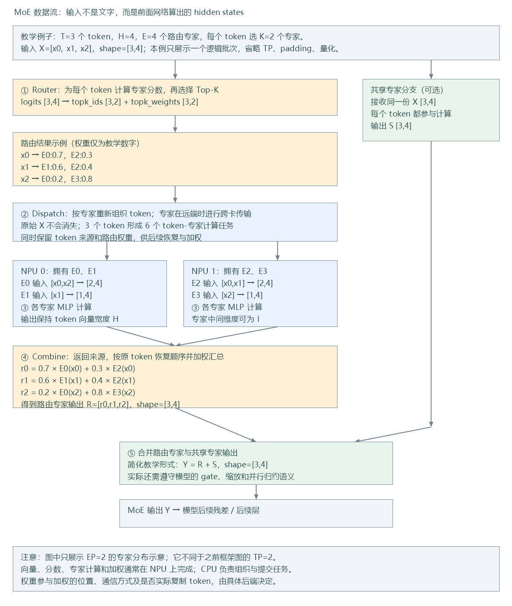
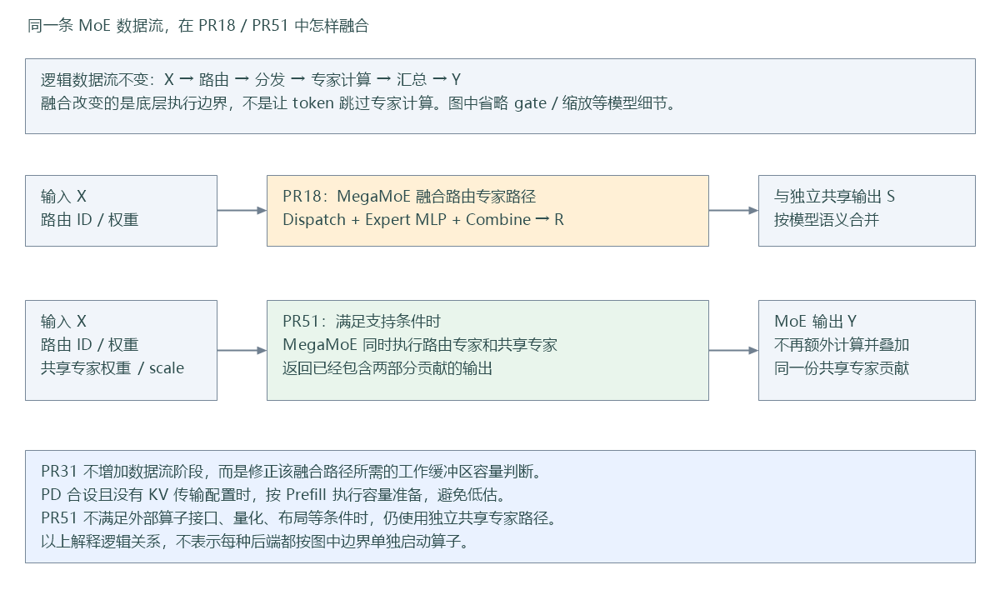

# MoE 数据流：一个 token 怎样经过专家计算

## 1. 从输入到输出



这是教学示意：3 个 token、4 个路由专家，每个 token 选 2 个专家。图中的 EP=2 表示专家分布到两张卡，不同于框架图中拆分计算的 TP=2。实际代码还可能有 padding、量化、TP/SP、容量和并行归约等处理。

### 输入是什么

MoE 接收前面网络算出的向量 `X[T,H]`，不是文本，也不是 token ID。`T` 是本次参与计算的 token 数，`H` 是每个 token 的向量宽度。图中 `x0` 表示第一个 token 的整条向量，不是向量里的一个数。

### 路由输出什么

Router 为每个 token 计算专家分数，再按模型的路由规则选取专家，得到两份关键数据：

- `topk_ids[T,K]`：每个 token 选中的专家编号。
- `topk_weights[T,K]`：选中专家对应的加权系数。

路由权重不是专家模型参数，也不是选中专家的输出。具体分数变换、分组限制、修正偏置和归一化依模型而定，图中数字仅用于展示数据流。

### Dispatch 搬运什么

Dispatch 按专家整理输入向量。`x0` 选择 E0 和 E2，就要让这两个专家都处理 `x0`；E2 位于远端时，需要跨卡传输相关数据。图中 3 个 token 产生 6 个 token-专家任务，不表示用户输入变成了 6 个 token。

实现会保留来源和映射，以便把专家结果还原到原 token。是否实际复制向量、使用 AllToAll、MC2 还是融合通信，取决于执行路径；图中不是某个通信 API 的逐调用记录。

### 专家计算什么

各专家有各自学习到的权重。常见 SwiGLU 专家可用下面的数学示意理解：

```text
输入 [N_e,H]
  → gate / up 投影 [N_e,I]
  → SiLU(gate) × up [N_e,I]
  → down 投影 [N_e,H]
```

`N_e` 是交给该专家的 token 数，`I` 是专家中间维度。实际权重可能融合、分片或量化存储；不是所有模型都使用相同激活。

### Combine 怎样恢复输出

从各专家取得结果，返回 token 来源并恢复逻辑顺序，然后按路由权重汇总。例如，图中第一个 token：

```text
r0 = 0.7 × E0(x0) + 0.3 × E2(x0)
```

最终路由输出仍是 `[T,H]`。加权可能在专家执行或融合算子内部完成，不能把图中的概念顺序当成独立 kernel 的实际启动顺序。

### 共享专家在哪里

带共享专家的模型还有另一条分支：共享专家处理输入，产生共享输出 `S[T,H]`。教学形式可写为 `Y=R+S`；实际合并还需遵守具体模型的 gate、路由缩放和并行归约语义。MoE 输出随后交给模型的残差及后续计算。

图中的向量计算和通信主要发生在 NPU 上，CPU 代码组织和提交任务。KV Cache 读写主要属于 Attention 路径，没有画成这条专家分发链中的一个阶段；具体模型仍可能向 MoE 传入额外 token ID 等信息。

## 2. 对应三个 PR，哪里发生变化



- **PR18**：接入 MegaMoE，将路由专家的分发、专家计算和汇总放入融合执行路径，补齐输入、容量及资源接口。共享专家仍独立计算。
- **PR31**：修正容量选择，不新增一种专家运算。无 KV 传输配置的 PD 合设实例，应按 Prefill 的执行容量准备工作缓冲区。
- **PR51**：接口和布局等条件支持时，把共享专家权重传给 MegaMoE，同一融合调用返回已包含两部分贡献的输出；不满足条件时保留独立分支。

适配到 v0.30 RFC 后，融合路径接入已有 `FusedMC2CommImpl`，并沿用当前通信和权重接口。更多修改前后对比见 [三个 PR 修改图解](three-pr-visual-guide.md)。

## 3. 按数据流找当前本仓代码

| 数据流阶段 | 本仓代码入口 | 关注的数据 |
| --- | --- | --- |
| 模型调用 MoE | [vllm_ascend/models/](../../vllm_ascend/models/) | 模型如何产生输入 hidden states、如何使用输出 |
| 组织路由与共享分支 | [vllm_ascend/ops/fused_moe/fused_moe.py](../../vllm_ascend/ops/fused_moe/fused_moe.py) | `hidden_states`、路由分数、共享专家输入及输出 |
| 选择专家 | [vllm_ascend/ops/fused_moe/router/](../../vllm_ascend/ops/fused_moe/router/) | `topk_ids`、`topk_weights` |
| 路由专家执行组织 | [vllm_ascend/ops/fused_moe/routed_experts.py](../../vllm_ascend/ops/fused_moe/routed_experts.py) | 将输入、路由和量化信息交给后端 |
| 输入准备与输出恢复 | [vllm_ascend/ops/fused_moe/prepare_finalize.py](../../vllm_ascend/ops/fused_moe/prepare_finalize.py) | padding、分片、有效行及归约处理 |
| token 分发与汇总 | [vllm_ascend/ops/fused_moe/token_dispatcher.py](../../vllm_ascend/ops/fused_moe/token_dispatcher.py) | token 布局、通信及恢复映射 |
| 专家 MLP | [vllm_ascend/ops/fused_moe/moe_mlp.py](../../vllm_ascend/ops/fused_moe/moe_mlp.py) | 输入向量、专家权重、量化参数、专家结果 |
| 共享专家 | [vllm_ascend/ops/fused_moe/shared_experts.py](../../vllm_ascend/ops/fused_moe/shared_experts.py) | 共享输入、共享权重及输出 |
| MegaMoE 融合执行 | [vllm_ascend/ops/fused_moe/moe_comm_method.py](../../vllm_ascend/ops/fused_moe/moe_comm_method.py) | `FusedMC2CommImpl._apply_cann_mega_moe()` 将向量、Top-K、权重及缓冲区交给外部算子 |
| 融合共享权重适配 | [vllm_ascend/ops/fused_moe/mega_moe.py](../../vllm_ascend/ops/fused_moe/mega_moe.py) | 共享权重布局检查及外部算子参数 |

这些文件对应不同执行层次和分支，不是每个 token 必须依次调用每个文件。尤其融合路径把多个逻辑阶段交给一个外部算子，不一定经过独立的 Dispatcher 和 MLP 调用。

图片同时提供同名 SVG，位于 `assets/` 下。上传到文档平台时，可直接上传 PNG。
