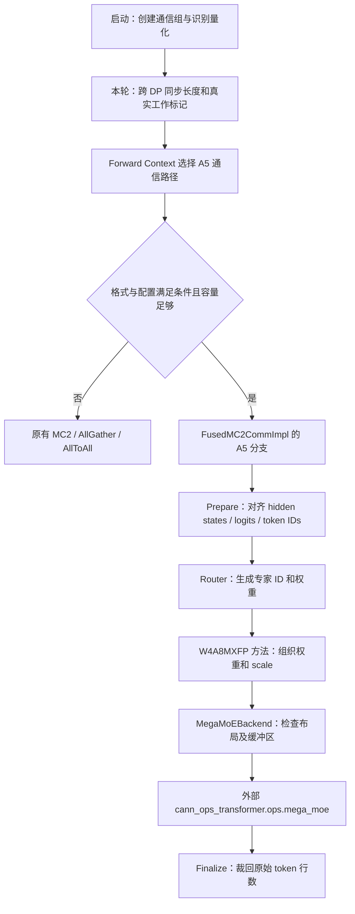

# PR18 学习详解：A5 MegaMoE 方案与代码修改

阅读导航：

**原始代码定位约定：本文的历史行号统一对应提交 `df1286cca8c1bfffa665ea4be57c6498bea1c49e`，不是当前工作区行号。** 实现小节均补“原始代码对应”定位链接，`prepare()` 另有逐步行号表；链接打开[带原始行号的源码摘录](pr18-original-source-reference.md)，可将讲解和图中的步骤直接对回文件、函数及行号。当前源码入口另行标为“当前”，不要混用。

- [1. 先确定我们在学习哪一份代码](#1-先确定我们在学习哪一份代码)
- [2. 目标：让 A5 的 DeepSeek MoE 走融合执行](#2-目标让-a5-的-deepseek-moe-走融合执行)
- [3. 总体方案与模块关系](#3-总体方案与模块关系)
- [4. 修改清单：原始 17 个文件逐一对应](#4-修改清单原始-17-个文件逐一对应)
- [5. 第一步：判断什么时候可以用 A5 MegaMoE](#5-第一步判断什么时候可以用-a5-megamoe)
- [6. 第二步：算出缓冲区输入容量](#6-第二步算出缓冲区输入容量)
- [7. 第三步：建立通信组并管理缓冲区](#7-第三步建立通信组并管理缓冲区)
- [8. 第四步：对齐各 rank 的输入与图执行状态](#8-第四步对齐各-rank-的输入与图执行状态)
- [9. 第五步：正确生成专家 ID 和路由权重](#9-第五步正确生成专家-id-和路由权重)
- [10. 第六步：将 W4A8MXFP 权重交给正确的接口](#10-第六步将-w4a8mxfp-权重交给正确的接口)
- [11. 第七步：把新后端接入已有 MoE 调度](#11-第七步把新后端接入已有-moe-调度)
- [12. 其他配套修改也要理解](#12-其他配套修改也要理解)
- [13. 原始 PR18 与当前工作区怎样对应](#13-原始-pr18-与当前工作区怎样对应)
- [14. 按一次请求串起所有改动](#14-按一次请求串起所有改动)
- [15. 怎样自己查看代码差异](#15-怎样自己查看代码差异)
- [16. 学习练习与核对答案](#16-学习练习与核对答案)
- [17. 本文校验与延伸阅读](#17-本文校验与延伸阅读)

## 1. 先确定我们在学习哪一份代码

本文把 PR18 的设计、全部修改文件和关键代码对应起来。阅读顺序为“目标 → 方案 → 各步骤实现 → 完整调用链 → 当前代码对照”。

| 项目 | 精确版本 |
| --- | --- |
| 来源 | 本地已保存的 GitCode DSNext !18，提交标题 `[Feat][Model] Merge MegaMoE support into DeepSeek V4.1` |
| 原始提交 | `df1286cca8c1bfffa665ea4be57c6498bea1c49e` |
| 修改前父提交 | `df083891752e632313f00dca195e2caa59f208f7` |
| 当前分支中保留的来源提交 | `1f2c71ce13e753f0744ba5da0142b762254032cd` |
| 当前完整适配状态 | `integrate/dsnext-megamoe-vllm-cann` / `203fbd7d43268cbca4ecb6b2a8a8aa4f43e57839` |
| 当前集成基线 | `rfc/vllm_cann` / `0040652a66d31a2b277588ac90d7d37e92757bc5` |

**正文标记为“原始 PR18”的类和片段，来自原始提交，不表示它们仍存在于当前工作区。** 当前源码已经包含 PR31、PR51、第四个适配提交及新基线的演进。第 13 章给出对应关系，避免照着旧名字在新文件里寻找。

完整原始差异已导出为 [pr18-original.patch](pr18-original.patch)。它用于阅读和检索，文中的 diff 块与 Python 片段分别表示历史差异和历史源码；没有把旧 Python 文件另存为第二套运行代码。

本次依据本地 Git 对象和当前源码静态整理，没有运行 NPU 算子、验证推理精度或测量性能。

### 1.1 给 C 开发者的阅读约定

本文面向熟悉 C、尚不熟悉 Python 和 PyTorch 的读者。C 片段是语义示意，不是可直接编译的等价实现。

| Python 写法 | C 的近似理解 | 区别 |
| --- | --- | --- |
| `from module import function` | 取得外部函数入口 | 不是 `#include` 文本插入 |
| `def prepare(...)` | 定义函数 | 冒号与缩进近似划定 `{ ... }` |
| `class Child(Parent)` | 结构体、操作函数并沿用父类型接口 | C 没有直接对应的继承语法 |
| `self.num_tokens` | `self->num_tokens` | `self` 是当前对象，方法调用时自动传入 |
| `value: int`、`-> Output` | 参数、返回值的类型说明 | 通常不自动强制检查类型 |
| `flag=False` | 带默认值的参数 | C 通常需显式传参或另写包装函数 |
| `None`、`is None` | 无值、检查是否类似 `NULL` | `None` 是对象，不是空指针 |
| `raise ValueError(...)` | 退出正常执行流程 | 异常向上层传播，不是返回普通错误码 |
| `getattr(obj, name, default)` | 按名字读属性，缺失时取默认值 | C 字段通常在编译时确定 |
| `tensor[:count]` | 暴露前 `count` 行的视图 | 不包含结束位置，通常不复制存储 |
| `f"count={count}"` | 格式化字符串 | 花括号表达式替换为实际值 |
| `func(**kwargs)` | 按名字展开一组参数 | 不是 C 的二级指针 |

`torch.Tensor` 是带数据地址、shape、dtype、device、stride 的多维数组对象。shape 是各维长度，dtype 是元素编码，device 是存放设备，stride 是沿某一维前进一步跨过的存储元素数。相同 shape 不保证相同布局。

```text
版本阅读图；此处不改变张量：
原始 PR18 → 独立 wrapper / 通信组 / BufferKey
    ├─ PR31：修正无 KV 传输配置时的容量
    ├─ PR51：共享专家融合
    └─ RFC 适配 → 当前 FusedMC2CommImpl / MC2 组
```

### 1.2 全文统一的张量符号

| 符号 | 含义 | C 视角或示例 |
| --- | --- | --- |
| `T_r` | 本 rank 真实 token 行数 | rank 0 为 3，rank 1 为 5 |
| `T_pad` | 本轮对齐后的执行行数 | 示例为 5，不是所有轮次始终固定为 5 |
| `H` | token 特征宽度 | `float hidden_states[T_r][H]` |
| `E_total` | 路由候选专家总数 | `float router_logits[T_r][E_total]` |
| `E_local` | 本 rank 持有的专家数 | 权重的专家维，不一定等于总专家数 |
| `K` | 每 token 选择的专家数 | `int32_t topk_ids[T_pad][K]` |
| `I` | FFN 中间宽度 | gate/up 合并宽度为 `2I` |
| `C` | 每 rank 输入容量上限 | `T_pad <= C`，不是实际 token 数 |
| `R_r` | 派发后本 rank 收到的专家任务数 | 受路由影响，不一定等于 `T_pad` |

历史片段和原有公式按所在小节解释：第 6 章的 `E` 是执行容量，第 10 章的 `E` 是本地专家数。新增图使用完整符号避免混淆。

## 2. 目标：让 A5 的 DeepSeek MoE 走融合执行

### 2.1 普通 MoE 在算什么

**原始代码对应：[vllm_ascend/ops/fused_moe/mega_moe.py:301](pr18-original-source-reference.md#mega-moe-l301)；[vllm_ascend/ops/fused_moe/moe_comm_method.py:469](pr18-original-source-reference.md#moe-comm-l469)。**

每个 token 的 hidden state 是一个长度为 H 的数值向量。路由器为它选出 K 个专家；每个专家对向量执行 FFN，结果按路由权重相加。

```text
输入 X [T,H]
  → Router → 专家编号 [T,K]、专家权重 [T,K]
  → Dispatch：把输入发给专家所在设备
  → 专家 FFN：第一组矩阵乘 → SwiGLU → 第二组矩阵乘
  → Combine：把专家结果归并
  → 输出 Y [T,H]
```

T 是本轮参与计算的 token 行数，H 是 hidden size，K 是每 token 选择的专家数。T 可能包含执行所需的 padding 容量，真实 token 数要另行保留。

MegaMoE 将上述通信和专家计算交给融合执行实现，旨在减少分步提交和中间搬运，并提供通信与计算重叠的机会。Python 侧仍要选择专家、准备输入和参数；PR18 没有在本仓实现 MegaMoE 内部设备 kernel。

两张输入表的区别：`hidden_states` 是交给专家计算的内容，`router_logits` 是选择专家的依据。它们第 i 行必须对应同一个 token。

```text
hidden_states [3,H]          router_logits [3,4]
a 的 H 个特征                a: [0.2, 3.1, 1.0, 2.5]
b 的 H 个特征                b: [4.0, 0.3, 2.2, 1.1]
c 的 H 个特征                c: [0.5, 1.2, 3.8, 2.9]
       │                              │ 简单 TopK，K=2
       │                    topk_ids [3,2]、权重 [3,2]
       │                    a→[1,3]，b→[0,2]，c→[2,3]
       └──────────────────────┬───────┘
                              ↓ 专家执行、加权归并
                          output [3,H]
```

原始 logits 不直接等于最终加权系数。这里是普通分数 TopK 教学例子，实际路由还可能含 hash、分组、bias 和归一化。

### 2.2 修改前 A5 已能运行 MoE，缺少的是对应融合路径

**原始代码对应：[vllm_ascend/ascend_forward_context.py:348](pr18-original-source-reference.md#forward-context-l348)。**

原始 PR18 的父提交中，`use_cann_megamoe()` 明确检查设备为 A3；A5 的 `_select_a5_moe_comm_method()` 只在 MC2、AllGather、AllToAll 中选择。这描述的是该快照的接入范围，不是硬件能力的全部边界。

| 方面 | PR18 前 | PR18 后的方案 |
| --- | --- | --- |
| A5 专家执行 | 使用已有 MoE 路径 | 满足条件时选择 MegaMoE |
| 权重接口 | 面向原有量化/计算调用 | 为 A5 FP4 权重和 MX scale 准备特定布局 |
| 通信 | 已有 MC2 等通信组 | 原方案增加独立 MegaMoE 组及缓冲区 |
| 各 DP 批次长度 | 使用既有同步/跳过规则 | 统一融合输入的长度及图模式协议 |
| 共享专家 | 独立计算 | PR18 仍独立计算，PR51 才补充融合 |

原始 PR18 仅为 A5 新路径准入 `W4A8MXFP`，不能把当前代码更广的量化支持范围倒推给原 PR。

## 3. 总体方案与模块关系



这里的 `FUSED_MC2` 是框架中的逻辑执行类型，不能只凭这个枚举名断言底层一定是 MegaMoE：原代码里同一类型也容纳其他融合实现。需继续看设备分支和最终调用。

PR18 包含三类改动：A5 新执行能力、配套正确性修复、外部算子 API 兼容。下文分别说明。

### 3.1 用形状串起 wrapper 和算子边界

**原始代码对应：[vllm_ascend/ops/fused_moe/prepare_finalize.py:351](pr18-original-source-reference.md#prepare-finalize-l351)；[vllm_ascend/ops/fused_moe/mega_moe.py:266](pr18-original-source-reference.md#mega-moe-l266)。**

Wrapper 是 Python 包装层，可类比 C 中检查参数、准备数组、调用库函数、整理结果的适配函数。原始方案主要分布在 `PrepareAndFinalizeWithMegaMoE` 和 `MegaMoEBackend`，不是固定指一个类。

```text
本轮协调元数据 → T_pad、兼容的图模式
                     ↓
X [T_r,H]、logits [T_r,E_total]、IDs [T_r]
                     ↓ prepare / ID 补齐
X [T_pad,H]、logits [T_pad,E_total]、IDs [T_pad]
                     ↓ Router
X [T_pad,H]、专家编号 [T_pad,K]、权重 [T_pad,K]
                     ↓ Backend：布局检查、缓冲区、参数
════════════ Python wrapper / 外部算子边界 ════════════
MegaMoE：Dispatch → 专家 FFN → Combine → Y_pad [T_pad,H]
══════════════════════════════════════════════════════
                     ↓ finalize：Y_pad[:T_r]
Y [T_r,H]
```

内部阶段可以切块并重叠；图表示逻辑依赖，不表示底层完整串行执行。

## 4. 修改清单：原始 17 个文件逐一对应

原始提交共 **17 个文件，新增 847 行、删除 58 行**。以下增删行从 Git 差异提取；表中链接打开该文件的原始源码摘录，摘录左侧保留历史行号。它们不是当前工作区的文件链接。完整增删上下文仍可在附带 patch 中搜索相应 `diff --git`。

| 原始 PR 修改文件（链接为历史源码摘录） | 增/删行 | 方案环节 | 对应修改 |
| --- | ---: | --- | --- |
| [docs/source/user_guide/configuration/additional_config.md](pr18-original-source-reference.md#additional-config) | +1 / -1 | 说明容量含义 | 解释 A3 接收容量与 A5 输入容量计算的差异 |
| [vllm_ascend/_310p/model_runner_310p.py](pr18-original-source-reference.md#runner-310p) | +2 / -0 | 继承接口兼容 | 给覆盖方法补 `is_dummy_run` 并透传，未增加 310P MegaMoE |
| [vllm_ascend/ascend_config.py](pr18-original-source-reference.md#ascend-config) | +26 / -3 | 容量计算 | 新增纯计算函数，校验容量和并行规模 |
| [vllm_ascend/ascend_forward_context.py](pr18-original-source-reference.md#forward-context) | +132 / -7 | 策略选择 | A5 准入、配置识别、容量解析和本轮模型实例传递 |
| [vllm_ascend/device/device_op.py](pr18-original-source-reference.md#device-op) | +20 / -5 | 配套算子 API | 切换 A5 SwiGLU+量化操作的命名空间和参数 |
| [vllm_ascend/distributed/parallel_state.py](pr18-original-source-reference.md#parallel-state) | +32 / -2 | 通信生命周期 | 新增独立 MegaMoE 组、提前初始化和销毁 |
| [vllm_ascend/models/deepseek_v4/model.py](pr18-original-source-reference.md#deepseek-model) | +0 / -1 | 恢复实际计算 | 删除 `DeepseekV4MoE.forward` 的临时提前返回 |
| [vllm_ascend/ops/fused_moe/mega_moe.py](pr18-original-source-reference.md#mega-moe) | +322 / -0 | 新增后端 | 新增 322 行 A5 wrapper，检查布局、管理缓冲区并调用外部算子 |
| [vllm_ascend/ops/fused_moe/moe_comm_method.py](pr18-original-source-reference.md#moe-comm) | +27 / -2 | 接入调度框架 | A5 使用新 backend 与 prepare/finalize，旁路普通 dispatcher |
| [vllm_ascend/ops/fused_moe/prepare_finalize.py](pr18-original-source-reference.md#prepare-finalize) | +65 / -1 | 输入对齐 | 新增 A5 prepare/finalize，补齐数据和 IDs，输出裁回原始行数 |
| [vllm_ascend/ops/fused_moe/routed_experts.py](pr18-original-source-reference.md#routed-experts) | +11 / -1 | 记录量化类型 | 缓存量化类型，供上下文选择 A5 路径 |
| [vllm_ascend/ops/fused_moe/router/fused_topk_router.py](pr18-original-source-reference.md#router) | +113 / -9 | 路由正确性与可选融合 | 处理文本/hash/视觉路径、ID 对齐、padding ID、可选视觉算子 |
| [vllm_ascend/ops/fused_moe/shared_experts.py](pr18-original-source-reference.md#shared-experts) | +20 / -5 | 独立共享专家配套 | 调整共享专家 SwiGLU+量化 API；本 PR 尚未融合共享专家 |
| [vllm_ascend/patch/worker/patch_distributed.py](pr18-original-source-reference.md#patch-distributed) | +1 / -1 | 通信隔离 | 将 mega_moe 加入专用通信组复用域 |
| [vllm_ascend/quantization/methods/w4a8/w4a8_mxfp4.py](pr18-original-source-reference.md#w4a8-mxfp4) | +21 / -6 | 权重接口适配 | A5 融合路径调整 W1/W2 与 scale 的方向，传给算子 |
| [vllm_ascend/utils.py](pr18-original-source-reference.md#utils) | +15 / -6 | 跨 DP 协议 | 可能使用 FUSED_MC2 时保留 DP 元数据同步 |
| [vllm_ascend/worker/model_runner_v1.py](pr18-original-source-reference.md#model-runner) | +39 / -8 | 运行时一致性 | 同步真实工作标记，避免 dummy rank 放大批次或错误改变图模式 |

`fused_moe.py`、`dataclass/fused_experts.py` 的共享专家权重传递不是原始 PR18 的修改文件，它们是后续 PR51 等改动的内容。PR18 也没有修改 `csrc/`、Attention 或 KV 管理目录。

### 4.1 按数据流给文件分工

**原始代码对应：[vllm_ascend/ops/fused_moe/moe_comm_method.py:273](pr18-original-source-reference.md#moe-comm-l273)；[vllm_ascend/worker/model_runner_v1.py:741](pr18-original-source-reference.md#model-runner-l741)。**

```text
ascend_config / forward_context      parallel_state / patch_distributed
配置 → C、策略                       rank 列表 → 通信组、复用范围
          │                                    │
          ↓                                    ↓
runner / utils → prepare_finalize → router → w4a8_mxfp4 → mega_moe
长度等元数据     [T_r,*]→[T_pad,*]   [T_pad,K]   权重布局     外部调用
                                                           ↓
prepare_finalize：输出 [T_pad,H] → [T_r,H] → 后续模型层
```

配置和组管理不直接补齐张量；变化发生在 prepare、路由、权重视图处理及 finalize。310P 文件只补继承接口参数，不能据此认为它调用 A5 算子。

## 5. 第一步：判断什么时候可以用 A5 MegaMoE

### 5.1 代码落点

**原始代码对应：[vllm_ascend/ascend_forward_context.py:348](pr18-original-source-reference.md#forward-context-l348)；[vllm_ascend/ascend_forward_context.py:369](pr18-original-source-reference.md#forward-context-l369)。**

原始 `ascend_forward_context.py` 修改 `_select_a5_moe_comm_method()`，并增加量化、激活及分组识别辅助函数；`routed_experts.py` 在构建时缓存非 NONE 的量化类型；Runner 的上下文路径传入 `model_instance`，供选择器读取模型属性。

对应的原始准入判断如下。片段从函数中抽取，独立展示，因此外层参数和局部变量定义请结合完整 patch 阅读。

来源：提交 `df1286cca`，[vllm_ascend/ascend_forward_context.py:369](pr18-original-source-reference.md#forward-context-l369) 起。

```python
normalized_activation = None if activation is None else activation.lower().removeprefix("moeactivation.")
use_mega_moe = (
    ascend_config.enable_fused_mc2 == 1
    and world_size > 1
    and num_tokens <= buffer_tokens_per_rank
    and quant_type in _A5_MEGA_MOE_QUANT_TYPES
    and normalized_activation in (None, "silu", "swiglu")
    and group_size in (None, _A5_MEGA_MOE_GROUP_SIZE)
    and not eplb_config.dynamic_eplb
    and eplb_config.num_redundant_experts == 0
    and not ascend_config.mix_placement
)
if use_mega_moe:
    return MoECommType.FUSED_MC2
```

### 5.2 每个条件解决什么问题

**原始代码对应：[vllm_ascend/ascend_forward_context.py:370](pr18-original-source-reference.md#forward-context-l370)。**

| 条件 | 目的 |
| --- | --- |
| 融合开关启用、并行规模大于 1 | 进入用户请求的多设备融合路径 |
| 本轮同步 token 数不超过容量 | 不将超出预留缓冲区的输入交给算子 |
| `W4A8MXFP` | 保证初始接入的权重/激活表示与算子接口相符 |
| SiLU / SwiGLU | 不为加速而更改模型的激活语义 |
| 量化分组为 32，或配置未显式给出 | 对接支持的 MX 分组约定；缺省仍依赖实际布局检查 |
| 关闭动态 EPLB、无冗余专家、无 mix placement | 避免把尚未适配的专家布局/映射送入新后端 |

动态 EPLB 是运行时调整专家放置和权重的机制。新算子接入不自动继承这种机制的全部能力，所以原方案先限制范围。

未通过选择条件时，函数继续沿原有 MC2 / AllGather / AllToAll 策略选择。进入后端后仍有硬性检查；某个外部包缺失或布局错误可能明确报错，并不保证所有错误都自动回退。

### 5.3 量化类型为什么还要缓存

**原始代码对应：[vllm_ascend/ascend_forward_context.py:397](pr18-original-source-reference.md#forward-context-l397)；[vllm_ascend/ops/fused_moe/routed_experts.py:260](pr18-original-source-reference.md#routed-experts-l260)。**

框架可能在模型层已经构造、但本轮没有传入 `model_instance` 的位置调用通信选择器。原始 `cache_a5_moe_quant_type()` 用配置对象身份关联量化类型，提供额外查找入口。

这属于历史实现细节：当前适配没有保留这套同名缓存，不能照着旧方案再增加一份状态。当前选择沿硬件 policy、target/draft 信息和新接口执行，见第 13 章。

### 5.4 选择器只决定交给谁执行

**原始代码对应：[vllm_ascend/ascend_forward_context.py:348](pr18-original-source-reference.md#forward-context-l348)。**

```text
T_pad + 配置 + 量化类型 + 激活 / 专家布局
                    ↓ 准入检查
           ┌────────┴─────────┐
           ↓ 满足              ↓ 不满足
        FUSED_MC2          原有其他 MoE 路径
           ↓
原始 A5 分支选择 MegaMoEBackend

这里没有执行 X [T_r,H] → X_pad [T_pad,H]
```

原片段的 `and`、`or`、`not` 可按 C 的 `&&`、`||`、`!` 理解；`in` 是成员检查，可类比遍历枚举数组。返回 `MoECommType.FUSED_MC2` 只是返回执行类型枚举。

## 6. 第二步：算出缓冲区输入容量

### 6.1 容量计算函数

**原始代码对应：[vllm_ascend/ascend_config.py:36](pr18-original-source-reference.md#ascend-config-l36)。**

`ascend_config.py` 新增以下函数，它处理配置的 token 上限，而不是把 token 数直接当作字节数分配内存。

来源：提交 `df1286cca`，[vllm_ascend/ascend_config.py:36](pr18-original-source-reference.md#ascend-config-l36) 起。

```python
def compute_mega_moe_buffer_tokens_per_rank(
    mega_moe_max_tokens: int,
    execution_tokens_per_rank: int,
    expert_parallel_size: int,
) -> int:
    """Compute the per-rank token capacity for the A5 MegaMoE buffer."""
    if execution_tokens_per_rank <= 0:
        raise ValueError(f"execution_tokens_per_rank must be positive, got {execution_tokens_per_rank}")
    if expert_parallel_size <= 0:
        raise ValueError(f"expert_parallel_size must be positive, got {expert_parallel_size}")

    configured_tokens_per_rank = mega_moe_max_tokens // expert_parallel_size
    buffer_tokens_per_rank = min(configured_tokens_per_rank, execution_tokens_per_rank)
    if buffer_tokens_per_rank <= 0:
        raise ValueError(
            "MegaMoE per-rank token capacity must be positive: "
            f"mega_moe_max_tokens={mega_moe_max_tokens}, "
            f"execution_tokens_per_rank={execution_tokens_per_rank}, "
            f"expert_parallel_size={expert_parallel_size}."
        )
    return buffer_tokens_per_rank
```

令 M 为 `mega_moe_max_tokens`，P 为传入的并行规模，E 为当前执行容量，则：

```text
每 rank 输入容量 C = min(M // P, E)
```

原始调用用 `world_size_across_dp` 作为该计算的并行规模。它在函数中名为 `expert_parallel_size`；阅读实际 TP/DP/PP 配置时，需要核对它与实际通信组的关系，不能简单用“物理卡数”代替。

教学例子：M=65536、P=8、E=4096，得到 C=4096。它限制每 rank 输入多少行；派发后某 rank 收到多少专家任务是另一个概念。

### 6.2 原始方案怎样区分 P/D 角色

**原始代码对应：[vllm_ascend/ascend_forward_context.py:270](pr18-original-source-reference.md#forward-context-l270)。**

来源：提交 `df1286cca`，[vllm_ascend/ascend_forward_context.py:275](pr18-original-source-reference.md#forward-context-l275) 起。

```python
kv_transfer_config = getattr(vllm_config, "kv_transfer_config", None)
kv_role = getattr(kv_transfer_config, "kv_role", None)
is_kv_producer = bool(getattr(kv_transfer_config, "is_kv_producer", False))
if kv_role in ("kv_producer", "kv_both") or (kv_role is None and is_kv_producer):
    execution_tokens_per_rank = vllm_config.scheduler_config.max_num_batched_tokens
else:
    if mc2_tokens_capacity is None:
        mc2_tokens_capacity = get_mc2_tokens_capacity()
    if mc2_tokens_capacity is None:
        raise RuntimeError("MC2 token capacity must be initialized before using A5 MegaMoE.")
    execution_tokens_per_rank = mc2_tokens_capacity
```

明确 producer / both 角色使用 `max_num_batched_tokens`；其他路径使用已初始化的 MC2 容量。这是 PR18 的原始实现。

**这里有一个后来才修复的遗漏：没有 KV 传输配置的普通 PD 合设实例，也会落入 else 分支。** 它需要支持 Prefill，却可能取得较小的 Decode 执行容量。

PR31 在上述 if 条件中补入 `kv_transfer_config is None`。其测试示例中，M=65536、P=8、Prefill 容量4096、MC2 容量32：结果由32变为4096。明确影响是容量低估和融合路径被错误回退；不能仅根据这项差异宣称曾发生实际内存越界或精度错误。

当前代码已保留该修复：[get_a5_mega_moe_buffer_tokens_per_rank](../../vllm_ascend/ascend_forward_context.py)。

### 6.3 容量必须在三处保持一致

**原始代码对应：[vllm_ascend/ascend_forward_context.py:370](pr18-original-source-reference.md#forward-context-l370)；[vllm_ascend/ops/fused_moe/mega_moe.py:213](pr18-original-source-reference.md#mega-moe-l213)。**

1. 选择器：本轮输入能否选择 MegaMoE。
2. 缓冲区初始化：实际为多大容量创建资源。
3. 后端调用前：当前输入是否超过资源容量。

如果三处采用不同口径，就可能出现“选择时认为能执行，分配的 buffer 却不够”或不必要的回退。当前第四个适配提交继续统一了这三处的计算。

### 6.4 三种容量参数不要混在一起

**原始代码对应：[vllm_ascend/ascend_forward_context.py:275](pr18-original-source-reference.md#forward-context-l275)；[vllm_ascend/ascend_config.py:47](pr18-original-source-reference.md#ascend-config-l47)。**

producer / both 分支不是直接选择 `mega_moe_max_tokens`。它只决定公式中的执行容量 `E`；两条分支最终都会使用 `M // P` 这个配置推导上限。

| 名字 | 在本段逻辑中的作用 | 不是 |
| --- | --- | --- |
| `mega_moe_max_tokens` | 参与推导输入容量的配置值 | 当前批次实际 token 数或内存字节数 |
| `max_num_batched_tokens` | 需要支持 Prefill 时采用的调度 token 上限 | 每个请求完整历史长度 |
| `mc2_tokens_capacity` | 已初始化的 MC2 执行容量 | NPU 总显存容量或 MC2 固定硬件极限 |

MC² 是 Matrix Computation & Communication，指计算与通信融合。MoE 中需要把 token 发到专家所在设备、计算后传回；MC2 相关实现组织这些通信和计算。此处是在为 MegaMoE 解析容量，不是在按 producer/consumer 把执行方式简单分成 MegaMoE 和 MC2。

```text
实例角色 ──→ 选择执行容量 E
  producer / both ─────────────→ 调度上限 4096
  无 KV 传输配置的普通 PD 合设 ─→ PR31 后也是 4096
  原始其他分支 ────────────────→ MC2 容量，例如 32
                                     │
配置 M=65536，计算规模 P=8            │
             ↓                       ↓
         M // P=8192 ─────→ C=min(8192,E)
                              ├─ E=4096 → C=4096
                              └─ E=32   → C=32

X [1024,H] → 比较 T_pad=1024 与 C；此时张量尚未变化
  C=32：容量检查不通过 → 其他路径
  C=4096：通过容量检查 → 还需满足其他融合条件
```

P 是 Prefill，一次可处理较多提示词 token；D 是 Decode，普通情况下每个活跃请求每轮处理一个新 token。PD 合设实例同时做两者，不配置跨实例 KV 传输也需要 Prefill 容量。`kv_producer`、`kv_consumer`、`kv_both` 分别表示发送、接收、两者兼具的 KV 传输职责，实际执行阶段还受连接器和调度配置影响。

本节的输入行数上限与 dispatch 后某 rank 收到的专家任务数不同。一行输入可能选择 K 个专家，任务又可能集中到某些 rank；不能把 `C` 直接当成所有接收工作区都只需要容纳 C 项。

## 7. 第三步：建立通信组并管理缓冲区

### 7.1 原始方案增加独立组

**原始代码对应：[vllm_ascend/distributed/parallel_state.py:23](pr18-original-source-reference.md#parallel-state-l23)；[vllm_ascend/distributed/parallel_state.py:98](pr18-original-source-reference.md#parallel-state-l98)；[vllm_ascend/distributed/parallel_state.py:201](pr18-original-source-reference.md#parallel-state-l201)。**

在 `distributed/parallel_state.py` 中，PR18 增加 `_MEGA_MOE`、`get_mega_moe_group()`，在 A5 开启融合时创建对应组。参与 rank 与当时 MC2 组的组织相关，但资源使用独立命名。

`_initialize_mega_moe_communicator()` 主动取得 HCCL 通信名称，用来提前初始化通信器。这样把通信资源准备从第一次融合执行中移出来。

`patch/worker/patch_distributed.py` 同时把 `mega_moe` 纳入专用的 reuse domain，防止框架将它归入普通共享组的复用范围。只新增通信组而不修改复用规则，不能确保隔离意图成立。

销毁时也销毁该组并清空引用，形成“创建 → 使用 → 销毁”的生命周期。

### 7.2 为什么缓冲区需要保存一组 key

**原始代码对应：[vllm_ascend/ops/fused_moe/mega_moe.py:80](pr18-original-source-reference.md#mega-moe-l80)；[vllm_ascend/ops/fused_moe/mega_moe.py:213](pr18-original-source-reference.md#mega-moe-l213)。**

原始 `mega_moe.py` 定义不可变的 `_MegaMoEBufferKey`，记录以下信息：

| 字段 | 影响什么 |
| --- | --- |
| `num_experts`、`top_k` | 专家数量和每 token 专家任务规模 |
| `buffer_tokens_per_rank` | 输入容量 |
| `hidden_size`、`intermediate_hidden` | 向量及 FFN 中间宽度 |
| `dispatch_quant_mode`、`dispatch_quant_out_dtype` | 派发数据格式 |

`_get_sym_buffer()` 首次创建缓冲区，将 key 和 buffer 绑定到 MegaMoE 组对象；后续复用时，若 key 不同就报错，避免在推理中直接替换这份共享状态。

这不是完整的 target/draft 拓扑支持方案。若不同模型的专家数量、维度或通信需求不同，原始“已有 buffer 的 key 必须相同”就可能拒绝执行，不能推断它自动支持任意混合草稿模型。

### 7.3 当前版本的区别

**原始代码对应：[vllm_ascend/distributed/parallel_state.py:166](pr18-original-source-reference.md#parallel-state-l166)；[vllm_ascend/ops/fused_moe/mega_moe.py:213](pr18-original-source-reference.md#mega-moe-l213)。**

当前代码复用现有 MC2 通信组，保留基线已有的 HCCL teardown/restore 协议，不再使用原始 `_MEGA_MOE` 组和该 BufferKey 机制。当前入口为 [moe_comm_method.py](../../vllm_ascend/ops/fused_moe/moe_comm_method.py) 的 `_init_mega_moe_symm_buffer()`、`prepare_hccl_teardown()` 和 `refresh_hccl_runtime_state()`。

因此学习 PR18 时要掌握“资源必须提前准备、匹配布局、按生命周期收尾”，不要直接把旧通信组代码复制回当前分支。

### 7.4 通信组是协作名单，缓冲区是工作内存

**原始代码对应：[vllm_ascend/distributed/parallel_state.py:98](pr18-original-source-reference.md#parallel-state-l98)；[vllm_ascend/ops/fused_moe/mega_moe.py:238](pr18-original-source-reference.md#mega-moe-l238)。**

rank 是通信组中的进程编号；常见部署是一进程绑定一张 NPU。同一机器内和跨机器都可能发生通信。每个进程有自己的 Python 对象和设备内存，模块级变量不是所有 rank 共用的内存。

```text
MegaMoE 通信组：rank 0、rank 1

rank 0 的 NPU                          rank 1 的 NPU
本地输入 X0 [T_pad,H]                 本地输入 X1 [T_pad,H]
本地专家 0、1                         本地专家 2、3
MegaMoE 缓冲区 B0  ←── HCCL 通信 ──→ MegaMoE 缓冲区 B1
        │                                      │
        └─ token a 选专家 3 → 发往 rank 1 ──────┘

通信组：规定谁参与、组内编号、使用哪个通信器
缓冲区：给通信和融合执行提供工作内存
```

缓冲区不是注意力的 KV Cache，也不是专家权重。对称缓冲区要求各参与者遵循兼容的分配、布局和访问约定，不表示各卡数据相同，也不表示各卡内存自动变为一个普通大数组。具体内部分区由外部实现管理，图中不臆造其布局。

### 7.5 domain 和复用：逻辑对象与底层资源是两层

**原始代码对应：[vllm_ascend/patch/worker/patch_distributed.py:39](pr18-original-source-reference.md#patch-distributed-l39)；[vllm_ascend/distributed/parallel_state.py:101](pr18-original-source-reference.md#parallel-state-l101)。**

```text
只创建两个不同名字的逻辑组，不必然隔离底层资源：
逻辑组 A ──┐
           ├─ rank、后端、选项、reuse_domain 等相同 → 可复用底层组
逻辑组 B ──┘

原始 PR18：
普通组   → domain=shared   → 底层组 A
MC2      → domain=mc2      → 底层组 B
MegaMoE  → domain=mega_moe → 底层组 C
```

domain 是复用范围标签，不是域名或物理链路。原始补丁使 `mega_moe` 不再落入 `shared`；修改前 MC2 已经在专用范围内。不同 domain 不复用，同 domain 也只有其他条件匹配才复用。专用 domain 不是禁止一切复用。

当前方案直接取得 MC2 组，相当于共用一套逻辑运输网络；底层可能有多条连接，并不是只建一根物理通道。复用通信组不意味着两个功能共用同一块工作缓冲区，更不意味着数据被自动合并。独立组和复用组的性能优劣需实测；当前适配保留已有生命周期以避免重复实现，不能推断原始独立组方案错误。

### 7.6 key 是缓冲区规格标签，不是本轮数据

**原始代码对应：[vllm_ascend/ops/fused_moe/mega_moe.py:187](pr18-original-source-reference.md#mega-moe-l187)；[vllm_ascend/ops/fused_moe/mega_moe.py:213](pr18-original-source-reference.md#mega-moe-l213)；[vllm_ascend/ops/fused_moe/mega_moe.py:229](pr18-original-source-reference.md#mega-moe-l229)。**

```text
首次需求 key=(专家数, C, K, H, I, 量化模式, 输出 dtype)
                         ↓
创建 buffer → 将 {key, buffer} 保存到 MegaMoE 组对象
                         ↓ 后续调用
                新 key 与旧 key 相同？
                 ├─ 是 → 复用 buffer
                 └─ 否 → 报错，不在推理中替换

容量 C=8 的同一 buffer：本轮 T_pad=5，下轮 T_pad=7
只要规格一致且未超容量，不因实际行数变化而更换 key。
```

从 C 理解，组对象像保存了 `BufferState { BufferKey key; Buffer *buffer; }`。绑定是保存引用，不是复制缓冲区内容。即使新需求更小，也不能只凭“装得下”就复用：数据布局、量化解释和已有执行引用都需要匹配。

当前恢复逻辑重新绑定 MC2 通信器是预期行为。如果另行引入独立组，必须连同创建、复用规则、缓冲区绑定、销毁和恢复一起修改；不能只替换某一个 getter。完整隔离方案没有原则性问题，但需要新增配套维护与验证。

## 8. 第四步：对齐各 rank 的输入与图执行状态

### 8.1 为什么不能让一个 rank 自己决定长度

**原始代码对应：[vllm_ascend/worker/model_runner_v1.py:762](pr18-original-source-reference.md#model-runner-l762)；[vllm_ascend/ops/fused_moe/prepare_finalize.py:361](pr18-original-source-reference.md#prepare-finalize-l361)。**

假设两个参与者分别有3行和5行输入。原始 A5 wrapper 的方案是先交换元数据，统一目标长度为5，再将3行输入补齐到5。计算结束后，小批次的输出裁回3行。

这里补齐的是当前 token 维，不是把所有请求的完整历史长度补齐成一样，也不是要求不同 rank 拥有相同的真实请求。

```text
本轮真实输入：
rank 0：X0 [3,H] = [a,b,c]
rank 1：X1 [5,H] = [d,e,f,g,h]
               ↓ 上游交换长度等元数据，约定 T_pad=5
rank 0：X0_pad [5,H] = [a,b,c,零行,零行]
rank 1：X1_pad [5,H] = [d,e,f,g,h]
               ↓ 各自的路由、跨 rank 专家计算、归并
rank 0：Y0_pad [5,H] → 取前 3 行 → Y0 [3,H]
rank 1：Y1_pad [5,H] → 取前 5 行 → Y1 [5,H]
```

a～h 表示不同 token 的特征行，不是不同 rank 共享的同一批请求。普通 Decode 中，两个请求即使历史长度分别为 100 和 1000，本轮各处理一个 token，MoE 输入仍可为 `[2,H]`；历史 K/V 由注意力缓存管理。

原始 wrapper 采用同轮对齐的输入协议，并协调图执行状态；仅凭补齐代码不能断言底层 MegaMoE API 对所有用法都要求等长，更不能说所有轮次 token 数固定不变。图重放需要匹配相应图的形状及执行约定，是否重放和使用哪种模式由上游协调。

### 8.2 原始 PrepareAndFinalizeWithMegaMoE

**原始代码对应：[vllm_ascend/ops/fused_moe/prepare_finalize.py:351](pr18-original-source-reference.md#prepare-finalize-l351)；[vllm_ascend/ops/fused_moe/prepare_finalize.py:354](pr18-original-source-reference.md#prepare-finalize-l354)。**

原始 `prepare_finalize.py` 增加专用类，其职责为：

| 方法 | 修改 |
| --- | --- |
| `prepare()` | 保存原始行数；检查同步长度及容量；补齐 hidden states 和 router logits |
| `pad_and_split_input_ids()` | 给原始 token IDs 做相同的尾部补齐 |
| `finalize()` | 清除本轮准备标记，裁回原始输入行数 |

关键片段如下，变量 `self.num_tokens` 在前面的代码中保存了原始行数。

来源：提交 `df1286cca`，[vllm_ascend/ops/fused_moe/prepare_finalize.py:381](pr18-original-source-reference.md#prepare-finalize-l381) 起。

```python
        self.padded_num_tokens = max_tokens_across_dp
        pad_size = self.padded_num_tokens - self.num_tokens
        if pad_size > 0:
            hidden_states = nn.functional.pad(hidden_states, (0, 0, 0, pad_size))
            router_logits = nn.functional.pad(router_logits, (0, 0, 0, pad_size))
        self._mega_moe_input_prepared = True
        return MoEPrepareOutput(
            hidden_states=hidden_states,
            router_logits=router_logits,
            mc2_mask=None,
            padded_hidden_states_shape=hidden_states.shape,
            pertoken_scale=None,
        )
```

为什么 IDs 也要跟着补？DeepSeek 的 hash/视觉路由会查看 token IDs。hidden states 第 i 行、logits 第 i 行和 ID 第 i 项必须代表同一个位置，否则会给错误的向量选择专家。

原始专用 prepare 保留每 rank 本地输入组织，不套用普通 MC2 prepare 中的完整 TP 切分逻辑；这正是当时需要新增类而非只换最后一个算子的原因。当前分支已经使用基线的 prepare/finalize 协议，不能把旧协议的每个形状规则直接套过来。

### 8.3 空闲 rank 仍需要参与通信

**原始代码对应：[vllm_ascend/worker/model_runner_v1.py:762](pr18-original-source-reference.md#model-runner-l762)；[vllm_ascend/worker/model_runner_v1.py:770](pr18-original-source-reference.md#model-runner-l770)；[vllm_ascend/worker/model_runner_v1.py:779](pr18-original-source-reference.md#model-runner-l779)。**

MoE 的 EP 通信可以跨 DP 副本。某个 rank 没有真实请求时，仍可能需要以 dummy 路径参与集体通信。PR18 给 DP 同步信息增加“是否有真实工作”的字段。

来源：提交 `df1286cca`，[vllm_ascend/worker/model_runner_v1.py:762](pr18-original-source-reference.md#model-runner-l762) 起。

```python
packed_tensor = torch.zeros(DP_METADATA_FIELD_COUNT, self.dp_size, device="cpu", dtype=torch.int32)
packed_tensor[DP_METADATA_NUM_TOKENS][self.dp_rank] = num_tokens
packed_tensor[DP_METADATA_CUDAGRAPH_MODE][self.dp_rank] = cudagraph_mode.value
packed_tensor[DP_METADATA_HAS_REAL_WORK][self.dp_rank] = not is_dummy_run
dist.all_reduce(packed_tensor, group=get_dp_group().cpu_group)

# Unpack the results
num_tokens_across_dp = packed_tensor[DP_METADATA_NUM_TOKENS, :]
active_dp_mask = packed_tensor[DP_METADATA_HAS_REAL_WORK, :].bool()
if not active_dp_mask.any():
    active_dp_mask = torch.ones_like(active_dp_mask)

max_tokens_across_dp = int(num_tokens_across_dp[active_dp_mask].max().item())
synced_cudagraph_mode = CUDAGraphMode(_post_process_cudagraph_mode(packed_tensor, active_dp_mask))

# Dummy ranks enter the same collective shape and graph chosen by ranks
# with real work without inflating the real ranks' batch size.
num_tokens_across_dp[~active_dp_mask] = max_tokens_across_dp
```

各 rank 仅在自己的列填写数据，再通过 CPU 通信组汇集。此处的 all-reduce 用于取得控制元数据，不是对 hidden states 求和。

教学例子：一个 active rank 的长度为32，另一个 dummy rank 的占位长度为1024。新逻辑决定同步目标时仅看 active rank，使 dummy 值不把真实批次放大到1024。图模式也只由 active rank 的模式参与协调，避免空闲 rank 单独报告 NONE 而让真实任务退出图执行。

如果全是 dummy，例如预热/捕获阶段，代码会将 mask 恢复为全参与，再进行一致性协调。不能简单理解为“dummy 总是被跳过”。

### 8.4 为什么 utils.py 也要改

**原始代码对应：[vllm_ascend/utils.py:1106](pr18-original-source-reference.md#utils-l1106)；[vllm_ascend/utils.py:1152](pr18-original-source-reference.md#utils-l1152)。**

`should_skip_allreduce_across_dp_group()` 以前会把 MC2/FUSED_MC2 都视为可考虑跳过同步的情况。原始 PR18 改为：如果可能选择融合路径，则保留必要的 DP 同步。

原因是新路径依赖统一长度和图模式。若不同 rank 分别根据本地 token 数作决定，可能选择不同协议。PR18 还检查极小非空批次与最大执行容量的选择情况，避免只在某个代表批次上检查。

`_310p/model_runner_310p.py` 的修改只是新增参数透传，防止父类方法签名变化影响子类，并不表示为310P增加MegaMoE。

### 8.5 从 C 结构体角度读三个方法

**原始代码对应：[vllm_ascend/ops/fused_moe/prepare_finalize.py:351](pr18-original-source-reference.md#prepare-finalize-l351)；[vllm_ascend/ops/fused_moe/prepare_finalize.py:354](pr18-original-source-reference.md#prepare-finalize-l354)。**

`class PrepareAndFinalizeWithMegaMoE(PrepareAndFinalize)` 定义子类，沿用父类协议并实现本路径的方法。可以先把对象状态近似看成以下 C 结构体：

```c
typedef struct {
    int64_t num_tokens;
    int64_t padded_num_tokens;
    bool mega_moe_input_prepared;
} MegaMoEPrepareContext;
```

Python 的 `obj.prepare(hidden_states, router_logits)` 近似 C 的 `prepare(&obj, hidden_states, router_logits, false, QUANT_NONE)`。Python 自动传入 `self`，未传的可选参数使用默认值。`replace_allreduce` 和 `quant_type` 在这份实现中未使用，只保留统一接口。

下面按原始 `prepare()` 的实际顺序逐步解释。完整历史源码仍以第 15 章的 Git 读取方式为准。

| 步骤 | 原始文件与行号 | Python 语句 | C 角度及作用 | 示例状态或形状 |
| --- | --- | --- | --- | --- |
| 1 | [prepare_finalize.py:361](pr18-original-source-reference.md#prepare-finalize-l361) | `self.num_tokens = hidden_states.shape[0]` | `self->num_tokens = x->shape[0]`；记住真实行数 | `T_r=3`，X `[3,H]` |
| 2 | [prepare_finalize.py:362](pr18-original-source-reference.md#prepare-finalize-l362) | `vllm_config = get_current_vllm_config()` | 获取配置对象，近似取得配置指针 | 张量不变 |
| 3 | [prepare_finalize.py:363](pr18-original-source-reference.md#prepare-finalize-l363) | `if vllm_config is None: raise RuntimeError(...)` | 无配置则抛异常，中止正常流程 | 不创建补齐结果 |
| 4 | [prepare_finalize.py:365](pr18-original-source-reference.md#prepare-finalize-l365) | `buffer_tokens_per_rank = get_a5_mega_moe_buffer_tokens_per_rank(vllm_config)` | 计算允许的输入容量 C | 示例 `C=8` |
| 5 | [prepare_finalize.py:366](pr18-original-source-reference.md#prepare-finalize-l366) | `max_tokens_across_dp = _EXTRA_CTX.max_tokens_across_dp` | 读取上游协调的目标，不在这里通信 | 示例 `T_pad=5` |
| 6 | [prepare_finalize.py:367](pr18-original-source-reference.md#prepare-finalize-l367) | `if max_tokens_across_dp is None: max_tokens_across_dp = self.num_tokens` | 未设置目标时使用本地长度 | 若未设置，取 3，无需补齐 |
| 7 | [prepare_finalize.py:369](pr18-original-source-reference.md#prepare-finalize-l369) | `if max_tokens_across_dp < self.num_tokens: raise ValueError(...)` | 不允许目标丢弃真实行 | 目标 2、真实 3 则报错 |
| 8 | [prepare_finalize.py:374](pr18-original-source-reference.md#prepare-finalize-l374) | `if max_tokens_across_dp > buffer_tokens_per_rank: raise ValueError(...)` | 不允许执行长度超出容量 | 目标 9、容量 8 则报错 |
| 9 | [prepare_finalize.py:381](pr18-original-source-reference.md#prepare-finalize-l381) | `self.padded_num_tokens = max_tokens_across_dp` | 保存执行长度 | `self->padded_num_tokens=5` |
| 10 | [prepare_finalize.py:382](pr18-original-source-reference.md#prepare-finalize-l382) | `pad_size = self.padded_num_tokens - self.num_tokens` | 计算需要补的行数 | `pad_size=2` |
| 11 | [prepare_finalize.py:383](pr18-original-source-reference.md#prepare-finalize-l383) | 两次 `nn.functional.pad(...)` | 为输入和分数表尾部补零 | X `[5,H]`，logits `[5,E_total]` |
| 12 | [prepare_finalize.py:386](pr18-original-source-reference.md#prepare-finalize-l386) | `self._mega_moe_input_prepared = True` | 标记本轮输入准备完成 | 供 ID 准备方法检查 |
| 13 | [prepare_finalize.py:388](pr18-original-source-reference.md#prepare-finalize-l388) | `return MoEPrepareOutput(...)` | 返回包含多个结果字段的对象，类似结构体返回 | 两张张量、形状及可选字段 |

```text
必须满足：T_r <= T_pad <= C

开始：X [3,H]、L [3,E_total]
  ↓ 1～10：读取和检查标量；张量不变
pad_size = 5-3 = 2
  ↓ 11：pad
X_pad [5,H]、L_pad [5,E_total]
  ↓ 12～13：设置状态并打包返回；张量形状不再变化
MoEPrepareOutput { X_pad, L_pad, mc2_mask=None,
                   padded_hidden_states_shape=(5,H), pertoken_scale=None }
```

`MoEPrepareOutput(hidden_states=hidden_states, ...)` 左侧是构造参数名，右侧是局部变量值。可类比 C 的 `Output result = { .hidden_states = hidden_states, ... }; return result;`，但 Python 构造函数不限于 C 的结构体初始化。

### 8.6 二维 pad 的四个数字和一维 ID pad

**原始代码对应：[vllm_ascend/ops/fused_moe/prepare_finalize.py:384](pr18-original-source-reference.md#prepare-finalize-l384)；[vllm_ascend/ops/fused_moe/prepare_finalize.py:396](pr18-original-source-reference.md#prepare-finalize-l396)。**

对于这里的二维张量，`(0, 0, 0, pad_size)` 从最后一维向前指定补齐量：列前 0、列后 0、行前 0、行后 `pad_size`。这是一个 Python 元组，不是 C 函数的四个独立实参。

```text
为方便观察，取 H=4：
原 X [3,4]                     pad(X,(0,0,0,2)) → [5,4]
[1 2 3 4]                      [1 2 3 4]
[5 6 7 8]                      [5 6 7 8]
[9 1 2 3]                      [9 1 2 3]
                               [0 0 0 0]
                               [0 0 0 0]

IDs [3]： [101,205,309]
       pad(IDs,(0,2)) → IDs_pad [5]：[101,205,309,0,0]
```

`hidden_states = pad(...)` 将局部名字指向补齐结果，不能按 C 的原地扩容理解。可近似想成分配更大的零数组、复制原始行，再让局部指针指向新数组；真实实现由张量库管理。

`pad_and_split_input_ids()` 先执行 `if not getattr(self, "_mega_moe_input_prepared", False): return input_ids`。`not` 对应 C 的 `!`；`getattr` 在属性不存在时返回 False，因此未完成准备就原样返回。准备好后，按同一个 `pad_size` 补 ID。虽然方法名带 split，这份实现没有执行切分。

占位 ID 的 0 不表示新增了有意义的输入文字。占位行可能仍进入路由或带来额外计算；不能只凭“补零并裁剪”就证明占位完全无开销，或自动证明所有模型变体的数值正确性。

### 8.7 finalize 是切片，不是重新运行专家

**原始代码对应：[vllm_ascend/ops/fused_moe/prepare_finalize.py:404](pr18-original-source-reference.md#prepare-finalize-l404)；[vllm_ascend/ops/fused_moe/prepare_finalize.py:410](pr18-original-source-reference.md#prepare-finalize-l410)。**

```python
self._mega_moe_input_prepared = False
return hidden_states[: self.num_tokens]
```

```text
算子输出 Y_pad [5,H]        切片 [:3] → Y [3,H]
[真实输出 a]                [真实输出 a]
[真实输出 b]                [真实输出 b]
[真实输出 c]                [真实输出 c]
[占位输出  ]                不返回
[占位输出  ]                不返回
```

`[:3]` 是取索引 0、1、2，不含索引 3；可类比返回仅暴露前三行的 Tensor 视图，而不是 `free()` 后两行。`torch.Size | None` 是允许形状对象或 None 的类型标注，不是 C 按位或。`reduce_results` 和 `padded_hidden_states_shape` 在这份 finalize 中没有使用。

### 8.8 上游元数据和图状态怎样协调

**原始代码对应：[vllm_ascend/worker/model_runner_v1.py:741](pr18-original-source-reference.md#model-runner-l741)；[vllm_ascend/worker/model_runner_v1.py:774](pr18-original-source-reference.md#model-runner-l774)；[vllm_ascend/worker/model_runner_v1.py:5673](pr18-original-source-reference.md#model-runner-l5673)。**

```text
rank 0：真实工作，3 行，图模式 A ──┐
                                  ├─ 交换控制元数据 → 目标 5、兼容图模式
rank 1：真实工作，5 行，图模式 B ──┘
                                           ↓
                         rank 0 / rank 1 按约定准备本轮执行

另一场景：真实 rank=32 行；dummy rank 的占位长度=1024
选择目标时只看真实工作 → 目标 32，而不是被 dummy 放大到 1024
全为 dummy 时 → 恢复为全参与，协调预热 / 图捕获
```

元数据同步交换的是长度、图模式和真实工作标记，不是把所有 rank 的 hidden states 相加。图执行可理解为预先记录设备执行流程后重放，重放要满足相应图的执行约定。某 rank 无真实输入也可能需要参与专家通信，不能直接退出协作。

`_EXTRA_CTX` 是模块级访问入口；当前版本是代理对象，将属性访问转给当前 forward context。它不是所有 rank 共用的全局内存，也不应把不同版本的上下文内部实现当成相同。这里的 `prepare()` 只读取已协调结果，跨 rank 协调发生在上游。

### 8.9 图中每一步怎样跳回原始代码

| 图中的步骤 | 原始文件与行号 | 需要对照的内容 |
| --- | --- | --- |
| 读取本地真实行数 | [prepare_finalize.py:361](pr18-original-source-reference.md#prepare-finalize-l361) | `self.num_tokens = hidden_states.shape[0]` |
| 读取共同目标 | [prepare_finalize.py:366](pr18-original-source-reference.md#prepare-finalize-l366) | 读取上下文；不是在此发起通信 |
| 检查目标不能小于本地行数 | [prepare_finalize.py:369](pr18-original-source-reference.md#prepare-finalize-l369) | 目标错误则抛异常 |
| 检查目标不能大于容量 | [prepare_finalize.py:374](pr18-original-source-reference.md#prepare-finalize-l374) | 容量不足则抛异常 |
| 计算补齐量 | [prepare_finalize.py:381](pr18-original-source-reference.md#prepare-finalize-l381) | 保存目标长度，再减去真实长度 |
| 补 hidden states | [prepare_finalize.py:384](pr18-original-source-reference.md#prepare-finalize-l384) | `[3,H] → [5,H]` |
| 补 router logits | [prepare_finalize.py:385](pr18-original-source-reference.md#prepare-finalize-l385) | `[3,E_total] → [5,E_total]` |
| 返回准备结果 | [prepare_finalize.py:388](pr18-original-source-reference.md#prepare-finalize-l388) | 构造 `MoEPrepareOutput` |
| 检查 ID 准备状态 | [prepare_finalize.py:397](pr18-original-source-reference.md#prepare-finalize-l397) | 未准备则原样返回 |
| 补 token IDs | [prepare_finalize.py:401](pr18-original-source-reference.md#prepare-finalize-l401) | `[3] → [5]` |
| 清理准备状态 | [prepare_finalize.py:410](pr18-original-source-reference.md#prepare-finalize-l410) | 为后续执行更新状态 |
| 裁回真实输出 | [prepare_finalize.py:411](pr18-original-source-reference.md#prepare-finalize-l411) | `[5,H] → [3,H]` |

上游长度交换对应 [vllm_ascend/worker/model_runner_v1.py:766](pr18-original-source-reference.md#model-runner-l766)；目标长度计算对应 [vllm_ascend/worker/model_runner_v1.py:774](pr18-original-source-reference.md#model-runner-l774)；真正的融合算子调用对应 [vllm_ascend/ops/fused_moe/mega_moe.py:318](pr18-original-source-reference.md#mega-moe-l318)。三个位置不在同一个文件，不能把它们都当成 `prepare()` 内部执行。

## 9. 第五步：正确生成专家 ID 和路由权重

### 9.1 为什么需要 token IDs

**原始代码对应：[vllm_ascend/ops/fused_moe/router/fused_topk_router.py:198](pr18-original-source-reference.md#router-l198)；[vllm_ascend/ops/fused_moe/router/fused_topk_router.py:218](pr18-original-source-reference.md#router-l218)。**

普通路由器常从 hidden state 计算专家分数，再取 TopK。当前来源模型还包含两种相关逻辑：

- 文本 hash 路由：可以根据 token ID 和 `tid2eid` 表确定专家编号。
- 视觉路由：根据图像 token 标记和视觉 bias 处理相应位置。

因此路由需要同时理解 logits、token IDs、可选查表和视觉 bias。它不是把一个统一的 softmax 函数替换成 MegaMoE。

### 9.2 原始 PR18 的修改

**原始代码对应：[vllm_ascend/ops/fused_moe/router/fused_topk_router.py:33](pr18-original-source-reference.md#router-l33)；[vllm_ascend/ops/fused_moe/router/fused_topk_router.py:224](pr18-original-source-reference.md#router-l224)；[vllm_ascend/ops/fused_moe/router/fused_topk_router.py:236](pr18-original-source-reference.md#router-l236)。**

| 修改点 | 对应代码行为 | 解决的问题 |
| --- | --- | --- |
| `tid2eid` 可选 | 仅非 None 时转换为 int32 | 视觉路径不一定具备文本查表，避免直接访问 None |
| 对齐 input IDs | 按当前通信准备及序列分片规则整理 | IDs 和 logits 行位置一致 |
| 清理 padding ID | 将 `-1` 替换为0 | 避免 hash 表使用非法 padding 索引；不能据此把 padding 当作真实 token |
| 探测可选视觉算子 | 检查 schema 是否包含视觉参数 | 避免仅按同名操作存在就认为接口兼容 |
| 视觉算子不可用 | 保留 Python 视觉路由实现 | 维持功能语义的回退路径 |
| 视觉输出后处理 | 根据配置执行 renormalize 和 routed scaling | 保持路由权重的数学含义 |
| 调整分支结构 | 防止 bias 的 dtype 判断错误控制 IDs 清空 | 让 ID 生命周期由实际路由类型决定 |

原始可选视觉算子探测的是 `_C_ascend.npu_moe_gating_top_k`，要求 `image_bias`、`image_token_mask` 参数。这是 PR18 当时的接口约定；PR51 和当前基线随后都有演进。

当前使用 [router/fused_topk_router.py](../../vllm_ascend/ops/fused_moe/router/fused_topk_router.py) 与设备能力判断，第四个适配提交保留当前已有视觉/hash 实现。不要把原始算子命名空间和参数再覆盖到新代码中。

### 9.3 路由阶段的三条输入线

**原始代码对应：[vllm_ascend/ops/fused_moe/router/fused_topk_router.py:229](pr18-original-source-reference.md#router-l229)；[vllm_ascend/ops/fused_moe/router/fused_topk_router.py:249](pr18-original-source-reference.md#router-l249)；[vllm_ascend/ops/fused_moe/router/fused_topk_router.py:278](pr18-original-source-reference.md#router-l278)。**

```text
X_pad [T_pad,H] ────────────────────────────────────┐
                                                  │ 保留给专家计算
logits_pad [T_pad,E_total] ──┐                      │
IDs_pad [T_pad] ─────────────┼─→ 文本 / hash / 视觉路由
可选查表 tid2eid、图像标记等 ─┘          │           │
                                       ↓           │
               topk_ids [T_pad,K]、topk_weights [T_pad,K]
                                       │           │
                                       └─────┬─────┘
                                             ↓
                                   进入专家执行接口
```

可以近似看成 C 的三个数组：`float logits[T_pad][E_total]`、`int32_t expert_ids[T_pad][K]`、`float weights[T_pad][K]`。最后一个 float 仅是理解用的示例，真实 dtype 以运行张量为准。

```text
同一真实 token a：
X_pad[0]   = a 的特征向量
IDs_pad[0] = a 的词表编号
logits[0]  = a 对各专家的分数
                         ↓ 选 K=2 个专家
expert_ids[0] = [1,3]，weights[0] = [w1,w3]
                         ↓
专家 1 和专家 3 分别处理 a，最终按 w1、w3 合并
```

词表 token ID 与专家 ID 是不同编号系统。hash 路由可根据前者查出后者；视觉路径不一定有文本 hash 表。把 `-1` 清理为 0 是避免非法索引，不代表占位变成了真实输入，也不能把“选择专家”和“执行专家 FFN”当成同一步。

## 10. 第六步：将 W4A8MXFP 权重交给正确的接口

### 10.1 先理解权重形状

**原始代码对应：[vllm_ascend/ops/fused_moe/mega_moe.py:106](pr18-original-source-reference.md#mega-moe-l106)；[vllm_ascend/ops/fused_moe/mega_moe.py:158](pr18-original-source-reference.md#mega-moe-l158)。**

设本地堆叠的专家数为 E、hidden size 为 H、FFN 中间宽度为 I。第一层矩阵将 gate/up 两路合在一起，因此有 `2I` 个输出通道。

原始 wrapper 要求的 packed FP4 字节容器形状为：

```text
W1： [E, 2I, H/2]
W2： [E, H,  I/2]

scale1：[E, 2I, ceil(H/64), 2]
scale2：[E, H,  ceil(I/64), 2]
```

H/2 和 I/2 来自两个FP4数值装进一个字节。scale 最后两维按当时接口组织，两项对应两个32值分组；不要把其中的64误认为每 token 选择64个专家。上面的 H、I 还需满足打包及实现的对齐条件。

### 10.2 为什么量化方法要转置

**原始代码对应：[vllm_ascend/quantization/methods/w4a8/w4a8_mxfp4.py:159](pr18-original-source-reference.md#w4a8-mxfp4-l159)。**

原有计算路径与 MegaMoE 接口所需的矩阵方向不同。PR18 在 `AscendW4A8MXFPDynamicFusedMoEMethod.apply()` 中，对 A5 融合路径选择相应方向的权重和 scale：

来源：提交 `df1286cca`，[vllm_ascend/quantization/methods/w4a8/w4a8_mxfp4.py:159](pr18-original-source-reference.md#w4a8-mxfp4-l159) 起。

```python
if (
    not self.dynamic_eplb
    and _EXTRA_CTX.moe_comm_type == MoECommType.FUSED_MC2
    and get_ascend_device_type() == AscendDeviceType.A5
):
    w1 = layer.w13_weight.transpose(1, 2)
    w2 = layer.w2_weight.transpose(1, 2)
    w1_scale = layer.w13_weight_scale.transpose(1, 2)
    w2_scale = layer.w2_weight_scale.transpose(1, 2)
else:
    w1 = layer.w13_weight
    w2 = layer.w2_weight
    w1_scale = layer.w13_weight_scale
    w2_scale = layer.w2_weight_scale
```

这是把已有存储视图恢复到该算子期望的逻辑方向，不是重新训练或重新量化权重。`transpose()` 本身通常产生视图，不能保证任意输入因此变为连续；最终是否符合要求，由真实 stride 和后端检查决定。

### 10.3 scale 的 view 不能换成普通数值转换

**原始代码对应：[vllm_ascend/ops/fused_moe/mega_moe.py:50](pr18-original-source-reference.md#mega-moe-l50)。**

原始 wrapper 允许 scale 已具有 E8M0 dtype，或以 uint8 保存 E8M0 编码。后一种情况使用 `view(dtype)` 解释相同的比特：

来源：提交 `df1286cca`，[vllm_ascend/ops/fused_moe/mega_moe.py:50](pr18-original-source-reference.md#mega-moe-l50) 起。

```python
def _view_mxfp_scales_as_e8m0(scales: list[torch.Tensor], name: str) -> list[torch.Tensor]:
    if _TORCH_FLOAT8_E8M0FNU_DTYPE is None:
        raise RuntimeError("A5 MegaMoE requires torch.float8_e8m0fnu to reinterpret MXFP weight scales.")

    normalized_scales: list[torch.Tensor] = []
    for idx, scale in enumerate(scales):
        if scale.dtype == _TORCH_FLOAT8_E8M0FNU_DTYPE:
            normalized_scales.append(scale)
        elif scale.dtype == torch.uint8:
            normalized_scales.append(scale.view(_TORCH_FLOAT8_E8M0FNU_DTYPE))
        else:
            raise RuntimeError(
                f"A5 MegaMoE requires {name}[{idx}] to be FLOAT8_E8M0 weight scale, "
                f"got dtype={scale.dtype}, shape={tuple(scale.shape)}."
            )
    return normalized_scales
```

`view(E8M0)` 与 `to(E8M0)` 的语义不同：前者重新解释存储编码，后者执行数值转换。例如字节中存的是浮点格式的编码时，先把它当作0～255整数再转换，会改变原本的scale含义。

### 10.4 这些检查保护哪些约定

**原始代码对应：[vllm_ascend/ops/fused_moe/mega_moe.py:106](pr18-original-source-reference.md#mega-moe-l106)；[vllm_ascend/ops/fused_moe/mega_moe.py:266](pr18-original-source-reference.md#mega-moe-l266)。**

`MegaMoEBackend._validate_stacked_mxfp_layout()` 检查权重列表只包含一份堆叠张量、连续性、W1/W2维度、scale维度、通道打包以及专家维一致性。`fused_experts()` 还检查量化类型、MX参数、动态EPLB及冗余专家。

这些检查表示 Python wrapper 的接口要求，不能替代完整的设备算子校验或实际精度测试。

当前代码的加载后处理已演进为准备逐专家 NZ 权重/scale 列表，并通过 `get_fused_mc2_weights()` 提供给现有通信方法，不再照搬上述每次apply的转置和单堆叠张量约定。

### 10.5 先分清数学权重、打包容器、存储视图

**原始代码对应：[vllm_ascend/ops/fused_moe/mega_moe.py:145](pr18-original-source-reference.md#mega-moe-l145)；[vllm_ascend/ops/fused_moe/mega_moe.py:158](pr18-original-source-reference.md#mega-moe-l158)；[vllm_ascend/ops/fused_moe/mega_moe.py:305](pr18-original-source-reference.md#mega-moe-l305)。**

```text
单个专家的逻辑计算；R 是该专家收到的 token 任务数：
X_e [R,H]
    ↓ 第一组线性映射，数学权重 [2I,H]
gate_up [R,2I]
    ↓ 分成两半
gate [R,I]、up [R,I]
    ↓ SwiGLU：SiLU(gate) * up，逐元素相乘
activated [R,I]
    ↓ 第二组线性映射，数学权重 [H,I]
expert_out [R,H]

把本 rank 的 E_local 个专家权重堆叠并用 FP4 打包：
W1 逻辑 [E_local,2I,H] → 两个 FP4 装一字节 → [E_local,2I,H/2]
W2 逻辑 [E_local,H,I]  → 两个 FP4 装一字节 → [E_local,H,I/2]
```

每个专家的 R 可以不同，派发后所有本地专家任务数之和才是 `R_r`。这里的形状是数学解释，不意味着底层必须把所有中间张量完整物化。容器 dtype 和算子另传的 FP4 类型标记共同决定字节如何被解释，不能只看容器 dtype 就认为它是普通整数权重。

MXFP 的缩放可以先理解为 `原值约等于 scale * 低位值`，一组数共享一个 scale。`W4A8MXFP` 表示权重 4 bit、激活 8 bit 的相关方案，W/A 位宽不包含所有 scale 存储开销；此处适配主要是在组织已有权重，而不是在 prepare 中把输入直接转换为 4 bit。

### 10.6 transpose 与 view 的变化图

**原始代码对应：[vllm_ascend/quantization/methods/w4a8/w4a8_mxfp4.py:164](pr18-original-source-reference.md#w4a8-mxfp4-l164)；[vllm_ascend/ops/fused_moe/mega_moe.py:56](pr18-original-source-reference.md#mega-moe-l56)。**

```text
transpose(1,2) 的三维示例，维号从 0 开始：
[E_local,A,B] → [E_local,B,A]
       专家维不动，交换后两个轴
       shape / stride 变化，底层字节不必搬动
                     ↓
后端检查：最终 shape、stride、连续性符合接口吗？
       ├─ 是 → 继续
       └─ 否 → 明确报错，不自动假定已正确重排

scale 字节容器：
uint8 的 E8M0 编码，shape [E_local,2I,ceil(H/64),2]
                     ↓ view(E8M0)
同一组字节、相同 shape，以 E8M0 类型解释
                     ≠
把这些字节当普通整数，再 to(E8M0) 做数值转换
```

可类比 C 中数组描述符的维度/步长调整，以及同一存储按另一种编码解释；这不是建议用任意 C 指针强转替代算子布局要求。转置后的权重还要通过连续性检查，不能说 `transpose()` 自动得到连续新内存。

`scale1` 的尾部 `[ceil(H/64),2]` 是原接口布局，最后的 2 对应两个 32 值分组。它和专家 TopK=2、并行规模 P=2 完全不是一回事。

## 11. 第七步：把新后端接入已有 MoE 调度

### 11.1 原始 FusedMC2CommImpl 的 A5 分支

**原始代码对应：[vllm_ascend/ops/fused_moe/moe_comm_method.py:253](pr18-original-source-reference.md#moe-comm-l253)；[vllm_ascend/ops/fused_moe/moe_comm_method.py:273](pr18-original-source-reference.md#moe-comm-l273)；[vllm_ascend/ops/fused_moe/moe_comm_method.py:469](pr18-original-source-reference.md#moe-comm-l469)。**

PR18 为 A5 构造 `MegaMoEBackend`，选择新的 prepare/finalize，并用旁路 dispatcher 防止误入普通的分步派发/归并接口。

来源：提交 `df1286cca`，[vllm_ascend/ops/fused_moe/moe_comm_method.py:469](pr18-original-source-reference.md#moe-comm-l469) 起。

```python
if self._is_a5_backend:
    assert self._mega_moe_backend is not None
    out, expert_tokens = self._mega_moe_backend.fused_experts(fused_experts_input)
    return FusedExpertsResult(
        routed_out=out,
        expert_tokens=expert_tokens,
    )
```

`_MegaMoEBypassTokenDispatcher.token_dispatch()` 和 `token_combine()` 会明确报错，提醒调用方应走 backend 的融合接口。因为通信与专家计算已经由 MegaMoE 接管，再单独 dispatch/combine 会破坏执行协议。

### 11.2 最后真正调用什么

**原始代码对应：[vllm_ascend/ops/fused_moe/mega_moe.py:68](pr18-original-source-reference.md#mega-moe-l68)；[vllm_ascend/ops/fused_moe/mega_moe.py:301](pr18-original-source-reference.md#mega-moe-l301)。**

来源：提交 `df1286cca`，[vllm_ascend/ops/fused_moe/mega_moe.py:301](pr18-original-source-reference.md#mega-moe-l301) 起。

```python
_, mega_moe = _get_mega_moe_ops()
mega_moe_kwargs = {
    "x": fused_experts_input.hidden_states,
    "topk_ids": fused_experts_input.topk_ids.to(torch.int32),
    "topk_weights": fused_experts_input.topk_weights,
    "l1_weights": w1,
    "l1_weights_sf": w1_scale,
    "l2_weights": w2,
    "l2_weights_sf": w2_scale,
    "sym_buffer": self._get_sym_buffer(fused_experts_input, intermediate_hidden),
    "activation": activation,
    "activation_clamp": activation_clamp,
}
if weight_type is not None:
    mega_moe_kwargs["weight1_type"] = weight_type
    mega_moe_kwargs["weight2_type"] = weight_type

output, expert_tokens = mega_moe(**mega_moe_kwargs)
return output, expert_tokens
```

`_get_mega_moe_ops()` 从外部 `cann_ops_transformer.ops` 导入算子和缓冲区构造函数。没有对应包时抛出带安装提示的异常。

| 参数 | 含义 |
| --- | --- |
| `x` | 待送到专家的 hidden states |
| `topk_ids` | 每行选择的专家编号，此处转为 int32 |
| `topk_weights` | 专家结果的加权系数 |
| `l1_weights/l2_weights` | 专家两组矩阵权重 |
| `l1_weights_sf/l2_weights_sf` | 相应缩放信息 |
| `sym_buffer` | 跨设备融合执行使用的缓冲资源 |
| `activation/activation_clamp` | 激活语义及模型配置的裁剪参数 |
| `weight1_type/weight2_type` | 低位权重的实际类型标记 |

输出包括 hidden states 和专家token统计。外层 finalize 恢复本 rank 的有效输出行数。PR18 没有在 `csrc/moe/` 新增对应 kernel；这是 Python 侧对外部实现的集成。

### 11.3 从 C 的库函数调用理解 kwargs

**原始代码对应：[vllm_ascend/ops/fused_moe/mega_moe.py:302](pr18-original-source-reference.md#mega-moe-l302)；[vllm_ascend/ops/fused_moe/mega_moe.py:318](pr18-original-source-reference.md#mega-moe-l318)。**

Python 的 `mega_moe_kwargs = {...}` 是字典，可以按字符串名字保存参数。`mega_moe(**mega_moe_kwargs)` 把字典展开为命名参数调用。`output, expert_tokens = ...` 是把两个返回值分别赋给两个变量。

C 中可以近似想象为定义参数结构体 `MegaMoEArgs args`，填入 `x`、`topk_ids`、权重和 buffer，然后调用 `MegaMoEResult result = mega_moe(&args)`。这只是接口组织的类比，Python 实际不要求构造相应 C 结构体。

```text
调用前：
x                 [T_pad,H]
topk_ids          [T_pad,K] → to(int32) → [T_pad,K]，值为专家编号
topk_weights      [T_pad,K]
W1 / W2 / scales  本地专家的已验证布局
sym_buffer        与通信组和规格匹配的工作资源
                     ↓ mega_moe(**kwargs)
内部逻辑：
Dispatch：按专家 ID 分发 → 本 rank 接收 R_r 个专家任务
FFN：各专家的 [R,H] → [R,2I] → [R,I] → [R,H]
Combine：回传并按路由权重合并每个 token 的 K 份贡献
                     ↓
output            [T_pad,H]
expert_tokens     专家任务统计，具体布局按外部接口，不在此猜测
                     ↓ finalize
本地真实输出       [T_r,H]
```

例如一个 token 选专家 1 和 3，最终是 `w1 * FFN_1(x) + w3 * FFN_3(x)`；分发产生两份专家任务，归并后仍是一行 token 输出。`topk_ids.to(int32)` 是编号数值的 dtype 转换，与 scale 的比特重解释不同。

普通分步 dispatcher 在这里被旁路，是因为融合算子已经接管派发和归并；如果外层再做一次相同操作，就不再符合该执行协议。

## 12. 其他配套修改也要理解

### 12.1 删除 MoE 的临时提前返回

**原始代码对应：[vllm_ascend/models/deepseek_v4/model.py:374](pr18-original-source-reference.md#deepseek-model-l374)。**

原始 `models/deepseek_v4/model.py` 删除下面一行：

```diff
-        return hidden_states #TODO wangtao
```

被删除的语句对应父提交 `df083891752e632313f00dca195e2caa59f208f7` 的 `vllm_ascend/models/deepseek_v4/model.py:380`；PR18 后该语句已不存在，因此不能用修改后的第 380 行定位删除语句。可对照[删除前后的差异](pr18-original.patch)。

它位于 `DeepseekV4MoE.forward()` 起始处。保留时，该函数直接返回输入，后面的路由和专家计算不会执行；删除后恢复实际MoE逻辑。它是来源分支中的临时占位，不代表所有0.27版本都跳过MoE。

尽管PR标题写DeepSeek V4.1，这一修改实际位于当时的V4模型文件。本文按真实路径说明，不把它写成修改了 `deepseek_v41/model.py`。当前RFC基线已有正常计算，本次适配没有修改模型目录。

### 12.2 共享专家和设备适配层的 SwiGLU+量化接口

**原始代码对应：[vllm_ascend/ops/fused_moe/shared_experts.py:383](pr18-original-source-reference.md#shared-experts-l383)；[vllm_ascend/ops/fused_moe/shared_experts.py:397](pr18-original-source-reference.md#shared-experts-l397)；[vllm_ascend/device/device_op.py:1041](pr18-original-source-reference.md#device-op-l1041)。**

原始 `shared_experts.py` 与 `device/device_op.py` 将某些A5 SwiGLU+量化调用从本仓 `_C_ascend` 接口切到外部 `cann_ops_nn` 接口，并调整 `round_scale`、`quant_mode`、`clamp_limit` 等参数。

两个接口的枚举和参数名不能按同名数字直接等同；需依照实际安装的包来解释。PR18 也增加外部包导入，保证对应操作注册。

**这项修改仍然是在独立共享专家执行路径中调整算子调用，并没有将共享专家交给 MegaMoE。** 共享权重透传、能力检查和合并输出处理属于PR51。

当前适配保留新基线的device adaptor与共享专家算子路径，没有重复移植旧接口切换。

### 12.3 原始 PR18 的测试范围

原始17文件清单中没有测试文件。PR31增加容量回归测试，第四个适配提交补充主机回归测试并更新既有测试。不能将这些后续测试全部记为PR18原有内容，也不能把主机替身验证写成NPU实际推理通过。

### 12.4 配套修改怎样影响数据流

**原始代码对应：[vllm_ascend/models/deepseek_v4/model.py:374](pr18-original-source-reference.md#deepseek-model-l374)；[vllm_ascend/ops/fused_moe/shared_experts.py:397](pr18-original-source-reference.md#shared-experts-l397)。**

```text
来源分支的临时提前返回：
X [T,H] → 直接 return X → 路由 / FFN 根本没执行

删除提前返回后恢复真实 MoE 计算：
                    ┌→ Routed experts → Y_routed [T,H] ─┐
X [T,H] ────────────┤                                  ├→ 后续组合
                    └→ Shared experts → Y_shared [T,H] ─┘

PR18：共享专家仍走独立路径；不是放进 MegaMoE 一起算
PR51：满足后续接口条件时，才增加共享专家融合
```

共享专家路径的教学形状是 `[T,H] → [T,2I_shared] → SwiGLU → [T,I_shared] → [T,H]`。配套接口变更涉及激活输出的量化方式和 scale 参数，但不能只看参数名相似就当作两个外部 API 完全等价。模型最终组合还要遵守其缩放等语义，本图不额外假定所有模型都直接无条件相加。

测试和文档本身不改变张量；它们验证上述协议。主机替身测试能检查分支、参数和形状约定，不能代替真实 NPU 上的内核、精度、通信和图重放验证。

## 13. 原始 PR18 与当前工作区怎样对应

当前基线已经有A5相关MegaMoE能力，因此第四个适配提交保留框架中的成熟接口，并补入缺少的行为。下面把旧入口和当前入口放在一起。

| 原始 PR18 | 当前同类入口 | 变化与阅读重点 |
| --- | --- | --- |
| `_select_a5_moe_comm_method()` | [ascend_forward_context.py](../../vllm_ascend/ascend_forward_context.py) 的 `_select_capacity_and_world_size_moe_comm_method()` | 按hardware policy选择，包含target/draft量化信息与容量回退 |
| `cache_a5_moe_quant_type()` | [hardware_profile.py](../../vllm_ascend/device/hardware_profile.py)、当前context/config | 不再使用原始同名量化缓存 |
| `compute_mega_moe_buffer_tokens_per_rank()` | [ascend_config.py](../../vllm_ascend/ascend_config.py) | 保留统一容量函数 |
| `get_a5_mega_moe_buffer_tokens_per_rank()` | [ascend_forward_context.py](../../vllm_ascend/ascend_forward_context.py) | 保留并包含PR31的无KV配置分支 |
| `MegaMoEBackend` | [moe_comm_method.py](../../vllm_ascend/ops/fused_moe/moe_comm_method.py) 的 `FusedMC2CommImpl._apply_cann_mega_moe()` | 复用当前融合后端；旧类已不存在 |
| 专用 `_MEGA_MOE` 组和BufferKey | [moe_comm_method.py](../../vllm_ascend/ops/fused_moe/moe_comm_method.py)、[parallel_state.py](../../vllm_ascend/distributed/parallel_state.py) | 复用MC2组和现有缓冲区/HCCL生命周期 |
| `PrepareAndFinalizeWithMegaMoE` | [prepare_finalize.py](../../vllm_ascend/ops/fused_moe/prepare_finalize.py) 的 `PrepareAndFinalizeWithMC2` | 使用基线协议处理TP/SP、padding及IDs；不是旧类换名 |
| `.apply()` 中转置权重 | [w4a8_mxfp4.py](../../vllm_ascend/quantization/methods/w4a8/w4a8_mxfp4.py) 的后处理和 `get_fused_mc2_weights()` | 新基线已提供逐专家设备布局和权重接口 |
| 原始视觉融合探测 | [fused_topk_router.py](../../vllm_ascend/ops/fused_moe/router/fused_topk_router.py) 与设备能力 | 保留当前hash/视觉接口，未保留旧探测函数 |
| active/dummy元数据协议 | [model_runner_v1.py](../../vllm_ascend/worker/model_runner_v1.py) 的 `_sync_metadata_across_dp()` | 保留真实工作标记，并适配当前Runner签名及padding判断 |
| 独立共享专家API调整 | [shared_experts.py](../../vllm_ascend/ops/fused_moe/shared_experts.py) | 当前还包含PR51融合与相应回退，需分开理解 |

当前 `mega_moe.py` 主要承担共享权重接口和布局检查，而原始同名文件包含完整 `MegaMoEBackend`。仅比较文件名或行数容易误判功能被删除；要沿实际调用链阅读。

### 13.1 两个版本保留逻辑目标，不要求内部协议逐项相同

**原始代码对应：[vllm_ascend/ops/fused_moe/moe_comm_method.py:298](pr18-original-source-reference.md#moe-comm-l298)；[vllm_ascend/ops/fused_moe/mega_moe.py:213](pr18-original-source-reference.md#mega-moe-l213)。**

```text
原始 PR18：
X [T_r,H] → 专用 PrepareAndFinalizeWithMegaMoE → [T_pad,H]
          → Router [T_pad,K] → MegaMoEBackend
          → 独立 MegaMoE 组 + 组上保存的 BufferKey / buffer
          → 外部算子 → [T_pad,H] → 专用 finalize → [T_r,H]

当前适配：
本地 X → 基线 PrepareAndFinalizeWithMC2 的 TP/SP/padding 协议
       → 基线 Router / 权重接口 → FusedMC2CommImpl
       → 现有 MC2 组 + MegaMoE 缓冲区及 HCCL 恢复协议
       → 外部算子 → 基线 finalize → 对应本地有效输出
```

当前中间形状还受 TP/SP 和基线准备协议影响，不能把原始的每一步形状机械贴到当前实现中。这里明确不为当前通用路径写一个无条件的 `[T_r,H] → [T_pad,H]` 等式。

变化的已知原因是适配目标基线已有相应后端和资源管理，避免重复实现。原始独立组是有意隔离；当前复用现有组是集成取舍。没有 NPU 对比测试就不能宣称哪种方案一定更快或更稳定。

## 14. 按一次请求串起所有改动

以下是原始PR18在满足其准入条件时的逻辑顺序，初始化与执行的实际安排以相应方法为准。

| 阶段 | 发生什么 | 关键代码 |
| --- | --- | --- |
| 初始化 | 创建A5 MegaMoE通信组，准备量化类型信息 | `parallel_state.py`、`routed_experts.py` |
| 本轮协调 | 汇集token数、图模式、真实工作标记 | `model_runner_v1.py` |
| 策略选择 | 根据本轮长度、量化和配置选FUSED_MC2或回退 | `ascend_forward_context.py` |
| 输入准备 | 记住真实行数，统一hidden/logits/IDs的行数 | `prepare_finalize.py` |
| 路由 | 得到专家ID和加权系数，正确处理文本/视觉 | `router/fused_topk_router.py` |
| 权重接口 | 选择A5所需的权重与scale方向 | `w4a8_mxfp4.py` |
| 后端验证 | 检查MXFP布局、激活和容量，取得匹配缓冲区 | `mega_moe.py` |
| 设备执行 | 派发、专家计算、归并 | 外部 `cann_ops_transformer.ops.mega_moe` |
| 输出恢复 | 裁回真实行数，与独立共享专家路径衔接 | prepare/finalize及已有MoE框架 |
| 资源结束 | 销毁对应通信资源 | `destroy_ascend_model_parallel()` |

教学例子：两参与者分别有3行和5行；每token选择2个专家；每rank输入容量8。同步目标为5；前者补2行；Router为这5行产生 `[5,2]` IDs/权重；融合算子返回对应输出；前者finalize裁回3行。它说明形状与生命周期，不保证任意TP、EP组合都满足原方案，也省略设备内核的任务拆分。

### 14.1 从输入到输出的双 rank 完整图

**原始代码对应：[vllm_ascend/worker/model_runner_v1.py:762](pr18-original-source-reference.md#model-runner-l762)；[vllm_ascend/ops/fused_moe/prepare_finalize.py:351](pr18-original-source-reference.md#prepare-finalize-l351)；[vllm_ascend/ops/fused_moe/mega_moe.py:301](pr18-original-source-reference.md#mega-moe-l301)。**

以下只演示原始输入协议。容量 8、H=128、E_total=4、K=2 都是教学参数，不表示整组参数已经通过算子对齐约束和设备验证。

```text
阶段                     rank 0                         rank 1
真实输入                 X0 [3,128]                     X1 [5,128]
路由分数                 L0 [3,4]                       L1 [5,4]
词表 ID                  IDs0 [3]                       IDs1 [5]
                           │                              │
协调控制元数据             └──── 长度 3、5 → T_pad=5 ─────┘
检查容量                       5 <= C=8，通过
                           │                              │
prepare                  X0_pad [5,128]                  X1_pad [5,128]
                         L0_pad [5,4]                    L1_pad [5,4]
                         原 3 行 + 2 零行                不补行
                           │                              │
ID 准备                  IDs0_pad [5]                    IDs1_pad [5]
                         原 3 项 + 2 零项                不补项
                           │                              │
Router                   专家编号 [5,2]                  专家编号 [5,2]
                         路由权重 [5,2]                  路由权重 [5,2]
                           │                              │
Backend                  检查本地权重 / scales / buffer 规格
                           └─────────┬────────────────────┘
                                     ↓
MegaMoE             跨 rank 派发 → 各专家 FFN → 回传、加权归并
                                     ↓
                         Y0_pad [5,128]                  Y1_pad [5,128]
                           │ [:3]                         │ [:5]
finalize                 Y0 [3,128]                      Y1 [5,128]
```

### 14.2 沿 token a 看派发和归并

**原始代码对应：[vllm_ascend/ops/fused_moe/mega_moe.py:302](pr18-original-source-reference.md#mega-moe-l302)。**

```text
rank 0 的 a：一行 [H]
         │ Router 选专家 1、3，权重 w1、w3
         ├→ rank 0 的专家 1 → y1 [H] ─┐
         └→ rank 1 的专家 3 → y3 [H] ─┤
                                      ↓ 返回原 token 所属位置并归并
                         a 的输出 = w1*y1 + w3*y3，仍为一行 [H]
```

专家编号没有改变 token 的原始身份。真实输入总共 8 行、K=2，意味着 16 份真实专家任务；占位行还可能带来额外任务，实际掩码及跳过行为依底层协议。某 rank 收到多少任务取决于路由，不能用“每 rank 都有 5 行”推断负载一定相同。

### 14.3 对应的 C 调用骨架

**原始代码对应：[vllm_ascend/ops/fused_moe/moe_comm_method.py:469](pr18-original-source-reference.md#moe-comm-l469)；[vllm_ascend/ops/fused_moe/prepare_finalize.py:404](pr18-original-source-reference.md#prepare-finalize-l404)。**

```c
PrepareContext ctx;
PreparedInputs inputs = prepare(&ctx, hidden_states, router_logits);
Tensor *aligned_ids = prepare_ids(&ctx, input_ids);
RoutingResult routing = route(inputs.router_logits, aligned_ids);
MegaMoEResult result = run_mega_moe(inputs.hidden_states, routing, weights, buffer);
Tensor *output = finalize(&ctx, result.output);
```

这里省略类型定义、资源和错误处理，只帮助理解调用顺序；它不是本仓可编译 C API。Python 原实现也不是 `prepare()` 内部隐式完成所有这些步骤，各函数由外层框架串起来。

## 15. 怎样自己查看代码差异

在仓库根目录的PowerShell执行以下只读命令，不需要切换分支。

查看整个PR18：

```powershell
git show --stat df1286cca
git diff 'df1286cca^' df1286cca --
```

先看策略，再看后端：

```powershell
git diff 'df1286cca^' df1286cca -- vllm_ascend/ascend_forward_context.py
git show 'df1286cca:vllm_ascend/ops/fused_moe/mega_moe.py'
```

看输入协议与DP同步：

```powershell
git diff 'df1286cca^' df1286cca -- vllm_ascend/ops/fused_moe/prepare_finalize.py
git diff 'df1286cca^' df1286cca -- vllm_ascend/worker/model_runner_v1.py vllm_ascend/utils.py
```

看原始后端和当前后端的演进：

```powershell
git diff df1286cca 203fbd7d -- vllm_ascend/ops/fused_moe/mega_moe.py vllm_ascend/ops/fused_moe/moe_comm_method.py
```

最后一条比较跨越多个提交和基线，不能将全部差异都归因于第四个适配提交。仅看第四个提交本身时使用：

```powershell
git show 203fbd7d -- vllm_ascend/ops/fused_moe/moe_comm_method.py
```

建议首次按“选择器 → prepare/finalize → 量化apply → backend调用 → DP同步 → 通信资源”阅读，不必先逐行学习322行wrapper。理解主线后，再学习layout检查和异常分支。

```text
阅读定位图；这些只读命令不执行张量计算：
想看 [3,H] 如何变 [5,H]     → prepare_finalize.py
想看 logits 如何变 [T,K]   → router/fused_topk_router.py
想看权重轴如何交换          → w4a8_mxfp4.py
想看 [T,H] 如何交给外部算子  → 历史 mega_moe.py
想看输出如何恢复 [3,H]      → finalize()
想看谁提供目标长度          → model_runner_v1.py / forward context
```

Git diff 行首的 `+` 表示新增，`-` 表示删除，界面行号也不是 Python 语法；复制片段时不要把它们当函数内容。

## 16. 学习练习与核对答案

| 问题 | 应掌握的答案 |
| --- | --- |
| 开启融合开关，是否必然走MegaMoE？ | 否；还取决于设备、量化、并行、容量和接口；原PR后端也有报错分支 |
| 为什么容量不能只用本rank本轮token数？ | 通信参与者需要一致的资源/执行协议，且buffer跨轮复用 |
| 为什么padding时还要处理token IDs？ | hash/视觉路由要保证ID与hidden/logits逐行对应 |
| 为什么输入3行可以执行5行后裁回3行？ | 后2行是执行协议中的padding；真实行数单独记录 |
| 为什么scale用view而非to？ | 原始uint8承载E8M0编码，需解释比特而不是将字节整数重新量化 |
| PR18是否实现共享专家融合？ | 否；它调整了独立共享专家API，融合由PR51增加 |
| PR31补的是什么？ | 无KV传输配置的PD合设实例使用Prefill容量，避免错误低估 |
| 当前为什么找不到MegaMoEBackend？ | 功能适配进基线已有FusedMC2CommImpl，同名mega_moe.py主要做共享接口检查 |
| 需要学习本仓csrc/moe才能找到完整MegaMoE吗？ | 该PR调用外部CANN包；本仓csrc/moe不是其完整底层实现 |

### 16.1 用一组形状自测

**原始代码对应：[vllm_ascend/ops/fused_moe/prepare_finalize.py:361](pr18-original-source-reference.md#prepare-finalize-l361)；[vllm_ascend/ops/fused_moe/prepare_finalize.py:411](pr18-original-source-reference.md#prepare-finalize-l411)。**

```text
给定：T_r=3，T_pad=5，C=8，H=128，E_total=4，K=2
             ↓ 自己填空
X [3,128] → prepare → X_pad [?,?]
logits [3,4] → prepare → logits_pad [?,?]
IDs [3] → pad IDs → IDs_pad [?]
Router → topk_ids [?,?]、topk_weights [?,?]
MegaMoE → Y_pad [?,?] → finalize → Y [?,?]
```

答案依次是 `[5,128]`、`[5,4]`、`[5]`、两个 `[5,2]`、`[5,128]`、`[3,128]`。如果目标变成 2，会在“目标小于真实长度”检查处报错；目标变成 9，会在“超过容量”检查处报错。如果新一轮仍用相同容量规格但真实行数变了，不能仅据此说 BufferKey 变化。

能正确解释每一维分别是 token、专家候选、TopK 还是特征，才算理解这条数据流；不能把二维数组的两个数字都理解成 token 数。

## 17. 本文校验与延伸阅读

整理时核对了原始commit/parent、17文件增删行、所有历史片段的来源、当前替代符号和本地链接。附带patch与本地Git生成的差异保持一致。这些是文档与源码一致性检查，不是设备功能或性能测试。

```text
文档形状图 / Python 与 C 对照
              ↓ 对照历史 Git 和当前源码
检查：版本、符号、补齐参数、维度、容量和异常分支
              ↓
静态说明可信度；不产生新的运行张量
              ≠
NPU 运行验证：[输入] → 真正通信 / 内核 / 图重放 → [输出对比与性能]
```

本次扩写覆盖每个一级章节的示意图；不涉及张量变换的版本、文件索引和检查章节，图中明确表示控制流程或阅读定位。示例维度用于解释，不代表真实模型配置或设备实测。文档不把普通 PD 合设容量修复直接解释为已发生越界或精度错误，也不把原始 wrapper 的等长协议解释成外部算子所有接口的普遍限制。

完整功能设计见 [详细设计](detailed-design.md)；三个来源PR及第四个适配提交的记录见 [适配说明](dsnext-vllm-cann-adaptation.md)；其他MoE改动见 [其他PR分析](dsnext-other-moe-pr-analysis.md)。
