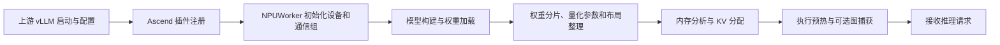
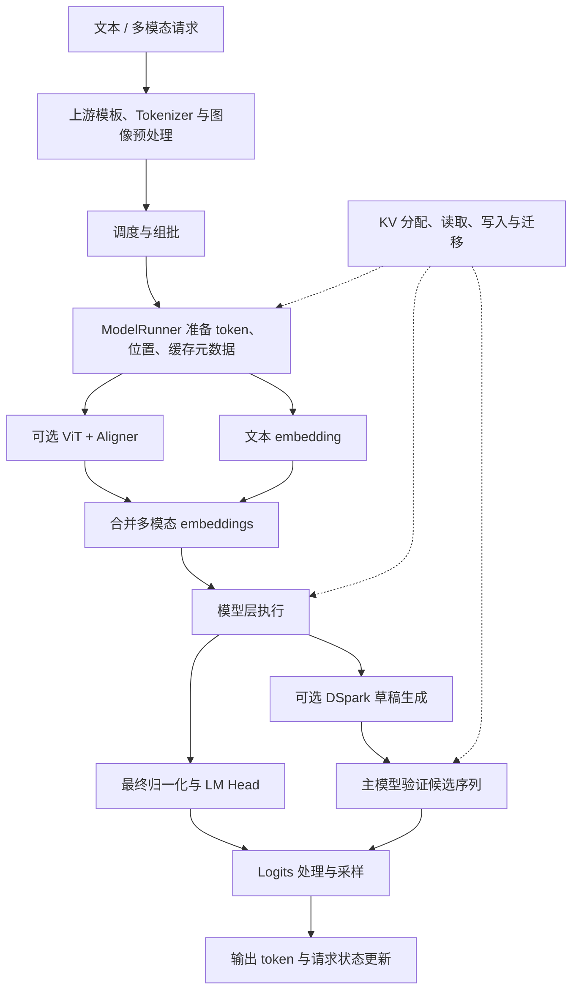
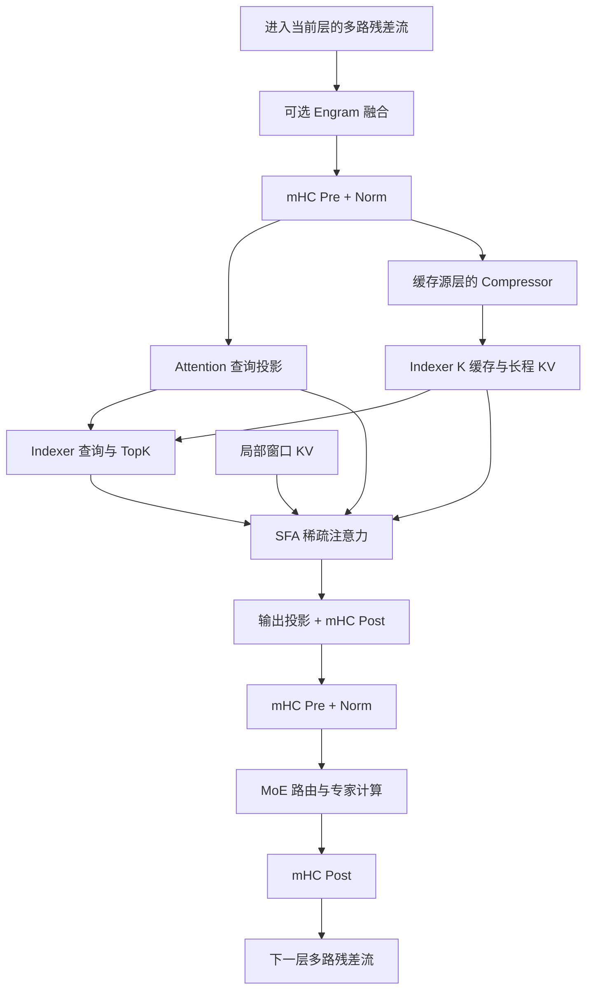
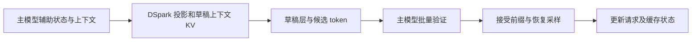
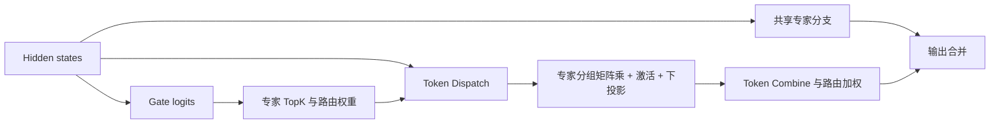

# vLLM Ascend 当前代码仓介绍与模块划分

从零学习各模块原理、内部数据结构与执行时序，请继续阅读 [详细设计：从基础原理到代码实现](detailed-design.md)。

## 1. 扫描范围与仓库定位

本文根据本地代码静态扫描整理，重点解释模块职责、输入输出、代码入口及相互关系。

| 项目 | 本次扫描版本 |
| --- | --- |
| 本地目录 | `D:\code\vllm-ascend` |
| 当前分支 | `integrate/dsnext-megamoe-vllm-cann` |
| 当前提交 | `203fbd7d43268cbca4ecb6b2a8a8aa4f43e57839` |
| 集成基线 | `rfc/vllm_cann`，提交 `0040652a66d31a2b277588ac90d7d37e92757bc5` |
| 版本参考文件 | [vLLM release 标记](../../.github/vllm-release-tag.commit) 为 `v0.30.0`；[验证的 vLLM 提交](../../.github/vllm-main-verified.commit) 为 `ced6857afa0ea7b2e3f0846a62e1394e90f15607` |
| 扫描对象 | 当前仓库受 Git 管理的源码；排除未跟踪的 `v30-workspace/` 旧副本 |

版本参考文件描述源码的兼容目标，不能据此判断本机实际安装的 vLLM 版本。本文没有启动模型或进行 NPU 性能验证。

**这个仓库是 vLLM 的 Ascend 硬件插件：它接入上游推理引擎，在 NPU 上实现模型执行、算子、量化、通信和缓存管理。** HTTP 服务、一般的请求生命周期、通用 tokenizer 接口及部分模型基础组件由上游 vLLM 提供；本仓通过平台插件、模型注册、继承和补丁接入。

当前分支同时包含通用 Ascend 框架、多个模型适配，以及 DeepSeek V4/V4.1 专有实现。Engram、Compressor、Indexer、mHC 等模块需要结合具体模型阅读，不能认为所有模型都会执行这些模块。是否走某条路径，还取决于模型配置、量化方式、硬件能力和推理配置。

插件入口见 [setup.py](../../setup.py)、[包初始化](../../vllm_ascend/__init__.py)、[NPUPlatform](../../vllm_ascend/platform.py)；模型映射见 [模型注册表](../../vllm_ascend/models/__init__.py)。例如 `DeepseekV41ForCausalLM` 注册到 V4.1 的 [多模态包装层](../../vllm_ascend/models/deepseek_v41/vl_model.py)，再由它调用文本骨干。

### 1.1 阅读来源与组织方式

本次先阅读 README 提供的 [DeepWiki](https://deepwiki.com/vllm-project/vllm-ascend)，再核对当前源码。不同页面的快照、对应入口和实现差异见 [阅读记录](deepwiki-reading-notes.md)。本介绍先建立仓库边界；[详细设计](detailed-design.md) 按原理展开；[目录导读](code-directory-guide.md) 把职责对应到文件与调用关系。

## 2. 总体模块地图

模块可以分为四层：服务与调度层、模型计算层、执行与资源层、算子与硬件层。目录与逻辑模块不是一一对应的，例如 MoE 同时涉及 `models/`、`ops/`、`quantization/`、`distributed/` 和 `csrc/`。

| 层次 | 主要内容 | 主要目录或入口 |
| --- | --- | --- |
| 服务与调度 | 请求接入、批处理、Prefill/Decode 调度 | 上游 vLLM；本仓 [core](../../vllm_ascend/core/)、[platform 补丁](../../vllm_ascend/patch/platform/) |
| 模型计算 | ViT、Engram、Compressor、Indexer、SFA、MoE、mHC、DSpark | [models](../../vllm_ascend/models/)、[attention](../../vllm_ascend/attention/)、[spec_decode](../../vllm_ascend/spec_decode/) |
| 执行与资源 | 权重加载、输入组批、Worker、KV 管理、分布式通信、图执行、采样 | [model_loader](../../vllm_ascend/model_loader/)、[worker](../../vllm_ascend/worker/)、[distributed](../../vllm_ascend/distributed/)、[compilation](../../vllm_ascend/compilation/)、[sample](../../vllm_ascend/sample/) |
| 算子与硬件 | NPU 算子适配、Triton、自定义 C++/Ascend C 算子、量化实现 | [device](../../vllm_ascend/device/)、[ops](../../vllm_ascend/ops/)、[quantization](../../vllm_ascend/quantization/)、[csrc](../../csrc/) |

本次扫描中，受 Git 管理的文件数量为：`vllm_ascend/` 767 个、`csrc/` 1771 个、`tests/` 1183 个、`docs/` 446 个、`examples/` 52 个、`benchmarks/` 10 个。这里统计的是文件数，包含配置、构建文件和文档，不是 Python 文件数或代码行数。

### 2.1 用户指定模块的职责速览

| 模块 | 解决的问题 | 主要输入 | 主要输出 | 通用性 |
| --- | --- | --- | --- | --- |
| 权重准备 | 把 checkpoint 转成可执行的参数及算子布局 | 模型配置、权重、量化配置 | 已加载模型、权重分片及 scale | 通用框架，布局随模型/硬件变化 |
| 输入准备 / Tokenizer | 把请求转成当前推理步的 token 和执行元数据 | 文本、图片、调度结果 | token IDs、位置、批边界、缓存映射 | 通用；LoPT 是可选扩展 |
| ViT | 将图像转成语言模型可消费的表示 | 图像 patch、网格信息 | 对齐后的视觉 embeddings | 多模态模型 |
| Indexer | 为稀疏注意力选择历史上下文位置 | 当前查询、索引 K 缓存 | TopK 位置及有效长度 | 稀疏注意力模型 |
| Engram | 用 token 历史检索学习到的记忆表并融合 | 原始 token IDs、历史状态、hidden states | 记忆增强后的 hidden states | 当前重点为 DeepSeek V4.1 |
| Compressor | 生成供长上下文注意力使用的压缩表示 | hidden states、位置、压缩状态 | 长程 latent KV、关联索引 K | 当前重点为 DeepSeek V4/V4.1 |
| DSpark | 用草稿模型提出多个候选 token | 主模型辅助 hidden states、上下文、已知 token | 候选 token，由主模型验证 | 投机解码扩展 |
| SFA | 在局部窗口及选中历史位置上计算注意力 | Q、KV、TopK 位置、缓存元数据 | attention hidden states | 稀疏注意力后端 |
| MoE | 路由 token 到专家并合并计算结果 | hidden states、门控 logits | 专家加权输出及共享专家输出 | 多种 MoE 模型 |
| mHC | 管理多路残差流及子层前后混合 | 多路 hidden states、混合参数 | 更新后的多路残差流 | 当前重点为 DeepSeek V4/V4.1 |
| KV 管理 | 分配、定位、复用、迁移和释放注意力状态 | cache spec、调度结果、位置 | 缓存张量、block table、slot mapping | 通用框架及模型专用布局 |

### 2.2 理解模块时同时看三条关系

| 关系 | 要回答的问题 | 典型链路 |
| --- | --- | --- |
| 控制关系 | 谁决定本轮执行哪些请求、使用何种路径 | Scheduler → Worker/Runner → Forward Context → 后端选择 |
| 数值计算 | token 和 hidden states 怎样变成输出 | Tokenizer → Embedding/ViT → 模型层 → LM Head → 采样 |
| 状态与资源 | 历史、地址、权重和异步任务怎样保持有效 | Cache spec/分配 → block/slot 映射 → 设备写入/消费 → 回收或迁移 |

例如 Indexer 依赖 Runner 提供坐标和缓存资源，又产生 SFA 要消费的稀疏索引。单看 `indexer.py` 的类和函数不能解释这三者怎样衔接。推荐先看目录导读中的执行链，再按本文模块表定位实现。

DeepWiki 的平台、执行、注意力、分布式和算子章节分别覆盖这些关系。本地 DeepSeek V4.1 的模块组合继续以模型注册、层拓扑和专有 cache config 为准。

## 3. 两条主流程

### 3.1 模型启动：权重到可执行模型

权重加载后的布局整理与缓存规划都受硬件和模型配置影响。LoRA、网络权重加载、RFork、投机解码及图执行属于按配置启用的路径。

### 3.2 推理请求：输入到输出 token

Prefill 处理初始上下文并建立缓存，Decode 读取历史缓存并写入新 token 的状态。调度器也可以把 Prefill 切块，或在一个批次中混合不同请求阶段；模型不能仅凭当前 token 数推断请求处于哪个阶段。

### 3.3 DeepSeek V4.1 的单层关系

下面是逻辑数据流。真实代码包含跨层缓存共享、异步 lookup、元数据流、并行通信及算子融合，因此执行时不必逐框串行。

在 [DeepseekV41Model.forward](../../vllm_ascend/models/deepseek_v41/model.py) 中，DSpark 所需的辅助状态从配置指定层的入口残差流提取，发生在该层 Engram 融合之前。最后一层之后，再对 mHC 多路状态做 collapse 和最终 Norm。

## 4. 权重准备、输入数据准备与 Tokenizer

### 4.1 权重准备

权重准备包括模型实例化、checkpoint 名称映射、TP/EP/PP 分片、量化 scale 加载，以及算子要求的转置、打包或布局转换。最终产物是可直接参与前向计算的参数；在线激活量化则发生在后续计算阶段。

| 子模块 | 职责 | 代码入口 |
| --- | --- | --- |
| Worker 加载入口 | 初始化 NPU，组织模型加载与后续准备 | [worker.py](../../vllm_ascend/worker/worker.py)，`NPUWorker.load_model` |
| Runner 模型加载 | 对接 vLLM 的模型加载、内存分析和执行准备 | [model_runner_v1.py](../../vllm_ascend/worker/model_runner_v1.py)，[V2 model_runner.py](../../vllm_ascend/worker/v2/model_runner.py) |
| 模型权重映射 | 对齐 checkpoint 与本地层命名，处理专家、视觉及记忆参数 | [V4.1 文本模型](../../vllm_ascend/models/deepseek_v41/model.py)，[多模态包装层](../../vllm_ascend/models/deepseek_v41/vl_model.py) |
| 量化配置解析 | 选择量化配置和计算方法 | [configs](../../vllm_ascend/quantization/configs/)，[ModelSlim 配置](../../vllm_ascend/quantization/configs/modelslim_config.py)，[quant_parser.py](../../vllm_ascend/quantization/quant_parser.py) |
| 层级量化适配 | Linear、MoE、Embedding、KV 的权重创建、后处理和执行 | [method_adapters.py](../../vllm_ascend/quantization/method_adapters.py)，[methods](../../vllm_ascend/quantization/methods/) |
| 可选网络加载 | 注册 `netloader`，提供网络权重加载路径 | [netloader.py](../../vllm_ascend/model_loader/netloader/netloader.py)，`ModelNetLoaderElastic` |
| 可选 RFork 加载 | 使用 manifest、session、seed 服务及 tensor layout 管理加载过程 | [rfork_loader.py](../../vllm_ascend/model_loader/rfork/rfork_loader.py)，[RFork 目录](../../vllm_ascend/model_loader/rfork/) |
| 权重传输与更新 | 提供 HCCL/NPU IPC 权重传输实现 | [weight_transfer](../../vllm_ascend/distributed/weight_transfer/) |

理解量化时，至少要同时看权重、激活、scale、矩阵布局和目标算子的接口。W4A8/MXFP 等标签不足以说明两组参数可直接互换；例如 routed expert 与 shared expert 的布局及 kernel 参数必须分别匹配。

### 4.2 Tokenizer 与原始输入

一般的文本规范化、chat template 和 tokenizer 调用来自上游 vLLM。本仓提供可选的 LoPT 长文本并行 tokenization：在 CPU 上并行处理文本片段，通过重叠区和边界匹配合并结果，并在不满足条件或处理失败时回退到常规 tokenizer。

主要入口是 [LosslessParallelTokenizer](../../vllm_ascend/tokenization/lopt_tokenizer.py) 和 [LoPT 接入补丁](../../vllm_ascend/patch/platform/patch_lopt_tokenization.py)。它优化输入编码阶段，不参与 Decoder 的 NPU 注意力计算。

多模态预处理还会产生图像 patch、网格和占位信息。V4.1 包装层引用配套上游 vLLM 的 `mm_preprocess`；本仓 [V4 mm_preprocess.py](../../vllm_ascend/models/deepseek_v4/mm_preprocess.py) 属于另一条模型路径，阅读时需确认实际注册的模型。

### 4.3 当前推理步的输入准备

ModelRunner 把调度结果整理成设备张量及元数据，典型内容包括：

- `input_ids` 与 `positions`：当前步 token 及其序列位置。
- `query_start_loc`、序列长度和已计算 token 数：描述不同请求在展平批次中的边界。
- `block_table` 与 `slot_mapping`：将逻辑序列位置映射到物理缓存页和写入槽位。
- 多模态 embeddings、有效 token mask，以及各注意力后端需要的附加信息。

代码入口见 [V1 Runner 的 `_prepare_inputs`](../../vllm_ascend/worker/model_runner_v1.py)、[V2 输入批次](../../vllm_ascend/worker/v2/input_batch.py)、[block_table.py](../../vllm_ascend/worker/block_table.py)。设计说明见 [ModelRunner_prepare_inputs.md](../../docs/source/developer_guide/Design_Documents/ModelRunner_prepare_inputs.md)。

另外，[device_metadata.py](../../vllm_ascend/worker/device_metadata.py) 将设备元数据生产分成 `COMPRESSOR`、`ATTENTION`、`INDEXER` 阶段，并管理流与事件依赖。修改输入布局时，需要同时检查元数据生产、消费时机和图捕获中的 buffer 复用。

## 5. ViT 与 Indexer

### 5.1 ViT：图像编码与语言表示对齐

ViT 属于多模态输入分支。V4.1 的典型流程是：图像 patch 投影 → 带二维位置处理的视觉 Attention/MLP → Aligner → 加入图像边界与换行表示 → 形成可合入语言输入的 embeddings。

| 组件 | 职责 | 代码入口 |
| --- | --- | --- |
| PatchEmbed、VisionAttention、VisionMLP、ViT | 提取图像特征；视觉 Attention 使用多模态编码器算子 | [V4.1 vision.py](../../vllm_ascend/models/deepseek_v41/vision.py) |
| Aligner | 将视觉维度对齐到语言模型 hidden size | [V4.1 vision.py](../../vllm_ascend/models/deepseek_v41/vision.py) |
| 多模态包装层 | 处理 patch/grid，构建图像序列并返回 embeddings | [V4.1 vl_model.py](../../vllm_ascend/models/deepseek_v41/vl_model.py)，`_encode_image`、`_build_image_span`、`embed_multimodal` |
| 编码器执行与复用 | 管理视觉编码相关图执行和结果复用 | [encoder_acl_graph.py](../../vllm_ascend/worker/encoder_acl_graph.py)，[mm_encoder_attention.py](../../vllm_ascend/ops/mm_encoder_attention.py) |

当前 V4.1 ViT 的本地实现采用复制的视觉塔路径，不能直接套用文本骨干的 TP/EP 分片规则。是否构建和使用图像分支由视觉配置与允许的多模态输入决定。

### 5.2 Indexer：稀疏注意力的位置选择器

Indexer 使用较小的索引表示评估历史上下文相关性，为 SFA 产生候选位置。它与 ViT 是独立模块，也与 MoE 的专家选择 TopK 不同。

在 V4.1 中，`DeepseekV41Indexer` 包含两部分：

1. **索引 K 生产与缓存**：拥有索引 K 的源层将 Compressor 的 latent 投影成索引 K，经归一化、位置处理和量化后写入缓存。
2. **查询与选择**：当前 token 的查询投影和 head 权重与历史索引 K 计算评分，产生最终 TopK；部分路径先用候选 block 缩小范围。

跨层共享的候选 block ID 与最终注意力位置属于不同坐标，必须结合有效长度、压缩比例和缓存映射解释。当前实现的正确性路径在每个 TP rank 上复制索引 heads，以产生相同的稀疏位置。

主要入口：

- [V4.1 indexer.py](../../vllm_ascend/models/deepseek_v41/indexer.py)：`update_keys`、`project_query`、`select_projected` 等。
- [通用 attention/indexer.py](../../vllm_ascend/attention/indexer.py)：其他索引后端的接入。
- [prepare_indexer_indices.py](../../vllm_ascend/ops/triton/prepare_indexer_indices.py)：位置整理。
- [量化索引算子](../../csrc/attention/quant_lightning_indexer_v2/)：自定义算子实现。

## 6. Engram：基于 token 历史的学习记忆

Engram 从原始 token IDs 及历史状态生成 n-gram/hash 索引，读取模型学习到的 embedding 表，将得到的表示投影、门控后融合进 hidden states。它提供额外的记忆通路，表参数属于模型权重。

这里要区分三种状态：**Engram 表是学习参数，hash/lookback 状态用于解释 token 历史，Attention KV 是请求前向计算产生的状态。** 三者的加载、生命周期和复用规则不同。

| 子组件 | 职责 | 代码入口 |
| --- | --- | --- |
| Hash 与历史维护 | 根据原始 token 及 lookback 生成记忆索引，处理有效位置和分块边界 | [hash_state.py](../../vllm_ascend/models/deepseek_v41/engram/hash_state.py)，[model_state.py](../../vllm_ascend/models/deepseek_v41/engram/model_state.py) |
| 表与 lookup | 支持不同表格式、分片、读取与反量化 | [embedding.py](../../vllm_ascend/models/deepseek_v41/engram/embedding.py)，`AscendParallelEngramEmbedding` |
| 并行与存储 | 管理 Engram 并行交换，以及 NPU/host UVA 表存储路径 | [parallel.py](../../vllm_ascend/models/deepseek_v41/engram/parallel.py)，[npu.py](../../vllm_ascend/models/deepseek_v41/engram/npu.py) |
| Hidden 融合 | 将 lookup 结果做 key/value 投影及门控，更新多路 hidden states | [layer.py](../../vllm_ascend/models/deepseek_v41/engram/layer.py)，`AscendEngram` |
| 模型集成 | 准备 lookup、mask、图事件，在指定层使用结果 | [model.py](../../vllm_ascend/models/deepseek_v41/model.py)，`prepare_engram`、`prepare_engram_inputs`、`forward` |
| 底层实现 | Hash、lookup、lookback、门控算子 | [Triton 算子目录](../../vllm_ascend/ops/triton/) 中的 `engram_*.py` |

当前代码包含 BF16、INT8 和 MXFP8 等表路径，以及 host UVA 读取和共享存储实现；具体可用组合受模型和硬件条件约束。

模型前向可以提前发起 hash/lookup，让早期层与其重叠。进入第一个实际消费该结果的层时，代码等待相应事件，再对静态容量 lookup buffer 做有效 token 裁剪和必要的序列并行分片。因此，分析 Engram 不能只看 lookup 算子，还要看层入口、mask 与图事件。

## 7. Compressor 与 DSpark

这两个模块处理不同对象：Compressor 组织历史注意力表示；DSpark 组织未来候选 token 的生成与验证。两者都可能需要缓存，但数据格式和更新时机不同。

### 7.1 Compressor：长程上下文表示

V4.1 的 `DeepseekV41Compressor` 生成 latent KV。当前文件具有 ratio-1 投影/归一化路径，以及 ratio-2 的 FP32 投影、门控评分和 ring pooling 路径；具体层使用哪种比例由模型层拓扑决定。

ratio-2 路径维护循环状态，并将池化输出 buffer 提前分配，使其占用进入内存预算。输出 latent 首先供 Indexer 生成索引 K，再执行长程 KV 的位置处理并写入缓存，保证两条消费路径使用各自要求的表示。

| 关注点 | 代码入口 |
| --- | --- |
| 投影、归一化、循环状态与池化 | [compressor.py](../../vllm_ascend/models/deepseek_v41/compressor.py)，`DeepseekV41Compressor` |
| Ring pooling 实现 | [compressor_triton.py](../../vllm_ascend/ops/triton/compressor/compressor_triton.py) |
| 源层写入流程 | [dsa_v41.py](../../vllm_ascend/attention/dsa_v41.py)，`_write_compressed_source` |
| 源层/消费者及压缩比例 | [model.py](../../vllm_ascend/models/deepseek_v41/model.py)，`build_layer_plan` |
| 缓存格式与状态布局 | [cache_config.py](../../vllm_ascend/models/deepseek_v41/cache_config.py) |

跨层共享时，拥有缓存的源层负责生产，消费者复用对应数据；并非每个 Decoder 层都独立生成完整长程 KV。V4 的 [compressor.py](../../vllm_ascend/models/deepseek_v4/compressor.py) 是另一套模型实现，不能直接用 V4.1 的比例和布局解释。

### 7.2 DSpark：投机解码

DSpark 使用主模型指定层提供的辅助 hidden states，结合上下文和 token 信息执行草稿网络，一次提出多个候选 token。主模型随后验证候选序列，采样阶段决定接受的前缀及恢复 token，再推进请求和缓存状态。

主要入口：

- [V4.1 dspark.py](../../vllm_ascend/models/deepseek_v41/dspark.py)：草稿层构建、辅助状态投影、上下文 KV 预计算、Markov embedding/bias、logits 和权重映射。
- [dspark_proposer.py](../../vllm_ascend/spec_decode/dspark_proposer.py)：V1 侧草稿生成流程。
- [V2 DSpark speculator.py](../../vllm_ascend/worker/v2/spec_decode/dspark/speculator.py)：V2 侧 Ascend 接入。
- [rejection_sampler.py](../../vllm_ascend/sample/rejection_sampler.py)：验证后接受与恢复采样。
- [DSpark 补丁](../../vllm_ascend/patch/worker/patch_v2/patch_dspark.py)：对接配套上游实现。

草稿层数、目标层、block size 及并行设置来自具体配置。草稿模型的专家形状、上下文缓存和主模型不必相同，分析或升级时应分别核对。仓库还包含 MTP、Eagle、DFlash 等其他投机解码路径，不能将 `spec_decode/` 全部理解为 DSpark。

## 8. SFA：稀疏注意力计算

在当前实现中，可以把 DSA 理解为包含查询、Compressor、Indexer 和缓存组织的模型级稀疏注意力流程；SFA 是消费这些结果的稀疏注意力计算部分。

对 V4.1 来说，注意力结合局部窗口 KV 和选中的长程 KV。Indexer 提供历史位置，SFA 根据 Q、缓存内容和元数据执行实际的注意力加权聚合，之后进行必要的位置处理和输出投影。

| 组件 | 职责 | 代码入口 |
| --- | --- | --- |
| V4.1 注意力编排 | 查询预处理、缓存写入、Indexer 调用和 Attention 调用 | [dsa_v41.py](../../vllm_ascend/attention/dsa_v41.py)，`AscendDSAV41Impl` 的相关流程 |
| 通用 SFA 接入 | Backend、metadata builder 与实现 | [sfa_v1.py](../../vllm_ascend/attention/sfa_v1.py) |
| 普通稀疏 MLA 适配 | 对接 CANN 稀疏计算路径 | [sparse_flash_mla.py](../../vllm_ascend/attention/sparse_flash_mla.py) |
| 混合量化路径 | 对接 packed cache / 量化稀疏计算 | [mixed_quant_sparse_flash_mla.py](../../vllm_ascend/attention/mixed_quant_sparse_flash_mla.py) |
| 上下文并行 | 协调拆分后的查询、KV 与结果 | [context_parallel](../../vllm_ascend/attention/context_parallel/) |
| Offload 接入 | 协调稀疏注意力与 KV 迁移 | [sfa_kv_offload.py](../../vllm_ascend/attention/sfa_kv_offload.py) |

`dsa_v41.py` 的 `_forward_attention` 根据可用 packed-cache 算子选择量化路径，或调用 `_C_ascend.npu_sparse_flash_mla` 等路径。两者的缓存表示和接口存在差异，不能只改 Python 调用而忽略 scale、block table、有效长度及算子版本。

## 9. MoE：路由、专家计算与结果合并

MoE 由门控、专家选择、token 分发、专家 FFN、结果合并及可选共享专家组成。模型层提供门控及专家配置，Ascend 通用实现负责通信与 NPU 计算。

| 子模块 | 职责 | 代码入口 |
| --- | --- | --- |
| 模型级 MoE | 门控与模型专有路由行为、专家实例化 | [V4.1 model.py](../../vllm_ascend/models/deepseek_v41/model.py) |
| 统一执行入口 | 协调 routed/shared expert 和执行方法 | [fused_moe.py](../../vllm_ascend/ops/fused_moe/fused_moe.py)，`AscendMoERunner` |
| 路由与分发 | TopK、路由布局、token dispatch/combine | [fused_moe 目录](../../vllm_ascend/ops/fused_moe/) |
| 量化专家 | 创建专家权重、整理 scale 和调用量化计算 | [quantization/methods](../../vllm_ascend/quantization/methods/) |
| MegaMoE | 检查融合调用所需 ABI 与参数；配合相应量化方法接入融合计算 | [mega_moe.py](../../vllm_ascend/ops/fused_moe/mega_moe.py) |
| EPLB | 专家负载统计、映射与重排 | [eplb](../../vllm_ascend/eplb/) |
| 自定义算子 | 分组矩阵计算、路由与通信相关算子 | [csrc/moe](../../csrc/moe/) |

通信策略可以涉及 AllGather、AllToAll、MC2 等，选择受硬件、并行规模和执行阶段影响。EP 是专家分布，TP 是参数/张量分片，两者不能用同一组 rank 或 buffer 假设替代。

当前分支包含此前移植的三项 MegaMoE 改动及 `vllm_cann` 适配：A5 MegaMoE、Prefill/Decode 混合场景的 buffer 处理、共享专家融合。融合是否执行仍受量化格式、算子 ABI、共享专家兼容性及 EPLB 等条件控制，存在回退路径；并非所有 MoE 调用都会走同一融合算子。

这里介绍的是当前仓库已有的 EPLB。之前扫描 GitCode 时发现的其他 OmniEPLB PR，不能据此视为已合入当前分支。

## 10. mHC：多路残差流与层间混合

mHC（manifold-constrained Hyper-Connections）将残差状态扩展为多路流，并在 Attention、FFN 前后进行受约束的混合。它改变模型层的残差组织方式，与注意力头或通信组属于不同概念。

V4.1 代码中，hidden states 的主要形式为 `[token, hc_mult, hidden_size]`。每层先通过 `hc_pre` 得到子层输入及混合信息，完成 Attention 后用 `hc_post` 更新多路残差；随后对 MoE/FFN 重复该流程。`pre_mix` 可以跨层传递，最终层之后才 collapse 成单路表示并执行最终 Norm。

主要入口是 [DeepseekV41DecoderLayer 与 DeepseekV41Model](../../vllm_ascend/models/deepseek_v41/model.py) 中的 `hc_pre`、`hc_post`、`hc_collapse`；底层实现见 [hc_pre](../../csrc/moe/hc_pre/) 和 [hc_post](../../csrc/moe/hc_post/)。算子位于 `csrc/moe/` 是目录组织方式，不表示 mHC 负责专家路由。

修改 mHC 时应关注形状、混合参数、精度和最终 collapse，同时检查 Engram 输入、DSpark 辅助状态和序列并行切分是否仍保持相同语义。

## 11. KV 管理：逻辑缓存与物理存储

KV 管理贯穿模型和执行框架。上游 vLLM 主要管理请求、逻辑 block、调度与复用；Ascend 插件扩展 cache spec、设备布局、注意力元数据、物理分配及 NPU 数据迁移。

### 11.1 一般缓存链路

1. 模型/注意力层声明缓存规格，包括 block size、dtype、维度和缓存类型。
2. Worker/Runner 做内存分析并分配设备缓存，绑定到实际层。
3. 调度及输入准备生成 block table 和 slot mapping。
4. 前向计算写入当前 token 的状态，并根据映射读取历史状态。
5. 请求推进、结束或被抢占时，按框架规则复用、迁移或释放 block。

主要入口见 [kv_cache_interface.py](../../vllm_ascend/core/kv_cache_interface.py)、[single_type_kv_cache_manager.py](../../vllm_ascend/core/single_type_kv_cache_manager.py)、[V1 Runner](../../vllm_ascend/worker/model_runner_v1.py) 的 `get_kv_cache_spec`/分配/初始化流程，以及 [V2 Runner](../../vllm_ascend/worker/v2/model_runner.py)。

### 11.2 V4.1 中的多个缓存平面

| 状态 | 用途 | 主要生产者/消费者 |
| --- | --- | --- |
| 局部窗口 KV | 保留近邻 token 的注意力表示 | Attention 写入和读取 |
| 长程 latent KV | 保存供稀疏注意力读取的长程表示 | Compressor/源 Attention 层生产，SFA 消费 |
| Indexer K 与 scale | 保存用于相关性评分的索引表示 | Indexer 生产和选择 |
| 可选 folded index cache | 为候选 block 选择提供整理后的表示 | 候选源层生产，Indexer 消费 |
| Compressor ring state | 跨步维护压缩累积状态 | Compressor 更新 |
| DSpark 上下文 KV | 供草稿网络读取目标上下文 | DSpark 预计算和消费 |

这些状态具有不同 dtype、维度、长度解释和有效范围，不能统一按普通 K/V 二元张量处理。关键定义在 [cache_config.py](../../vllm_ascend/models/deepseek_v41/cache_config.py)、[dsa_v41.py](../../vllm_ascend/attention/dsa_v41.py) 的 `DeepseekV41CacheLayer`，以及 [model.py](../../vllm_ascend/models/deepseek_v41/model.py) 的层拓扑。

硬件能力还会选择 A5 packed-cache 等布局。逻辑 token block、压缩后存储 block 和实际字节布局需要分别理解。

### 11.3 KVPP、PD 传输、缓存池与 Offload

| 功能 | 解决的问题 | 代码入口 |
| --- | --- | --- |
| KVPP | 在一个阶段的 TP ranks 间按层分布持久 KV，由 owner 保存并向消费者提供；使用 scratch/prefetch 组织访问 | [kv_cache_placement.py](../../vllm_ascend/core/kv_cache_placement.py)，[KVPP 设计说明](../../docs/source/developer_guide/Design_Documents/kvpp.md) |
| PD 点对点传输 | 在 Prefill 与 Decode 实例之间交接请求缓存 | [kv_p2p](../../vllm_ascend/distributed/kv_transfer/kv_p2p/) |
| KV Pool / Store | 对接缓存存储和跨实例协调 | [ascend_store](../../vllm_ascend/distributed/kv_transfer/kv_pool/ascend_store/) |
| 通用 KV Offload | 对接 NPU 与其他存储层之间的缓存迁移 | [native/npu.py](../../vllm_ascend/distributed/kv_transfer/kv_pool/kv_offload/native/npu.py) |
| 稀疏 KV Offload | 按稀疏访问需要组织 HBM/host 内存中的 KV 数据 | [sparse_kv_offload_manager.py](../../vllm_ascend/distributed/kv_transfer/sparse_kv_offload/sparse_kv_offload_manager.py) |

KVPP 的重点是缓存物理归属；PP 的重点是模型层执行分段。Prefix cache 的重点是复用已有前缀计算；PD 传输的重点是实例之间交接缓存。它们可以关联，但不是同一机制，也不会默认全部启用。

## 12. 其他建议纳入的模块

### 12.1 Worker、ModelRunner 与调度

这是整套计算的执行骨架。Worker 管理设备、分布式初始化和模型生命周期；ModelRunner 管理持久批次、输入准备、forward、缓存绑定及采样衔接。仓库同时维护 [V1 Runner](../../vllm_ascend/worker/model_runner_v1.py) 与 [V2 Runner](../../vllm_ascend/worker/v2/model_runner.py)，实际采用哪个入口取决于配置和配套 vLLM。

[core](../../vllm_ascend/core/) 和 [platform 补丁](../../vllm_ascend/patch/platform/) 中包含调度及配置适配。分析算子性能时，应同时区分模型计算、输入准备、通信、CPU 调度和同步等待的时间。

### 12.2 分布式通信与并行

| 并行方式 | 主要划分对象 | 主要影响 |
| --- | --- | --- |
| TP | 张量/参数 | Linear、embedding、结果聚合及缓存布局 |
| EP | 专家 | MoE 路由、分发与合并 |
| DP | 请求/模型副本 | 批次协调与副本负载 |
| PP | 模型层 | 中间状态传输及各阶段执行 |
| CP / PCP / DCP | 上下文或 token 计算 | Attention 上下文拆分、索引及 KV 协调 |

主要目录见 [distributed](../../vllm_ascend/distributed/)、[parallel_state.py](../../vllm_ascend/distributed/parallel_state.py) 和 [Attention 上下文并行](../../vllm_ascend/attention/context_parallel/)。硬件通信后端及组间配合会影响计算模块的 shape 和 buffer 生命周期。

### 12.3 图编译、捕获与执行

[compilation](../../vllm_ascend/compilation/) 提供 ACL graph、融合和编译接入。其目标是减少执行开销，但要求正确处理静态容量 buffer、实际有效 token 数、shape 分桶、事件及更新规则。模型中出现异步 producer、Engram lookup 或 KV 预取时，图内外的依赖尤其关键。

图路径与 eager 路径可能采用不同的准备方式，具体模型也可能声明需要绕过某些编译模式。阅读时应把算子、Runner、图包装与事件生命周期连起来看。

### 12.4 采样与输出处理

LM Head 将最终 hidden states 转成词表 logits；采样处理温度、TopK/TopP、惩罚和其他约束后选择 token。投机解码还需要处理候选接受及恢复。

本仓入口见 [sampler.py](../../vllm_ascend/sample/sampler.py)、[rejection_sampler.py](../../vllm_ascend/sample/rejection_sampler.py)、[vocab_parallel_embedding.py](../../vllm_ascend/ops/vocab_parallel_embedding.py)。Logits 与请求状态的其他通用处理仍与配套上游 vLLM 协作。

### 12.5 硬件能力、算子与量化

[hardware_profile.py](../../vllm_ascend/device/hardware_profile.py) 集中描述硬件能力、通信策略和权重布局策略；[device_op.py](../../vllm_ascend/device/device_op.py) 组织设备算子适配。上层还会调用 `torch_npu`、CANN、外部算子包、本仓 `_C_ascend` 及 [Triton 算子](../../vllm_ascend/ops/triton/)。因此，Python 中出现算子调用，不代表该算子的全部实现都在本仓。

[quantization](../../vllm_ascend/quantization/) 跨越权重准备和实际计算，不能仅归入加载模块。[LoRA](../../vllm_ascend/lora/) 与 [weight_switch](../../vllm_ascend/weight_switch/) 则提供额外的参数适配与切换路径。

### 12.6 硬件专用路径、测试与观测

[_310p](../../vllm_ascend/_310p/) 和 [xlite](../../vllm_ascend/xlite/) 包含专用执行路径；不能认为 A5 或通用路径的算子在这些设备上行为完全一致。

[tests/ut](../../tests/ut/)、[tests/e2e](../../tests/e2e/)、[benchmarks](../../benchmarks/) 和 [docs](../../docs/) 分别承担单元验证、端到端验证、性能评估和设计说明。主机侧静态检查能发现接口和语法问题，NPU 算子的精度、通信与性能仍需要对应硬件和模型配置验证。

## 13. 模块之间的主要接口与改动影响

| 修改对象 | 需要同时核对的模块 | 原因 |
| --- | --- | --- |
| 权重格式、量化方法 | Loader、Linear/MoE、scale、设备算子 | 参数布局与实际计算接口必须一致 |
| Tokenizer、输入 token 或占位符 | 输入准备、ViT、Engram、模型路由 | 不同模块可能需要原始 token 与处理后的 embeddings |
| Compressor 比例或输出布局 | Indexer、SFA、cache spec、PD/Offload | 索引坐标、有效长度及缓存字节布局改变 |
| Indexer TopK 或候选筛选 | 缓存映射、SFA、CP、设备元数据 | block ID 与 token 位置需要一致解释 |
| Engram 表格式或 lookup 并行 | 权重加载、hash/history、图事件、mHC 输入 | 表参数、原始 token 状态和消费时序关联 |
| MoE 路由、共享专家或融合 | EP/TP、量化、EPLB、通信 buffer、草稿模型 | 分发与合并布局、专家 shape 和融合条件关联 |
| mHC shape 或混合方式 | Attention、MoE、Engram、DSpark、最终 Norm | 它包围子层并改变残差状态格式 |
| DSpark 草稿配置 | 主模型辅助状态、草稿 KV、验证、采样、PD | 候选数与缓存推进必须保持一致 |
| KV 物理布局或 owner | Runner、Attention、Indexer、KVPP、迁移 | 所有读写和传输路径都依赖布局约定 |
| Graph 捕获与异步流 | 元数据、Engram、KV 预取、buffer 复用 | 生产完成与消费/复用之间必须保持依赖 |

## 14. 建议的代码阅读顺序

1. **先看插件如何接入**：[包初始化](../../vllm_ascend/__init__.py) → [platform.py](../../vllm_ascend/platform.py) → [模型注册表](../../vllm_ascend/models/__init__.py)。
2. **再看执行骨架**：[worker.py](../../vllm_ascend/worker/worker.py) → 实际使用的 V1/V2 Runner，串起加载、输入、缓存、forward 与采样。
3. **以 V4.1 为模型主线**：[vl_model.py](../../vllm_ascend/models/deepseek_v41/vl_model.py) → [model.py](../../vllm_ascend/models/deepseek_v41/model.py)，先理解层拓扑和 mHC。
4. **沿注意力数据流深入**：Compressor → Indexer → [dsa_v41.py](../../vllm_ascend/attention/dsa_v41.py) → SFA；同时打开 cache spec 与 cache config。
5. **分别看旁路与 FFN**：Engram 的 hash/lookup/fusion；MoE 的 gate/dispatch/compute/combine。
6. **最后看扩展执行**：DSpark、KVPP、PD、Offload、图捕获和多机并行，确认各路径的启用条件。

后续如果按模块评估升级适配，可先从第 13 节的接口关系找出受影响路径，再分别核对主模型与草稿模型、Prefill 与 Decode、eager 与 graph，以及当前硬件实际采用的量化和通信后端。
