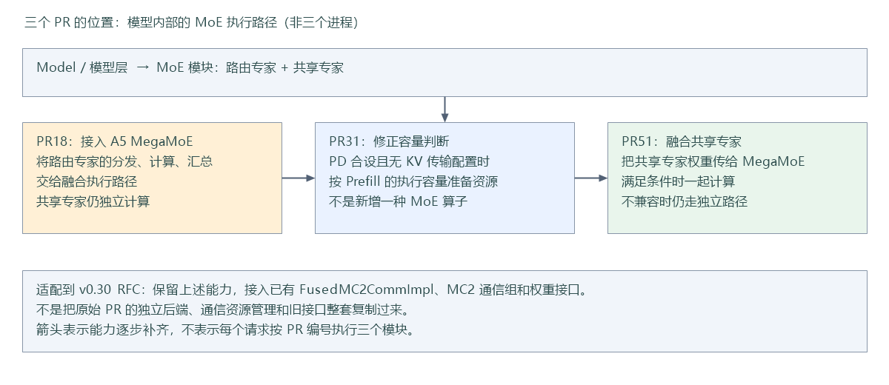
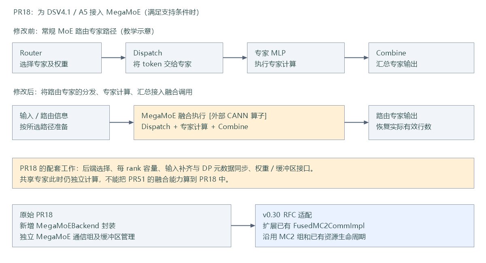
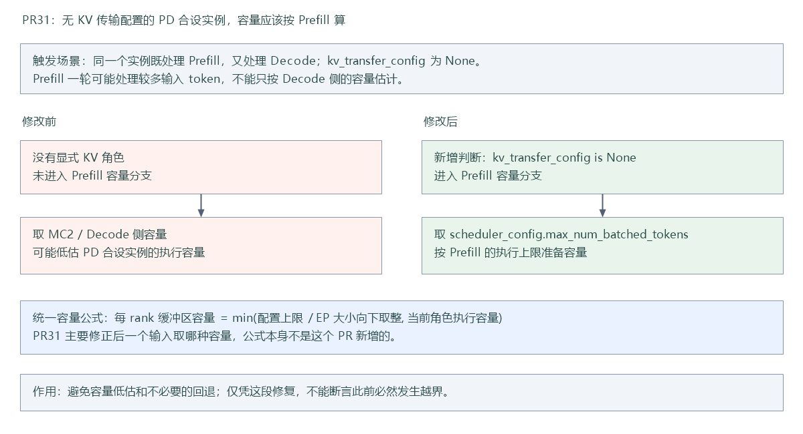
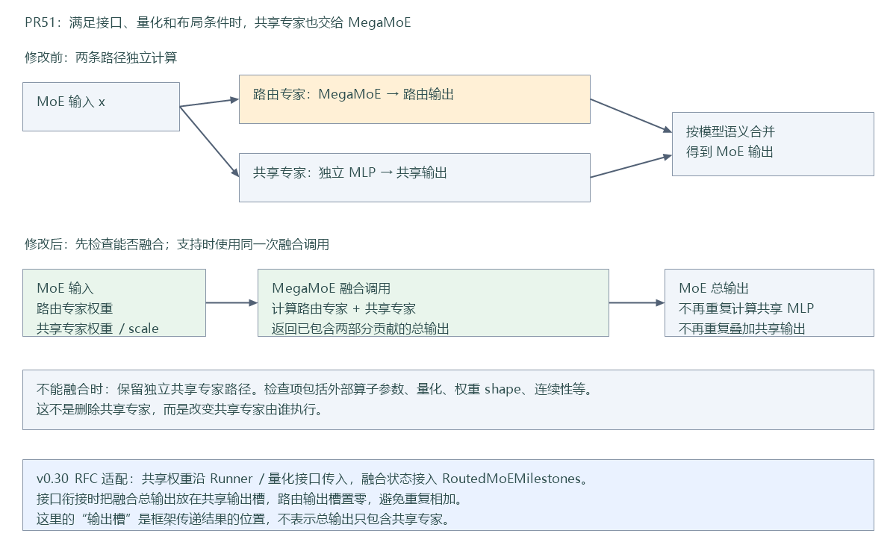

# 三个 PR 修改图解：PR18、PR31、PR51

想先理解向量怎样经过专家计算，见 [MoE 数据流图解](moe-data-flow.md)。

先看功能变化，再看适配到 v0.30 RFC 时的实现调整。图是教学示意，不表示设备实测时序或性能结果。“修改前”指各 PR 的来源上下文，不是声称 v0.30 RFC 缺少这些全部能力。

图片使用 PNG，便于上传到文档平台；同目录下提供同名 SVG，便于放大查看。单独复制 Markdown 不会自动上传图片。

## 1. 一张图看懂三个 PR

- **PR18：接入 A5 MegaMoE。** 改变路由专家的执行路径及相关输入、资源管理。
- **PR31：修正容量判断。** 无 KV 传输配置的 PD 合设实例，按 Prefill 的执行容量准备资源。
- **PR51：融合共享专家。** 满足条件时，将原来独立执行的共享专家也交给 MegaMoE。

三者都在支撑 Model 内部的 MoE 执行，不是三个进程，也不是三个顺序执行的模型层。

## 2. PR18：接入 A5 MegaMoE

先理解三个动作：Dispatch 把 token 分给专家；专家 MLP 执行计算；Combine 汇总结果。PR18 在符合支持条件时，把这些动作接入外部 MegaMoE 融合算子，并补充后端选择、容量、输入补齐和 DP 同步等配套逻辑。图中常规路径只是概念拆分，不代表修改前一定是三个独立算子调用。

**PR18 没有把共享专家融合进去。** 共享专家仍走独立路径；后来的 PR51 才补充融合。

适配到 v0.30 RFC 时，已有 `FusedMC2CommImpl` 承担相关融合后端职责，因此将能力接入已有实现，沿用 MC2 组、prepare/finalize 和量化权重接口，避免再保留来源方案的整套独立后端。

当前本仓阅读入口：

| 内容 | 代码路径 |
| --- | --- |
| 选择本轮 MoE 执行方式 | [vllm_ascend/ascend_forward_context.py](../../vllm_ascend/ascend_forward_context.py) |
| 融合后端、外部算子调用及缓冲区管理 | [vllm_ascend/ops/fused_moe/moe_comm_method.py](../../vllm_ascend/ops/fused_moe/moe_comm_method.py)，重点看 `FusedMC2CommImpl` |
| 输入准备和输出恢复 | [vllm_ascend/ops/fused_moe/prepare_finalize.py](../../vllm_ascend/ops/fused_moe/prepare_finalize.py) |
| DP 元数据同步 | [vllm_ascend/worker/model_runner_v1.py](../../vllm_ascend/worker/model_runner_v1.py) |

## 3. PR31：修正 PD 合设时的容量判断

PD 合设表示一个实例既处理输入阶段 Prefill，也处理逐步生成阶段 Decode；它不是必须配置 KV 跨实例传输的 PD 分离部署。

原判断只识别显式的 Prefill/混合 KV 角色。没有 `kv_transfer_config` 时，会进入另一容量分支。PR31 增加 `kv_transfer_config is None` 条件，让普通 PD 合设实例使用 `scheduler_config.max_num_batched_tokens` 作为执行容量。

教学例子：若配置上限除以 EP 后为 512，Decode 侧容量为 32，Prefill 上限为 256，那么统一公式在两种判断下分别得到 `min(512, 32)=32` 和 `min(512, 256)=256`。这些数字仅用于解释“选错容量输入”的影响，不是实际默认配置。

该修复避免容量低估和不必要的回退，不代表修改前必然发生缓存越界。这里是 **MegaMoE 的执行工作缓冲区容量**，不是给请求分配多少 KV page。

当前本仓阅读入口：

- [vllm_ascend/ascend_forward_context.py](../../vllm_ascend/ascend_forward_context.py)：`get_a5_mega_moe_buffer_tokens_per_rank()` 判断当前角色使用何种执行容量。
- [vllm_ascend/ascend_config.py](../../vllm_ascend/ascend_config.py)：`compute_mega_moe_buffer_tokens_per_rank()` 计算统一容量。
- [vllm_ascend/ops/fused_moe/moe_comm_method.py](../../vllm_ascend/ops/fused_moe/moe_comm_method.py)：消费容量信息，分配和检查工作缓冲区。

## 4. PR51：把共享专家加入融合计算

路由专家只处理被路由给自己的 token；共享专家通常处理每个 token。PR51 之前，两部分各自计算，再按模型语义合并。PR51 把共享专家权重和量化 scale 传给支持该接口的 MegaMoE 算子，在同一次融合调用中得到包含两部分贡献的输出。

**共享专家仍存在，变化的是执行方式。** 外部算子能力、量化或权重布局不满足条件时，保留独立共享专家路径。

适配到 v0.30 RFC 时，除了传权重，还要接入现有 `RoutedMoEMilestones` 协作机制，并避免把已融合的共享贡献再次相加。当前接口衔接将融合总输出放入共享输出槽，路由输出槽置零；“共享输出槽”是框架的结果传递位置，不代表里面只有共享专家结果。

当前本仓阅读入口：

| 内容 | 代码路径 |
| --- | --- |
| 组织 MoE 执行和输出衔接 | [vllm_ascend/ops/fused_moe/fused_moe.py](../../vllm_ascend/ops/fused_moe/fused_moe.py) |
| 共享专家权重与独立执行路径 | [vllm_ascend/ops/fused_moe/shared_experts.py](../../vllm_ascend/ops/fused_moe/shared_experts.py) |
| 共享权重接口检查和参数构造 | [vllm_ascend/ops/fused_moe/mega_moe.py](../../vllm_ascend/ops/fused_moe/mega_moe.py) |
| 将参数交给外部融合算子 | [vllm_ascend/ops/fused_moe/moe_comm_method.py](../../vllm_ascend/ops/fused_moe/moe_comm_method.py) |
| 共享与路由路径的阶段协作 | [vllm_ascend/ops/fused_moe/dataclass/shared_experts.py](../../vllm_ascend/ops/fused_moe/dataclass/shared_experts.py) |
| 量化权重相关适配 | [vllm_ascend/quantization/methods/](../../vllm_ascend/quantization/methods/) |

## 5. 原始 PR 与适配修改的边界

上述三张修改图主要解释 PR 的功能意图。当前分支还需要额外完成与 v0.30 RFC 的兼容工作，例如修正旧后端属性引用、补齐权重透传和 dummy-run 参数、保留现有 gate-logits 与 HCCL 生命周期。这些不能全部归为某一个原始 PR 的改动。

来源提交为 PR18 `df1286cca`、PR31 `bca6b8ff8`、PR51 `8d0686064`。适配基线为 `rfc/vllm_cann` 的 `0040652a6`。具体适配记录见 [DSNext 三个 PR 的 vllm_cann 适配](dsnext-vllm-cann-adaptation.md)，PR18 原方案详解见 [PR18 方案与代码逐项学习](pr18-megamoe-design-and-code-walkthrough.md)。
