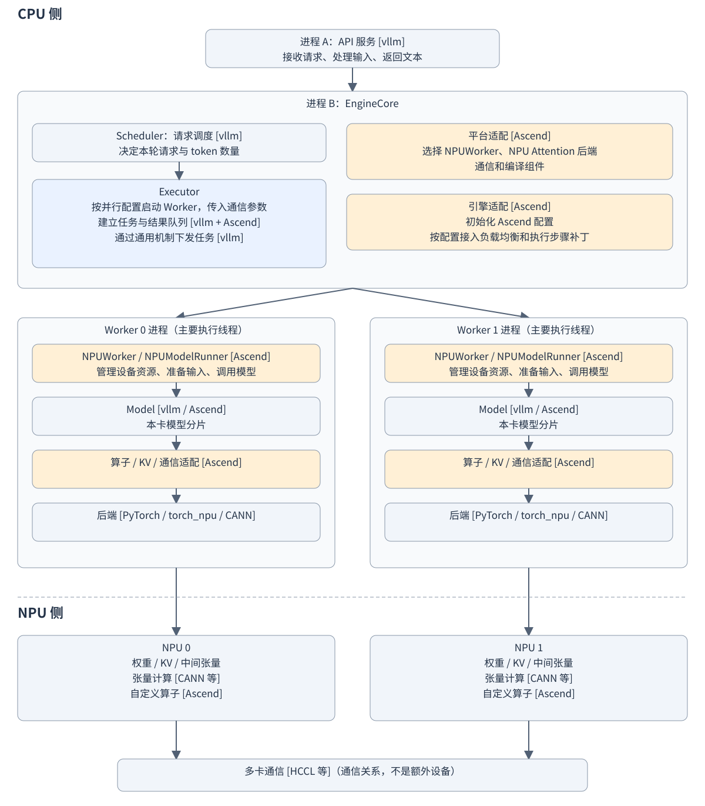

# vLLM Ascend 框架图

本文以在线服务、单机两张 NPU、TP=2、多进程执行器为教学场景。TP=2 表示模型计算被拆到两张卡上。实际进程布局取决于 vLLM 版本和执行配置；本文不是本机运行时的进程采集结果。

## 1. vLLM Ascend 框架

图中代码来源统一放在 `[]` 中：`[Ascend]` 表示 **vllm-ascend**，`[vllm / Ascend]` 表示按模型选择上游或本仓实现，`[vllm + Ascend]` 表示上游框架加本仓适配。两个 Worker 各有自己的对象和设备数据。

橙色节点标出本仓负责的部分，蓝色节点表示上游框架加本仓适配；Worker 和 Runner 仍复用上游框架。Model 的代码来源随模型路径变化，因此未统一标为橙色。两个 Model 节点分别属于各自的 Worker 进程，不表示共享同一个对象。

“多卡通信”节点表示两卡之间的通信关系，不是额外的进程或设备。

### 图中各模块负责什么

| 模块 | 主要职责 | 代码来源 |
| --- | --- | --- |
| API 服务 | 接收用户请求、处理输入，将生成结果以文本形式返回给用户 | [vllm] |
| EngineCore | 推进请求的执行循环，组织调度、执行及请求状态更新 | [vllm]，本仓补充相关适配 |
| Scheduler | 决定本轮执行哪些请求、每个请求处理多少 token，并协调 KV 缓存资源 | [vllm] |
| Executor | 按并行配置启动 Worker、配置控制通信，向 Worker 下发任务并收集结果 | [vllm + Ascend]，通用任务下发复用上游 |
| 平台适配 | 选择 NPUWorker、NPU Attention 后端、通信和编译组件，检查配置是否支持 | [Ascend] |
| 引擎适配 | 初始化 Ascend 配置，按配置接入负载均衡和执行步骤补丁 | [Ascend] |
| NPUWorker | 管理对应 NPU 的设备和工作资源，组织模型加载、缓存初始化和预热 | [Ascend]，复用上游 Worker 基础设施 |
| NPUModelRunner | 准备本轮输入和执行元数据，衔接缓存、调用模型并处理结果 | [Ascend]，复用上游 Runner 框架 |
| Model | 定义模型结构和前向计算，例如 Embedding、Attention、MoE、输出层；TP=2 时各进程持有本卡所需的模型分片 | [vllm / Ascend] |
| 算子 / KV / 通信适配 | 把模型运算、缓存读写及跨卡张量传输接到 Ascend 实现 | [Ascend] |
| 后端 | 提供张量框架、NPU 算子调用和设备运行时支持 | [PyTorch / torch_npu / CANN] |
| NPU 0 / NPU 1 | 保存本卡权重、KV 和中间张量，执行实际的张量计算 | [CANN 等] 提供的算子及 [Ascend] 自定义算子 |
| 多卡通信 | 在两张 NPU 之间交换模型计算需要的张量，协同完成并行计算 | [HCCL 等]，本仓提供接入和适配 |

请求的主线是“API 接收请求 → Scheduler 安排本轮工作 → Executor 下发任务 → Worker / Runner 调用模型 → NPU 计算 → 处理输出并继续下一轮或返回结果”。平台和引擎适配支撑组件选择、启动和执行，不是每个请求都要依次经过的独立处理站点。具体代码目录见第 2 章。

## 2. 沿着图理解各部分，并找到本仓代码目录

以下按“服务与引擎 → Worker → 模型 → NPU”的顺序解释。目录链接均指向本仓。对于上游或外部依赖，列出本仓的接入位置，不代表其完整源码在本仓。 所有本仓代码入口均显示仓库相对路径：Python 包内从 `vllm_ascend/` 写起；根目录文件和自定义算子分别写为 `setup.py`、`csrc/...`。

### 2.1 API 和 Scheduler：接请求、安排本轮工作

API 接收请求、返回文本；Scheduler 决定本轮处理哪些请求及多少 token。主体由上游 vLLM 提供，本仓补充 Ascend 所需的引擎和调度相关行为。

本仓代码目录：[vllm_ascend/patch/platform/](../../vllm_ascend/patch/platform/)。这里是相关补丁的入口，不是完整的 API 服务或上游调度器实现。先看 [vllm_ascend/patch/platform/patch_engine_core.py](../../vllm_ascend/patch/platform/patch_engine_core.py)。

### 2.2 平台适配：选择组件、检查配置

vLLM 通过插件入口接入本仓的 `NPUPlatform`，选中 Ascend 平台后，由它选择 Worker、Attention 后端、通信和编译组件，并检查相关配置。

Worker 的选择逻辑在 [vllm_ascend/platform.py](../../vllm_ascend/platform.py) 的 `_setup_worker_and_scheduler()` 中：如果 `parallel_config.worker_cls` 为 `"auto"`，根据硬件类型和 Xlite 配置选择具体类；否则保留显式指定的类。A2/A3/A5 常规路径默认使用 `NPUWorker`，310P、Xlite 使用各自实现。Executor 随后按选好的类配置启动 Worker。

本仓代码入口：[vllm_ascend/__init__.py](../../vllm_ascend/__init__.py) 注册平台类，[vllm_ascend/platform.py](../../vllm_ascend/platform.py) 选择组件、检查配置，[vllm_ascend/device/hardware_profile.py](../../vllm_ascend/device/hardware_profile.py) 定义硬件能力和默认 Worker 类。

平台适配不单独占一个进程。图中标在引擎侧表示其职责，相关代码也可在其他进程中调用。

### 2.3 引擎适配：给启动和执行流程补充处理

本仓在上游引擎启动时初始化 Ascend 扩展配置，按配置接入 DP 负载均衡、profiling chunk 等扩展，并接入 PP/MTP 的步骤后处理补丁。这些扩展不是每次推理都会启用，也不表示重新实现整个引擎。

本仓代码目录：[vllm_ascend/patch/platform/](../../vllm_ascend/patch/platform/)。

阅读入口：[vllm_ascend/patch/platform/patch_engine_core.py](../../vllm_ascend/patch/platform/patch_engine_core.py)。先看 `_run_engine_core_patch_func()`：补充初始化处理后，继续调用保存的上游引擎入口。

### 2.4 Executor：建立 Worker、连通通信，再下发任务

启动阶段，Executor 按并行配置建立 Worker，安排 rank 编号，配置任务广播和结果返回队列，等待 Worker 就绪。运行阶段通过通用机制下发任务、收集结果。

本仓代码目录：[vllm_ascend/patch/platform/](../../vllm_ascend/patch/platform/)。

阅读入口：[vllm_ascend/patch/platform/patch_multiproc_executor.py](../../vllm_ascend/patch/platform/patch_multiproc_executor.py)：

| 工作 | 先看哪个定义 | 来源关系 |
| --- | --- | --- |
| 建立 Worker、配置队列与启动顺序 | `AscendMultiprocExecutor._init_executor()` | 本仓适配，复用上游基础设施 |
| 读取并检查并行规模 | `_get_parallel_sizes()` | 本仓实现，使用 vLLM 配置 |
| 创建 Worker 进程 | `AscendWorkerProc.make_worker_process()` | 本仓组织创建，入口仍为上游 `WorkerProc.worker_main` |
| 通用任务下发与 Worker 执行循环 | 沿导入的 `MultiprocExecutor`、`WorkerProc` 查上游 | 复用 vLLM |

#### Executor 中的 Ascend 适配具体在哪里

本仓在上述目录中定义 `AscendMultiprocExecutor(MultiprocExecutor)` 和 `AscendWorkerProc(WorkerProc)`，继承上游执行器和进程封装；文件末尾将上游模块的 `MultiprocExecutor` 名字替换为本仓类。补丁生效后，上游通过这个名字使用本仓适配。

下面列的是本仓覆盖实现中负责的具体内容，并非宣称这些机制全部由 Ascend 新增；确认相对上游的逐行改动仍需对照相应版本。

| 本仓适配负责的内容 | 用容易理解的话说 | 对应代码 |
| --- | --- | --- |
| 并行规模和 Worker 编号 | 检查 Worker 总数是否等于 `TP × PP × PCP`，根据节点位置计算本机 Worker 的全局编号，并选择 driver Worker | `_get_parallel_sizes()`、`_init_executor()`、`_is_driver_worker()` |
| 任务与结果通信队列 | 由 DP 组内的 leader 节点建立任务广播队列，连接本地或远端 Worker 的结果队列 | `_init_executor()` 中的 `rpc_broadcast_mq`、`response_mqs` |
| Worker 进程创建参数 | 把 rank、通信初始化地址、队列句柄等交给子进程，显式设置 `daemon=False` | `AscendWorkerProc.make_worker_process()` |
| 初始化同步顺序 | 先创建所有 Worker，再等待就绪，避免有的 Worker 等待设备同步、其他 Worker 却还没创建；随后按顺序等待通信队列就绪 | `_init_executor()` 中的创建循环、`wait_for_ready()`、`wait_until_ready()` |
| 退出和失败清理 | 创建就绪与父进程退出通知管道；初始化失败时关闭通知端并清理已创建的 Worker | `make_worker_process()` 中的 pipes、`_init_executor()` 中的 `finally` |

与这些适配配合的**通用任务下发机制仍来自上游**：本仓没有在这个类中重写通用任务下发方法，子进程入口也仍使用 `WorkerProc.worker_main`。可以把它理解成“本仓安排好 Worker 怎样启动、怎样连通，再复用上游机制传任务”。

这里的进程间通信传递 CPU 侧控制消息，与 NPU 之间的张量通信是两回事。执行器还会按配置启动 Worker 健康监控线程，图中省略了辅助线程。

### 2.5 NPUWorker：管理一张卡上的工作资源

在本文部署中，一个 Worker 进程管理一张 NPU。`NPUWorker` 是进程中的 Python 对象，负责初始化设备与通信、创建 Runner，以及组织加载、内存分析、缓存初始化和预热。

本仓代码目录：[vllm_ascend/worker/](../../vllm_ascend/worker/)。

阅读入口：[vllm_ascend/worker/worker.py](../../vllm_ascend/worker/worker.py) 中的 `init_device()`、`load_model()`、`determine_available_memory()` 和 `compile_or_warm_up_model()`。

API 和引擎还会使用额外进程，因此服务总进程数不等于卡数。“一个 Worker 对应一张卡”是本文部署的映射，不是物理卡只能运行一个进程的限制。

### 2.6 NPUModelRunner：把本轮任务组织成模型执行

Runner 接收调度结果，准备输入和 Attention 元数据，衔接 KV 缓存，调用模型并处理结果。它由 Worker 创建；Worker、Runner、Model 通常在同一个进程内，由主要执行线程调用。

本仓代码目录：[vllm_ascend/worker/](../../vllm_ascend/worker/)、[vllm_ascend/worker/v2/](../../vllm_ascend/worker/v2/)。

阅读入口：[vllm_ascend/worker/model_runner_v1.py](../../vllm_ascend/worker/model_runner_v1.py)、[vllm_ascend/worker/v2/model_runner.py](../../vllm_ascend/worker/v2/model_runner.py)。两套 Runner 按配置选择，分别复用对应的上游框架，不是依次执行。

### 2.7 Model 和 Loader：定义模型结构、装入权重

Model 表示模型结构和前向计算。结构可能来自上游，也可能来自本分支实现或适配，底层计算接入 Ascend 后端。Loader 按配置构建模型、加载权重，是加载组件，不是额外的常驻进程。

本仓代码目录：[vllm_ascend/models/](../../vllm_ascend/models/)、[vllm_ascend/model_loader/](../../vllm_ascend/model_loader/)、[vllm_ascend/patch/worker/](../../vllm_ascend/patch/worker/)。分别用于本分支模型实现、加载扩展、Worker 侧补丁；通用加载逻辑仍会复用上游。

阅读入口：[vllm_ascend/models/__init__.py](../../vllm_ascend/models/__init__.py) 的注册和 Runner 的 `load_model()`；模型专用示例见 [vllm_ascend/models/deepseek_v41/](../../vllm_ascend/models/deepseek_v41/)。

TP=2 时，每个 Worker 有自己的 Python Model 对象，持有本卡所需权重分片或副本。两个进程不共享同一个 Model 对象，通过多卡通信协作计算。

### 2.8 KV 管理：CPU 管块，NPU 保存历史数据

分页 KV 缓存把历史状态划分成块。上游引擎负责主要的分配、复用和释放决策；本仓提供相关扩展，并在 Runner 中准备或衔接缓存映射，供 Attention 后端在 NPU 上读写实际数据。它横跨引擎、Runner 和算子，不只属于 Model 内部。

本仓代码目录：[vllm_ascend/core/](../../vllm_ascend/core/)、[vllm_ascend/worker/](../../vllm_ascend/worker/)、[vllm_ascend/attention/](../../vllm_ascend/attention/)。

阅读入口：[vllm_ascend/core/kv_cache_interface.py](../../vllm_ascend/core/kv_cache_interface.py)、[vllm_ascend/core/single_type_kv_cache_manager.py](../../vllm_ascend/core/single_type_kv_cache_manager.py)，再结合所选 Runner 和 Attention 后端阅读。缓存格式随模型和配置变化。

### 2.9 算子和通信适配：把模型运算接到 NPU

CPU 执行 Python 控制代码，大量矩阵乘法、Attention 和专家计算由 NPU 完成。跨卡执行还需要分发和汇总张量，本仓提供相应通信适配。图中后端概括 PyTorch、torch_npu、CANN 等外部依赖，不保证每个算子严格依次经过全部层次。

本仓接入代码目录：[vllm_ascend/ops/](../../vllm_ascend/ops/)、[vllm_ascend/attention/](../../vllm_ascend/attention/)、[vllm_ascend/distributed/](../../vllm_ascend/distributed/)。图执行相关代码还可看 [vllm_ascend/compilation/](../../vllm_ascend/compilation/)。这些是本仓调用、适配外部依赖的位置，不是外部依赖的完整源码。

中间张量通常留在 NPU 内存中继续计算，不是每层都返回 CPU。NPU stream 是设备任务队列，不能等同于 Python 线程。结果沿控制链路回到引擎和 API。

### 2.10 NPU 自定义算子：本仓也有设备计算代码

NPU 执行的算子既可由 CANN 等提供，也可由本仓自定义。自定义算子通常包含 CPU 侧调用、参数准备和设备侧 kernel；不能把整个算子目录都理解成 NPU 代码。不是每条路径都会使用本仓自定义算子。

本仓代码目录：[csrc/](../../csrc/)、[vllm_ascend/ops/](../../vllm_ascend/ops/)。

目录示例：[csrc/moe/](../../csrc/moe/)、[csrc/attention/](../../csrc/attention/)。其中常见的 `op_host/` 用于算子定义及参数、切分准备，`op_kernel/` 放设备计算实现，具体组织随算子变化。

MoE / MegaMoE 的代码目录阅读路线见 [MoE / MegaMoE 代码目录导读](moe-megamoe-code-guide.md)。
