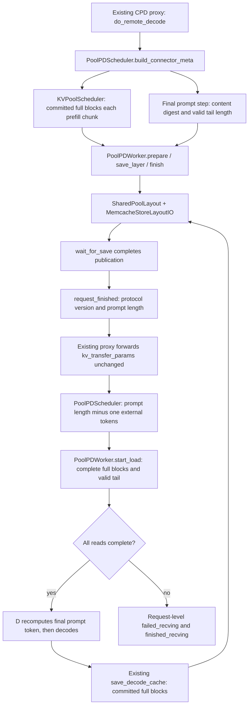

# Pool-backed PD connector

Status: experimental implementation, registered as `LayerwisePoolConnector`.
GLM-5.3-Flash BF16 has passed native MemCache, original-proxy PD boundary,
MTP=1 lifecycle and ordinary pool bulk/layerwise interoperability checks.
Concurrent full-output checks have also passed with actual preemptions, as
have native KDA/ring byte restoration for MTP=0/1 and all four bulk/layerwise
combinations. Phase-one functional acceptance is complete for the scope below.
Concurrent logprob deviations remain unexplained; this does not establish
bitwise equivalence across compute paths or production readiness. See the
Flash design document for the recorded limitations and validation scope.

The subsequent asynchronous layerwise-write change reuses the existing pool
sender and drains at every step boundary, including PD tail/state copies.
Its remote CPU regressions cover queue overlap and state/lease lifetimes;
the earlier model results above predate this change. A new native NPU run is
required to establish its model correctness, actual overlap and performance.

## Scope

Implement the public `LayerwisePoolConnector` here. Support both bulk and
layerwise execution with the same object format and request lifecycle.
The phase-one target is GLM-5.3-Flash BF16 with its actual MLA/indexer,
KDA recurrent state and circular indexer-tail layout. Do not change model
structure, forward computation or the speculative algorithm to fit the connector.

Reference `../mooncake/` for the separation of vLLM connector callbacks,
scheduler-side request ownership, worker-side execution and serializable
metadata. Use pool-backed transport by composition, without inheriting an
entire Mooncake or AscendStore connector or copying their transport code.

## Files

Create implementation files as their functionality is added, rather than
checking in empty classes or speculative extension points.

| File | Responsibility |
| --- | --- |
| `connector.py` | `LayerwisePoolConnector`: bridge vLLM callbacks to the scheduler/worker; registration remains in the existing KV-transfer registry |
| `scheduler.py` | `PoolPDScheduler`: compose `KVPoolScheduler`; interpret CPD flags and track final prompt publication |
| `worker.py` | `PoolPDWorker`: compose `KVPoolWorker`/`SharedPoolTransfer`; execute full-block and tail reads, handle layer readiness and report receive completion/failure |
| `metadata.py` | Versioned PD handoff descriptors and scheduler-to-worker/worker-to-scheduler records; no duplicate pool key or tensor-layout definitions |

Do not introduce `base_scheduler.py`, `base_worker.py` or separate push/pull
implementations until there are actual implementations requiring that split.
Bulk/layerwise are execution modes, not separate connector hierarchies.

## Dependency and ownership boundary

```text
vLLM connector callbacks
    -> pd_pool/connector.py
        -> pd_pool/scheduler.py  (request lifecycle)
        -> pd_pool/worker.py     (device-side orchestration)
            -> kv_pool/ascend_store/shared_layout.py
            -> kv_pool/ascend_store/shared_io.py
            -> existing MemcacheBackend

AscendStoreConnector / ordinary pool worker
    -> the same common pool layout and I/O
```

- The common pool owns content keys, schema compatibility, component ranges,
  TP shard/replica rules, allocation, copy and publication.
- PD owns CPD request semantics, handoff readiness and receive completion.
- Keep pool modules independent of `pd_pool` request types and proxy semantics.
- PD constructs a real `KVPoolWorker` for common backend setup, actual-cache
  registration and prefix lookup, then composes its `SharedPoolTransfer`.
  It neither subclasses a connector nor imitates a fake pool worker. Ordinary
  full-block scheduling stays in `KVPoolScheduler`; PD-specific tails and
  request completions stay here. Layout and native I/O contain no CPD flags.
- Call existing public Mooncake helpers when their contracts fit. If a useful
  helper is coupled to P2P state, extract only the required pure calculation
  within KV-transfer code, preserving V2 behavior and adding regression coverage.
- No model-name conditionals in generic I/O. Select component behavior from
  actual cache specs, registered tensors, ownership and readiness contracts.

## Full blocks and PD tails

Full blocks use identical keys and payloads across ordinary pooling and PD.
Ordinary pooling neither writes nor searches for incomplete tails.

PD alone stores immutable partial objects identified by model/schema, the
prefix-content hash through the valid tail, valid token length, logical shard
and an explicit partial-object discriminator. Both sides reconstruct the key;
do not add proxy metadata merely to pass key lists or addresses.

Reuse common component range planning and native I/O for full and partial
objects. The ordinary scheduler still admits only full-block prefix hits.
PD supplies the exact valid transfer range, including the tail.
The async D allocation covers only the first `prompt_length - 1` tokens.
When the last prompt token alone starts a new block, D skips that one-token
tail object: its block is allocated later for local recomputation. Larger
tails are restored into the allocated tail block before D resumes.

Do not delete tails after a request completes. Let the pool's normal eviction
policy reclaim them. Normal read/write leases protect active copies and end
through the existing I/O lifecycle. Receive completion remains necessary before
D uses the restored cache; it does not trigger tail deletion.

## Proxy and MTP

Reuse the existing CPD proxy flow and `kv_transfer_params` envelope. If the
actual producer-computed boundary cannot be derived by D, describe that range
through the existing transfer contract where possible. Do not make the proxy
understand layouts, TP rank mapping, MTP configuration or physical block IDs.

Reuse existing MTP execution and V2 target/draft behavior. P and D must use
the same speculative token count for this Flash phase; the handoff verifies
that count, while each endpoint initializes its own draft cache. Verify
target/draft selection, D startup boundaries and schema compatibility.
D full-block publication must stay within accepted tokens with materialized
KV; reuse existing committed-hash/save-range logic. Do not implement a new
speculative algorithm or Flash recurrent-state recovery here.

## Initial acceptance

1. GLM-5.3-Flash BF16 MLA, indexer, KDA and circular tail components, equal
   TP8, MRV2 eager, PP=PCP=DCP=1; full recovery checkpoints and PD tails.
2. Original proxy end-to-end; ordinary pool writes read by PD and PD writes
   read by ordinary pooling, including D full-block writeback reused by P.
3. Matching MTP configuration, accepted/rejected-token writeback, the four
   bulk/layerwise combinations and cancellation/concurrency/preemption.
4. Heterogeneous TP/PCP/DCP and additional quantized model deployments are
   outside this phase's model acceptance scope.

Test the facade and lifecycle separately from component byte recovery. Include
incomplete publication, receive failure, repeated requests and concurrent
readers. Model acceptance requires native MemCache/NPU and output/computation
evidence, not only CPU address tests or an HTTP 200.

Production changes stay inside PD/pooling and necessary KV-transfer
registration. Any model, runner, attention, core scheduler/allocator, global
patch or upstream change requires a concrete blocker and a separately explained
minimal fix. Corresponding tests and documentation use their normal directories.

See the [Flash phase-one design and acceptance status](../../../../../docs/source/developer_guide/Design_Documents/glm53flash_pool_stage1.md)
and the [shared pool design](../../../../../docs/source/developer_guide/Design_Documents/ascend_store_shared_layout.md).

## Current request flow



The response envelope contains `do_remote_prefill`, `do_remote_decode`,
`pool_pd_protocol`, `remote_num_prompt_tokens`, and, for stateful or speculative
handoffs, `pool_pd_mtp_tokens`. The last field checks compatibility; it does not
ask P to compute D's draft cache. The envelope contains no object keys,
physical block addresses or producer ranks. Full hashes are the
request's committed prefix hashes. `prompt_digest` uses upstream extra-hash
identity (salt, LoRA, multimodal content and embeddings) plus the entire prompt;
the common layout adds schema, logical shard and valid tail length.

Both connectors require `backend=memcache`, an explicit shared `cache_prefix`
and compatible `store_tp_size`. P normally uses `kv_producer`; D uses
`kv_consumer` and may set `save_decode_cache=true`. Both currently require
MRV2 eager and PP=PCP=DCP=1. P `use_layerwise` can be true or false; CPD D loads
the whole request before reporting receive completion. The ordinary pool
prefix path still supports either read timing.

PD read failures are reported per request, without hybrid block-ID rollback.
The existing Ascend platform rejects hybrid `kv_load_failure_policy=recompute`;
this connector does not remove that guard. Ordinary synchronous pool reads
still have an open lookup-to-lease eviction failure-isolation gap, described
in the Flash design. Successful interoperability does not prove that gap closed.

The upstream dependency must include StoreLayout from vLLM PR #54307 and
the corresponding cache-spec/state-splitting interfaces, including `is_draft`.
An image with a newer Ascend package may still contain an older vLLM checkout.
Check the actual imported source and dependencies; copying only `layout.py`
into an older upstream installation does not establish compatibility.

Draft specs marked `is_draft` are excluded from persistent target objects and
from loaded-group reporting. Allocator group numbers are not part of the
shared identity. This implements the target/draft boundary; it is not evidence
that every proposer or MTP execution mode has passed model acceptance.
